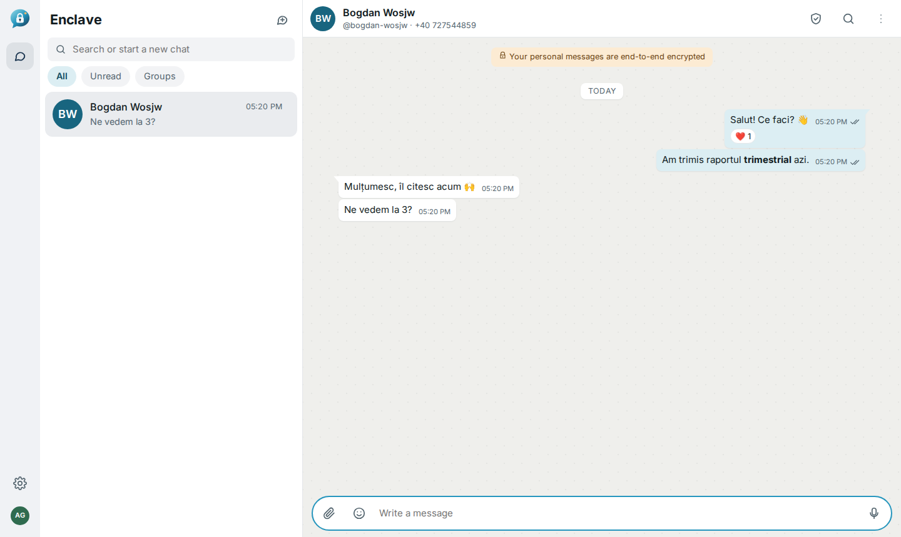
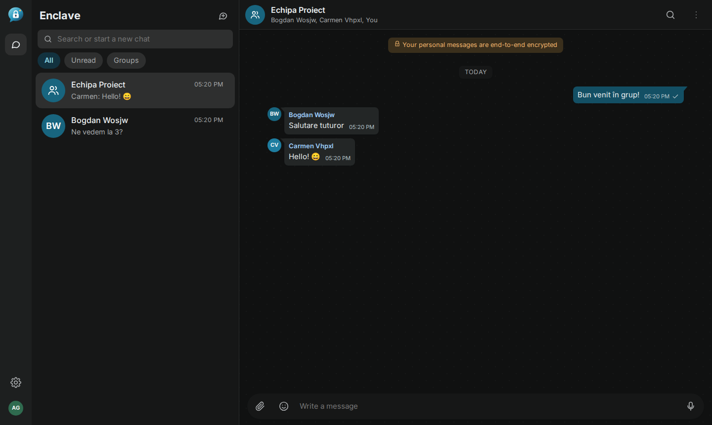
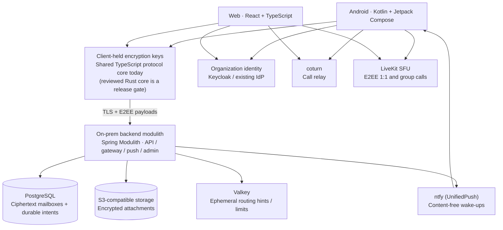

<p align="center">
  
</p>

<p align="center"><strong>Private conversations. Your infrastructure. Your rules.</strong></p>

Convo is an on-prem messaging platform for organizations that
want a friendly, feature-rich chat experience while keeping message content, storage, identity and
media infrastructure under their own control. Message content is end-to-end encrypted on the
devices; the servers only relay ciphertext.

**Every feature in the launch inventory is required at launch on Android and web.** iOS remains a
subsequent client target.

> **Project status — pre-release implementation.** The web client, a native Android client and the
> backend run today with `docker compose`, and in Kubernetes from published images
> ([deploy/k8s.md](deploy/k8s.md), deployment hostname `convo.doncik.ro`). Working: organization
> sign-in with optional passkeys, device enrollment and linking, end-to-end encrypted 1:1 chats
> (Signal protocol), groups and channels (MLS), communities with announcements, acknowledgements
> and onboarding, encrypted media and voice notes, end-to-end encrypted audio/video calls (LiveKit
> SFU + coturn), push wake-ups without content (UnifiedPush/ntfy), app and per-chat locks,
> disappearing messages, an admin console with scoped roles and an audit chain, and EN/RO
> light/dark UIs with matching web and Android features. Still open before release: the reviewed
> native Rust/SQLCipher core, post-quantum keys, FCM fallback, signed client policies, physical
> device/accessibility certification, independent security review and iOS. Interim choices are
> recorded in [docs/decisions](docs/decisions) and
> [specs §32](docs/specs.md#32-implementation-status-and-recorded-deviations); progress is tracked
> in [tasks.md](tasks.md).

[Specification](docs/specs.md) · [Architecture](docs/arf.md) · [UI](docs/UI.md) · [Mobile](docs/mobile.md) · [Delivery tasks](docs/tasks.md) · [Progress](tasks.md) · [Decisions](docs/decisions) · [Diagrams](docs/diagrams/README.md)

<p align="center">
  
  
</p>

## Run it locally

```bash
docker compose up -d --build                  # postgres, valkey, keycloak, seaweedfs, livekit, coturn, ntfy, pgadmin, server, web
open https://localhost:8443                    # sign in as alice / alice-dev-password (also bob, carol)
docker compose --profile e2e run --rm e2e     # Playwright end-to-end suite (Chromium + Firefox)
```

| URL | What |
|---|---|
| https://localhost:8443 | Convo web app |
| https://localhost:8443/auth/admin | Keycloak admin (`admin` / `admin-dev-password`) |
| http://localhost:5050 | pgAdmin (database password `enclave-dev-db`) |

The deployment hostname is **convo.doncik.ro** (production: the homelab Kubernetes charts, see
[deploy/k8s.md](deploy/k8s.md)). For local Compose, set `CONVO_SERVER_IP` (this host's LAN
address, used for call media) in `.env`, and point `convo.doncik.ro` at this host in the hosts file
or LAN DNS of the devices you test with; then open **https://convo.doncik.ro/** or `:8443`.
`https://localhost:8443` works for ordinary sign-in; passkeys require the hostname.
Accept the self-signed certificate once per device. Plain HTTP on port 8088 shows an HTTPS-required
page. Development accounts include `bogdan` / `bogdan` and `maria` / `maria`.
Keycloak, PostgreSQL, attachment storage and the TLS certificate persist in Compose volumes.

Uploaded message history is encrypted under the account key and restores on linked devices.
Create and save a recovery code in **Settings → History and recovery** before losing all devices.
Recovery requires organization sign-in plus this code; a password reset alone cannot decrypt history.

All credentials are development-only. See [docs/development.md](docs/development.md) for tests,
fast iteration and conventions, and [docs/configuration.md](docs/configuration.md) for every
backend setting.

## Android development build

Install [convo-android-debug.apk](apps/assets/convo-android-debug.apk); its SHA-256 checksum is
next to it. The default server for new installs is `https://convo.doncik.ro`; existing
installs preserve their saved address and local keys. Source, build instructions,
verified interoperability and remaining limitations are in [apps/android/README.md](apps/android/README.md).
The Compose UI uses the same generated light/dark colors and logo as the browser. This interim
client bundles the existing encryption core; reviewed native Keystore/SQLCipher storage,
background delivery, full localization and complete feature/UX parity remain release gates.

Set `CONVO_ATTACHMENT_MAX_MB=100` in `.env` to configure the plaintext attachment limit for
both clients. The backend separately allows encryption tags and size-bucket padding; attachment
contents, names and keys remain end-to-end encrypted.

## What works today

| Area | Highlights |
|---|---|
| Identity | Keycloak SSO (PKCE), browser-primary enrollment, device proof-of-possession on every request, transcript-bound device linking with comparison codes, device list/unlink |
| 1:1 chats | Signal sessions, multi-device fan-out, offline mailbox delivery, delivery/read receipts, typing (opt-in), Note to self |
| Groups and channels | MLS discussion groups and admin-only encrypted channels, owner/admin/member controls, shared owners, recent-contact picker, review-before-create wizard |
| Messages | Safe formatting, replies, reactions, edits, delete for everyone / me, forward, star, in-chat search |
| Media | Encrypted photos (EXIF stripped), files, videos with posters, voice notes, in-app viewer, shared galleries and all-chat search/filter/batch actions |
| UX | Messenger-style layout, directory search by name/handle/phone, emoji picker, splash with E2EE notice, URL-based navigation (refresh-safe), EN/RO, light/dark with contrast tests |
| History and recovery | Encrypted account archive, linked-device history restore, saved recovery code plus organization login, last-device logout safeguard |
| Communities | Announcement feed with linked groups (discoverable or private), ask-to-join, explicit acknowledgements with due/closing times and named reviewers, welcome/rules/checklist onboarding, parent-removal delegation |
| Calls | 1:1 and group audio/video through a self-hosted LiveKit SFU with frame E2EE (no unencrypted fallback), coturn relay, multi-device ringing, key rotation when someone leaves, ringing via push |
| Notifications | Generic previews by default, per-chat All/Mentions/Muted, timed snooze, UnifiedPush (ntfy) wake-ups without content, optional Android background connection |
| Privacy | Passkeys from Settings, app lock and per-chat locks (passkey on web, biometrics on Android), browser passphrase lock (Argon2id), disappearing messages, blocking, message requests |
| Administration | Separate admin console: account/device support with reasons, scoped helpdesk/org-admin/security/auditor roles, step-up, hash-chained audit with external checkpoints and export |
| Platform | Spring Modulith backend (identity, messaging, groups, communities, attachments, calls, push, admin) with verified boundaries, PostgreSQL mailbox, Valkey hints, S3 object storage; Compose for development, Helm charts and CI-built images for Kubernetes |

## Complete launch feature inventory

**One complete launch scope:** every feature in this inventory must be implemented, tested and accepted before Android/web general availability. “Optional” means available at launch and enabled by a user or organization policy; it never means postponed. Feasibility, security review and capacity certification are launch blockers for their respective requirements. This remains a plan, not a claim of working software.

Each feature has concrete scenarios, test methods, pass/fail criteria and evidence requirements in the [acceptance catalogue](docs/specs.md#31-feature-verification-and-launch-acceptance).

### Chats and everyday messaging

- Private 1v1 conversations and Note to self, with linked-device synchronization.
- Message requests with accept/block/delete-local actions; contact blocking and unblocking.
- Text, emoji, safe bold/italic/code/quote formatting, replies, quoted-message navigation, mentions, and reactions.
- Optional client-generated link previews, off by default and controlled by policy; external fetches are disabled in restricted profiles.
- Author-only edits, edit indicators/history under retention policy, delete-for-everyone requests, and local deletion.
- Delivery status; optional read receipts and typing indicators, both off by default.
- Explicit forwarding/copy/sharing with destination review and a Forwarded marker.
- Selection of up to 100 messages for copy, one-destination forwarding, save/bookmark, or eligible deletion, with per-item outcomes.
- Durable offline composition, drafts, queued sends, retry/reconnect recovery, and clear sending/delivery/error states.
- Topics/threads, private chat folders/custom filters, quiet/silent sending, device-local scheduled messages, and reminders. Scheduling explains when an online device is required.

### Groups and member controls

- E2EE discussion groups, with everyone-posts and admin-only modes.
- Add/remove members, promote members to admin, owner-controlled admin demotion/removal, accepted ownership transfer, and final-owner protection.
- Invite links/QR, join requests, admin approval, expiring/revocable links, bans/unbans, and explicit leave/delete flows.
- Rich encrypted descriptions with purpose, formatted text, safe links, rules references, and contact people; group names/avatars remain encrypted.
- Searchable account-level member lists, All/Admins filters, owner/admin labels, and authorized Groups in common.
- Shared pinned messages, disappearing timers, encrypted group metadata, and clear rekey/rejoin/removal states.
- Role-authorized moderation deletion with a visible tombstone; admins cannot rewrite another author's words.
- Custom admin grants, per-member sending restrictions, slow mode, larger certified announcement groups, and advanced topic controls. Group capacity figures remain targets until benchmarked.

### Communities and announcements

- First-class communities with owner/admin/member roles, an admin-only announcement feed, and separately permissioned linked discussion groups.
- Community creation, membership/invites/approval, authorized group linking/unlinking, discovery/join requests, and community-wide removal progress.
- Independent subgroup access: community administration does not automatically grant subgroup readership or admin rights.
- Announcement posts, shared rules/pins, and optional policy-controlled member reactions.
- Optional explicit announcement acknowledgements, due times, revision-bound responses, offline retry, and named-reviewer reports; ordinary read receipts never count as acknowledgement.
- Community welcome/about pages, versioned rules acknowledgement, recommended eligible groups, help/contact entry, and a private newcomer checklist synced to own devices.
- Visible updated-rules/announcement states, pending membership operations, and recovery without false completion claims.
- Polls/quizzes, community events/RSVP with local reminders, organized announcement replies through permitted discussion groups, and customized/localized onboarding templates.

### Photos, files, voice notes, and expression

- Encrypted photos and files, captions, thumbnails, downloads, and attachment galleries.
- Ordered albums of 2–10 photos, album/per-photo captions, grid/full-screen browsing, upload recovery, and clear unavailable/expired-photo slots.
- Voice-note recording, pause/cancel/send, local waveform display, playback speed, and interruption handling.
- Android file/photo selection and web paste/drag-and-drop, with progress/cancel/retry and storage/size-limit feedback.
- Location EXIF removal by default, verified download/open behavior, explicit external sharing, and expiry-driven media/cache cleanup.
- Stickers/approved locally hosted GIFs, optional on-device transcription, view-once photos/video, and multipart attachment uploads. View-once cannot prevent a recipient from recording content.

### Search, navigation, and conversation organization

- Local message/file search, including Romanian diacritics, with conversation/sender/date/type filters and media browsing.
- Private conversation pins/bookmarks, shared message pins, archive, unread state, and mute controls.
- First-unread catch-up, Jump to latest, Return to previous position, and stable reading position while new messages arrive.
- Android swipe-to-reply/long-press actions; web hover/focus actions, context menus, and documented keyboard shortcuts.
- Accessible equivalents for gestures, selection counts, destructive confirmations, and partial-failure feedback.
- Additional private folders/filters and richer topic navigation. Bookmarks and pins do not extend expired content's lifetime.

### Profiles, appearance, and accessibility

- Organization handles/directory search, encrypted profiles/display names/photos, and useful fallbacks where profile keys are unavailable.
- Light/dark themes and private per-chat colors/wallpapers, bundled offline assets, optional user-selected images, preview, and Reset.
- Appearance preferences synced only to own devices, with readable contrast and no third-party wallpaper requests.
- Responsive compact/wide web layouts and Android layout adaptation, font scaling, reduced motion, and visible focus.
- Keyboard/screen-reader accessible web journeys and TalkBack-accessible Android journeys.
- English/Romanian catalogs, localized dates/numbers, 12/24-hour preferences, and layouts prepared for longer/RTL text.
- Friendly empty, offline, permission-denied, update-required, storage-full, and recovery states.
- Certified Chromium, Firefox and Safari browser targets; extensible localization catalogs. iOS accessibility/native integration follows the iOS client schedule.

### Notifications and attention controls

- Generic notification previews by default, configurable within organization/privacy/lock policy.
- Per-conversation All messages, Mentions only, and Muted modes; mention alerts require local decrypted verification.
- Timed snoozing until this evening, tomorrow morning, a duration, or a custom time; automatic restoration of the underlying mode and End snooze now.
- E2EE preference synchronization, separate call/security controls, and no notification backlog flood after snooze expiry.
- Android UnifiedPush or approved foreground-connection delivery, optional connected-profile FCM, and active-session web delivery.
- Clear notification permission/locked-device/LAN/VPN/platform limitations and sanitized connectivity diagnostics.
- Optional connected-profile browser Web Push, available at launch with documented closed-browser and suspended-device limits. iOS APNs/CallKit and local-network push are defined in the separate client plan.

### Audio/video calling

- Direct audio/video calls across Android and web, encrypted signaling, and self-hosted TURN fallback.
- Multi-device ringing/first-answer arbitration, answered-elsewhere/missed/busy/cancelled states, and stale-offer protection.
- Explicit microphone/camera permission and activation, mute/camera/audio-route controls, and network-change recovery.
- Always-relay option, enabled by default for guest/external calls, and useful secure-call failure states.
- Self-hosted group audio/video, participant/active-speaker views, raise hand, screen sharing, P2P-to-group escalation, and authenticated invited-member call links. Android/web screen sharing is a launch requirement; iOS screen broadcast follows its client certification gate.

### Privacy, identity, and device management

- Default E2EE for direct chats, groups, community announcements, media, and authorized content recipients.
- Safety-number/QR identity verification, verified-key-change sending blocks, and visible device-list changes.
- Explicit trusted-device linking, device-bound transport proofs, device naming/listing/unlinking, app/browser lock, encrypted local storage, and private-CA deployment support.
- Disappearing content and expiry cleanup covering search entries, media keys/caches, previews, and reminders.
- Generic locked previews, Android screenshot/app-switcher protections where supported, and excluded native OS backups.
- Revocation of authenticated device access/future recipient delivery and best-effort local cleanup on next contact; sealed sender uses separately documented recipient-side revocation checks, and offline copies cannot be forcibly erased.
- Telemetry off by default; optional sanitized on-prem diagnostics with explicit consent.
- Current preferences/future traffic on linked devices, with explicit browser trust and local-storage-loss behavior.
- Separate sealed-sender transport, explicit bounded encrypted history transfer, guest invitations/expiry, and user-selected abuse-report evidence.
- Independently witnessed key transparency, recovery-key encrypted backup, reviewed PQ MLS upgrades, visible archive/bot recipients, and on-device assistance. Any plaintext-receiving extension is an explicit trust decision; a full-group bot can read the group, while addressed-only bots use separate recipient encryption.

### Organization administration and on-prem operations

- Organization SSO through Keycloak and existing identity providers; user-selectable passwordless sign-in with passkeys and optional authenticator-app 2FA, including Google Authenticator, plus organization-enforced MFA and secure account recovery.
- Separate admin web app with helpdesk/admin/security/auditor/platform roles, step-up actions, device/account support, and policy version/conflict handling.
- Managed user/guest status, device limits/inactivity expiry, account disablement/reconciliation, and revocation workflows.
- Signed client policies, accountable admin actions/exports, independently checkpointed audit, and aggregate health dashboards.
- Customer-hosted backend, identity, encrypted object storage, database, TURN, push alternatives, assets, and optional diagnostics.
- Small/medium/large certified deployment profiles, connected/restricted/air-gapped operation, signed offline bundles and release inventory.
- HA failure recovery, durable delivery/wake intent, bounded overload, capacity evidence, and privacy-aware monitoring.
- Signed, reproducible builds/SBOM/provenance, compatible upgrades/migrations, trust rotation, backups, safe restore, incident runbooks, and independent security review.
- Cross-deployment federation, larger certified capacity tiers, and visible compliance archive integrations. Native desktop packaging is a separate client target alongside the iOS plan.

The [specification](docs/specs.md), [conversation/feature matrix](docs/specs.md#30-direct-chats-groups-communities-and-launch-features), [selected chat refinements](docs/specs.md#308-everyday-chat-refinements-androidweb-p0), and [delivery tasks](docs/tasks.md) define exact permissions, limits, retention, and acceptance evidence.

## Security by design

Message content is encrypted on the sending endpoint and decrypted on authorized receiving endpoints. The proposed design uses Signal Protocol for direct conversations and MLS for groups. Attachments are encrypted before upload; direct-call signaling is encrypted, and group media adds frame encryption beyond transport security.

Servers still handle metadata such as accounts, device lists, group membership, routing, IP/timing information, and call authorization. Encryption does not protect an unlocked compromised endpoint. A web session also trusts code delivered by its origin, so its security limits are stated explicitly. [Trust boundaries and threat model](docs/arf.md#4-trust-boundaries-and-data-classification).

Signal library licensing, browser portability, cryptographic composition, and safe group recovery are **feasibility and review gates**. Using the Signal Protocol does not imply compatibility with the Signal network or equivalent security assurance. [Cryptographic implementation gates](docs/specs.md#274-cryptographic-implementation-gates).

## Architecture at a glance



The backend launches as a Spring Modulith application with explicit feature modules, owned data, verified boundaries and durable events. Modules can be extracted into microservices if needed; extraction requires explicit contracts and migration work. PostgreSQL owns durable mailbox and notification intent; Valkey accelerates coordination. The clients are React/TypeScript on web and Kotlin/Jetpack Compose on Android. Today the Android client runs the same version-pinned TypeScript protocol core in a headless engine (never remote code); the reviewed shared Rust core with native storage remains a release gate (docs/mobile.md). [Architecture decisions](docs/arf.md#14-updated-architecture-decisions).

## Deployment scope

| Profile | Intended operation |
|---|---|
| Connected on-prem | Locally hosted platform with explicitly enabled, content-free vendor push where desired. |
| Restricted LAN/VPN | Private identity, DNS/CA, storage, TURN, and Android push; browser messages arrive while the session is active. |
| Air-gapped | No runtime internet route; offline packages, registries, assets, and updates with documented notification limits. |

The platform will support small installations and a tested HA profile. Capacity, recovery objectives, and availability figures in the docs are targets until measured. Closed-browser wake-ups and iOS background delivery depend on platform/network capabilities; the UI must explain the actual supported behavior.

## Build sequence and launch gate

1. **Prove the design:** Android/browser cryptography, storage, Spring Modulith boundaries, dependency licenses and all extension/security feasibility gates.
2. **Build the walking slice:** organization login/passwordless/2FA, Android and browser registration/linking, encrypted chat and offline recovery.
3. **Complete the full inventory:** all messaging, community, collaboration, media, calling, privacy, recovery, federation and optional integration features above.
4. **Qualify the complete product:** cross-client acceptance for every feature, supported browser/device/profile evidence, accessibility, capacity/failure/restore drills, independent security review and signed offline delivery.
5. **Launch only when all gates pass:** no feature in this inventory is deferred to a later release. iOS and native desktop are separate client targets; feature implementation on Android/web is complete before launch.

This sequence describes internal development milestones, not partial public releases. No release date or completed implementation is implied. See the [delivery plan](docs/tasks.md) and [feature verification catalogue](docs/specs.md#31-feature-verification-and-launch-acceptance).

## Explore the repository

| Document | What it answers |
|---|---|
| [docs/specs.md](docs/specs.md) | Product requirements, protocols, APIs, state semantics, limits, privacy, and release contract |
| [docs/arf.md](docs/arf.md) | Trust model, backend boundaries, deployment, recovery, and architecture decisions |
| [docs/UI.md](docs/UI.md) | Android/web journeys, visual system, interaction states, accessibility, and admin experience |
| [docs/mobile.md](docs/mobile.md) | Android framework/native boundaries, storage, background delivery, calls, and later iOS scope |
| [docs/tasks.md](docs/tasks.md) | Workstreams, planned artifacts, prerequisites, and measurable acceptance criteria |
| [docs/diagrams/README.md](docs/diagrams/README.md) | Six original diagrams, their revision notes, and maintained Mermaid sources |
| [docs/sources.md](docs/sources.md) | Primary technical references, assumptions, and external-conversation access status |
| [docs/decisions/](docs/decisions) | Implementation ADRs: interim browser crypto, directory names/phones, messenger UX and brand |
| [docs/development.md](docs/development.md), [docs/configuration.md](docs/configuration.md) | Developer setup, tests, conventions; every backend setting |
| [tasks.md](tasks.md) | Implementation progress against the task IDs |

## Working on Convo

Keep requirements, architecture decisions, client flows, and tasks consistent. A change to encryption, identity, group membership, browser trust, or recovery needs explicit rationale and relevant failure-case evidence. Avoid custom cryptographic constructions, plaintext server fallbacks, hidden content recipients, and promises that exceed the tested deployment profile.

Do not commit credentials, private keys, user databases, or payload-bearing diagnostics. Choose and document the project's distribution license before shipping; dependency licenses are tracked separately in the release bill of materials.
