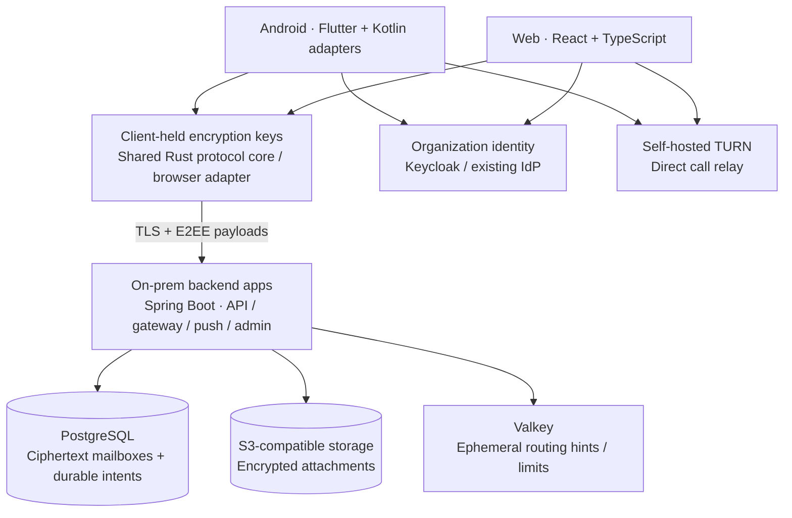

# Convo

### Private conversations. Your infrastructure. Your rules.

Convo is a planned on-prem messaging platform for organizations that want a friendly, feature-rich chat experience while keeping message content, storage, identity, and media infrastructure under their own control.

**Android and web come first. iOS follows later.**

> **Project status:** specification and architecture planning. This repository currently contains design documents and diagrams; application code, runnable services, and validated releases are still to be built. The documents use **Enclave** as the working platform name.

[Specification](docs/specs.md) · [Architecture](docs/arf.md) · [UI](docs/UI.md) · [Mobile](docs/mobile.md) · [Delivery tasks](docs/tasks.md) · [Diagrams](docs/diagrams/README.md)

## What we're building

A secure everyday messenger that feels approachable to employees and manageable for IT. Sign in with your organization, find a colleague, chat, share a file or voice note, and make a call—without requiring a phone number or uploading a personal address book.

| First release: Android + web | Later releases |
|---|---|
| Encrypted direct chats and groups | iOS app and its native notification/call integrations |
| Replies, reactions, mentions, edits, and delete requests | Group video, screen sharing, and call escalation |
| Encrypted photos, files, and voice notes | Polls, stickers, guest invitations, and history transfer |
| Local search, drafts, pins, mute, archive, Note to self | Sealed-sender transport and optional Web Push |
| Linked devices, identity verification, disappearing messages | Independent key transparency and encrypted recovery backup |
| Direct audio/video calls with TURN fallback | Federation, desktop packaging, and visible archive/bot participants |
| Accessible UI, light/dark themes, English/Romanian | Additional locales and certified deployment integrations |
| SSO, admin policies, audit, signed on-prem delivery | Separately reviewed optional extensions |

This is the intended scope, not a list of shipped features. Acceptance criteria and dependencies live in [tasks.md](docs/tasks.md).

## Security by design

Message content is encrypted on the sending endpoint and decrypted on authorized receiving endpoints. The proposed design uses Signal Protocol for direct conversations and MLS for groups. Attachments are encrypted before upload; direct-call signaling is encrypted, and group media later adds frame encryption beyond transport security.

Servers still handle metadata such as accounts, device lists, group membership, routing, IP/timing information, and call authorization. Encryption does not protect an unlocked compromised endpoint. A web session also trusts code delivered by its origin, so its security limits are stated explicitly. [Trust boundaries and threat model](docs/arf.md#4-trust-boundaries-and-data-classification).

Signal library licensing, browser portability, cryptographic composition, and safe group recovery are **feasibility and review gates**. Using the Signal Protocol does not imply compatibility with the Signal network or equivalent security assurance. [Cryptographic implementation gates](docs/specs.md#274-cryptographic-implementation-gates).

## Architecture at a glance

The backend starts as a modular codebase that can run together for smaller deployments or as separately scaled apps. PostgreSQL owns durable mailbox and notification intent; Valkey accelerates coordination. The first clients use Flutter on Android and React/TypeScript on web, with shared protocol contracts and Rust logic subject to browser feasibility validation. Kotlin Multiplatform remains a documented mobile alternative. [Architecture decisions](docs/arf.md#14-updated-architecture-decisions).

## Deployment scope

| Profile | Intended operation |
|---|---|
| Connected on-prem | Locally hosted platform with explicitly enabled, content-free vendor push where desired. |
| Restricted LAN/VPN | Private identity, DNS/CA, storage, TURN, and Android push; browser messages arrive while the session is active. |
| Air-gapped | No runtime internet route; offline packages, registries, assets, and updates with documented notification limits. |

The platform will support small installations and a tested HA profile. Capacity, recovery objectives, and availability figures in the docs are targets until measured. Closed-browser wake-ups and later iOS background delivery depend on platform/network capabilities; the UI must explain the actual supported behavior.

## Delivery roadmap

1. **Prove the design:** Android/browser encryption, persistence, framework integration, group roles, and dependency/distribution feasibility.
2. **Build a secure walking slice:** Android registration, browser linking, direct encrypted chat, offline recovery, and notifications.
3. **Complete the everyday messenger:** groups, media/voice notes, local search, private sync, direct calls, and accessible UI.
4. **Prepare Android/web for production:** administration, load/failure evidence, independent security review, signed offline install/upgrade, and safe restore.
5. **Expand after stabilization:** iOS, group media, and separately gated privacy/productivity features.

No release date or completed implementation is implied. See the [dependency-ordered delivery plan](docs/tasks.md).

## Explore the repository

| Document | What it answers |
|---|---|
| [docs/specs.md](docs/specs.md) | Product requirements, protocols, APIs, state semantics, limits, privacy, and release contract |
| [docs/arf.md](docs/arf.md) | Trust model, backend boundaries, deployment, recovery, and architecture decisions |
| [docs/UI.md](docs/UI.md) | Android/web journeys, visual system, interaction states, accessibility, and admin experience |
| [docs/mobile.md](docs/mobile.md) | Android framework/native boundaries, storage, background delivery, calls, and later iOS scope |
| [docs/tasks.md](docs/tasks.md) | Workstreams, planned artifacts, prerequisites, and measurable acceptance criteria |
| [docs/diagrams/README.md](docs/diagrams/README.md) | Six original diagrams, their revision notes, and maintained Mermaid sources |
| [docs/sources.md](docs/sources.md) | Primary technical references, assumptions, and external-conversation access status |

There are no installation/build commands yet because implementation scaffolding does not exist. The foundation tasks require reproducible developer setup and real commands as soon as runnable code is added.

## Working on Convo

Keep requirements, architecture decisions, client flows, and tasks consistent. A change to encryption, identity, group membership, browser trust, or recovery needs explicit rationale and relevant failure-case evidence. Avoid custom cryptographic constructions, plaintext server fallbacks, hidden content recipients, and promises that exceed the tested deployment profile.

Do not commit credentials, private keys, user databases, or payload-bearing diagnostics. Choose and document the project's distribution license before shipping; dependency licenses are tracked separately in the release bill of materials.
