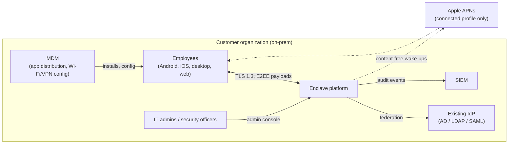
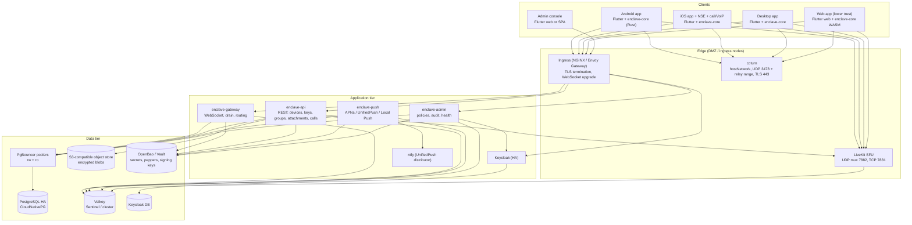
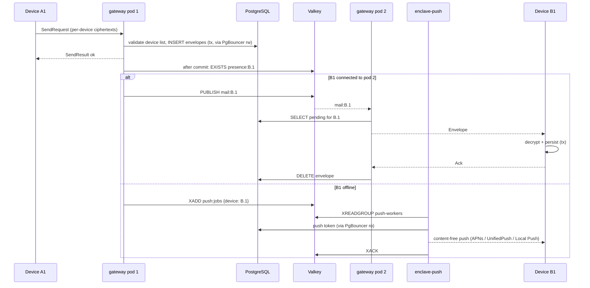

# Enclave — Architecture Reference File (ARF)

| Field | Value |
|---|---|
| Document | Architecture reference: structure, trust model, threat model, deployment, operations, architecture decision records |
| Status | Draft v1.0 |
| Related | `prd.md`, `specs.md`, `ui.md` |

---

## 1. Architectural drivers

| Driver | Source | Architectural consequence |
|---|---|---|
| Server must never access content | PRD principle 1, NFR-SEC-01 | All crypto on clients; server is a relay for opaque bytes; no server-side features requiring plaintext. |
| Operator is an adversary | PRD principle 2 | Minimize stored metadata; detectable key changes; audit log; key transparency roadmap. |
| Fully on-prem, including air-gapped | G3 | No SaaS dependencies; self-hosted push alternatives; offline release bundles. |
| Multi-device with consistent state | G1, FR-DEV | Device as unit of delivery; Sesame-style fan-out; MLS leaves per device. |
| Large groups and group calls | FR-GRP-02, FR-CAL-05 | MLS (log N rekey); SFU with frame-level E2EE. |
| Small team, Java/Python strength | Team context | Spring Boot backend, single Flutter client codebase, Rust only in the crypto core. |
| Reliability equals security | PRD principle 5 | Store-then-notify, at-least-once with dedupe, strict transactional client processing. |

---

## 2. System context



The only optional external dependency is APNs (and FCM if explicitly enabled) in the connected profile. Both receive content-free payloads.

---

## 3. Container view



### 3.1 Backend internal structure (hexagonal / modular monolith)

```
enclave-server/
├── enclave-domain/            # pure domain: DeviceAddress, Envelope, Roster, policies (no Spring)
├── enclave-application/       # use cases: SendMessage, ClaimPreKeys, SubmitCommit, RevokeDevice
├── enclave-adapters-in/
│   ├── rest/                  # Spring MVC controllers
│   ├── websocket/             # gateway handlers
│   └── keycloak-events/       # Keycloak event listener webhook
├── enclave-adapters-out/
│   ├── postgres/              # JdbcTemplate repositories, Flyway migrations
│   ├── valkey/                # presence, mail/ctl signals, push-job stream, rate limiting
│   ├── objectstore/           # S3 presigning (AWS SDK v2 with custom endpoint)
│   ├── livekit/               # token minting, RemoveParticipant
│   └── push/                  # APNs (Pushy / java-apns2), UnifiedPush HTTP, Local Push bridge
├── enclave-boot-gateway/      # Spring Boot app: gateway profile
├── enclave-boot-api/          # Spring Boot app: api profile
├── enclave-boot-push/
├── enclave-boot-admin/
└── enclave-boot-all/          # single deployable for small tier
```

Module boundaries are enforced with ArchUnit tests (domain must not depend on Spring; adapters must not depend on each other).

---

## 4. Trust boundaries and data classification

### 4.1 Trust boundaries

| Boundary | Trusted side | Untrusted side |
|---|---|---|
| TB1: Device ↔ network | Unlocked device with `enclave-core` | Everything else (server, network, TURN, SFU) |
| TB2: Client process ↔ OS | `enclave-core` memory and SQLCipher DB | Other apps; OS backups (excluded) |
| TB3: Web origin ↔ server | Code integrity of served JS/WASM | Server (can serve malicious code) → web is lower trust (ADR-014) |
| TB4: Admin console ↔ backend | Admin role actions | Audited, cannot reach content |
| TB5: Backend ↔ Keycloak | Account authentication | Cannot affect E2EE except by enabling device registration (detectable) |

### 4.2 What the server knows

| Data | Stored? | Retention | Notes |
|---|---|---|---|
| Account ID, username, IK public key | Yes | Account lifetime | Directory necessity. |
| Device list per account, registration IDs, platform | Yes | Until revoked | Fan-out necessity. |
| Public prekeys, KeyPackages | Yes | Until consumed/expired | |
| Encrypted envelopes | Yes | Until acked or 30 days | Ciphertext + routing fields. |
| Sender of 1:1 messages | Only when not sealed | With envelope | Sealed sender between contacts. |
| Group roster (accounts, devices, roles) | Yes | Group lifetime | Required for fan-out and ACL; accepted metadata (residual risk R3). |
| Group name, avatar, description | **No** | — | Inside MLS application messages. |
| Profile (display name, photo) | Encrypted blob | Account lifetime | Profile key shared only with contacts. |
| Attachments | Encrypted blob | ≤ 30 days | No uploader/recipient mapping. |
| Call content | **No** | — | |
| Call participation | Ephemeral (Valkey) | Call lifetime | Opaque participant IDs at SFU. |
| IP addresses | Rate-limit counters, infra logs | ≤ 24 h / ≤ 14 days | Configurable; recommend minimal. |
| Contact lists / conversation lists | **No** | — | |
| Admin actions | Yes | Per compliance (e.g. 7 years) | Hash-chained. |

---

## 5. Threat model

### 5.1 Adversaries

| ID | Adversary | Capabilities |
|---|---|---|
| A1 | Network attacker | Observe/modify traffic between clients and server; on-path in corporate network or Wi-Fi |
| A2 | Compromised server (external breach) | Full read/write of DB, object store, memory, code on servers |
| A3 | Malicious insider admin | A2 capabilities plus legitimate Keycloak and admin console access |
| A4 | Lost/stolen device | Physical access, possibly unlocked |
| A5 | Malicious group member / former member | Valid keys at some point in time |
| A6 | Compromised client build pipeline | Ability to ship modified clients |
| A7 | Future quantum adversary | Records traffic today, decrypts later |

### 5.2 Threats and mitigations

| Threat | Adversary | Mitigation | Residual |
|---|---|---|---|
| Read message content in transit | A1 | E2EE (Signal/MLS) + TLS 1.3 with pinned CA | None material |
| Read stored content on server | A2, A3 | Server stores ciphertext only; keys never leave devices | None material |
| Register ghost device to receive messages | A2, A3 | Device-list-change notices to owner and contacts; IK signature requirements; safety numbers; key transparency (P2) | Users may ignore notices until KT ships (R1) |
| Replace a user's identity key (MITM) | A2, A3 | Identity-change warnings; blocking for verified contacts; KT (P2) | Unverified contacts accept new key with a notice (R1) |
| Traffic analysis (who talks to whom, when) | A2, A3 | Sealed sender for 1:1; minimal logs; no conversation tables | Timing/IP correlation at gateway possible (R2) |
| Group membership exposure | A2, A3 | — (required for fan-out) | Roster visible to server (R3); future: anonymous credentials (zkgroup-like) |
| Malicious served web client | A2, A3 | Web disabled by default; SRI + signed bundle manifest; strict CSP; prefer desktop | Inherent to web model (R4) |
| Server forks MLS group views (split view) | A2 | MLS transcript hashes; clients include epoch authenticator in GroupCallUpdate and periodic `EpochCheck` app messages to detect divergence | Detection, not prevention |
| Removed member reads new messages | A5 | MLS removal → new epoch; server pending_removal gating | None material |
| Former member reads past messages from their device | A5 | Out of scope: they legitimately had access; disappearing messages limit exposure | Inherent |
| Stolen unlocked device | A4 | App lock with timeout, biometric; remote revoke + wipe directive; disappearing messages | Data on device until wipe reaches it |
| Stolen locked device | A4 | SQLCipher key in hardware keystore, `ThisDeviceOnly`; excluded from OS backups | Device-level OS exploits |
| Prekey exhaustion DoS | any client | Rate limits per target; last-resort Kyber key | Forward secrecy of first message reduced when OPKs exhausted |
| Malicious client build | A6 | Signed builds, SBOM, reproducible builds (P2), MDM-pinned app signatures | Trust in build infra |
| Harvest now, decrypt later | A7 | PQXDH for 1:1 now; PQ ratchet (ADR-007); PQ MLS ciphersuite post-GA | Group traffic classically protected until PQ MLS (R5) |
| Push metadata leakage to Apple/Google | external | Content-free pushes; restricted/air-gapped profiles avoid them | Apple learns "device X got a push at time T" in connected profile |
| SFU learns call metadata | A2, A3 | Opaque participant IDs, room tokens via HMAC | IPs, timing, speaking activity (audio levels) visible |
| Compliance archive abuse | A3 | Archive agent must be added via visible MLS commit; non-dismissible banner; audit log | Users must notice banner |

### 5.3 Residual risk register

| ID | Risk | Plan |
|---|---|---|
| R1 | Key substitution undetected by users who ignore notices | Key transparency (ADR-012), UX nudges to verify, admin-visible stats on verification rates |
| R2 | Gateway can correlate connections and timing | Document; optional mixing delays not planned; minimize logs |
| R3 | Server knows group rosters | Evaluate anonymous credentials / encrypted rosters (Signal groups v2 approach) for v2 |
| R4 | Web client trust | Default off; desktop recommended |
| R5 | Groups not PQ-secure at GA | Adopt hybrid PQ MLS ciphersuite when stable in OpenMLS |
| R6 | libsignal AGPL obligations | ADR-004 |

---

## 6. Deployment architecture (Kubernetes)

### 6.1 Namespaces and workloads

| Namespace | Workload | Kind | Replicas (medium tier) | Notes |
|---|---|---|---|---|
| `enclave` | enclave-gateway | Deployment | 4 (HPA on connections) | ~10k sockets per pod target with virtual threads; PDB minAvailable 75% |
| `enclave` | enclave-api | Deployment | 3 (HPA on CPU/RPS) | Stateless |
| `enclave` | enclave-push | Deployment | 2 (HPA on `push:jobs` lag) | Stream consumer group `push-workers`; no ingress; only workload with egress to APNs/FCM |
| `enclave` | enclave-admin | Deployment | 2 | Separate ingress host, IP allowlist |
| `enclave-data` | PostgreSQL | CloudNativePG Cluster | 3 (1 primary, 2 sync/async replicas) | `synchronous_commit=remote_apply` to 1 replica for RPO 0 |
| `enclave-data` | PgBouncer | CNPG Pooler | 3 `rw` + 2 `ro` | Transaction mode; flyway bypasses it |
| `enclave-data` | Valkey | StatefulSet (Sentinel) | 3 | Presence, pub/sub signals, `push:jobs` stream, rate limits, LiveKit state; AOF `everysec` |
| `enclave-data` | Object store | SeaweedFS / Garage / Ceph RGW | 3+ | Erasure coding or 3x replication |
| `iam` | Keycloak | Keycloak Operator | 3 | Infinispan clustering; own PostgreSQL |
| `media` | coturn | DaemonSet on `media` node pool | 1 per media node | `hostNetwork: true`; UDP relay range 49152–65535 |
| `media` | LiveKit | Deployment/DaemonSet on `media` pool | 3+ | `hostNetwork: true` or UDP mux on fixed port behind L4 LB |
| `push` | ntfy | Deployment | 2 | UnifiedPush distributor |
| `platform` | OpenBao/Vault, External Secrets, cert-manager, ingress, Prometheus/Grafana/Loki/Tempo, ArgoCD | various | — | Shared platform |

### 6.2 Node pools

- **general**: app tier and Keycloak.
- **data**: PostgreSQL, Valkey, object store, local NVMe, anti-affinity across racks/zones.
- **media**: coturn + LiveKit, public/corporate-routable IPs, high NIC throughput, CPU-optimized; taints `dedicated=media:NoSchedule`.

### 6.3 Network ports

| Service | Port | Protocol | Exposure |
|---|---|---|---|
| Ingress (REST, WS, Keycloak, admin) | 443 | TCP (TLS 1.3) | Clients |
| coturn STUN/TURN | 3478 | UDP/TCP | Clients |
| coturn TURN/TLS | 443 (dedicated IP) or 5349 | TCP | Clients behind strict firewalls |
| coturn relay | 49152–65535 | UDP | Clients |
| LiveKit signaling | 443 (via ingress) | TCP WSS | Clients |
| LiveKit media | 7882 (UDP mux), 7881 (TCP fallback) | UDP/TCP | Clients |
| ntfy | 443 (via ingress) | TCP | Android clients |
| Local Push Connectivity provider | 443 dedicated host | TCP | iOS on configured SSIDs |

Network policies: default deny; the data tier only accepts from app-tier service accounts; media nodes accept no inbound to app tier except LiveKit → Valkey.

### 6.4 Ingress and WebSockets

- Envoy Gateway or NGINX Ingress with WebSocket idle timeout ≥ 120 s, no sticky sessions required (store-then-notify routing makes any pod valid).
- Connection draining: `preStop` hook sleeps 20 s, gateway sends `4100 RECONNECT` with jittered delay; `terminationGracePeriodSeconds: 60`.
- Rate limiting at ingress for unauthenticated endpoints (provisioning, Keycloak login).

### 6.5 GitOps

```
deploy/
├── charts/enclave/                # umbrella Helm chart
│   ├── charts/gateway, api, push, admin
│   ├── values.yaml
│   └── values-profiles/{small,medium,large}.yaml
├── argocd/
│   ├── app-of-apps.yaml
│   ├── enclave-staging.yaml
│   └── enclave-prod.yaml          # sync waves: secrets → data → iam → app → media
└── airgap/
    └── bundle.yaml                # image list + charts for offline packaging (e.g. Zarf or skopeo sync to Harbor)
```

ArgoCD sync waves enforce ordering: External Secrets (wave -2), data tier (wave -1), Keycloak (wave 0), Flyway migration Job (wave 1, `PreSync` hook), app services (wave 2), media (wave 3).

### 6.6 Secrets and keys on the server

| Secret | Location | Rotation |
|---|---|---|
| Device credential pepper | OpenBao KV | Rotation requires dual-pepper verification window |
| Server certificate signing key (sealed sender) | OpenBao Transit (non-exportable) | Yearly; trust root offline (HSM / air-gapped laptop) |
| Policy signing key | OpenBao Transit | Yearly |
| coturn static auth secret | OpenBao KV → coturn + api | Quarterly with overlap |
| LiveKit API key/secret | OpenBao KV | Quarterly |
| APNs auth key (.p8) | OpenBao KV | Per Apple policy |
| Room token HMAC secret | OpenBao KV | Monthly |

---

## 7. Data flows

### 7.1 1:1 message (happy path)



Presence: gateway pods register `presence:{account}.{device} → pod_id` in Valkey with a 90 s TTL refreshed by keepalives. Writers check it after commit to choose between a mail signal (online) and a push job (offline).

### 7.2 Service interaction rules

The four backend services never call each other. Full channel catalogue: `specs.md` §1.1.

| From | To | Through | Purpose |
|---|---|---|---|
| gateway | gateway (other pods) | Valkey pub/sub `mail:*` | Wake the pod holding the recipient's socket |
| gateway, api | push | Valkey stream `push:jobs` | Wake offline devices, exactly one push pod per job |
| api, admin | gateway | Valkey pub/sub `ctl:*`, `ctl:broadcast` | Close revoked sockets, key/policy directives |
| all | all | PostgreSQL (`rw` / `ro` poolers) | Shared durable state |
| Keycloak | api | HTTPS + mTLS webhook | User disabled → revoke devices |

Safety nets: client keepalives trigger a mailbox `EXISTS` check (lost signals), `XAUTOCLAIM` re-delivers jobs from crashed push pods, and a 5 s coalescing key drops duplicate wake-ups.

---

## 8. Capacity planning (reference)

Assumptions: average 50 messages/user/day sent, average 3 recipient devices per message (incl. own sync), 1.5 KB average envelope, 20% of users in a call at peak hour for medium tier.

| Tier | Envelope writes/day | Peak writes/s | Mailbox steady size | Gateway pods | PG sizing | Media nodes |
|---|---|---|---|---|---|---|
| Small (500) | ~75k | ~10 | < 1 GB | 1–2 | 4 vCPU / 16 GB, single + replica | 1 (coturn + LiveKit) |
| Medium (10k) | ~1.5M | ~200 | ~5 GB | 4 | 16 vCPU / 64 GB, NVMe | 3 |
| Large (100k) | ~15M | ~2,000 | ~50 GB | 20+ | 32 vCPU / 128 GB primary + replicas; consider mailbox move to ScyllaDB (ADR-008 escape hatch) | 10+ |

Group call capacity rule of thumb for LiveKit: plan ~150–250 published video tracks with simulcast per 8-core media node; validate with LiveKit's load tester in the target network.

---

## 9. High availability and disaster recovery

| Component | HA | Backup | DR |
|---|---|---|---|
| PostgreSQL | CNPG 3 instances, sync replica | Continuous WAL archiving to object store (Barman), daily base backup | Replica cluster in secondary site; RPO ≤ 5 min, RTO ≤ 1 h |
| Valkey | Sentinel 3 nodes, AOF `everysec` | None needed (signals ephemeral; jobs bounded) | Rebuilt empty; clients reconnect and drain; at most ~1 s of push jobs lost on failover |
| Object store | Replication/EC | Cross-site async replication | Attachments lost beyond RPO are acceptable (messages show "attachment expired") |
| Keycloak | 3 replicas | DB backups | Restored with PostgreSQL |
| Secrets | OpenBao Raft 3 nodes | Encrypted snapshots, offline unseal keys split (Shamir) | Restore runbook |
| Client data | n/a | Devices are the source of truth; optional encrypted backup (P2) | — |

**Important asymmetry:** a server restore cannot "lose" message history (it was never there), but restoring an old DB snapshot can **reintroduce consumed one-time prekeys** and **roll back MLS epochs**. DR runbook therefore: after restore, (1) delete all one-time prekeys and KeyPackages and send `KEYS_LOW`/`KEYPACKAGES_LOW` to all devices, (2) set each group's `epoch` from the latest commit observed by clients via a "resync" flow (clients whose epoch is ahead submit their latest GroupInfo; server accepts the highest verifiable one).

---

## 10. CI/CD and supply chain

| Stage | Tooling |
|---|---|
| Source | Monorepo (see §11), protected branches, signed commits |
| Build backend | Gradle, JDK 21, Jib for distroless images |
| Build Rust core | cargo with locked deps, `cargo-deny` (licenses, advisories), `cargo-vet` for crypto deps |
| Build clients | Flutter stable channel pinned; Android Gradle; iOS Xcode via self-hosted macOS runners; Fastlane for signing |
| Scanning | Trivy (images), OSV-Scanner, Semgrep, gitleaks, MobSF for APK/IPA |
| SBOM | Syft (CycloneDX) per image and per client build |
| Signing | cosign keyless-in-airgap alternative: cosign with key in OpenBao; Kyverno policy only admits signed images |
| Registry | Harbor (on-prem) with replication to air-gapped registries |
| Delivery | ArgoCD; air-gapped bundles with image tarballs + charts + checksums + signature |
| Reproducible clients (P2) | Pinned toolchains in containers; publish build recipe so customers can verify APK/desktop binaries; iOS reproducibility is limited by Apple signing |

---

## 11. Repository layout

```
enclave/
├── core/                       # Rust workspace
│   ├── enclave-core/           # public API for clients (frb annotations)
│   ├── enclave-proto/          # prost-generated protobufs
│   ├── enclave-store/          # SQLCipher / SQLite-WASM storage, migrations
│   ├── enclave-direct/         # libsignal integration
│   ├── enclave-group/          # OpenMLS integration
│   ├── enclave-sim/            # multi-device protocol simulator
│   └── fuzz/
├── server/                     # Gradle multi-module (see §3.1)
├── apps/
│   ├── enclave_app/            # Flutter app (Android, iOS, desktop, web)
│   ├── ios_extensions/         # NSE, Broadcast Upload, Local Push provider (Swift)
│   ├── android_native/         # ConnectionService, foreground services (Kotlin)
│   └── admin_console/          # Flutter web (or React) admin UI
├── proto/                      # .proto sources (single source of truth)
├── deploy/                     # Helm, ArgoCD, air-gap bundle
├── tools/
│   ├── loadtest/               # Python asyncio clients, Gatling
│   └── ops/                    # Python admin/provisioning scripts
└── docs/
    ├── prd.md  specs.md  arf.md  ui.md
    └── adr/
```

---

## 12. Architecture Decision Records

### ADR-001: Untrusted-server ("dumb relay") architecture
**Status:** Accepted
**Context:** Customers deploy on-prem, which makes the operator a realistic adversary (insider, coercion, breach).
**Decision:** The server never holds content, private keys, profile data, or group metadata. All features are designed client-side first; a feature requiring plaintext on the server is rejected or redesigned.
**Consequences:** (+) Server compromise does not expose content. (−) No server-side search, previews, moderation, or AI features; more client complexity; compliance needs client-visible mechanisms (archive agent).

### ADR-002: Spring Boot on Java 21+ with virtual threads for the backend
**Status:** Accepted
**Context:** Team expertise in Spring Boot; the gateway needs tens of thousands of concurrent WebSockets; blocking JDBC is simpler than reactive stacks.
**Options:** Spring Boot + virtual threads; Spring WebFlux; Go; Elixir/Phoenix; Rust (axum).
**Decision:** Spring Boot (3.5.x, migrate to 4.x when ecosystem stable) on Java 21 LTS (25 LTS when adopted), `spring.threads.virtual.enabled=true`, Tomcat/Jetty WebSocket, JdbcTemplate.
**Consequences:** (+) Team velocity, mature ecosystem, Signal-Server precedent (Java). (−) Higher per-connection memory than Go/Elixir; mitigated by horizontal scaling; avoid `synchronized` blocks around I/O (pinning) in hot paths.

### ADR-003: Modular monolith first, split by deployment profile
**Status:** Accepted
**Decision:** One codebase with hexagonal modules; separate Spring Boot apps (gateway, api, push, admin) built from the same modules; `enclave-boot-all` for small deployments.
**Consequences:** (+) Simple small-tier operations; independent scaling of the gateway in larger tiers. (−) Shared DB schema across apps requires migration discipline (Flyway owned by api).

### ADR-004: Use libsignal (AGPL-3.0) for 1:1 encryption
**Status:** Accepted, pending legal review
**Context:** The user requirement allows reusing the Signal Protocol. `libsignal` is the maintained, audited implementation, including PQXDH. It is AGPL-3.0.
**Decision:** Use the `libsignal-protocol` Rust crate (git dependency pinned to release tags) inside `enclave-core`.
**Consequences:** Distributing clients that link libsignal requires offering corresponding client source under AGPL-compatible terms. For internal-only deployments this is usually acceptable; for a commercial product, either (a) publish client source (aligns with transparency and reproducible builds), or (b) supersede with MLS-only design (ADR-005 alternative B). Backend does not link libsignal.

### ADR-005: Hybrid protocol design: Signal for 1:1, MLS for groups
**Status:** Accepted
**Options:** (A) Signal everywhere (Sender Keys for groups); (B) MLS everywhere (1:1 as 2-member MLS groups, like Wire); (C) Hybrid.
**Decision:** (C). 1:1 via Signal Protocol (mature multi-device fan-out, sealed sender, PQXDH, PQ ratchet), groups via MLS (O(log N) rekeying, strong PCS, standardization).
**Consequences:** (+) Best protocol for each case. (−) Two protocol stacks to integrate, test, and audit; two sets of key material per device. Alternative (B) remains the fallback if ADR-004 licensing blocks libsignal.

### ADR-006: OpenMLS with server as ordering Delivery Service; commits as PublicMessage
**Status:** Accepted
**Context:** MLS needs consistent ordering of commits; the server must know rosters for fan-out regardless.
**Decision:** OpenMLS in `enclave-core`; server enforces epoch compare-and-set (`specs.md` §6.4); commits and proposals framed as `PublicMessage` so the server can validate ACLs and maintain rosters; application messages as `PrivateMessage`; group metadata only in encrypted app messages.
**Consequences:** (+) Deterministic ordering, server-enforced roles, simple fork handling via external commits. (−) Server learns membership changes (already known via rosters); a malicious server could withhold commits (detectable via epoch checks).

### ADR-007: Post-quantum posture
**Status:** Accepted
**Decision:** PQXDH (ML-KEM-1024 hybrid) mandatory for 1:1 session setup at GA; enable libsignal's post-quantum ratchet when available in the pinned version and interoperable across all client platforms; adopt a hybrid PQ MLS ciphersuite post-GA. Track via crypto-agility fields (protocol versions in device capabilities).
**Consequences:** (+) 1:1 traffic protected against harvest-now-decrypt-later at GA. (−) Larger key bundles and messages; group traffic classical until PQ MLS (R5).

### ADR-008: PostgreSQL for the mailbox, not Kafka
**Status:** Accepted
**Context:** Mailbox access patterns: per-device queues (100k+ logical queues), point deletes on ack, ordered drains, TTL.
**Decision:** PostgreSQL with daily range partitions on `server_ts` (pg_partman), composite primary key, drop partitions for expiry. Escape hatch for very large tiers: ScyllaDB with partition key `(account_id, device_id)`, clustering key `guid`, TTL per row.
**Rejected:** Kafka (topics do not scale to per-device queues, no per-record deletion, keyed partitions require scans), RabbitMQ (per-device queues feasible but durability/operations at 100k+ queues and lack of ad-hoc queries).
**Consequences:** (+) One database to operate, transactional consistency with device validation. (−) Write amplification on high-volume deployments; vacuum tuning needed (partitions mitigate).

### ADR-009: Valkey for presence and pub/sub
**Status:** Accepted
**Context:** Redis licensing changed in 2024 (source-available) and again in 2025 (AGPL option added); Valkey is the BSD-licensed Linux Foundation fork with protocol compatibility.
**Decision:** Valkey (Spring Data Redis client compatible). NATS considered for routing; rejected for v1 to avoid an extra system, revisit if pub/sub fan-out becomes a bottleneck.
**Consequences:** (+) Permissive license, familiar tooling, one system for presence, signals and jobs. (−) Pub/sub is fire-and-forget; correctness relies on store-then-notify, drain on reconnect, and keepalive-triggered mailbox checks. Work that must not be lost or duplicated across replicas (push wake-ups) uses streams, not pub/sub (ADR-017).

### ADR-010: Flutter + shared Rust core for all clients
**Status:** Accepted
**Options:**

| Option | Pros | Cons |
|---|---|---|
| Native Kotlin + Swift (+ Electron/Tauri desktop, separate web) | Best platform fidelity, official libsignal bindings | 3–4 UI codebases; too costly for team size |
| Kotlin Multiplatform + Compose MP | Shared logic, Kotlin familiarity | Web support immature for this use case; still needs Rust core for MLS; iOS UI less proven |
| React Native | Large ecosystem, web via react-native-web | Web parity weak; Rust integration via JSI/uniffi-bindgen-react-native less mature; background/call integration heavier |
| **Flutter + Rust core** | One UI codebase for Android, iOS, desktop, web; `flutter_rust_bridge` mature; LiveKit and `flutter_webrtc` support all targets; consistent rendering | Native code still needed for CallKit/ConnectionService/NSE/Local Push; web build of Rust core via WASM needs validation |

**Decision:** Flutter (stable channel, pinned) for UI on all platforms, with all crypto, storage, and protocol logic in the Rust `enclave-core` (native via FFI, web via WASM). Platform-specific features via thin Kotlin/Swift plugins.
**Consequences:** (+) Single UI team; one protocol implementation for all platforms (no cross-platform crypto divergence). (−) Rust expertise required (1 dedicated engineer); iOS NSE and extensions are Swift + Rust without Flutter.

### ADR-011: Device credentials instead of OIDC tokens for messaging traffic
**Status:** Accepted (P0: static secret; P2: proof-of-possession)
**Decision:** Keycloak authenticates account-level actions (registration, linking, step-up); messaging uses per-device credentials. Upgrade to hardware-bound proof-of-possession (DPoP-style signatures) post-GA.
**Consequences:** (+) Robust long-lived connections; per-device revocation. (−) Two auth paths to secure and test.

### ADR-012: Key transparency post-GA
**Status:** Proposed
**Decision:** Implement an auditable key directory (Merkle prefix tree, AKD-style) with client inclusion/consistency checks and a customer-run auditor.
**Consequences:** Strongest mitigation for A3 key substitution; adds a service, proof sizes, and client verification logic.

### ADR-013: Calls: P2P for 1:1, LiveKit SFU with MLS-derived frame keys for groups
**Status:** Accepted
**Options for SFU:** LiveKit (Apache-2.0, Go, SDKs for all client targets, E2EE support), mediasoup (library, more custom work), Jitsi Videobridge (Java, Jitsi-centric clients), Janus (GPLv3).
**Decision:** 1:1 calls P2P WebRTC with E2EE signaling and TURN fallback (lowest latency, no SFU metadata). Group calls via LiveKit with frame encryption keys derived from the MLS exporter; ad-hoc calls with keys distributed over 1:1 sessions.
**Consequences:** (+) Media never decryptable by infrastructure; membership-bound call keys. (−) Two call paths (P2P and SFU); escalation transition; SFU sees IPs and speaking activity.

### ADR-014: Web client as an optional lower-trust tier
**Status:** Accepted
**Context:** A web client's code is delivered by the server on every load; a compromised server can serve key-exfiltrating code.
**Decision:** Provide the web client (Flutter web + WASM core), **disabled by default** via policy; when enabled: strict CSP, Subresource Integrity, signed bundle manifest verified by a service worker on updates, visible "Web session (reduced security)" indicator, shorter session lifetimes, no history transfer beyond 7 days. Recommend desktop apps.
**Consequences:** (+) Meets "web app" requirement for low-sensitivity use or kiosks. (−) Cannot match native trust guarantees; documented to customers.

### ADR-015: Content-free push with self-hosted alternatives
**Status:** Accepted
**Decision:** Pushes carry no content or sender; Android uses UnifiedPush (ntfy) or foreground service; iOS uses APNs in connected profile and Local Push Connectivity in restricted/air-gapped profiles.
**Consequences:** (+) Push providers learn nothing beyond timing. (−) iOS background delivery outside configured networks impossible in air-gapped profile; requires Apple entitlement and MDM.

### ADR-016: S3-compatible object storage, vendor-neutral
**Status:** Accepted
**Decision:** Code against the S3 API only (presigned URLs, multipart/tus); certify SeaweedFS and Garage, support Ceph RGW for customers with Ceph; MinIO supported if customer licensing permits.
**Consequences:** (+) No lock-in, licensing flexibility. (−) Test matrix across stores.

### ADR-017: No direct service calls; Valkey streams for push jobs; no Kafka
**Status:** Accepted (supersedes the earlier design where `enclave-push` subscribed to mail signals)
**Context:** gateway, api, push and admin must coordinate. The first design had push subscribe to `mail:*` pub/sub. Pub/sub delivers every message to every subscriber, so N push replicas would send N copies of each wake-up, and a restarting pod would miss jobs.
**Options:** (A) service-to-service HTTP; (B) pub/sub only; (C) Kafka topics; (D) PostgreSQL state + Valkey pub/sub for signals + Valkey stream with a consumer group for push jobs.
**Decision:** (D). No synchronous calls between services. Signals stay on pub/sub (losing one is harmless). Push jobs use the `push:jobs` stream with consumer group `push-workers`, `XACK` after delivery, `XAUTOCLAIM` for crashed consumers, and a 5 s coalescing key.
**Rejected:** (A) creates call chains, retries and cascading failures for no benefit. (C) Kafka provides the same consumer-group semantics as a Valkey stream here, at the cost of a 3-broker KRaft cluster, partition planning and another backup target; it also cannot target one specific gateway pod for signals or model per-device mailboxes.
**Revisit when:** a non-content domain-event backbone with many independent consumers is required (SIEM and data-lake streaming at scale, bot/webhook platform, cross-site event replication). Then: Kafka fed by a transactional outbox, carrying only minimized metadata.
**Consequences:** (+) At-least-once wake-ups with no duplicates across replicas; push scales horizontally on stream lag; nothing new to operate. (−) Valkey durability matters a little more (AOF `everysec`); a failover can drop about a second of jobs, which is tolerable because messages remain in PostgreSQL.

### ADR-018: Read-only consumers use replicas through the `ro` pooler
**Status:** Accepted
**Context:** `enclave-push` only reads push registrations; admin dashboards only read aggregates. Both previously pointed at the primary.
**Decision:** Both use the PgBouncer `ro` pooler (replicas). Writes from push (deleting registrations rejected by APNs/ntfy) go through `rw`.
**Consequences:** (+) Less primary load; a dashboard query can never slow message delivery; one fewer connection pool contending on the primary. (−) Replica lag (typically milliseconds) can make push use a token replaced moments earlier; the provider rejects it and the next job uses the new one.

---

## 13. Technical debt and future architecture

| Item | Rationale | Target |
|---|---|---|
| Anonymous group credentials (hide rosters) | Reduce R3 | v2 |
| Federation between deployments | Inter-org collaboration | v2+ (consider MLS-based federation, MIMI working group) |
| On-device AI features (summaries, smart replies) using local models | Preserve E2EE while adding productivity features | v2 |
| Mailbox migration path to ScyllaDB | Large tier scale | When > 50M envelopes/day |
| Encrypted cloud-free backup with recovery key | Device loss resilience | P2 |
| PQ MLS ciphersuite | R5 | Post-GA |
