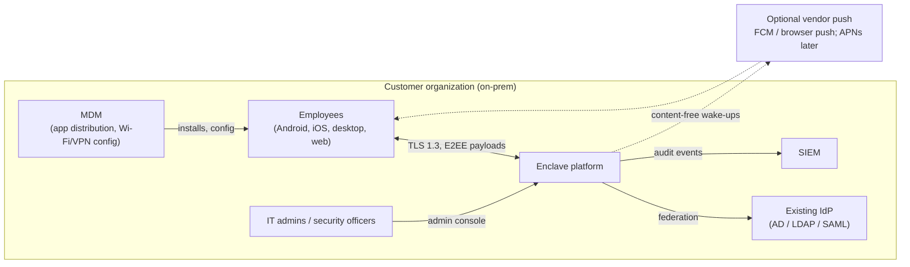
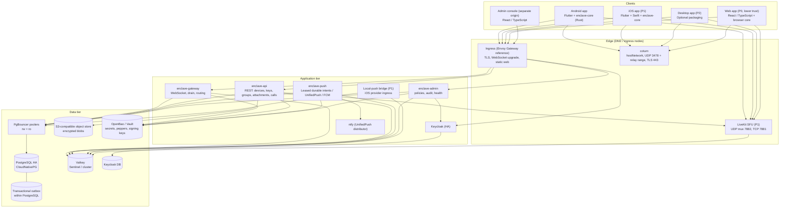

# Enclave — Architecture Reference File (ARF)

| Field | Value |
|---|---|
| Document | Architecture reference: structure, trust model, threat model, deployment, operations, architecture decision records |
| Status | Draft v1.2 — 1v1, groups, communities; Android/web first, not implemented |
| Updated | 2026-10-16 |
| Related | [Specs](specs.md), [UI](UI.md), [Mobile](mobile.md), [Tasks](tasks.md), [Sources](sources.md), [Diagram catalogue](diagrams/README.md) |

---

## 1. Architectural drivers

| Driver | Source | Architectural consequence |
|---|---|---|
| Server must never access content | Specs §0, NFR-SEC-01 | All crypto on clients; server is a relay for opaque bytes; no server-side features requiring plaintext. |
| Operator is an adversary | Specs §0 security promise | Minimize stored metadata; detectable key changes; audit log; key transparency roadmap. |
| Fully on-prem, including air-gapped | FR-OPS-01 | No SaaS dependencies; self-hosted push alternatives; offline release bundles. |
| Multi-device with consistent state | FR-DEV-01 | Device as unit of delivery; Sesame-style fan-out; MLS leaves per device. |
| Groups, communities, and later group calls | FR-GRP-02, FR-COM-01, FR-CAL-05 | Independent MLS scopes, authenticated roles/link delegation and pending removal; SFU media remains P1. |
| Android and web first | User scope, FR-UX-01 | Flutter Android + React/TypeScript web; shared Rust protocol code; native Swift/iOS work deferred. Staffing and Java/Python expertise are planning assumptions, not confirmed team facts. |
| Reliability equals security | NFR-REL-01 | Transactional envelopes/outbox, idempotent submissions, strict client persistence before acknowledgement. |
| Friendly, accessible daily use | FR-UX-01 | One clear onboarding route, local search, keyboard/TalkBack access, honest privacy/status language. |

---

## 2. System context



Runtime data, identity, storage, and media remain on-prem. Connected profiles may opt into Android FCM, browser-vendor Web Push, and later Apple APNs. These services see token/IP/timing metadata but no message content. Air-gapped builds must also remove external fonts, CDNs, update checks, license calls, and default public STUN endpoints.

---

## 3. Container view



### 3.1 Backend internal structure (hexagonal / modular monolith)

```
enclave-server/
├── enclave-domain/            # pure domain: DeviceAddress, Envelope, Roster, policies (no Spring)
├── enclave-application/       # use cases: SendMessage, ClaimPreKeys, SubmitCommit, RevokeDevice
├── enclave-adapters-in/
│   ├── rest/                  # Spring MVC controllers
│   ├── websocket/             # gateway handlers
│   └── keycloak-events/       # Keycloak event listener webhook
├── enclave-adapters-out/
│   ├── postgres/              # JdbcTemplate repositories, Flyway migrations
│   ├── valkey/                # presence, mail/ctl signals, optional outbox hints, rate limiting
│   ├── objectstore/           # S3 presigning (AWS SDK v2 with custom endpoint)
│   ├── livekit/               # token minting, RemoveParticipant
│   └── push/                  # UnifiedPush / FCM; APNs and local bridge in P1
├── enclave-boot-gateway/      # Spring Boot app: gateway profile
├── enclave-boot-api/          # Spring Boot app: api profile
├── enclave-boot-push/
├── enclave-boot-admin/
└── enclave-boot-all/          # single deployable for small tier
```

Module boundaries are enforced with ArchUnit tests (domain must not depend on Spring; adapters must not depend on each other).

---

## 4. Trust boundaries and data classification

### 4.1 Trust boundaries

| Boundary | Trusted side | Untrusted side |
|---|---|---|
| TB1: Device ↔ network | Unlocked device with `enclave-core` | Everything else (server, network, TURN, SFU) |
| TB2: Client process ↔ OS | OS isolation, native keystore, encrypted DB | Other apps, keyboards/accessibility services, backups; a compromised OS can read unlocked content. |
| TB3: Web origin ↔ server | Code integrity of served JS/WASM | Server (can serve malicious code) → web is lower trust (ADR-014) |
| TB4: Admin console ↔ backend | Admin role actions | Audited, cannot reach content |
| TB5: Backend ↔ Keycloak | Authentication under the configured issuer | Account reset/key substitution can affect future traffic; existing-device consent and peer identity verification remain separate controls. |

### 4.2 What the server knows

| Data | Stored? | Retention | Notes |
|---|---|---|---|
| Account ID, username, IK public key | Yes | Account lifetime | Directory necessity. |
| Device list per account, registration IDs, platform | Yes | Until revoked | Fan-out necessity. |
| Public prekeys, KeyPackages | Yes | Until consumed/expired | |
| Encrypted envelopes | Yes | Until acked or 30 days | Ciphertext + routing fields. |
| Sender of 1:1 messages | P0 authenticated sender; P1 sealed transport omits durable sender | Envelope retention; short operational metadata | Sealed transport cannot use an authenticated messaging socket. |
| Group/community roster, parent-child IDs, link visibility and operation state | Yes | Space lifetime plus bounded operation cleanup | Routing/authorization mirrors expose relationship metadata (R3); titles/content remain encrypted. |
| Group name, avatar, description | **No** | — | Inside MLS application messages. |
| Profile (display name, photo) | Encrypted blob | Account lifetime | Profile key shared only with contacts. |
| Attachments | Encrypted blob | ≤ 30 days | No durable content-recipient map; transient upload authorization and access metadata are still observable. |
| Call content | **No** | — | |
| Call participation | Ephemeral authorization/participant mappings | Call lifetime + bounded cleanup | Opaque SFU IDs are correlatable with token requests and network traffic. |
| IP addresses | Short-lived rate limits and explicitly enabled infra logs | ≤ 24 h default | Sanitized application logs may live 14 days; IP retention is separately bounded. |
| Contact lists / conversation lists | **No** | — | |
| Admin actions | Yes | 365 days default; customer policy may extend | Serialized hash chain + signed independent checkpoints. |
| Announcement/rules responses and personal onboarding progress | Encrypted transport/store only; no plaintext service report | Parent request/content lifetime; obsolete rules responses ≤ 30 days default | Named reviewers receive explicit E2EE responses; checklist progress goes only to own devices. |

---

## 5. Threat model

### 5.1 Adversaries

| ID | Adversary | Capabilities |
|---|---|---|
| A1 | Network attacker | Observe/modify traffic between clients and server; on-path in corporate network or Wi-Fi |
| A2 | Compromised server (external breach) | Full read/write of DB, object store, memory, code on servers |
| A3 | Malicious insider admin | A2 capabilities plus legitimate Keycloak and admin console access |
| A4 | Lost/stolen device | Physical access, possibly unlocked |
| A5 | Malicious group member / former member | Valid keys at some point in time |
| A6 | Compromised client build pipeline | Ability to ship modified clients |
| A7 | Future quantum adversary | Records traffic today, decrypts later |

### 5.2 Threats and mitigations

| Threat | Adversary | Mitigation | Residual |
|---|---|---|---|
| Read message content in transit | A1 | E2EE (Signal/MLS) + TLS 1.3 with pinned CA | Conditional on endpoint/code integrity and validated protocol implementation |
| Read stored content on server | A2, A3 | Server stores ciphertext only; keys never leave devices | Conditional on endpoint/code integrity and validated protocol implementation |
| Register ghost device to receive messages | A2, A3 | Existing-device transcript approval and account-key bindings; verified identity-change blocking; independent key transparency (P2) | Reset/substitution, first-use trust, or compromise of any device holding shared IK remain risks (R1). |
| Replace a user's identity key (MITM) | A2, A3 | Identity-change warnings; blocking for verified contacts; KT (P2) | Unverified contacts accept new key with a notice (R1) |
| Traffic analysis (who talks to whom, when) | A2, A3 | Sealed sender for 1:1; minimal logs; no conversation tables | Timing/IP correlation at gateway possible (R2) |
| Group membership exposure | A2, A3 | — (required for fan-out) | Roster visible to server (R3); future: anonymous credentials (zkgroup-like) |
| Malicious served web client | A2, A3 | Web is P0 and enabled in pilot; policy may disable it; strict CSP/SRI/update integrity and explicit reduced-trust UX | Inherent to web model (R4) |
| Server forks MLS group views (split view) | A2 | MLS transcript hashes; clients include epoch authenticator in GroupCallUpdate and periodic `EpochCheck` app messages to detect divergence | Detection, not prevention |
| Removed member reads new messages | A5 | Client-validated removal/roles, new epoch, stale-send rejection, media pause on removal | Already encrypted old-epoch traffic and malicious/stale senders remain exposed. |
| Former member reads past messages from their device | A5 | Out of scope: they legitimately had access; disappearing messages limit exposure | Inherent |
| Stolen unlocked device | A4 | App lock with timeout, biometric; remote revoke + wipe directive; disappearing messages | Data on device until wipe reaches it |
| Stolen locked device | A4 | SQLCipher key in hardware keystore, `ThisDeviceOnly`; excluded from OS backups | Device-level OS exploits |
| Prekey exhaustion DoS | any client | Rate limits per target; last-resort Kyber key | Forward secrecy of first message reduced when OPKs exhausted |
| Malicious client build | A6 | Signed builds, SBOM, reproducible builds (P2), MDM-pinned app signatures | Trust in build infra |
| Harvest now, decrypt later | A7 | PQXDH for 1:1 now; PQ ratchet (ADR-007); PQ MLS ciphersuite post-GA | Group traffic classically protected until PQ MLS (R5) |
| Push metadata leakage to Apple/Google | external | Content-free pushes; restricted/air-gapped profiles avoid them | Apple learns "device X got a push at time T" in connected profile |
| SFU learns call metadata | A2, A3 | Opaque participant IDs, room tokens via HMAC | IPs, timing, speaking activity (audio levels) visible |
| Compliance archive abuse | A3 | Archive agent must be added via visible MLS commit; non-dismissible banner; audit log | Users must notice banner |

### 5.3 Residual risk register

| ID | Risk | Plan |
|---|---|---|
| R1 | Key substitution undetected by users who ignore notices | Key transparency (ADR-012), UX nudges to verify, admin-visible stats on verification rates |
| R2 | Gateway can correlate connections and timing | Document; optional mixing delays not planned; minimize logs |
| R3 | Server knows group rosters | Evaluate anonymous credentials / encrypted rosters (Signal groups v2 approach) for v2 |
| R4 | Web client trust | P0 with explicit lower-trust indication; customer policy can disable; independent native distribution reduces this risk. |
| R5 | Groups not PQ-secure at GA | Adopt hybrid PQ MLS ciphersuite when stable in OpenMLS |
| R6 | libsignal licensing/support/portability | ADR-004; M0 exact dependency/target proof before implementation. |
| R7 | Shared account identity private key on every linked device | Device compromise has account-wide impersonation impact; rotate identity, revoke all devices, re-verify peers. |
| R8 | Unauthenticated role state or unsafe group recovery | Client-authenticated role transitions and bounded catch-up; fail closed on fork, ADR-020/022. |
| R9 | Delayed/lost provider delivery and OS suspension | Durable intents do not guarantee OS wake; visible delivery capability/status, mobile acceptance matrix. |

---

## 6. Deployment architecture (Kubernetes)

### 6.1 Namespaces and workloads

| Namespace | Workload | Kind | Replicas (medium tier) | Notes |
|---|---|---|---|---|
| `enclave` | enclave-gateway | Deployment | 4 (HPA on connections) | ~10k sockets per pod target with virtual threads; PDB minAvailable 75% |
| `enclave` | enclave-api | Deployment | 3 (HPA on CPU/RPS) | Stateless |
| `enclave` | enclave-push | Deployment | 2 (HPA on oldest eligible intent/throughput) | Primary DB leases + optional stream hints; no ingress; allowlisted provider egress |
| `enclave` | enclave-admin | Deployment | 2 | Separate ingress host, IP allowlist |
| `enclave-data` | PostgreSQL | CloudNativePG Cluster | 3 (1 primary, 2 sync/async replicas) | Configure a required synchronous standby; `remote_apply` alone is insufficient. Local single-failure RPO 0 only within this quorum policy |
| `enclave-data` | PgBouncer | CNPG Pooler | 3 `rw` + 2 `ro` | Transaction mode; flyway bypasses it |
| `enclave-data` | Valkey | StatefulSet + independent Sentinel voters | 3 data + 3 voters | Presence, pub/sub, optional outbox hints, rate limits; separate credentials/keyspace or instance for P1 LiveKit |
| `enclave-data` | Object store | SeaweedFS / Garage / Ceph RGW | 3+ | Erasure coding or 3x replication |
| `iam` | Keycloak | Keycloak Operator | 3 | Infinispan clustering; own PostgreSQL |
| `media` | coturn | DaemonSet on `media` node pool | 1 per media node | `hostNetwork: true`; UDP relay range 49152–65535 |
| `media` | LiveKit (P1) | Deployment/DaemonSet on `media` pool | 3+ | `hostNetwork: true` or UDP mux on fixed port behind L4 LB |
| `push` | ntfy | Deployment | 2 | UnifiedPush distributor |
| `platform` | OpenBao/Vault, External Secrets, cert-manager, ingress, Prometheus/Grafana/Loki/Tempo, ArgoCD | various | — | Shared platform |

### 6.2 Node pools

- **general**: app tier and Keycloak.
- **data**: PostgreSQL, Valkey, object store, local NVMe, anti-affinity across racks/zones.
- **media**: coturn + LiveKit, public/corporate-routable IPs, high NIC throughput, CPU-optimized; taints `dedicated=media:NoSchedule`.

### 6.3 Network ports

| Service | Port | Protocol | Exposure |
|---|---|---|---|
| Ingress (REST, WS, Keycloak, admin) | 443 | TCP (TLS 1.3) | Clients |
| coturn STUN/TURN | 3478 | UDP/TCP | Clients |
| coturn TURN/TLS | 443 (dedicated IP) or 5349 | TCP | Clients behind strict firewalls |
| coturn relay | 49152–65535 | UDP | Clients |
| LiveKit signaling | 443 (via ingress) | TCP WSS | Clients |
| LiveKit media | 7882 (UDP mux), 7881 (TCP fallback) | UDP/TCP | Clients |
| ntfy | 443 (via ingress) | TCP | Android clients |
| Local-push bridge (P1) | 443 dedicated host | TCP | iOS provider on configured SSIDs; separate from no-ingress worker |

Network policies: default deny; database access is allowlisted by source workload/IP plus distinct database roles. Kubernetes NetworkPolicy normally selects pods/namespaces, not service accounts; use supported CNI identity features where required. hostNetwork media requires host firewall controls in addition to pod policy.

### 6.4 Ingress and WebSockets

- Envoy Gateway reference (alternatives require certification) with WebSocket idle timeout ≥ 120 s, no sticky sessions required (store-then-notify routing makes any pod valid).
- Connection draining: `preStop` hook sleeps 20 s, gateway sends `4100 RECONNECT` with jittered delay; `terminationGracePeriodSeconds: 60`.
- Rate limiting at ingress for unauthenticated endpoints (provisioning, Keycloak login).

### 6.5 GitOps

```
deploy/
├── charts/enclave/                # umbrella Helm chart
│   ├── charts/gateway, api, push, admin
│   ├── values.yaml
│   └── values-profiles/{small,medium,large}.yaml
├── argocd/
│   ├── app-of-apps.yaml
│   ├── enclave-staging.yaml
│   └── enclave-prod.yaml          # sync waves: secrets → data → iam → app → media
└── airgap/
    └── bundle.yaml                # image list + charts for offline packaging (e.g. Zarf or skopeo sync to Harbor)
```

ArgoCD phases precede waves: a `PreSync` migration does not wait for ordinary Sync-phase negative-wave data resources. Bootstrap prerequisites separately, then use a Sync-phase migration Job with a lower wave than app rollout and a tested Job health gate. Order: secrets → data → identity → migration → app → optional media. Repeatable upgrades use a unique migration Job name/digest and explicit failure/rollback behavior.

### 6.6 Secrets and keys on the server

| Secret | Location | Rotation |
|---|---|---|
| Device credential pepper | OpenBao KV | Rotation requires dual-pepper verification window |
| Server certificate signing key (sealed sender) | OpenBao Transit (non-exportable) | Yearly; trust root offline (HSM / air-gapped laptop) |
| Policy signing key | OpenBao Transit | Yearly |
| coturn static auth secret | OpenBao KV → coturn + api | Quarterly with overlap |
| LiveKit API key/secret | OpenBao KV | Quarterly |
| APNs auth key (.p8) | OpenBao KV | Per Apple policy |
| Room token HMAC secret | OpenBao KV | Monthly |

---

## 7. Data flows

### 7.1 1:1 message (happy path)

```mermaid
sequenceDiagram
    participant A as Sender Android or web
    participant G as Gateway/API
    participant D as PostgreSQL primary
    participant H as Valkey optional hints
    participant P as Push worker
    participant B as Recipient
    A->>A: Persist protocol advancement + ciphertext
    A->>G: Send submission ID + stored ciphertext
    G->>D: TX validate + dedupe + envelopes + intents
    D-->>G: Durable commit
    G-->>A: Original accepted result
    G-->>H: Best-effort online/intent hint
    par Connected delivery
        G->>D: Drain recipient mailbox
        G-->>B: Encrypted envelope
        B->>B: TX decrypt + state + message + dedupe marker
        B-->>G: Ack after local commit
        G->>D: Delete acknowledged envelope
    and Background wake-up
        P->>D: Poll + lease eligible intent
        P-->>B: Content-free provider attempt
        P->>D: Persist accepted/retry/expired outcome
    end
    Note over D,P: Lost hints and worker crashes recover from durable intent
    Note over P,B: Provider acceptance is not guaranteed device delivery; duplicate wakes are safe
```

Editable source: [durable-delivery.mmd](diagrams/durable-delivery.mmd).

Presence is an expiring routing hint. Writers signal likely-online devices after commit; required wake intents already exist in the same database transaction and are cancelled/suppressed only by authoritative receipt/relevance checks, not stale presence alone.

### 7.2 Service interaction rules

The four backend services never call each other. Full channel catalogue: `specs.md` §1.1.

| From | To | Through | Purpose |
|---|---|---|---|
| gateway | gateway (other pods) | Valkey pub/sub `mail:*` | Wake the pod holding the recipient's socket |
| gateway, api | push | PostgreSQL outbox + optional `push:jobs` hints | Lease/retry durable wakes; duplicate external attempts are possible |
| api, admin | gateway | Valkey pub/sub `ctl:*`, `ctl:broadcast` | Close revoked sockets, key/policy directives |
| all | all | PostgreSQL (`rw` / `ro` poolers) | Shared durable state |
| Keycloak | api | HTTPS + mTLS webhook | User disabled → revoke devices |

Safety nets: keepalive mailbox checks for lost online signals; periodic primary outbox polling; expiring worker leases; client notification/event dedupe. Durable controls and authoritative request checks recover lost revocation/policy signals.

---

## 8. Capacity planning (reference)

Illustrative direct-message baseline: 50 sends/user/day, 3 target device envelopes/send including own sync, 1.5 KiB/envelope. Group traffic multiplies by actual roster leaves and must be modeled separately. These are sizing hypotheses, not benchmark results; 10M envelopes/day is a separate stress scenario, not the medium-tier nominal baseline. P1 media adds its own workload.

| Tier | Envelope writes/day | Peak writes/s | Mailbox steady size | Gateway pods | PG sizing | Media nodes |
|---|---|---|---|---|---|---|
| Small (500) | ~75k | ~10 | < 1 GB | 1–2 | 4 vCPU / 16 GB, single + replica | 1 (coturn + LiveKit) |
| Medium (10k) | ~1.5M | ~200 | ~5 GB | 4 | 16 vCPU / 64 GB, NVMe | 3 |
| Large (100k) | ~15M | ~2,000 | ~50 GB | 20+ | 32 vCPU / 128 GB primary + replicas; consider mailbox move to ScyllaDB (ADR-008 escape hatch) | 10+ |

Group call capacity rule of thumb for LiveKit: plan ~150–250 published video tracks with simulcast per 8-core media node; validate with LiveKit's load tester in the target network.

---

## 9. High availability and disaster recovery

| Component | HA | Backup | DR |
|---|---|---|---|
| PostgreSQL | CNPG 3 instances, sync replica | Continuous WAL archiving to object store (Barman), daily base backup | Replica cluster in secondary site; RPO ≤ 5 min, RTO ≤ 1 h |
| Valkey | Three data instances plus three independent Sentinel voters, or certified managed equivalent | Ephemeral state only; no message correctness dependency | Rebuild empty; reconnect/poll; durable notification intents remain in PostgreSQL |
| Object store | Replication/EC | Cross-site async replication | Loss follows documented object-store RPO; missing objects render unavailable and raise an operator alert, not a misleading normal-expiry diagnosis |
| Keycloak | 3 replicas | DB backups | Restored with PostgreSQL |
| Secrets | OpenBao Raft 3 nodes | Encrypted snapshots, offline unseal keys split (Shamir) | Restore runbook |
| Client data | n/a | Devices are the source of truth; optional encrypted backup (P2) | — |

**Restore is a protocol event.** A backup can omit accepted but not-yet-delivered envelopes after its RPO; server-side absence of plaintext does not mean ciphertext delivery cannot be lost. Older snapshots can resurrect consumed prekeys, undo revocations, and roll back group state. Follow §16 and ADR-022: maintenance/fencing first, reconcile current identity/device status, discard restored unconsumed-key pools, bump credential/control generations, quarantine uncertain groups, and require verified catch-up or explicit rejoin/recreation. Never accept a client’s largest epoch as proof of the correct group branch.

---

## 10. CI/CD and supply chain

| Stage | Tooling |
|---|---|
| Source | Monorepo (see §11), protected branches, signed commits |
| Build backend | Gradle, JDK 21, Jib for distroless images |
| Build Rust core | cargo with locked deps, `cargo-deny` (licenses, advisories), `cargo-vet` for crypto deps |
| Build clients | Pinned Flutter/Android Gradle and React/TypeScript web toolchains; later iOS Xcode on self-hosted macOS runners |
| Scanning | Trivy (images), OSV-Scanner, Semgrep, gitleaks, MobSF for APK/IPA |
| SBOM | Syft (CycloneDX) per image and per client build |
| Signing | cosign keyless-in-airgap alternative: cosign with key in OpenBao; Kyverno policy only admits signed images |
| Registry | Harbor (on-prem) with replication to air-gapped registries |
| Delivery | ArgoCD; air-gapped bundles with image tarballs + charts + checksums + signature |
| Reproducible clients (P2) | Pinned toolchains in containers; publish build recipe so customers can verify APK/desktop binaries; iOS reproducibility is limited by Apple signing |

---

## 11. Repository layout

```
enclave/
├── core/                       # Rust workspace
│   ├── enclave-core/           # public API for clients (frb annotations)
│   ├── enclave-proto/          # prost-generated protobufs
│   ├── enclave-store/          # native SQLCipher / browser encrypted-record adapters, migrations
│   ├── enclave-direct/         # libsignal integration
│   ├── enclave-group/          # OpenMLS integration
│   ├── enclave-sim/            # multi-device protocol simulator
│   └── fuzz/
├── server/                     # Gradle multi-module (see §3.1)
├── apps/
│   ├── enclave_app/            # Flutter Android first; iOS target later
│   ├── web/                    # React/TypeScript, browser core worker adapter
│   ├── ios_extensions/         # P1: NSE / Local Push (Swift); ReplayKit later
│   ├── android_native/         # ConnectionService, foreground services (Kotlin)
│   └── admin_console/          # React/TypeScript, separate origin/auth context
├── proto/                      # .proto sources (single source of truth)
├── deploy/                     # Helm, ArgoCD, air-gap bundle
├── tools/
│   ├── loadtest/               # Python asyncio clients, Gatling
│   └── ops/                    # Python admin/provisioning scripts
└── docs/
    ├── specs.md  arf.md  UI.md  mobile.md  tasks.md  sources.md
    └── diagrams/               # original PNGs + maintained Mermaid sources
```

---

## 12. Architecture Decision Records

### ADR-001: Untrusted-server ("dumb relay") architecture
**Status:** Accepted
**Context:** Customers deploy on-prem, which makes the operator a realistic adversary (insider, coercion, breach).
**Decision:** Infrastructure never holds user content private keys or plaintext profiles/group titles; it does hold server TLS/signing secrets and routing metadata. A P2 archive endpoint is an explicit separate recipient trust boundary. All features are designed client-side first; a feature requiring plaintext on the server is rejected or redesigned.
**Consequences:** (+) Stored ciphertext alone does not expose content; malicious served web code can expose browser-session content (TB3/R4). (−) No server-side content search, previews, moderation, or AI features; more client complexity; compliance needs client-visible mechanisms (archive agent).

### ADR-002: Spring Boot on Java 21+ with virtual threads for the backend
**Status:** Accepted
**Context:** Team expertise in Spring Boot; the gateway needs tens of thousands of concurrent WebSockets; blocking JDBC is simpler than reactive stacks.
**Options:** Spring Boot + virtual threads; Spring WebFlux; Go; Elixir/Phoenix; Rust (axum).
**Decision:** Spring Boot (3.5.x, migrate to 4.x when ecosystem stable) on Java 21 LTS (25 LTS when adopted), `spring.threads.virtual.enabled=true`, Tomcat/Jetty WebSocket, JdbcTemplate.
**Consequences:** (+) Team velocity, mature ecosystem, Signal-Server precedent (Java). (−) Higher per-connection memory than Go/Elixir; mitigated by horizontal scaling; avoid `synchronized` blocks around I/O (pinning) in hot paths.

### ADR-003: Modular monolith first, split by deployment profile
**Status:** Accepted
**Decision:** One codebase with hexagonal modules; separate Spring Boot apps (gateway, api, push, admin) built from the same modules; `enclave-boot-all` for small deployments.
**Consequences:** (+) Simple small-tier operations; independent scaling of the gateway in larger tiers. (−) Shared DB schema across apps requires migration discipline (Flyway owned by api).

### ADR-004: Use libsignal (AGPL-3.0) for 1:1 encryption
**Status:** Proposed; release blocked on license/support/portability assessment
**Context:** The user requirement allows reusing the Signal Protocol. `libsignal` is the maintained, audited implementation, including PQXDH. It is AGPL-3.0.
**Decision:** Use the `libsignal-protocol` Rust crate (git dependency pinned to release tags) inside `enclave-core`.
**Consequences:** Record the actual dependency licenses and distribution model before shipping. Do not assume internal/on-prem use waives obligations. Assign qualified license review and upstream-maintenance ownership; external use has no upstream support guarantee. Browser-target feasibility is a release gate. An MLS-only alternative requires an explicit superseding decision and product/security migration review; no improvised protocol substitute.


### ADR-005: Hybrid protocol design: Signal for 1:1, MLS for groups
**Status:** Accepted
**Options:** (A) Signal everywhere (Sender Keys for groups); (B) MLS everywhere (1:1 as 2-member MLS groups, like Wire); (C) Hybrid.
**Decision:** (C). 1:1 via Signal Protocol (mature multi-device fan-out, sealed sender, PQXDH, PQ ratchet), groups via MLS (O(log N) rekeying, strong PCS, standardization).
**Consequences:** (+) Best protocol for each case. (−) Two protocol stacks to integrate, test, and audit; two sets of key material per device. Alternative (B) remains the fallback if ADR-004 licensing blocks libsignal.

### ADR-006: OpenMLS with server as ordering Delivery Service; commits as PublicMessage
**Status:** Superseded for roles and recovery by ADR-020/022; public-commit delivery remains the baseline
**Context:** MLS needs consistent ordering of commits; the server must know rosters for fan-out regardless.
**Decision:** OpenMLS in `enclave-core`; server enforces epoch compare-and-set (`specs.md` §6.4); commits and proposals framed as `PublicMessage` so the server can validate ACLs and maintain rosters; application messages as `PrivateMessage`; group metadata only in encrypted app messages.
**Consequences (historical, superseded):** Delivery ordering and roster inspection remain useful; role authority and branch recovery require the client validation and safe recovery in ADR-020/022. (−) Server learns membership changes (already known via rosters); a malicious server could withhold commits (detectable via epoch checks).

### ADR-007: Post-quantum posture
**Status:** Accepted
**Decision:** PQXDH using the exact pinned upstream KEM/profile mandatory for 1:1 session setup at GA; enable libsignal's post-quantum ratchet when available in the pinned version and interoperable across all client platforms; adopt a hybrid PQ MLS ciphersuite post-GA. Track via crypto-agility fields (protocol versions in device capabilities).
**Consequences:** (+) Direct-message session setup has the certified hybrid PQ protection at GA; ordinary DTLS-SRTP call key agreement remains classical. (−) Larger key bundles and messages; group traffic classical until PQ MLS (R5).

### ADR-008: PostgreSQL for the mailbox, not Kafka
**Status:** Accepted
**Context:** Mailbox access patterns: per-device queues (100k+ logical queues), point deletes on ack, ordered drains, TTL.
**Decision:** PostgreSQL with daily range partitions on `server_ts` (pg_partman), composite primary key, drop partitions for expiry. Escape hatch for very large tiers: ScyllaDB with partition key `(account_id, device_id)`, clustering key `guid`, TTL per row.
**Rejected:** Kafka (topics do not scale to per-device queues, no per-record deletion, keyed partitions require scans), RabbitMQ (per-device queues feasible but durability/operations at 100k+ queues and lack of ad-hoc queries).
**Consequences:** (+) One database to operate, transactional consistency with device validation. (−) Write amplification on high-volume deployments; vacuum tuning needed (partitions mitigate).

### ADR-009: Valkey for presence and pub/sub
**Status:** Accepted
**Context:** Redis licensing changed in 2024 (source-available) and again in 2025 (AGPL option added); Valkey is the BSD-licensed Linux Foundation fork with protocol compatibility.
**Decision:** Valkey (Spring Data Redis client compatible). NATS considered for routing; rejected for v1 to avoid an extra system, revisit if pub/sub fan-out becomes a bottleneck.
**Consequences:** (+) Permissive license, familiar tooling, one system for presence, signals and jobs. (−) Pub/sub is fire-and-forget; correctness relies on store-then-notify, drain on reconnect, and keepalive-triggered mailbox checks. Durable wake-up intent uses a transactional outbox (ADR-019); streams are optional acceleration and cannot guarantee no duplicate provider effects.

### ADR-010: Flutter + shared Rust core for all clients
**Status:** Superseded for web/scope by ADR-021; retained as historical rationale
**Options:**

| Option | Pros | Cons |
|---|---|---|
| Native Kotlin + Swift (+ Electron/Tauri desktop, separate web) | Best platform fidelity, official libsignal bindings | 3–4 UI codebases; too costly for team size |
| Kotlin Multiplatform + Compose MP | Shared mobile logic/UI; Android and iOS supported as stable in current official platform matrix | Separate browser choice still needed; Rust/OpenMLS bridging and native lifecycle need certification |
| React Native | Large ecosystem, web via react-native-web | Web parity weak; Rust integration via JSI/uniffi-bindgen-react-native less mature; background/call integration heavier |
| **Flutter + Rust core** | One UI codebase for Android, iOS, desktop, web; `flutter_rust_bridge` mature; LiveKit and `flutter_webrtc` support all targets; consistent rendering | Native code still needed for CallKit/ConnectionService/NSE/Local Push; web build of Rust core via WASM needs validation |

**Decision:** Flutter (stable channel, pinned) for UI on all platforms, with all crypto, storage, and protocol logic in the Rust `enclave-core` (native via FFI, web via WASM). Platform-specific features via thin Kotlin/Swift plugins.
**Consequences:** (+) Single UI team; one protocol implementation for all platforms (no cross-platform crypto divergence). (−) Rust expertise required (1 dedicated engineer); iOS NSE and extensions are Swift + Rust without Flutter.

### ADR-011: Device credentials instead of OIDC tokens for messaging traffic
**Status:** Accepted (P0: static secret; P2: proof-of-possession)
**Decision:** Keycloak authenticates account-level actions (registration, linking, step-up); messaging uses per-device credentials. Upgrade to hardware-bound proof-of-possession (DPoP-style signatures) post-GA.
**Consequences:** (+) Robust long-lived connections; per-device revocation. (−) Two auth paths to secure and test.

### ADR-012: Key transparency post-GA
**Status:** Proposed
**Decision:** Implement an auditable key directory (Merkle prefix tree, AKD-style) with client inclusion/consistency checks and a customer-run auditor.
**Consequences:** Verifiable detection of directory inconsistency when clients and independent witnesses enforce proofs; adds a service, proof sizes, and client verification logic.

### ADR-013: Calls: P2P for 1:1, LiveKit SFU with MLS-derived frame keys for groups
**Status:** Retained technical direction; release scope and removal rotation refined by ADR-023/specs §15 (SFU P1)
**Options for SFU:** LiveKit (Apache-2.0, Go, SDKs for all client targets, E2EE support), mediasoup (library, more custom work), Jitsi Videobridge (Java, Jitsi-centric clients), Janus (GPLv3).
**Decision:** 1:1 calls P2P WebRTC with E2EE signaling and TURN fallback (lowest latency, no SFU metadata). Group calls via LiveKit with frame encryption keys derived from the MLS exporter; ad-hoc calls with keys distributed over 1:1 sessions.
**Consequences:** (+) Media never decryptable by infrastructure; membership-bound call keys. (−) Two call paths (P2P and SFU); escalation transition; SFU sees IPs and speaking activity.

### ADR-014: Web client as a configurable lower-trust tier
**Status:** Superseded for release scope/technology by ADR-021; trust warning retained
**Context:** A web client's code is delivered by the server on every load; a compromised server can serve key-exfiltrating code.
**Decision:** Provide the web client (Flutter web + WASM core), **disabled by default** via policy; when enabled: strict CSP, Subresource Integrity, signed bundle manifest verified by a service worker on updates, visible "Web session (reduced security)" indicator, shorter session lifetimes, no history transfer beyond 7 days. Recommend desktop apps.
**Consequences:** (+) Meets "web app" requirement for low-sensitivity use or kiosks. (−) Cannot match native trust guarantees; documented to customers.

### ADR-015: Content-free push with self-hosted alternatives
**Status:** Retained direction; durable dispatch refined by ADR-019, iOS/local bridge deferred to P1
**Decision:** Pushes carry no content or sender; Android uses UnifiedPush (ntfy) or foreground service; iOS uses APNs in connected profile and Local Push Connectivity in restricted/air-gapped profiles.
**Consequences:** (+) Push providers receive no message content, but observe tokens/network/timing metadata. (−) iOS background delivery outside configured networks impossible in air-gapped profile; requires Apple entitlement and MDM.

### ADR-016: S3-compatible object storage, vendor-neutral
**Status:** Accepted
**Decision:** Code against the S3 API only (presigned URLs, multipart/tus); certify SeaweedFS and Garage, support Ceph RGW for customers with Ceph; MinIO supported if customer licensing permits.
**Consequences:** (+) No lock-in, licensing flexibility. (−) Test matrix across stores.

### ADR-017: No direct service calls; Valkey streams for push jobs; no Kafka
**Status:** Superseded for job durability by ADR-019; no-direct-app-calls/no-Kafka rationale retained
**Context:** gateway, api, push and admin must coordinate. The first design had push subscribe to `mail:*` pub/sub. Pub/sub delivers every message to every subscriber, so N push replicas would send N copies of each wake-up, and a restarting pod would miss jobs.
**Options:** (A) service-to-service HTTP; (B) pub/sub only; (C) Kafka topics; (D) PostgreSQL state + Valkey pub/sub for signals + Valkey stream with a consumer group for push jobs.
**Decision:** (D). No synchronous calls between services. Signals stay on pub/sub (losing one is harmless). Push jobs use the `push:jobs` stream with consumer group `push-workers`, `XACK` after delivery, `XAUTOCLAIM` for crashed consumers, and a 5 s coalescing key.
**Rejected:** (A) creates call chains, retries and cascading failures for no benefit. (C) Kafka provides the same consumer-group semantics as a Valkey stream here, at the cost of a 3-broker KRaft cluster, partition planning and another backup target; it also cannot target one specific gateway pod for signals or model per-device mailboxes.
**Revisit when:** a non-content domain-event backbone with many independent consumers is required (SIEM and data-lake streaming at scale, bot/webhook platform, cross-site event replication). Then: Kafka fed by a transactional outbox, carrying only minimized metadata.
**Consequences:** (+) Consumer-group dispatch with possible duplicate provider attempts; push scales horizontally on stream lag; nothing new to operate. (−) Valkey durability matters a little more (AOF `everysec`); a failover can drop about a second of jobs, which is tolerable because messages remain in PostgreSQL.

### ADR-018: Read-only consumers use replicas through the `ro` pooler
**Status:** Superseded for push freshness and leases by ADR-019; dashboards may still use replicas
**Context:** `enclave-push` only reads push registrations; admin dashboards only read aggregates. Both previously pointed at the primary.
**Decision:** Both use the PgBouncer `ro` pooler (replicas). Writes from push (deleting registrations rejected by APNs/ntfy) go through `rw`.
**Consequences:** (+) Less primary load; dashboard read load is separated from primary query execution; shared storage/replication can still contend; one fewer connection pool contending on the primary. (−) Replica lag (typically milliseconds) can make push use a token replaced moments earlier; the provider rejects it and the next job uses the new one.

---

## 13. Technical debt and future architecture

| Item | Rationale | Target |
|---|---|---|
| Anonymous group credentials (hide rosters) | Reduce R3 | v2 |
| Federation between deployments | Inter-org collaboration | v2+ (consider MLS-based federation, MIMI working group) |
| On-device AI features (summaries, smart replies) using local models | Preserve E2EE while adding productivity features | v2 |
| Mailbox migration path to ScyllaDB | Large tier scale | When > 50M envelopes/day |
| Encrypted cloud-free backup with recovery key | Device loss resilience | P2 |
| PQ MLS ciphersuite | R5 | Post-GA |

---

## 14. Updated architecture decisions

These decisions describe the proposed implementation baseline. “Accepted” in earlier draft records means accepted as a design direction, not verified software. Where a record is superseded, this section and the corresponding specification govern; historical options remain for context.

### ADR-019: PostgreSQL outbox for durable notification and control intent

**Status:** Proposed baseline; supersedes job-durability parts of ADR-017/018.

**Context:** `afterCommit` followed by `XADD` has a crash window. A stale presence key can suppress background wake-ups; Valkey failover can lose work; coalescing before provider success can acknowledge an unsent job. Replica token reads can race replacements.

**Options:** Valkey-only durable queue; Kafka/RabbitMQ with distributed transaction/outbox; PostgreSQL outbox with optional Valkey hints.

**Decision:** Persist envelope, submission result, and required intent atomically in PostgreSQL. Workers lease/retry on the primary and poll independently of hints. Use replicas only for freshness-tolerant reads; token invalidation compares the exact generation. Keep synchronous calls between the four apps prohibited, while allowing infrastructure adapter calls.

**Consequences:** Reliable intent recovery after crash/Valkey loss and no new mandatory broker; additional indexed DB work and cleanup. External push remains best effort and can duplicate.

**Verification:** Kill at each transaction/provider boundary, replace tokens during replica lag, restore Valkey empty, and demonstrate intent recovery plus single local rendering. See specs §26, tasks MSG-02/OPS-02.

### ADR-020: Authenticated group roles and ordered group events

**Status:** Proposed; cryptographic profile review required before groups ship.

**Context:** A server ACL cannot constrain a malicious delivery service. MLS commits authenticate protocol members but application roles and provisioning bindings require an explicit profile. Epoch-only ordering loses information about interleaved applications and uncertain commit responses.

**Options:** Trust server roles; put role state only in unrelated encrypted messages; bind versioned role state to MLS group context with independent client authorization.

**Decision:** Authenticate roles in a required MLS extension; validate transitions against previous role state on every client. Mirror roles to the server for admission/routing. Serialize commits and applications with group sequence numbers; persist commit IDs/digests, retain a bounded catch-up log, and resolve lost responses by ID.

**Consequences:** Limits silent unauthorized membership changes under server compromise; requires reviewed extension semantics, capability negotiation, public-parser strategy, and conflict simulation. The DS still controls availability and sees membership.

**Verification:** Malicious server ACL edits do not authorize a client-visible member Add; race commits, lose acceptance responses, expire offline state, and inject split views. See specs §27 and tasks GRP-01/02/03.

### ADR-021: Android and web first; Flutter Android and React web

**Status:** Proposed baseline responding to the release scope; supersedes ADR-010 and release-scope parts of ADR-014.

**Context:** Android and web are the first UI targets. Browser keyboard access, semantic UI, worker/storage integration, and browser crypto portability need direct attention. iOS background/call extensions must not gate P0.

**Options:** Flutter everywhere; Flutter Android + React/TypeScript web; Kotlin Multiplatform mobile + React web.

**Decision:** Retain Flutter + Rust for Android; use a React/TypeScript web shell with browser Rust/WASM adapter and independent storage/platform adapters. Share protocol schemas, test vectors, domain state, and design tokens rather than forcing identical widgets. iOS reuses Flutter/Rust later. Kotlin Multiplatform remains a viable mobile alternative; evaluate it against measured integration cost, not outdated claims about iOS stability.

**Consequences:** Two UI implementations and deliberate contract testing; browser semantics and mobile lifecycle can be optimized independently. Shared Rust does not guarantee every native dependency compiles to browser WASM.

**M0 gate:** Prove native/browser cross-decryption, persistent state, browser RNG, worker concurrency, memory, and call support for the exact pinned dependency set. If this fails, publish a superseding protocol/portability decision before implementation; never decrypt on the backend to rescue web parity.

**Policy:** Web ships in P0 and is enabled in the Android/web pilot profile. Security-focused deployments can explicitly disable it. CSP/update signatures cannot make an origin-controlled web client equivalent to independently distributed native code. See UI §8, mobile §2, tasks FND-02/WEB-01.

### ADR-022: Fail closed on restored security/protocol state

**Status:** Proposed baseline.

**Context:** Backups contain ciphertext queues and security metadata. Restore can lose accepted queues beyond RPO, revive old credentials/keys, undo a removal, or select an incorrect MLS branch. The highest epoch is not a trustworthy branch selector.

**Decision:** Fence writers, reconcile identity/device state, invalidate uncertain credentials/prekey pools, and quarantine group sending until verified catch-up or authorized rejoin/recreation. Maintain signed restore-generation state outside the rollback domain and expose recovery status to clients.

**Consequences:** Restores can require device reauthentication/relinking and deliberate group repair. Safe availability recovery takes priority over silently trusting rolled-back authorization.

**Verification:** Restore a snapshot predating a device revoke, consumed prekeys, and concurrent group commits. Prove the revoked device cannot resume and no nonce/state reuse occurs. See §16, tasks OPS-04.

### ADR-023: P0 scope includes direct calls; group media and iOS follow

**Status:** Proposed baseline.

**Context:** Android/web-first delivery needs a complete everyday messenger before optional media/extension complexity expands.

**Decision:** Ship P0 direct text/media/voice notes, managed groups and communities (extended by ADR-024), multi-device, direct audio/video, admin, and offline on-prem operation. Ship SFU group calls/screen sharing and iOS in separate P1 workstreams after the P0 gates. Desktop packaging, federation, archive agents, and recovery backups remain P2.

**Consequences:** Faster validation of the highest-risk browser/mobile contracts; no silent deletion of future features. Direct-call setup remains E2EE and permission-bound. Product targets are mapped to task IDs rather than speculative dates.

## 15. Deployment and ownership contracts

### 15.1 Installable profiles

| Tier | Baseline | Availability expectation |
|---|---|---|
| Development | Compose/local containers, isolated test identity, Android emulator + browser | No production HA guarantee; no real user keys in fixtures. |
| Small production | One Spring Boot deployable with bounded modules; PostgreSQL primary + certified backup; local Valkey/object store/IdP/TURN | Explicit single-site/single-node failure limitations; HA option adds replicas without changing protocols. |
| Medium production | Separate gateway/API/push/admin; CNPG synchronous quorum; independent failure domains; dedicated media nodes where enabled | Reference SLO profile; prove measured resource/network budgets. |
| Restricted / air-gapped overlay | Offline registry, vendored toolchains/assets, private PKI/DNS/NTP, local identity/push | No runtime internet dependency; closed browser notifications and future iOS caveats explicitly surfaced. |

The reference production ingress is Envoy Gateway; select and pin a supported release in the BOM. Encrypt edge-to-service and service-to-data traffic; use mTLS where workload identity is required. Default-deny egress includes public STUN, crash reporting, font endpoints, and cloud SDK defaults. The web static host is a separate workload/origin; no third-party content execution.

### 15.2 Data and mutation ownership

| Owner | Mutations / capability | Database permissions |
|---|---|---|
| Messaging application module | Submission dedupe, mailbox insert/ack, delivery intents | Scoped tables/functions; no policy-signing or audit rewrite permissions. |
| Identity/device module | Enrollment, prekeys, revocation, provisioning relay, push registrations | Primary transactions with version checks; never content private keys. |
| Group/community modules | Public admission, ordered events, mirrored roles, link/join lifecycle and tracked cross-group removal | Group locks/CAS, independent subgroup keys, durable operation state; no content keys or automatic subgroup readership. |
| Push adapter | Intent lease/outcome, exact invalid-token removal | Narrow primary writes; allowlisted provider egress only. |
| Administration | Authorized policy/device actions and audit append | Separate role; primary for mutations, replicas for aggregates; cannot bypass group-client validation. |
| Migration Job | DDL, schema version | Exclusive elevated role, unavailable to normal applications. |

All applications come from one schema-versioned release. Splitting deployables is for scaling/isolation, not independent ownership of undocumented shared tables. Make transactions/use cases callable in process with the same boundaries in the small profile. Quotas, feature modules, and failure budgets must behave the same in both deployment modes.

### 15.3 Repository contracts

The layout in §11 is **planned**; this repository currently contains documentation. Add `core/enclave-browser/` for worker/WASM bindings and storage adapters; `packages/design-tokens/` for shared semantic tokens; `contracts/openapi/` for REST contracts; and `tests/scenarios/` for Android/browser end-to-end scenarios. Generated bindings belong to deterministic build outputs with a documented generation command. Do not maintain two independent protocol schemas.

## 16. Recovery, incident, and upgrade runbooks

### 16.1 Safe restore sequence

1. Enter maintenance mode, fence all existing writers/media token issuers, preserve incident evidence without payload logging, and record the backup's time/RPO.
2. Restore PostgreSQL, object-store metadata/objects, IdP data, and server secrets in an isolated network. Validate checksums, schema compatibility, and signed release artifacts.
3. Reconcile account disablement/device revocation against an independently protected lifecycle journal or trusted current authority. If that evidence is unavailable, invalidate affected device credentials and require fresh enrollment/consent; do not trust the old snapshot's active flag.
4. Delete restored one-time prekey/KeyPackage inventories and require replenishment with fresh generation IDs. Bump restore/control generation outside the restored snapshot's rollback domain. Replayed enrollment/session codes remain invalid.
5. Quarantine uncertain group sends; compare retained signed events and peer-confirmed authenticators. Rejoin/recreate where continuity cannot be verified. Never recover group private state from a server backup.
6. Rebuild ephemeral Valkey state, dispatch eligible notification intents subject to TTL, and expire old call offers. Validate live token generations and purge stale routes.
7. Open traffic gradually, verify Android/web receive/send/revoke/search/local history behavior, and measure RTO. Publish affected delivery/attachment ranges and any user recovery actions.

### 16.2 Required operational scenarios

| Scenario | Required response and evidence |
|---|---|
| Exposed server TLS/policy key | Rotate with approved current/next roots; distinguish server signing authority from user IK; invalidate affected tickets and audit the change. |
| Lost/compromised user device | Revoke transport credentials, stop fan-out, initiate authorized MLS removal, notify own devices, offer identity rotation for shared-IK exposure; explain offline limits. |
| Messaging DB full / outbox lag | Shed new sends before acceptance; prioritize ack/control; alert on oldest eligible intent and usable capacity; never drop accepted envelopes as overload control. |
| IdP outage / lifecycle feed stale | Block enrollment/privileged actions; apply explicit existing-device grace policy; reconcile before declaring offboarding complete. |
| Client signing/update compromise | Halt distribution, revoke release trust through separately protected channels, publish pinned recovery builds, and assess exposed endpoint content. |
| Unsupported client/protocol | Update-required state and bounded grace; no crypto downgrade or schema reinterpretation. |

Drill primary failover and replica lag before every infrastructure version change; test a secondary-site restore quarterly. Run rolling upgrades against N/N−1 clients and old/new server replicas. Database rollback uses compatible backups or forward fixes after destructive migrations; “roll back the container” alone is not a data recovery plan.

## 17. Architecture review and outstanding gates

| Gate | Owner role | Evidence / decision |
|---|---|---|
| libsignal support/license and browser viability | Security + client leads | Exact pinned revisions, license inventory/review, build/interoperability proof; FND-02. |
| Flutter vs KMP mobile baseline | Client lead | Android native call/notification/keystore spike and bridge costs; baseline is Flutter unless a superseding ADR is approved. |
| Group/community roles, joins, linking, removal and recovery | Protocol lead + independent reviewer | Reviewed application/link-delegation profile, vectors and adversarial simulator; GRP-01/02/03, COM-01/02. |
| Certified storage/IdP/PKI/version set | Platform lead | Release BOM and offline install/rotation tests; FND-03, OPS-01/03. |
| Web trust acceptance / allowed deployment policy | Product + customer security owner | Explicit browser UX and policy defaults; WEB-01/02, UI-01. |
| First production release | Security + QA + operations | Android/web scenario evidence, performance/failure reports, external review and rollback/runbooks; REL-01. |
| iOS entitlement/distribution feasibility | Mobile lead, P1 | Signed physical-device prototype and restricted-network delivery matrix; IOS-01. |

No accepted draft ADR overrides a failed feasibility gate. Update this document, the specification, task dependencies, and maintained diagrams together when a gate changes the design. Historical PNGs are retained for provenance; [the diagram catalogue](diagrams/README.md) identifies their differences from this revision.


## 18. Communities and expanded conversation controls

### ADR-024: Independent group keys and authenticated community administration

**Status:** Proposed v1.2 baseline; extends ADR-020/023 and P0 scope.

**Context:** The product requires 1v1 chats, groups with explicit member/admin controls, and communities with admin-only announcements. A community is not an organization-admin backdoor or a shared key covering every discussion.

**Decision:** Use a root MLS announcement group per community and independent MLS groups for linked discussions. Authenticate owner/admin/member roles, posting/invite/moderation policy, accepted two-sided links, and narrowly scoped parent-removal delegation. Community admins do not automatically become subgroup readers/admins. Stage removal across root/subgroups as a durable idempotent operation with send gating and explicit pending outcomes; do not claim cross-group cryptographic atomicity.

**Consequences:** Reuses the group protocol while preserving subgroup isolation. Adds observable community/group relationship metadata, cross-group proof validation, ownership/partial-failure cases, and client UI. Community roles alone do not entitle a user to modify subgroup membership except the accepted removal delegation. Post deletion is an honest-client moderation request, not remote erasure or author editing.

**Alternatives:** One community-wide key was rejected because it makes every member a recipient of all discussions. A server-only parent ACL was rejected because it cannot provide client-validated authority under a malicious operator. Standalone admin-only groups remain supported but do not replace the community entity/navigation.

**Verification and implementation:** Specs §30, COM-01/02 and GRP-01/02/03 define role matrices, link consent/proofs, pending removals, old-pin/history behavior and benchmark targets. Test a forged parent role, admin demotion with queued posts, subgroup-admin outage, revoked links, final-owner removal, and recovery of partial operations. Independent profile review is required before shipping. See [conversation-spaces.mmd](diagrams/conversation-spaces.mmd).


### 18.1 Explicit responses and private onboarding state

FR-COM-02/03 add announcement acknowledgements and community welcome/rules/recommendations/checklists to Android/web P0. The root feed carries versioned requests/current metadata; explicit account responses travel through existing pairwise Signal sessions to named authorized reviewers, not root-wide broadcast or plaintext server reports. Default reviewers are publishing admin + community owner, bounded at 10 accounts. Group posting restrictions still prohibit member posts while permitting typed scoped responses and protocol maintenance. Personal checklist progress is E2EE own-device state; subgroup recommendations obey normal private-link visibility/admission. Reviewers receive no passive read state, and onboarding completion cannot grant keys or membership. Specs §30.6–30.7 and COM-01/02 define revision, retention, retry, and role-change behavior.


### 18.2 User-centric chat state and notification behavior

Specs §30.8 adds rich encrypted descriptions, private themes/wallpapers, authorized local member/common-group discovery, ordered photo albums, mentions-only notifications, unread catch-up, bounded batch actions, accessible shortcuts/gestures and timed snoozing to Android/web P0. Reuse existing client storage/sync and encrypted attachment/message contracts: descriptions and album metadata are encrypted space content; appearance/notification preferences are E2EE own-device state; scroll anchors stay device-local. Common-group discovery derives from current authorized local rosters rather than a new social-graph endpoint. Mentions are verified after decryption, and snooze is a deadline overlay on the underlying notification mode. Batch actions revalidate each item and do not promise atomic cross-message success. FND-01/FEAT-01/02/03 and UI-01 provide schema and behavioral evidence; no new plaintext service or iOS prerequisite is introduced.
