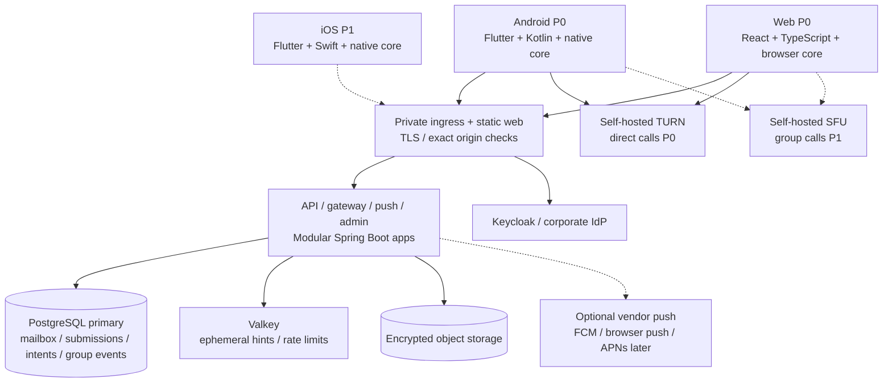

# Enclave — Diagram catalogue

All six original PNGs were inspected when enriching the specification. They are retained unchanged as the **v1.0 design snapshots**. For current behavior, use [specs](../specs.md), [ARF](../arf.md), and the maintained Mermaid sources below.

## Original diagrams

| Diagram | Description | Revision note |
|---|---|---|
| [1. Platform overview](enclave-1-overview-light.png) | Clients above the plaintext boundary; Kubernetes ingress, backend apps, IAM, PostgreSQL poolers, object storage, media, and shared platform operations | Android/web are P0; iOS/SFU are later. Durable outbox now lives with PostgreSQL. |
| [2. Backend services](enclave-2-services-light.png) | API/gateway/admin/push coordinate via shared data and Valkey; separate writer/replica poolers; Keycloak disable events | Push correctness no longer depends on Valkey-only jobs; worker leases/freshness checks use the primary. |
| [3. Messaging](enclave-3-messaging-light.png) | User HTTPS/WSS, encrypted object transfer, mailbox persistence, wake-up adapters, and no plaintext below endpoint boundary | Native/browser storage differ; durable submission/outbox closes commit-to-notify crash gaps. |
| [4. Calls](enclave-4-calls-light.png) | REST token issuance, client signaling/media paths, L4 media exposure, TURN and SFU participant removal | P0 direct calls use TURN; SFU group media is P1 with explicit E2EE/key-rotation gates. |
| [5. Identity and secrets](enclave-5-identity-secrets-light.png) | SSO/Keycloak, user-disable event intake, admin role access, OpenBao/PKI and secret synchronization | IdP identity is distinct from content identity; existing-device consent, binding, reconciliation, and reset risks are explicit. |
| [6. Platform operations](enclave-6-platform-ops-light.png) | Harbor/Git/Kyverno/ArgoCD, migration Job, CNPG/backup, telemetry collector, and SIEM audit export | ArgoCD phases/waves require a tested bootstrap/migration health gate; restored security state is fenced/reconciled. |

The plaintext boundary concerns user message/media plaintext and private content keys. Servers still hold infrastructure secrets, public keys, policies, group rosters, and routing metadata. Optional future archive endpoints are explicit separate recipients, not part of the relay confidentiality promise.

## Maintained diagrams

- [Current system context — Mermaid source](current-context.mmd): Android/web first, future iOS, local services, and optional external wake-ups.
- [Durable delivery — Mermaid source](durable-delivery.mmd): one transaction for submission/mailbox/intent, primary leases, provider retry, client commit-before-ack.

### Current system context

Render source with a pinned Mermaid toolchain when implementation tooling is added. Do not claim the historical PNGs were regenerated. Update both the editable source and this preview together.
