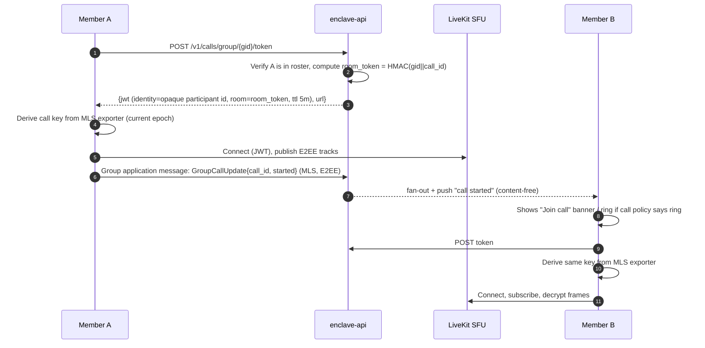

# Convo — Technical Specification

| Field | Value |
|---|---|
| Document | Technical specification |
| Status | Draft v1.3 — complete Android/web launch scope and verification contract |
| Updated | 2026-10-20 (implementation status §32) |
| Related | [Architecture](arf.md), [UI](UI.md), [Mobile](mobile.md), [Tasks](tasks.md), [Sources](sources.md), [Diagrams](diagrams/README.md) |
| Normative language | MUST, SHOULD, MAY as in RFC 2119 |

This document specifies **how** Enclave works: components, identities, cryptography (1:1 and group), the wire protocol, delivery semantics, REST and WebSocket APIs, data model, 1:1 and group calling, push notifications, and operational concerns. Code samples are illustrative and pinned to concepts rather than exact library versions; library APIs (notably `libsignal` and OpenMLS) evolve and MUST be validated against the pinned versions in the build.

---

## 0. Product scope and release contract

Enclave is a customer-operated, secure messaging platform with a friendly Android app and a full web client in the first release. iOS follows after Android/web stabilization; desktop packaging is optional later work. One deployment represents one organization/security domain. Development, test, and production have separate keys, storage, and identity issuers.

**Security promise:** message bodies, attachments, profiles, and call media are encrypted between authorized endpoints. The infrastructure still processes routing and operational metadata. A compromised endpoint or malicious web bundle can expose content available to that endpoint. The product combines useful interaction patterns from Signal, Telegram, and WhatsApp while retaining its own on-prem E2EE model; it does not claim network interoperability, exhaustive feature parity, or equivalent security assurance.

**Release contract:** every advertised product feature in this specification and README is required for Android/web general availability (GA). All feature requirements are P0 launch gates; former P1/P2 labels are superseded. Optional features must be delivered and verified at launch, with user/organization opt-in where specified. Internal milestones are implementation order, not feature deferrals or public partial releases. A prototype is not acceptance evidence. Unproven crypto, federation or capacity does not become a promise of feasibility: unresolved gates block launch or require an explicit user-approved scope revision. No milestone dates are asserted without a staffed estimate.

**Platform boundary:** Android and web remain the launch UI targets from the user's explicit platform instruction. All chat/security/administration features must work there; iOS and native desktop are separate client targets, not exceptions permitting feature deferral. The iOS requirement below documents that follow-on platform and is not an Android/web GA prerequisite. Feature verification, test procedures, acceptance criteria and release evidence are normative in §31.

### 0.1 Requirements and acceptance

| ID | Priority | Requirement and observable acceptance |
|---|---|---|
| FR-ID-01 | P0 | Organization URL/managed bootstrap, SSO with PKCE and policy-aware step-up; first-use Android and web users must supply an editable phone number. Address-book discovery requires separate explicit consent and remains optional. |
| FR-ID-02 | P0 | User-selectable Keycloak passwordless sign-in with WebAuthn/passkeys, enrollment and credential management; password/organization SSO remains available where policy permits (§4.1.1, AC-ID-02). |
| FR-ID-03 | P0 | Users can enable authenticator-app TOTP 2FA, including Google Authenticator; secure enrollment, fresh step-up for changes, recovery and organization-enforced MFA apply (§4.1.1, AC-ID-03/04). |
| FR-ARCH-01 | P0 | Backend ships as a Spring Modulith application with verified module boundaries, owned persistence, durable module events and an extraction contract (§1.2, AC-ARCH-01/02). |
| FR-DEV-01 | P0 | Link Android and web, list/revoke devices, show identity changes, and sync own sent/read state; new devices cannot silently obtain old history. |
| FR-MSG-01 | P0 | E2EE direct text, emoji, replies, reactions, mentions, edits, delete requests, encrypted files/photos, voice notes, delivery/read preferences, drafts, mute/archive/pin, and Note to self. Offline retries do not create duplicate messages. |
| FR-MSG-08 | P0 | Sealed-sender deliveries use a separate unauthenticated transport and abuse controls; authenticated WebSockets must never advertise sender anonymity. |
| FR-GRP-02 | P0 | E2EE groups: add/remove users, promote members to admin, demote admins under policy, transfer ownership, approve join requests, manage links/permissions, shared pins and moderation; targets of 1,000 accounts subject to §6/§30 limits. |
| FR-COM-01 | P0 | E2EE communities with admin-only announcement feeds, owner/admin/member roles, community membership, and separately permissioned linked discussion groups; no automatic subgroup-content access for community admins (§30). |
| FR-COM-02 | P0 | Optional per-announcement explicit acknowledgements, with revision-bound account dedupe, offline retry, and E2EE reports restricted to named authorized reviewers; independent of read receipts (§30.6). |
| FR-COM-03 | P0 | Versioned community welcome, rules acknowledgement, recommended eligible groups, and a privately synced newcomer checklist; onboarding never grants subgroup access or exposes old history (§30.7). |
| FR-MSG-02 | P0 | Shared message pins, explicit forwarding with destination review, safe basic formatting, message requests/blocking, media galleries, and private saved-message organization (§30.4). |
| FR-UX-02 | P0 | Rich encrypted group/community descriptions with purpose, safe links, rules references and contact people (§30.8). |
| FR-UX-03 | P0 | Private per-chat themes/wallpapers with accessible contrast and E2EE own-device preference sync (§30.8). |
| FR-GRP-03 | P0 | Search members/filter admins within authorized spaces; show locally computed active groups in common without a new social-graph directory (§30.8). |
| FR-MED-01 | P0 | Ordered photo albums with captions, stable per-photo references, upload recovery and one logical message/expiry boundary (§30.8). |
| FR-NOTIF-01 | P0 | Mentions-only notifications verified locally after decryption, plus timed conversation snoozing that restores prior settings (§30.8). |
| FR-UX-04 | P0 | First-unread catch-up, jump to latest, and return to saved position across restart without manufacturing read receipts (§30.8). |
| FR-MSG-03 | P0 | Bounded multi-message copy/forward/save/delete with per-item authorization, expiry checks and partial-result feedback (§30.8). |
| FR-UX-05 | P0 | Android swipe/long-press and web hover/focus/context-menu/keyboard actions with equivalent accessible controls (§30.8). |
| FR-CAL-01 | P0 | Android/web 1:1 audio/video with TURN fallback; microphone/camera denial, ringing on multiple devices, and network changes have explicit outcomes. |
| FR-CAL-05 | P0 | Group video, screen sharing, and P2P-to-SFU escalation, gated on E2EE compatibility and membership rotation evidence. Initial target: 50 participants. |
| FR-SEC-06 | P0 | Revoke authenticated account/device access immediately on commit, reject subsequent authenticated requests and all recipient fan-out, close existing connections within 60 s and attempt local wipe on next contact. Anonymous sealed-sender ingress has the explicit recipient-side freshness/residual contract in §5.4; offline erasure is not guaranteed. |
| FR-SEC-07 | P0 | Verify identity by QR/numeric fingerprint; verified identity replacement blocks sending until reconfirmed. |
| FR-UX-01 | P0 | Keyboard/screen-reader usable web app, TalkBack usable Android app, light/dark themes, English/Romanian localization, friendly empty/error/offline states. |
| FR-SRC-01 | P0 | Search local decrypted history and files, including Romanian diacritics; no query or result content reaches a server. |
| FR-ADM-01 | P0 | Separate administration for users, guests, devices, policies, health, and auditable actions; no conversation reading interface. |
| FR-OPS-01 | P0 | Install, upgrade, back up, and restore without SaaS; signed offline bundles and tested private-CA rotation. |
| FR-IOS-01 | Client follow-on | iOS native lifecycle, notifications, calling, storage, and accessibility reuse the established protocols; no dependency from Android/web milestones. |
| FR-EXT-01 | P0 | Polls, community events/RSVP, topics/threads, stickers, view-once media, quiet/scheduled sends, chat folders, history transfer, guest invitations, abuse reports, and advanced member restrictions (§30.4). |
| FR-EXT-02 | P0 | Encrypted recovery backup, independent key transparency, federation, explicitly visible archive/bot participants, and optional on-device assistance. |

### 0.2 Nonfunctional targets

| ID | Target | Verification boundary |
|---|---|---|
| NFR-SEC-01 | No service-held content keys or plaintext content | Inspect server databases, objects, traces, logs, push payloads, and media captures during the acceptance scenario. |
| NFR-REL-01 | Zero loss of acknowledged, unexpired envelopes on tested single-node failover in HA mode | Acknowledgement means durable commit under the selected synchronous replication policy; site loss follows the stated DR RPO. |
| NFR-PERF-01 | Healthy online delivery p95 ≤ 300 ms and p99 ≤ 1 s, acceptance-to-recipient durable receipt | Reference medium tier, intra-site RTT ≤ 50 ms, 20k sockets, measured direct/group mix; excludes offline clients and push provider delays. |
| NFR-AVAIL-01 | Messaging API availability ≥ 99.9% per calendar month | Valid supported requests, including failed planned upgrades; authentication and media are measured separately. |
| NFR-UX-01 | Usable first chat within 3 minutes in ≥ 90% of moderated new-user trials | Excludes organization account approval and unavailable identity/network services; test on Android and web separately. |
| NFR-A11Y-01 | Web WCAG 2.2 AA target; Android equivalent keyboard/assistive access | Automated checks plus manual core journeys; visual color alone never conveys security or delivery state. |
| NFR-DR-01 | Secondary-site RPO ≤ 5 min, RTO ≤ 1 h target | Measured quarterly with identity, secrets, ciphertext queues, objects, and safe protocol recovery. |

### 0.3 Deployment profiles

| Profile | Required connections | Notification behavior |
|---|---|---|
| Connected on-prem | All data/media hosted locally; allowlisted optional provider egress | Android UnifiedPush or opted-in FCM; web open-tab WebSocket, optional browser-vendor Web Push. |
| Restricted | Corporate LAN/VPN, private DNS/CA, local IdP/push/media | Android certified UnifiedPush distributor or approved foreground connection; web delivery while active. No vendor push. |
| Air-gapped | No internet route at runtime; offline registry/packages, local DNS/NTP/PKI/IdP | Same Android/web restrictions; closed browsers have no promised wake-up. Future iOS needs separately certified Local Push Connectivity. |

Federation is a launch feature in an explicitly enabled, mutually trusted on-prem profile (§30.9). Public phone-number discovery, SMS fallback, server-side plaintext content search/moderation, invisible recording and server-side AI remain out of product scope; they were never advertised product features. Feature richness MUST preserve the security promise; see §25 for feature semantics.

## Table of contents

0. Product scope and release contract
1. Components
2. Identifiers and addressing
3. Cryptographic foundations
4. Identity, authentication, and device lifecycle
5. 1:1 encryption (Signal Protocol)
6. Group encryption (MLS)
7. Attachments
8. Client-side storage and key protection
9. Transport and wire protocol
10. Delivery semantics
11. Message content types
12. REST API
13. Server data model
14. 1:1 calling
15. Group calling
16. Push notifications
17. Disappearing messages, edits, deletes, receipts
18. Search
19. Policies, administration, audit
20. Rate limiting and abuse controls
21. Observability
22. Error model
23. Testing strategy
24. Reference implementation notes
25. Feature behavior and state convergence
26. Durable submission, wake-ups, and backpressure
27. Identity, group authorization, and recovery hardening
28. Browser security and capability contract
29. Operations, privacy, and release gates
30. Direct chats, groups, communities, and launch features
31. Feature verification and launch acceptance

---

## 1. Components

| Logical module/adapter or external component | Tech | Responsibility | Sees plaintext content? |
|---|---|---|---|
| `enclave-gateway` | Spring Modulith gateway adapter (Java 21+, virtual threads), WebSocket | Persistent device connections, frame routing, mailbox drain | No |
| `enclave-api` | Spring Modulith REST adapters | Accounts, devices, prekeys, KeyPackages, groups roster/ACL, attachments, calls tokens, policies | No |
| `enclave-push` | Spring Modulith notification worker (no independent ingress) | Leases/retries durable PostgreSQL wake-up intents; optionally consumes `push:jobs` hints. Sends content-free UnifiedPush/optional FCM wakes; APNs and the separate local bridge follow the iOS client schedule. Only notification adapter initiates vendor push; shared runtime has allowlisted infrastructure egress, not per-module process isolation. | No |
| `enclave-admin` | Spring Modulith admin adapters + separate admin web UI | Admin console backend; aggregate metrics, policy, audit | No |
| Keycloak | Supported version pinned in release BOM | Account authentication, MFA, passkeys, federation, admin roles | No |
| PostgreSQL | Supported version pinned in release BOM (CloudNativePG) | Accounts, devices, keys, rosters, mailbox, audit | No (ciphertext only) |
| PgBouncer | CNPG Pooler | `rw` pooler (transaction mode) in front of the primary for all writers; `ro` pooler for freshness-tolerant aggregates/reads; push leases, authoritative checks, and outcomes use `rw`. Migrations bypass both. | No |
| Valkey (Redis-compatible) | Supported version pinned in release BOM | Presence keys, pub/sub signals (`mail:*`, `ctl:*`), optional `push:jobs` acceleration hints, rate limits, call room registry | No |
| Object storage | SeaweedFS / Garage / Ceph RGW (S3 API) | Encrypted attachment blobs | No |
| coturn | 4.6+ | TURN/STUN relay for 1:1 calls (and SFU fallback) | No (SRTP only) |
| LiveKit | Pinned launch server/SDK compatibility set | SFU for group calls | No (frame-encrypted media) |
| ntfy | Pinned certified version | Self-hosted UnifiedPush distributor for Android | No (empty payloads) |
| Android client | Flutter + native Kotlin adapters + Rust core | UI, native lifecycle, encrypted protocol/storage | **Yes** |
| Web client | React + TypeScript + browser Rust/WASM adapter, subject to feasibility gate | Accessible browser UI; local cryptography/storage; no plaintext backend | **Yes** |
| iOS client (client follow-on) | Flutter + native Swift adapters + Rust core | Separate client target; full feature contract and native extension certification apply | **Yes** |

The backend is a **Spring Modulith** application, deployed as one versioned Spring Boot runtime per replica at launch. API, gateway, push and administration are logical adapter/runtime responsibilities in that application, not separately owned microservices. Keycloak, database, object storage, TURN and SFU remain external infrastructure. Module extraction is a future operational option, not a prerequisite for feature availability.

### 1.1 How backend responsibilities communicate

Within a runtime, modules use declared in-process APIs for immediate queries/commands and typed domain events for asynchronous reactions. Do not call another module over HTTP/gRPC or reach into its repository/entity internals. Across replicas, durable PostgreSQL state remains authoritative and Valkey carries disposable wake/routing hints. External adapters may call configured infrastructure using bounded timeouts, retries and restricted egress.

| Channel | Mechanism | Carries | Guarantee |
|---|---|---|---|
| Module API | Explicit Spring Modulith named interfaces | Typed queries/commands without persistence leakage | Validated dependency direction; local transaction semantics declared |
| Domain event | Spring Modulith persistent event publication registry | Versioned event ID, aggregate ID/version, necessary metadata | Publication recorded with originating transaction; idempotent retryable consumers |
| Delivery intent | Messaging-owned PostgreSQL mailbox/outbox API | Ciphertext envelopes and content-free notification/control intents | Commit acceptance and required intent atomically (§26) |
| Replica hint | Valkey pub/sub/optional stream | Mailbox/control/intents ready | Best effort; periodic primary polling and revalidation recover loss |

Keycloak lifecycle events enter the identity module through an authenticated, deduplicated mTLS adapter, with periodic authoritative reconciliation (§27). LiveKit webhooks enter the calls module through a separately authenticated adapter. These infrastructure callbacks do not become module-to-module RPC.

### 1.2 Spring Modulith boundaries and extraction readiness

Declare application modules **identity, messaging, groups, communities, attachments, calls, notifications, policy, administration, audit, federation and integrations**. Shared ID/value types and versioned integration contracts are narrowly scoped; shared repositories or a catch-all shared business module are prohibited. Each module has internal domain/application/adapters and exports small named interfaces/events. Identity owns accounts/devices/prekeys; messaging owns submissions/mailboxes/delivery intents; groups/communities own their public admission/lifecycle mirrors; other modules own their corresponding records. Cryptographic private state stays in clients.

CI must run Spring Modulith `ApplicationModules.verify()` plus ArchUnit rules, module-scoped `@ApplicationModuleTest` and event `Scenario` tests. Reject cycles, undeclared dependencies, access to internal packages and cross-module repository/SQL writes. Generate module documentation from the verified model. Spring Modulith supplies verification, scoped testing and persistent event publication facilities; their exact APIs and failure behavior are pinned and tested against the [official reference](https://docs.spring.io/spring-modulith/reference/).

Event envelopes carry schema version, event ID, aggregate ID/version, causation/correlation IDs, creation time and sanitized data. Consumers deduplicate and handle version gaps, retry/backoff, poison events and retention explicitly; do not claim global ordering or exactly-once effects. The module event publication registry and per-device delivery outbox serve different guarantees: completing a local event listener cannot substitute for persisting a required notification intent. Register listeners once per logical consumer; multi-replica leasing/idempotency must prevent duplicate business effects.

Publish an extraction contract for each module: owner, public API/events, table ownership, transaction boundaries, consistency/authorization rules, latency and retry budget, and candidate external transport. Shared-database transactions are recorded coupling, not evidence of independent services. Launch includes a test of one noncritical notification/audit adapter in a separate test process using a versioned broker contract, with no production dual writes or new mandatory broker. A later extraction requires an ADR, owned database migration, transactional event externalization, consumer dedupe, reconcilable cutover and rollback. Replacing in-process calls with network calls alone is insufficient. AC-ARCH-01/02 define acceptance.

**Valkey key and channel catalogue**

| Name | Type | Written by | Read by | Content |
|---|---|---|---|---|
| `presence:{account}.{device}` | String, TTL 90 s | gateway (on connect, refreshed by pings) | gateway, api, admin before signalling | gateway pod id |
| `mail:{account}.{device}` | Pub/sub channel | gateway, api | the one gateway pod holding that device's socket | `1` (no content) |
| `ctl:{account}.{device}` | Pub/sub channel | api, admin | the gateway pod holding that device's socket | `REVOKED`, `KEYS_LOW`, `KEYPACKAGES_LOW`; hints never authorize an unsigned wipe |
| `ctl:broadcast` | Pub/sub channel | admin | every gateway pod | `POLICY_UPDATED` |
| `push:jobs` | Bounded stream, safe trim policy | outbox dispatch loop | consumer group `push-workers` | Opaque durable intent ID only; source of truth is PostgreSQL |
| `push:coalesce:{account}.{device}` | Expiring successful-attempt hint | push | push | Performance hint only; never proof that provider accepted a notification |

**Publishing rules and safety nets**

1. Persist envelopes and required push/control intents in the **same PostgreSQL transaction**. `afterCommit` may nudge dispatch but is never the only durable record.
2. Gateway/API signal online devices via `mail:*` after commit. A wake-up intent is also required for visible messages unless that device durably acknowledges within a short debounce. A stale presence key cannot suppress wake-ups indefinitely.
3. Workers lease intents with `FOR UPDATE SKIP LOCKED`, commit the lease before provider I/O, and persist success/retry outcomes. Worker restarts and a total Valkey loss are recovered by database polling.
4. Incoming calls have explicit type, TTL, and cancellation (§25); do not derive push type from a generic `urgent` Boolean. Security notices use their own policy. Receipts/typing do not wake devices.
5. All hints are content-free. Provider payloads use platform-required wrappers (§16), with no sender, group name, message body, or decryption key.

| Failure | Required outcome |
|---|---|
| Process dies immediately after mailbox commit | Committed outbox intent remains eligible; polling resumes wake-ups without a client reconnect. |
| Lost online signal | Connected gateway checks mailbox on keepalive; ordinary healthy recovery target is one 30 s interval. Network/server failure may take longer. |
| Worker dies before/after provider acceptance | Lease expires; retry may duplicate the push, never lose the message; client dedupe prevents repeated content/ringing. |
| Valkey unavailable or restored empty | Mailbox and intents remain durable; dispatch falls back to indexed PostgreSQL polling with bounded throughput. |
| Push token read is stale | Re-read current generation on primary; delete only the exact rejected token generation. |

**Why not Kafka.** Nothing here needs a distributed log. The mailbox needs per-device queues with point deletes (PostgreSQL), signals need sub-millisecond delivery to one specific pod (pub/sub), and push needs a small durable work queue (PostgreSQL intents, optionally accelerated by Valkey streams). Kafka is reconsidered only if a non-content domain-event backbone with many independent consumers is introduced (`arf.md` ADR-017).

---

## 2. Identifiers and addressing

| Identifier | Format | Scope | Notes |
|---|---|---|---|
| `account_id` | Application UUIDv4 | Immutable within deployment | Map a unique `(OIDC issuer, sub)` to this ID; never assume `sub` is a UUID. |
| `username` | `[a-z0-9._-]{3,32}` | Unique per deployment, mutable | Display/search handle. |
| `device_id` | uint32, 1..2^31−1 | Per account | Reserved before key bindings are signed; allocated monotonically; never reused. |
| `registration_id` | uint14 random | Per device install | Detects reinstall (stale sessions). |
| `DeviceAddress` | `account_id.device_id` | Global | Unit of delivery. |
| `group_id` | 32 random bytes (base64url) | Global | Opaque to server; equals MLS `group_id`. |
| `envelope_guid` | UUIDv7 | Global | Time-ordered; client dedupe key. |
| `message_id` | 16 random bytes | Inside ciphertext | Client-level message identity (edits/reactions reference it). |
| `call_id` | uint64 random | Per call | Carried inside E2EE CallMessages. |
| `room_token` | HMAC-SHA256 with typed, length-delimited context | SFU room name | Obscures raw group ID; operator correlation remains possible. |

The **unit of delivery is the device**, never the account. Every send fans out to an explicit list of device addresses.

---

## 3. Cryptographic foundations

### 3.1 Libraries

| Purpose | Library | Language | License |
|---|---|---|---|
| 1:1 protocol (PQXDH, Double Ratchet, sealed sender, fingerprints) | `libsignal` (`libsignal-protocol` crate) | Rust | AGPL-3.0 |
| Group protocol (MLS RFC 9420) | `openmls` + `openmls_rust_crypto` / `openmls_libcrux_crypto` | Rust | MIT |
| AEAD, HKDF, HMAC for app-layer crypto (attachments, storage, provisioning) | RustCrypto crates (`aes-gcm`, `hkdf`, `hmac`, `sha2`) | Rust | MIT/Apache |
| Password-based key derivation (desktop/web passphrase lock) | `argon2` | Rust | MIT/Apache |
| Frame encryption in calls | LiveKit client SDK E2EE (WebRTC encoded transforms) | Dart/Swift/Kotlin/JS | Apache-2.0 |

Protocol cryptography and transactional protocol state belong in the shared Rust core. Native Flutter uses a generated FFI facade; the React web client uses a browser-specific WASM/worker facade. Browser portability of the complete pinned dependency graph is an **M0 feasibility gate**, not an upstream guarantee. The backend contains public verification/parsing code but MUST NOT receive content decryption keys. General-purpose crypto libraries are permitted for TLS, signatures, token verification, and at-rest infrastructure encryption. [Upstream libsignal](https://github.com/signalapp/libsignal) documents its support boundary and change policy; see [sources](sources.md).

### 3.2 Primitives

| Use | Primitive |
|---|---|
| Identity keys (1:1) | Curve25519 key pair, XEdDSA signatures |
| Session key agreement (1:1) | PQXDH using the pinned libsignal profile; do not equate legacy Kyber wire formats with standardized ML-KEM |
| 1:1 message encryption | Double Ratchet; AES-256-CBC + HMAC-SHA256 (libsignal message format), HKDF-SHA256 |
| Post-quantum ratchet (1:1) | Sparse PQ / Triple Ratchet profile selected and interoperability-tested at M0; capability/version pinned, never silently downgraded (ADR-007) |
| MLS ciphersuite (classical baseline) | `MLS_128_DHKEMX25519_AES128GCM_SHA256_Ed25519` (0x0001) |
| MLS ciphersuite (launch PQ capability) | Reviewed supported hybrid PQ profile, selected by a launch-blocking ADR and interoperability gate; never claim a currently unproven suite exists |
| MLS signature keys | Ed25519, per device |
| Attachments | Versioned audited STREAM construction with 64 KiB chunks, unique nonces, authenticated final-chunk/length; SHA-256 of ciphertext |
| Local DB | SQLCipher (AES-256-CBC + HMAC-SHA512 page encryption) on native; app-layer AES-256-GCM on web |
| Device provisioning channel | X25519 ephemeral ECDH + HKDF-SHA256 + AES-256-GCM |
| Call media (1:1) | DTLS-SRTP (AES-GCM / AES_CM_128_HMAC_SHA1_80), fingerprints authenticated through E2EE signaling |
| Call media (group) | DTLS-SRTP hop-by-hop + AES-GCM frame encryption end-to-end with MLS-exported keys |

Post-quantum claims apply only to the certified direct-message and explicitly selected reviewed PQ MLS profiles. Classical baseline MLS and ordinary DTLS-SRTP direct-call key agreement remain classical; encrypted signaling alone does not make media key agreement post-quantum. PQ MLS feasibility/review is now a launch gate, not an assumed implementation.

### 3.3 Key hierarchy (per account)

```
Account Identity Key (IK, Curve25519)       shared by all devices of the account,
│                                           transferred only via provisioning channel
├── Device d1
│   ├── registration_id
│   ├── Signed PreKey (SPK, rotated every 7 days, signed by IK)
│   ├── One-time PreKeys (OPK x100, consumed once)
│   ├── Kyber PreKeys (one-time x100 + 1 last-resort, signed by IK)
│   ├── MLS signature key (Ed25519)  + DeviceBinding = signature_IK(canonical deployment/address/key-purpose/version transcript)
│   ├── MLS KeyPackages (x100, single-use baseline)
│   └── Local storage master key (hardware-protected)
├── Device d2 ... (same structure)
└── Profile Key (32 bytes AES-256-GCM key, shared with contacts/groups to decrypt profile)
```

The shared account identity key is the selected Enclave multi-device design: contacts see one safety number per account, not per device. Device-level authenticity comes from (a) IK signatures over device prekeys and MLS device bindings and (b) device-list change notifications (§4.6).

---

## 4. Identity, authentication, and device lifecycle

### 4.1 Two layers of identity

| Layer | Authority | Proves | Used for |
|---|---|---|---|
| Account authentication | Keycloak (OIDC) | "This person satisfied the configured account authentication policy." | Device registration, device linking authorization, admin console, REST calls requiring user presence |
| Cryptographic identity | Device-held keys | "This endpoint holds the account's IK / device keys." | All message encryption and verification |

Keycloak authenticates account actions; it does not supply E2EE keys. An additional device still needs existing-device consent and signed key bindings. An identity service or operator can attempt account reset/key substitution, affecting future traffic unless peers reject the identity change. No IdP reset recovers past plaintext by itself.

### 4.1.1 Passwordless, optional 2FA, and authentication assurance

**Launch requirement:** every supported client offers organization sign-in, optional **passwordless WebAuthn/passkey sign-in**, and user-enabled **TOTP two-factor authentication**, compatible with Google Authenticator and other certified TOTP apps. The organization may require stronger authentication or restrict credential types. User choice cannot lower an enforced minimum. Keycloak owns these credentials and authentication flows; Enclave does not implement password, WebAuthn or OTP verification. Upstream documents these mechanisms in the [Keycloak administration guide](https://www.keycloak.org/docs/latest/server_admin/index.html); the following settings are Enclave requirements and must be certified against the pinned release.

- **Choice and enrollment:** Settings → Privacy → Account authentication opens the trusted Keycloak Account Console/required action. Offer Add passkey, manage/remove named credentials, Enable authenticator 2FA and recovery options. Native clients use the system authentication browser; web uses the approved IdP redirect. Never embed a password/OTP collector in the chat UI. Bind OIDC state, nonce, PKCE and exact redirect URI; cancellation returns safely without creating a device.
- **Local native protection:** after verified passwordless enrollment, users may additionally require the OS fingerprint/device-PIN prompt when opening the app or selected conversations. Keycloak never receives the fingerprint or device PIN. Hidden conversation names, previews and media must not leak through ordinary lists, search, global galleries, notifications or navigation before local authentication. The current prototype's UI gate is distinct from the required reviewed Keystore storage/key-unwrapping gate.
- **Passwordless:** require WebAuthn user verification and the configured RP ID/origins. Certify platform and roaming authenticators on the supported client matrix. Do not require a cloud-synced passkey: restricted/air-gapped deployments certify local hardware/platform authenticators without external services. A missing/unsupported authenticator offers only policy-approved alternatives. No silent password downgrade or email/SMS magic-link assumption.
- **TOTP enrollment:** require recent authentication, display Keycloak's QR/secret only on its protected setup page, and verify a generated code before marking 2FA enabled. Default profile: six digits, 30-second period, SHA-1 for broad authenticator compatibility, at most one adjacent time step, reusable codes disabled, bounded attempts and Keycloak brute-force controls. Test the exact realm configuration rather than assuming defaults. QR secrets, OTP values and recovery codes never enter Enclave APIs, logs, analytics, URLs or support exports. TOTP works offline on the authenticator; signing in still requires access to the local IdP. Google Authenticator does not require Google SSO or a Google backend for local code validation.
- **Flow composition:** password + TOTP satisfies the configured two-factor path. When the user enables authenticator 2FA, the chosen passwordless path also requires TOTP; a passkey-only alternative must not bypass that preference. Where an organization explicitly certifies user-verified passkeys as a sufficient MFA alternative, disclose the policy and required assurance instead of claiming that a TOTP challenge occurred. Test both paths with SSO cookies and identity-provider brokering; an upstream SSO session cannot bypass local enforced factors.
- **Step-up and sessions:** the server validates signature, issuer, audience, expiry, mapped assurance (`acr` and certified method mapping), and recent authentication time for enrollment/linking, identity reset, credential changes and privileged actions. Merely requesting an `acr_values` value or receiving a token is insufficient. Sensitive operations require authentication within 5 minutes and the action's assurance level. Existing device credentials have their own lifecycle; enabling/changing 2FA does not rotate E2EE keys or implicitly revoke already linked devices. Show an explicit Review/revoke devices action and apply organization reauthentication/grace policy.
- **Recovery and disabling:** support the pinned Keycloak recovery-code flow and audited helpdesk recovery when allowed. Recovery codes are one-use; replacing them invalidates the prior set. Require fresh permitted step-up to remove a passkey, replace TOTP or disable optional 2FA; reject disabling when organization policy requires it. Warn before removing the last usable method, provide a verified alternative/recovery route, and notify the user of credential changes. Helpdesk reset is scoped, reasoned and audited; it must not silently bypass a required factor for routine sign-in.
- **E2EE boundary:** passwordless, TOTP and account recovery prove account access only. Existing-device approval is still required to link encryption identity. An account-only reset cannot decrypt history, import old protocol state or impersonate an unchanged verified identity. A fresh identity is explicitly announced to peers. Authentication recovery codes, client backup recovery keys and browser storage-lock passphrases are distinct secrets with distinct UI.

**Verification:** AC-ID-01–05 in §31 cover enrollment, optional/enforced policy, passwordless + TOTP combinations, replay/expiry, recovery, outages and device/history separation. ID-01/02 and SEC-01 own the evidence.

### 4.2 Device credentials

Production launch uses a **versioned device proof-of-possession credential** for authenticated REST and WebSocket setup (§30.9), separate from Keycloak authentication and account E2EE keys. The device generates a signing key, binds its public key to the reserved deployment/account/device address and proves possession during atomic enrollment. The server stores only the public verification key, algorithm/profile version, key generation and revocation status. Native platform-backed and browser-bound keys have separately certified assurance.

Every authenticated device request binds method, canonical path, body digest, device/deployment, request ID, expiry and a single-use server nonce. A reviewed standard-compatible profile, canonicalization vectors, nonce/retry behavior and native/browser interoperability are launch gates, not permission to invent cryptography. Key rotation/revocation is atomic and auditable. Browser socket tickets remain single-use/origin-bound and require possession at issuance/upgrade. The historical static `device_secret`/Basic-only proposal is superseded and cannot authenticate production launch requests. Sealed anonymous ingress is a separate recipient-authorized path (§5.4), not device authentication.

Keycloak remains responsible for fresh user authentication/step-up, while device possession is independently revocable and suited to long-lived connections. A Keycloak passkey is not reused as an arbitrary HTTP signing oracle. AC-ID-06 tests proof binding/replay/key rollover; ID-01 and PRIV-02 own implementation.

### 4.3 First device registration

```mermaid
sequenceDiagram
    autonumber
    participant U as User
    participant C as Client (enclave-core)
    participant K as Keycloak
    participant A as enclave-api
    U->>C: Open app, "Sign in with SSO"
    C->>K: OIDC Auth Code + PKCE (Android system browser / web redirect; iOS session later)
    K-->>C: id_token, access_token (configured assurance satisfied)
    C->>C: Generate IK, registration_id, SPK, 100 OPK, 100 Kyber + last-resort,<br/>MLS sig key, 100 KeyPackages, profile key, device signing key
    C->>A: POST /v1/devices/reservations (Bearer access_token)
    A-->>C: App account_id + reserved device_id + single-use reservation
    C->>C: Sign binding; persist pending enrollment + private keys before submit
    C->>A: POST /v1/devices/primary (Bearer access_token)<br/>{identity_key, registration_id, spk, opks, kyber_pks, mls_binding, key_packages, device_signing_public_key, registration_proof, device_name_enc}
    A->>A: Verify token, verify IK signatures on SPK/Kyber/binding,<br/>ensure no existing devices (else 409 -> link flow)
    A-->>C: 201 {device_id: reserved_id, device_list_version}
    C->>C: Mark pending enrollment accepted; open WebSocket
```

Android or web may be the first device. Web first-device creation requires explicit browser-trust acknowledgement and certified persistent encrypted storage; it cannot claim the native trust tier. There is no Android-phone prerequisite for web sign-in.

If the account already has devices, `POST /v1/devices/primary` returns `409 ACCOUNT_HAS_DEVICES` and the client offers (a) link via existing device or (b) **re-register** (new IK; all contacts will see a safety number change). Re-registration requires a Keycloak step-up (re-authentication + MFA) and is audit-logged.

### 4.4 Linking an additional device (QR provisioning)

The new device must obtain the account IK and profile key without the server learning them. An existing Android device scans the QR; an existing browser can scan or approve an equivalent session challenge only after comparing the transcript fingerprint on both devices. Manual pairing must preserve the same key/session binding and consent, not bypass it.

```mermaid
sequenceDiagram
    autonumber
    participant N as New device
    participant A as enclave-api
    participant G as enclave-gateway
    participant P as Primary/existing device
    participant U as User
    N->>N: Keycloak login (step-up MFA)
    N->>N: Generate ephemeral X25519 (eN)
    N->>A: POST /v1/provisioning/sessions (Bearer token, eN_pub)
    A-->>N: {provisioning_id, reserved_device_id, challenge, ws_url}
    N->>G: Open single-use authenticated provisioning WebSocket
    N->>U: Show QR/manual pairing challenge bound to deployment + session + eN + reserved address
    P->>P: User scans QR, confirms "Link Chrome on Linux?"
    P->>P: Generate eP; approve canonical bound transcript (§27.1)
    P->>P: K = HKDF(ECDH(eP,eN), transcript-bound context)
    P->>A: POST /v1/provisioning/sessions/{pid}/message<br/>{eP_pub, AES-GCM_K(ProvisionMessage)}
    A->>A: Store expiring ciphertext relay item + durable intent
    Note over A,G: Gateway reads shared relay state; no direct API-to-gateway call
    G-->>N: ProvisionMessage ciphertext
    N->>N: Decrypt: {IK pair, account_id, profile_key, provisioning_code, history_transfer_offer?}
    N->>N: Generate keys; sign bound address; persist pending enrollment before submit
    N->>A: POST /v1/devices/link {provisioning_code, keys...} (Bearer token)
    A->>A: Verify provisioning_code (single use, 10-min TTL, bound to account), verify signatures
    A-->>N: 201 {device_id: k}
    A->>A: Commit device-list version + own-device notices
    Note over A,G: Contacts compare signed lists on next send; no contact graph stored
    N->>N: Verified external join or authorized Add/Welcome (§6.6)
```

`ProvisionMessage` (protobuf, encrypted):

```protobuf
message ProvisionMessage {
  bytes identity_key_public  = 1;
  bytes identity_key_private = 2;
  string account_id          = 3;
  bytes profile_key          = 4;
  string provisioning_code   = 5;   // server-issued to the primary, proves primary consent
  bool read_receipts         = 6;
  HistoryTransferOffer history = 7; // optional (§4.5)
}
```

The `provisioning_code` is requested by the primary from `POST /v1/devices/provisioning-code` with the bound session/transcript (authenticated with its device credential), proving consent to exactly that destination and reserved address. The server requires both a valid Keycloak token for the account **and** a code issued to an existing device of the same account.

### 4.5 History transfer (launch, user opt-in)

Device-to-device only. The primary exports the last N days (policy, default 30) of messages, encrypts them with a fresh 256-bit key into an archive blob, uploads it as an attachment (§7), and sends the key and pointer inside the `ProvisionMessage`. The blob is deleted after download or 1 hour. The server never stores history in a decryptable form.

### 4.6 Device list integrity

- Every change increments a monotonic device-list version and produces durable notices for the account’s own devices. Contacts compare fetched signed snapshots with their local snapshot before sending; the server does not keep a direct-conversation/contact graph to distribute notices. A server signature alone does not prevent a malicious operator from presenting inconsistent lists.
- Clients render “Ana linked a new device” after comparing contact lists, and a high-priority own-account notice with the locally decrypted device label where available; do not disclose an owner-private encrypted device name to contacts.
- Clients refuse to encrypt to a device whose SPK/Kyber/MLS binding signature does not verify under the contact's known IK.
- Launch: independently witnessed key transparency (§19.4; supersedes ADR-012 staging).

### 4.7 Device revocation

Triggers: user unlinks, admin revokes, Keycloak user disabled (event listener SPI → `enclave-api` webhook), inactivity expiry.

1. `devices.revoked_at` set and credential invalidated in one transaction; after commit the api (or admin) publishes `REVOKED` on `ctl:{account}.{device}`, and the gateway pod holding that socket closes it with code `4401 DEVICE_REVOKED`.
2. Prekeys, KeyPackages, push tokens deleted; mailbox purged for that device.
3. For each MLS group containing the device: server marks the group `pending_removal` (§6.7) and refuses new application messages for that group until a member commits the removal.
4. `DeviceListChanged` is emitted.
5. If the device reconnects with a valid TLS session but revoked credential, the server rejects access with `DEVICE_REVOKED`; an honest client clears local credentials, keys, history, and caches. Unauthenticated or unsigned instructions MUST NOT erase local state. Remote wiping remains best effort (FR-SEC-06).

---

## 5. 1:1 encryption (Signal Protocol)

### 5.1 Session establishment (PQXDH)

To send to account B for the first time, client A:

1. `POST /v1/keys/{B}/claim` with the desired active device selector returns a **pre-key bundle per device** of B:
   `{device_id, registration_id, identity_key, signed_prekey{id,pub,sig}, one_time_prekey{id,pub}?, kyber_prekey{id,pub,sig}}`.
   A replay-safe claim ID returns the original bundle on retry within its short TTL; a new claim atomically consumes one OPK and one one-time Kyber key per device (falling back to the last-resort Kyber key when exhausted).
2. A verifies SPK and Kyber signatures under B's IK. If B's IK differs from a previously stored IK, A MUST surface an identity-change notice; if B was **verified**, sending is blocked until the user re-confirms.
3. A runs PQXDH per device via `SessionBuilder::process_prekey_bundle` and stores a session per `(B, device_id)`.
4. The first message to each device is a `PreKeySignalMessage` carrying A's IK, ephemeral key, Kyber ciphertext, and used prekey IDs.

The shared secret derivation is (per PQXDH): `SK = KDF(DH(IK_A,SPK_B) ‖ DH(EK_A,IK_B) ‖ DH(EK_A,SPK_B) ‖ DH(EK_A,OPK_B)? ‖ KEM_SS)`, providing hybrid classical + post-quantum security for the initial key.

### 5.2 Ongoing messages

Each subsequent message uses the Double Ratchet: a symmetric-key ratchet per message (forward secrecy) and a DH ratchet each round trip (post-compromise security). If enabled in the pinned libsignal version, the sparse post-quantum ratchet adds periodic ML-KEM-based ratchet steps (ADR-007).

### 5.3 Multi-device fan-out ("Sesame")

A message from device A1 to account B is encrypted separately for:

- every active device of B, and
- every other active device of A (as a `SyncMessage{sent}` so A's other devices show the outgoing message).

The `SendRequest` lists each device and its `registration_id`. The server validates against the current device list and returns `409 DEVICE_MISMATCH` with `missing`, `extra`, and `stale` device IDs. The client then fetches bundles for missing devices, drops sessions for extra devices, re-establishes sessions for stale ones, and retries. This loop is the backbone of multi-device correctness.

### 5.4 Sealed sender (P0, FR-MSG-08)

- Each device periodically fetches a **sender certificate** from `GET /v1/certificate/sender`: `{account_id, device_id, identity_key, expires(24h)}` signed by the deployment's **server certificate**, itself signed by an offline **trust root** whose public key is compiled into the client build for that deployment.
- Sender encrypts the inner Signal message plus the certificate in an `UnidentifiedSenderMessage` to the recipient's IK.
- Delivery authorization uses the exact unidentified-access construction supported by the pinned libsignal integration, with reviewed vectors; no hand-written AES formula substitutes for that protocol.
- This feature uses an isolated REST endpoint without device authentication/proofs, cookies, or an authenticated WebSocket. Sender certificates and recipient access checks are verified as specified by the selected profile.
- Sealed delivery is available at launch through the separate route. Authenticated E2EE delivery remains an explicit policy mode with honest sender-metadata disclosure. The service can still correlate source IP, request timing, and credential issuance; do not promise anonymity.

**Revocation boundary:** sealed ingress cannot identify a sender hidden inside recipient ciphertext. Active account/device checks apply to certificate issuance/renewal and authenticated requests, and to the receiving device at ingress; they cannot be claimed as sender checks on the anonymous submission. A holder of existing recipient access material may still deposit rate-limited ciphertext after sender revocation, until that access material is rotated or the route otherwise refuses it. Certificate validity alone is not current sender authorization.

Before committing a newly processed sealed message as application content, emitting application receipt or displaying/alerting, the recipient verifies the sender identity/device against authoritative authenticated lifecycle status with a maximum **60-second freshness bound**. Certify a signed/status-verified device-list generation and local monotonic freshness check; stale/missing/unreachable status quarantines new sealed content without an alert until revalidation. A cache within the permitted 60-second interval creates an explicit bounded residual acceptance window; hardened policy may require an online status check per processing batch. Newly inactive senders' unprocessed envelopes remain quarantined even if originally sent earlier; already retained authorized local history is unaffected. Explain this delivery tradeoff. Remote deployments use the same trusted/fresh lifecycle evidence or fail closed.

Status lookups expose additional account/timing metadata to the queried deployment; do not claim sealed transport prevents that correlation. The reviewed profile must define certificate-time validation for delayed envelopes separately from lifecycle freshness. AC-SEC-06 tests retained credentials after sender revocation, cache expiry, recipient offline processing and recipient/UAK revocation. No anonymous queue-admission cutoff or forced deletion of a recipient's copies is promised. PRIV-01 and independent review must validate this composition before launch.

### 5.5 Padding

Plaintext `Content` protobufs use a reviewed reversible pad-to-bucket profile (baseline 160-byte buckets, with unambiguous terminator and boundary vectors) before encryption, so ciphertext length reveals only coarse size buckets. Attachments are padded to the next size bucket (`max(541, 1.05^ceil(log_1.05(size)))`).

### 5.6 Safety numbers

`fingerprint = libsignal NumericFingerprintGenerator(iterations=5200, version=2)` over `(account_id_A, IK_A, account_id_B, IK_B)`, displayed as 60 digits and a scannable QR. Verified status is stored locally and synced to own devices via `SyncMessage{verified}`.

---

## 6. Group encryption (MLS)

### 6.1 Why MLS for groups

Signal's Sender Keys require O(N) pairwise messages to rekey after a removal and offer weaker post-compromise security. MLS provides O(log N) rekeying via a ratchet tree, formally analyzed security, and an IETF standard (RFC 9420). Targets: 1,000 interactive accounts at P0, 5,000 announcement accounts at P0. The real MLS size is the number of devices: enforce 5,000 and 25,000 leaves respectively, and publish benchmarked limits. Tree work can grow with proposal batches and sparse trees; full delivery still costs O(number of recipients). See ADR-006 and §27.

### 6.2 Model

- Every **device** of every member account is an MLS leaf (client).
- Leaf credential: `BasicCredential(identity = "account_id.device_id")` plus the `DeviceBinding` (IK signature over the canonical deployment/address/key-purpose/version transcript including the leaf signature key) carried in a custom leaf node extension `enclave_device_binding (0xF0A1, provisional private-use value subject to registry/capability validation)`.
- On processing any Add or external join, clients MUST verify the DeviceBinding against the account's known IK; failure means reject the commit and alert.
- `group_id` is random 32 bytes, generated by the creator.

### 6.3 Server role: Delivery Service (DS)

MLS requires that all members agree on the order of handshake messages. The server acts as an **ordering Delivery Service**:

| Message type | MLS framing | Server visibility | Server action |
|---|---|---|---|
| Commit | `PublicMessage` (signed, content visible to DS) | Proposal types, affected leaves, epoch, sender leaf | Validate epoch, validate sender authorization against ACL, update roster, fan out |
| Proposal (standalone) | `PublicMessage` | Same | Store as pending for the epoch, fan out |
| Application message | `PrivateMessage` | Epoch and group only | Fan out to current roster |
| Welcome | `Welcome` (HPKE to KeyPackage) | Recipient KeyPackage refs | Deliver to the specific new devices |
| GroupInfo (for external joins) | Signed `GroupInfo` with `ratchet_tree` extension | Public tree | Store latest per group |

Commits are sent as `PublicMessage` deliberately: the server must maintain the routing roster anyway (it cannot fan out without knowing recipient devices), and public commits let it validate membership changes and enforce role ACLs. Path secrets inside the UpdatePath remain HPKE-encrypted to tree nodes, so the server learns membership changes but never any group secret. Group metadata (name, avatar, description, disappearing timer) is sent in encrypted application messages (`GroupMetadataUpdate`, §11), not in the GroupContext, so the server never sees it.

### 6.4 Epoch ordering protocol

```
Client C (member, local epoch e) wants to commit:
  1. Build commit for epoch e (proposals by value + any pending by reference).
  2. POST /v1/groups/{gid}/commits {epoch: e, commit, welcome?, group_info}
  3. Server, in a single transaction:
       UPDATE mls_groups SET epoch = epoch + 1, group_info = :gi
        WHERE group_id = :gid AND epoch = :e AND status = 'active'
       -> 0 rows: 409 EPOCH_CONFLICT {current_epoch}
       -> 1 row: validate ACL, apply roster delta, enqueue commit to all
                 devices in OLD roster (including C), enqueue Welcome to new devices
  4. C merges its pending commit only after matching acceptance is known.
     A lost response requires commit-ID/digest lookup (§27.3), not a new commit.
     On a confirmed competing 409: discard pending commit, process accepted events,
     then rebuild if still needed. Sequence and role-state rules in §27 apply.
```

Application messages are tagged with their epoch. Process commits and applications through the durable group sequence (§27). Keep only bounded past-epoch **receive** state for reordering: default 2 epochs / 5 minutes. Expire it promptly; long-offline devices need retained commits or explicit resynchronization, not indefinite historical secrets. Revocation cannot stop a sender that is offline or using a stale epoch from encrypting; the server rejects such submissions until refreshed.

### 6.5 Group lifecycle operations

| Operation | Who may perform | MLS operation | Notes |
|---|---|---|---|
| Create group | Any account | Creator builds group, adds members' devices using claimed KeyPackages (`POST /v1/keypackages/claim`) | Server creates roster, ACL (creator = owner) |
| Add member | Admin/owner | Commit with Add proposals for every device of the new account | Server checks committer role |
| Remove member | Owner; admin for ordinary members | Commit with Remove for every leaf of the account | Admin peers/owner are protected by §30.2; removal may be paired with a ban/revoked invite. |
| Leave | Member | Standalone Remove proposal for own leaves; server marks `pending_commit`; next online member/admin commits it (auto-commit) | Clients auto-commit pending proposals they receive when they are the designated committer (lowest active `account_id.device_id` among online admins, falling back to any member after 30 s) |
| Key update | Any member | Empty commit with UpdatePath | Every device MUST self-update at least every 7 days and after app restore |
| Promote member to admin | Owner/admin under authenticated permissions | MLS commit updates role state, mirrored atomically | Cannot create an owner or grant permissions the actor lacks (§30.2). |
| Demote admin / transfer ownership | Owner | MLS commit updates role/owner state | Final-owner protection and explicit owner acceptance apply (§30.2). |
| Delete group | Owner | REST delete; server sends `GroupDeleted` system envelope to all | Clients archive locally |

### 6.6 Multi-device join and bounded state recovery

A newly approved device joins its account's existing groups with verified external commits only if the reviewed group profile supports credential binding, authenticated roles, and stale-leaf replacement. Otherwise an authorized member adds the device with a fresh KeyPackage/Welcome.

1. Fetch authorized group references and GroupInfo, corroborating the membership/role context with a trusted existing device where possible.
2. Verify credentials and supported extensions; construct a profile-valid join using the reserved active device address.
3. Submit with idempotent commit ID and expected epoch/sequence; server admission checks use authoritative device status and the mirrored role state.
4. Existing members independently validate the join under the previous authenticated group policy before accepting it.

Missing local state is not proof of a fork. First replay retained ordered events; after the catch-up window expires, use explicit verified rejoin. External commits alone cannot establish which divergent branch is correct. Quarantine genuine split views for peer corroboration or deliberate group recreation (§27.3). No server-held group secrets or automatic historical plaintext recovery are available.

### 6.7 Device revocation in groups

The server cannot commit (it is not a member). On revocation:

1. Server durably marks every affected group `pending_removal = {leaf refs}`, stops delivery to the device, and blocks application sends for affected groups until removal. Server availability gating is defense in depth, not a source of cryptographic authorization.
2. The next sender receives `409 PENDING_REMOVAL {leaves}`. An owner/admin must endorse/commit removal, unless the authenticated group policy explicitly delegated device-revocation removal authority to other members (§27.2). Sending remains blocked while no authorized committer is available; the server flag alone grants no role.
3. Honest clients encrypt new content under the accepted removal epoch; removed devices cannot derive its secrets. Ciphertext already encrypted under the old epoch remains exposed to members of that epoch, so stale submissions are rejected and re-encrypted after catch-up. Peers validate any removal authority as described in §27.

### 6.8 Large announcement groups

Standalone groups can use admin-only posting in P0, and every community announcement feed does so by default (§30). For launch-certified large announcement spaces (>1,000 accounts): clients enforce posting against authenticated role state, the server applies mirrored admission checks, and clients defer self-updates (randomized within 7 days) to limit commit storms. Commit fan-out cost is O(N) envelopes but each envelope is small; typical single-leaf tree updates scale logarithmically, while batched changes and sparse trees require measurement.

### 6.9 KeyPackages

- Each device uploads 100 single-use KeyPackages. Baseline Enclave refuses reuse; exhaustion waits for replenishment. A last-resort reuse extension is not assumed to be part of RFC 9420 or interoperable OpenMLS support; any future reuse profile requires its own review.
- `POST /v1/keypackages/claim {account_ids[]}` returns one KeyPackage per active device, consuming one-time packages atomically.
- Server sends `KEYPACKAGES_LOW` to a device when fewer than 20 remain.
- Lifetime: 90 days; devices rotate before expiry.

---

## 7. Attachments

### 7.1 Upload

```
1. Client: plaintext P, generate a fresh key K (32 B); obtain the nonce/header from the reviewed versioned STREAM implementation (§27).
2. Encrypt P using that construction with 64 KiB chunks; authenticate stream version, original length, chunk index, and final marker.
3. Pad ciphertext to bucket size (§5.5).
4. digest = SHA-256(ciphertext)
5. POST /v1/attachments/upload-form {size} -> {attachment_id, upload_url (presigned PUT, 15 min), resumable: optional multipart upload session (P0)}
6. PUT ciphertext to object storage.
7. Message carries AttachmentPointer{attachment_id, key K, versioned encryption header, digest, original size, content_type, file_name?, thumbnail(encrypted inline), blurhash, width, height, duration}.
```

### 7.2 Download

`GET /v1/attachments/{id}` → presigned GET URL (5 min). Client downloads, verifies digest **before** decryption, decrypts, verifies GCM tags per chunk, strips padding.

### 7.3 Server rules

- Objects stored in a bucket with no public access, server-side encryption optional (defense in depth only).
- Lifecycle: delete after 30 days (policy). Download counts are not tracked per recipient (metadata minimization); expiry is time-based.
- Content scanning is impossible server-side by design. Optional client-side scanning hooks are explicitly out of scope.

---

## 8. Client-side storage and key protection

| Platform | DB | DB key protection | Notes |
|---|---|---|---|
| Android | SQLite + SQLCipher (via `sqlcipher_flutter_libs`, accessed through `enclave-core`) | 256-bit DB key wrapped by Android Keystore (StrongBox if available), `setUserAuthenticationRequired` optional by policy | `FLAG_SECURE` per policy |
| iOS | SQLite + SQLCipher in App Group container | Keychain item `kSecAttrAccessibleAfterFirstUnlockThisDeviceOnly`, access group shared with Notification Service Extension | NSE must open DB read/write with file coordination (§16.3) |
| Desktop | SQLite + SQLCipher | OS keystore (Keychain / DPAPI / libsecret) or user passphrase (Argon2id m=64 MiB, t=3) | Passphrase required where OS keystore unavailable |
| Web | IndexedDB encrypted records; SQLite WASM/OPFS is optional after worker/concurrency validation | Reviewed record AEAD and passphrase/WebAuthn-PRF key wrapping where supported; non-extractable WebCrypto keys do not prevent hostile same-origin code from using them | Lower trust tier ([UI](UI.md) §8 and §28) |

The Rust core owns the logical schema and all protocol-state reads/writes through native/browser storage adapters of protocol state (sessions, prekeys, MLS state) to guarantee atomicity: **decrypt → persist plaintext + new ratchet state in one transaction → ack to server.** Never ack before commit.

Core local tables (simplified): `identity`, `sessions`, `prekeys`, `signed_prekeys`, `kyber_prekeys`, `mls_state` (OpenMLS storage provider), `contacts`, `conversations`, `messages`, `messages_fts` (FTS5), `attachments`, `reactions`, `receipts`, `call_log`, `outbox`, `processed_envelopes` (dedupe, 30-day window).

---

## 9. Transport and wire protocol

### 9.1 Endpoints

| Channel | URL | Auth |
|---|---|---|
| REST | `https://chat.<org>/v1/...` | Device credential (Basic) or Keycloak bearer (registration/linking/admin) |
| WebSocket | `wss://chat.<org>/v1/ws` | Device credential in `Authorization` header (native) or single-use ≤ 30 s exact-origin/device-bound `Sec-WebSocket-Protocol` ticket (web) |
| Provisioning WS | `wss://chat.<org>/v1/provisioning/ws` | Short-lived single-use ticket bound to the authenticated provisioning session; no long-lived URL secrets |
| TURN | `turns:turn.<org>:443?transport=tcp`, `turn:turn.<org>:3478?transport=udp` | Ephemeral HMAC credentials |
| SFU | `wss://sfu.<org>` | LiveKit JWT issued by `enclave-api` |

TLS 1.3 for client-facing HTTPS/WSS. Native clients pin approved SPKI keys via an authenticated configuration bundle with current/next overlap. Browsers use OS/browser certificate trust and cannot enforce native-style SPKI pinning from JavaScript. Private CA installation is an organization prerequisite. Internal TLS is required; see §28 and ARF deployment guidance.

### 9.2 WebSocket framing

Binary frames carrying protobuf. Request/response multiplexed by `request_id`. The following excerpts define field intent; FND-01 supplies the complete schema/types and generated compatibility fixtures.

```protobuf
syntax = "proto3";
package enclave.ws.v1;

message ClientFrame {
  uint64 request_id = 1;
  reserved 3, 7;                   // sealed WS and old typing relay are not P0 operations
  oneof body {
    SendRequest send           = 2;
    Ack ack                    = 4;
    GroupSendRequest group_send = 5;
    Ping ping                  = 6;
    // Encrypted typing uses send with transient_ttl_seconds.
  }
}

message ServerFrame {
  uint64 request_id = 1;            // 0 for server-initiated
  oneof body {
    Envelope envelope          = 2;
    SendResult send_result     = 3;
    QueueEmpty queue_empty     = 4;  // drain complete
    Directive directive        = 5;  // KEYS_LOW, KEYPACKAGES_LOW, WIPE, DEVICE_LIST_CHANGED, POLICY_UPDATED
    Pong pong                  = 6;
    Error error                = 7;
  }
}

message Envelope {
  enum Type {
    UNKNOWN = 0;
    CIPHERTEXT = 1;
    PREKEY_MESSAGE = 2;
    UNIDENTIFIED_SENDER = 3;
    MLS_PRIVATE = 4;       // group application message
    MLS_COMMIT = 5;
    MLS_WELCOME = 6;
    MLS_PROPOSAL = 7;
    SERVER_EVENT = 8;      // server-signed system events (DeviceListChanged, GroupDeleted)
  }
  Type type = 1;
  bytes guid = 2;                   // UUIDv7
  string source_account = 3;        // empty for UNIDENTIFIED_SENDER
  uint32 source_device = 4;
  bytes group_id = 5;               // MLS types only
  uint64 epoch = 6;                 // MLS types only
  bytes content = 7;
  uint64 server_timestamp = 8;
  bool urgent = 9;                  // priority hint, not notification kind
  uint64 group_seq = 10;            // required MLS processing sequence
  uint64 expires_at = 11;           // admission deadline / TTL in milliseconds
}

message SendRequest {
  string destination_account = 1;
  repeated DeviceMessage messages = 2;
  uint64 client_timestamp = 3;
  bool urgent = 4;
  reserved 5;                       // former online_only flag: not a P0 ephemeral path
  bytes submission_id = 6;           // 128 random bits; idempotent within origin
  uint64 device_list_version = 7;
  NotificationKind notification_kind = 8;
  uint32 transient_ttl_seconds = 10; // bounded encrypted typing/ICE; no push
}

message DeviceMessage {
  uint32 device_id = 1;
  uint32 registration_id = 2;
  Envelope.Type type = 3;
  bytes content = 4;
}

message GroupSendRequest {
  bytes group_id = 1;
  uint64 epoch = 2;
  bytes mls_private_message = 3;    // one ciphertext for all members
  bool urgent = 4;
  bytes submission_id = 5;
  NotificationKind notification_kind = 6;
}

enum NotificationKind { NONE = 0; MESSAGE = 1; CALL = 2; SECURITY = 3; }

message SendResult {
  bool ok = 1;
  repeated uint32 missing_devices = 2;
  repeated uint32 extra_devices = 3;
  repeated uint32 stale_devices = 4;
  string error_code = 5;            // EPOCH_CONFLICT, PENDING_REMOVAL, RATE_LIMITED, ...
}

message Ack { repeated bytes guids = 1; }
```

Group application messages are a single MLS ciphertext; the server fans out the same bytes to every roster device (excluding the sender device). This is the major bandwidth advantage of MLS over pairwise fan-out.

### 9.3 Keepalive and reconnection

- Client sends `Ping` every 30 s (foreground) / relies on OS push in background; server closes after 90 s of silence.
- Each `Ping` refreshes `presence:{account}.{device}` and makes the gateway run an indexed `EXISTS` on the device's mailbox; if anything is pending it drains immediately. This bounds the cost of a lost `mail:*` signal to one keepalive interval (§1.1).
- Reconnect with exponential backoff (1 s → 60 s, full jitter). On reconnect the server drains the mailbox oldest-first, then sends `QueueEmpty`.
- Graceful pod shutdown: gateway sends close code `4100 RECONNECT` with randomized delay hint to spread reconnect storms.

---

## 10. Delivery semantics

| Property | Guarantee |
|---|---|
| Durability | A `SendResult{ok}` means the envelope is committed to PostgreSQL (synchronous replication in HA mode). |
| Delivery | At-least-once per device. Envelope deleted only on device `Ack`. |
| Deduplication | Client keeps `processed_envelopes(guid)` for 30 days; duplicates are acked and dropped. |
| Ordering | Mailbox pagination uses stable `(server_ts, guid)` with recipient scope. MLS handshake/application processing follows a persisted per-group sequence; display uses bounded sender time with stable IDs (§27). |
| Expiry | Undelivered envelopes expire after 30 days (policy). Sender is not notified (no metadata leak); delivery receipts simply never arrive. |
| Store-then-notify | The gateway (or api) persists, then, after commit, publishes `mail:{account}.{device}` for online devices; the pod holding the socket drains. No content transits Valkey. |
| Offline wake-up | A durable intent is committed with the envelope; workers lease/retry content-free provider attempts (§16.4, §26). Duplicate wake-ups are possible. |
| Missed signal | Each client keepalive triggers a mailbox `EXISTS` check, bounding delivery delay to 30 s if a signal was lost (§1.1). |
| Transient | P0 `transient_ttl_seconds` queues short-lived ciphertext (typing ≤ 10 s, ICE ≤ 30 s), no push. A later ciphertext pub/sub path needs an ADR; content never enters ordinary Valkey hints. |

---

## 11. Message content types (inside encryption)

These are schema excerpts, not standalone compilable files. FND-01 defines the complete types, criticality/version rules, and generated bindings before code; feature additions in §25 must be represented in that schema.

```protobuf
syntax = "proto3";
package enclave.content.v1;

message Content {
  oneof body {
    DataMessage data = 1;
    SyncMessage sync = 2;
    CallMessage call = 3;
    ReceiptMessage receipt = 4;
    TypingMessage typing = 5;
    GroupMetadataUpdate group_metadata = 6;
    DecryptionErrorMessage decryption_error = 7;  // retry request
  }
  bytes sender_key_hint = 15;  // reserved
}

message DataMessage {
  bytes message_id = 1;
  string body = 2;
  repeated AttachmentPointer attachments = 3;
  Quote quote = 4;
  repeated Mention mentions = 5;
  Reaction reaction = 6;
  Edit edit = 7;
  Delete delete = 8;
  uint32 expire_timer_seconds = 9;
  uint64 timestamp = 10;
  bytes profile_key = 11;        // shared on first contact / rotation
  LinkPreview preview = 12;
}

message Edit { bytes target_message_id = 1; string new_body = 2; uint64 edited_at = 3; }
message Delete { bytes target_message_id = 1; }
message Reaction { bytes target_message_id = 1; string emoji = 2; bool remove = 3; }

message CallMessage {
  uint64 call_id = 1;
  oneof body {
    Offer offer = 2;
    Answer answer = 3;
    IceCandidates ice = 4;
    Hangup hangup = 5;
    Busy busy = 6;
    GroupCallUpdate group_call = 7;
    AdHocCallKey adhoc_key = 8;
  }
  uint32 destination_device_id = 9;  // 0 = all devices
}

message Offer { enum Type { AUDIO = 0; VIDEO = 1; } Type type = 1; string sdp = 2; }
message Answer { string sdp = 1; }
message IceCandidates { repeated string candidates = 1; }
message Hangup {
  enum Reason { NORMAL = 0; ACCEPTED_ELSEWHERE = 1; DECLINED_ELSEWHERE = 2; BUSY_ELSEWHERE = 3; NEED_PERMISSION = 4; }
  Reason reason = 1;
  uint32 device_id = 2;
}

message GroupMetadataUpdate {
  uint64 version = 1;             // monotonically increasing; highest wins, ties by sender leaf index
  string name = 2;
  string description = 3;
  AttachmentPointer avatar = 4;
  uint32 expire_timer_seconds = 5;
  bool announcement_only = 6;
  bool history_sharing = 7;
}

message SyncMessage {
  oneof body {
    SentTranscript sent = 1;       // own outgoing message mirrored to own devices
    Read read = 2;
    Verified verified = 3;
    Contacts contacts = 4;
    Configuration configuration = 5;
    CallEvent call_event = 6;      // answered/declined elsewhere
  }
}
```

---

## 12. REST API

All endpoints under `/v1`, JSON (keys as base64url) except where noted. Auth: `D` = active-device proof-of-possession credential (§4.2), `K` = Keycloak bearer, `A` = Keycloak admin role, `P` = provisioning session.

### 12.1 Accounts and devices

| Method | Path | Auth | Description |
|---|---|---|---|
| GET | `/deployment-info` | Public | Non-user deployment metadata and supported versions; native trust comes from signed managed config. |
| POST | `/ws/tickets` | D | One-use browser socket ticket, exact origin/device, ≤ 30 s TTL. |
| POST | `/devices/reservations` | K | Reserve an address and single-use enrollment challenge; expire after 10 minutes. |
| POST | `/devices/primary` | K | Register first device (§4.3). |
| POST | `/devices/provisioning-code` | D | Existing device requests a single-use linking code. |
| POST | `/provisioning/sessions` | K | New device opens provisioning session. |
| POST | `/provisioning/sessions/{pid}/message` | D | Existing device delivers encrypted ProvisionMessage. |
| POST | `/devices/link` | K | New device registers keys with provisioning code. |
| GET | `/devices` | D | List own devices (names encrypted, decrypted client-side). |
| DELETE | `/devices/{deviceId}` | D | Unlink own device (cannot delete self via this route; use `/devices/self`). |
| DELETE | `/devices/self` | D | Unregister this device. |
| GET | `/accounts/{accountId}/devices` | D | Device IDs + registration IDs of another account (for fan-out). |
| GET | `/directory/search?q=` | D | Org directory search by handle prefix, IdP display name or phone digits (≥ 4); returns `account_id`, username, organization display name and phone (ADR-0002), encrypted profile pointer. |
| PUT | `/profile` | D | Upload encrypted profile blob + versioned profile key commitment. |
| GET | `/profile/{accountId}/{version}` | D | Fetch encrypted profile. |
| PUT | `/accounts/me/unidentified-access-key` | D | Upload UAK for sealed sender. |
| GET | `/certificate/sender` | D | Server-signed sender certificate (24 h). |

### 12.2 Keys

| Method | Path | Auth | Description |
|---|---|---|---|
| PUT | `/keys` | D | Upload SPK, OPKs, Kyber prekeys. |
| GET | `/keys/status` | D | Counts of remaining OPK/Kyber. |
| POST | `/keys/{accountId}/claim` | D; isolated UAK route P0 | Claim bundles for selected active devices once; replay-safe claim ID, no caching/prefetch. |
| PUT | `/keypackages` | D | Upload MLS KeyPackages. |
| POST | `/keypackages/claim` | D | Claim KeyPackages for accounts' devices. |

Authenticated lifecycle-status API: `GET /v1/keys/{accountId}/devices/status` (`D`) returns account/device active flags, device-list generation, authenticated issuer/deployment and bounded issued/valid-until times. It issues no prekeys and grants no sender role. Authorize/rate-limit lookups, reject replay/rollback under the certified signed-status profile and keep content/social-graph data out of logs. Recipients use at most 60 s freshness for sealed processing (§5.4); exact signing/trust/caching profile is a PRIV-01 launch review gate.

### 12.3 Messages

Messages are sent over WebSocket. REST fallback for constrained environments and background sends (including later iOS NSE):

| Method | Path | Auth | Description |
|---|---|---|---|
| PUT | `/messages/{accountId}` | D | P0 authenticated direct E2EE submission (body = `SendRequest` protobuf). |
| PUT | `/sealed/messages/{accountId}` | UAK only, P0 | Isolated credential/cookie-free sealed submission; separate rate limits and dedupe scope. |
| PUT | `/groups/{groupId}/messages` | D | Send group application message. |
| GET | `/messages?limit=100` | D | Bounded mailbox drain; account/device scope from auth, no cache. |
| DELETE | `/messages/{guid}` | D | Ack. |

### 12.4 Groups

| Method | Path | Auth | Description |
|---|---|---|---|
| POST | `/groups` | D | Create group: `{group_id, initial_commit?, welcome, group_info, acl}`. |
| GET | `/groups/mine` | D | Groups of this account with latest `GroupInfo`. |
| POST | `/groups/{gid}/commits` | D | Submit commit (§6.4); `external=true` for external joins. |
| POST | `/groups/{gid}/proposals` | D | Submit standalone proposal (leave). |
| GET | `/groups/{gid}/acl` | D (member) | Read mirrored authenticated roles/version. |
| POST | `/groups/{gid}/invites` | D (authorized role) | Create an opaque scoped, expiring/revocable link; no identity bypass. |
| POST | `/groups/{gid}/join-requests` | D | Request membership; admission completes only after an authorized MLS Add. |
| DELETE | `/groups/{gid}/invites/{inviteId}` | D (authorized role) | Revoke future redemption, preserving authenticated invite-policy state. |
| GET | `/groups/{gid}/events?after_seq=` | D (member) | Bounded ordered catch-up with profile authorization. |
| GET | `/groups/{gid}/commits/{submissionId}` | D (authorized submitter/member) | Resolve uncertain commit acceptance by ID/digest. |
| DELETE | `/groups/{gid}` | D (owner) | Delete group. |

### 12.4a Communities

| Method | Path | Auth | Description |
|---|---|---|---|
| POST | `/communities` | D | Create root announcement MLS group and versioned community descriptor (§30.3). |
| GET | `/communities/mine` | D | Authorized community references, mirrored membership/version, encrypted descriptor pointers. |
| GET | `/communities/{cid}/groups` | D (community member) | Only authorized/discoverable linked-group references; membership remains separate. |
| POST | `/communities/{cid}/links` | D (authorized community role) | Stage a subgroup link; requires subgroup-owner acceptance and both authenticated descriptors. |
| DELETE | `/communities/{cid}/links/{gid}` | D (authorized role) | Stage explicit unlink/detach, with subgroup-owner consent and recorded membership disposition. |
| POST | `/communities/{cid}/membership-operations` | D (authorized role) | Idempotent root/subgroup membership change with visible pending/rekey status. |

Community role changes and announcement posts use the root MLS group's normal commit/message endpoints. A membership operation is a tracked orchestration request, not unilateral server authority. All new mutating routes need submission IDs/version checks; exact request/response schemas are FND-01/COM-01 artifacts.

### 12.5 Attachments

| Method | Path | Auth | Description |
|---|---|---|---|
| POST | `/attachments/upload-form` | D | Presigned upload / tus endpoint. |
| GET | `/attachments/{id}` | D | Presigned download URL. |

### 12.6 Calls

| Method | Path | Auth | Description |
|---|---|---|---|
| GET | `/calls/turn` | D | Ephemeral TURN credentials (§14.3). |
| POST | `/calls/group/{gid}/token` | D (member) | LiveKit join token for the group's call room. |
| GET | `/calls/group/{gid}/state` | D (member) | Is a call active? participant count only. |
| POST | `/calls/adhoc` | D | Create ad-hoc room (1:1 escalation); returns `room_token`, join token. |
| POST | `/calls/adhoc/{room}/token` | D | Join token for invited participant (server checks invite list hash). |

### 12.7 Push

| Method | Path | Auth | Description |
|---|---|---|---|
| PUT | `/push/apns` | D | `{token, voip_token, sandbox}` |
| PUT | `/push/unifiedpush` | D | `{endpoint_url}` (ntfy topic URL) |
| PUT | `/push/fcm` | D | `{token}` (connected profile only) |
| DELETE | `/push` | D | Remove push registration. |

### 12.8 Admin (separate ingress, `enclave-admin`)

| Method | Path | Auth | Description |
|---|---|---|---|
| GET | `/admin/users?q=` | A | Users with device counts, status, coarse last-seen (day granularity). |
| DELETE | `/admin/users/{id}/devices/{deviceId}` | A | Revoke device. |
| POST | `/admin/users/{id}/revoke-all` | A | Revoke all devices. |
| GET/PUT | `/admin/policies` | A | Org policy document (§19). |
| GET | `/admin/audit?from=&to=` | A (auditor) | Hash-chained audit entries. |
| GET | `/admin/health` | A | Aggregate metrics. |
| POST | `/admin/groups/{gid}/archive` | A (compliance) | Request archive designation; authorized group consent/Add still required (§19.3). |

---

## 13. Server data model (PostgreSQL)

```sql
-- Accounts and devices -------------------------------------------------------
CREATE TABLE accounts (
    account_id          uuid PRIMARY KEY,                 -- application ID
    oidc_issuer         text NOT NULL,
    oidc_subject        text NOT NULL,
    next_device_id      bigint NOT NULL DEFAULT 1 CHECK (next_device_id BETWEEN 1 AND 2147483648),
    device_list_version bigint NOT NULL DEFAULT 0,
    UNIQUE (oidc_issuer, oidc_subject),
    username            citext UNIQUE NOT NULL,
    identity_key        bytea NOT NULL,
    uak_hash            bytea,                            -- unidentified access key (hashed)
    profile_version     text,
    profile_blob_ref    text,
    status              text NOT NULL DEFAULT 'active',   -- active | disabled | guest_expired
    guest_expires_at    timestamptz,
    created_at          timestamptz NOT NULL DEFAULT now()
);

CREATE TABLE devices (
    account_id          uuid NOT NULL REFERENCES accounts ON DELETE CASCADE,
    device_id           int  NOT NULL CHECK (device_id > 0),
    registration_id     int  NOT NULL,
    device_signing_key  bytea NOT NULL,                   -- public verification key only
    device_key_profile  text NOT NULL,                    -- algorithm/canonicalization version
    device_key_generation bigint NOT NULL DEFAULT 1 CHECK (device_key_generation > 0),
    name_enc            bytea,
    platform            text NOT NULL,                    -- android | ios | desktop | web | archive_agent
    mls_sig_key         bytea NOT NULL,
    mls_binding_sig     bytea NOT NULL,
    created_at          timestamptz NOT NULL DEFAULT now(),
    last_seen_day       date,                             -- day granularity only
    revoked_at          timestamptz,
    PRIMARY KEY (account_id, device_id)
);
-- Allocate accounts.next_device_id atomically on the primary; never recycle a reserved ID.

-- Signal prekeys ---------------------------------------------------------------
CREATE TABLE signed_prekeys (
    account_id uuid, device_id int, key_id int,
    public_key bytea NOT NULL, signature bytea NOT NULL,
    PRIMARY KEY (account_id, device_id),
    FOREIGN KEY (account_id, device_id) REFERENCES devices ON DELETE CASCADE
);
CREATE TABLE one_time_prekeys (
    account_id uuid, device_id int, key_id int, public_key bytea NOT NULL,
    PRIMARY KEY (account_id, device_id, key_id),
    FOREIGN KEY (account_id, device_id) REFERENCES devices ON DELETE CASCADE
);
CREATE TABLE kyber_prekeys (
    account_id uuid, device_id int, key_id int,
    public_key bytea NOT NULL, signature bytea NOT NULL,
    last_resort boolean NOT NULL DEFAULT false,
    PRIMARY KEY (account_id, device_id, key_id),
    FOREIGN KEY (account_id, device_id) REFERENCES devices ON DELETE CASCADE
);

-- MLS ----------------------------------------------------------------------------
CREATE TABLE mls_key_packages (
    account_id uuid, device_id int, kp_ref bytea,
    expires_at timestamptz NOT NULL,
    PRIMARY KEY (account_id, device_id, kp_ref),
    FOREIGN KEY (account_id, device_id) REFERENCES devices ON DELETE CASCADE
);

CREATE TABLE mls_groups (
    group_id        bytea PRIMARY KEY,
    epoch           bigint NOT NULL DEFAULT 0,
    next_group_seq  bigint NOT NULL DEFAULT 1,
    role_version    bigint NOT NULL DEFAULT 0,
    role_state_hash bytea NOT NULL,
    status          text NOT NULL DEFAULT 'active' CHECK (status IN ('active','quarantined','deleted')),
    group_info      bytea NOT NULL,                    -- latest signed GroupInfo incl. ratchet tree
    announcement    boolean NOT NULL DEFAULT false,
    archived        boolean NOT NULL DEFAULT false,
    pending_removal bytea[] NOT NULL DEFAULT '{}',     -- leaf refs of revoked devices
    created_at      timestamptz NOT NULL DEFAULT now()
);

CREATE TABLE mls_group_members (                        -- account-level ACL
    group_id   bytea REFERENCES mls_groups ON DELETE CASCADE,
    account_id uuid  REFERENCES accounts ON DELETE CASCADE,
    role       text NOT NULL CHECK (role IN ('owner','admin','member')),
    PRIMARY KEY (group_id, account_id)
);

CREATE TABLE mls_group_leaves (                         -- device-level routing roster
    group_id   bytea REFERENCES mls_groups ON DELETE CASCADE,
    account_id uuid, device_id int,
    leaf_index int NOT NULL CHECK (leaf_index >= 0),
    UNIQUE (group_id, leaf_index),
    FOREIGN KEY (account_id, device_id) REFERENCES devices,
    PRIMARY KEY (group_id, account_id, device_id)
);
CREATE INDEX mls_group_leaves_device_idx ON mls_group_leaves (account_id, device_id);

-- Mailbox ---------------------------------------------------------------------------
CREATE TABLE envelopes (
    account_id  uuid NOT NULL,
    device_id   int  NOT NULL,
    guid        uuid NOT NULL,                          -- UUIDv7
    server_ts   timestamptz NOT NULL DEFAULT now(),
    urgent      boolean NOT NULL DEFAULT false,
    expires_at  timestamptz NOT NULL,
    group_seq   bigint,                                 -- group processing order when applicable
    payload     bytea NOT NULL,                         -- serialized Envelope
    PRIMARY KEY (account_id, device_id, guid, server_ts)
) PARTITION BY RANGE (server_ts);
-- Daily partitions created by pg_partman; partitions older than maximum retention are dropped.
CREATE INDEX envelopes_drain_idx ON envelopes (account_id, device_id, server_ts, guid);
-- Per-row expiry is also enforced; partition expiry is not sufficient for call/typing TTLs.
-- Idempotency and outbox tables are specified in §26; this schema is illustrative, not a ready migration.

-- Attachments -------------------------------------------------------------------------
CREATE TABLE attachments (
    attachment_id uuid PRIMARY KEY,
    object_key    text NOT NULL,
    size_bytes    bigint NOT NULL,
    uploaded_at   timestamptz,
    expires_at    timestamptz NOT NULL
);   -- no uploader column: metadata minimization

-- Push ----------------------------------------------------------------------------------
CREATE TABLE push_registrations (
    account_id uuid, device_id int,
    kind text NOT NULL CHECK (kind IN ('apns','apns_voip','unifiedpush','fcm','local_push')),
    token text NOT NULL,                                -- encrypted at rest with server-managed key
    generation bigint NOT NULL DEFAULT 1,
    updated_at timestamptz NOT NULL DEFAULT now(),
    PRIMARY KEY (account_id, device_id, kind),
    FOREIGN KEY (account_id, device_id) REFERENCES devices ON DELETE CASCADE
);

-- Policies and audit --------------------------------------------------------------------
CREATE TABLE policies (
    version     bigint PRIMARY KEY,
    document    jsonb NOT NULL,
    created_by  text NOT NULL,
    created_at  timestamptz NOT NULL DEFAULT now()
);

CREATE TABLE audit_log (
    seq         bigserial PRIMARY KEY,
    ts          timestamptz NOT NULL DEFAULT now(),
    actor       text NOT NULL,                 -- admin username (admins are not anonymous)
    action      text NOT NULL,
    target      text,                          -- hashed account id for user targets
    details     jsonb,
    prev_hash   bytea NOT NULL,
    entry_hash  bytea NOT NULL                 -- SHA-256(prev_hash || canonical(entry))
);
REVOKE UPDATE, DELETE ON audit_log FROM enclave_app;
```

**Explicitly not stored in plaintext:** message content, direct conversation/contact lists, call history, and read state. The server necessarily handles group rosters and call-authorization mappings; attachment/push access and timing can be correlated while requests run. No durable sender field is stored for P0 sealed deliveries. IP-bearing infrastructure logs, if enabled, obey explicit short retention (§29).

---

## 14. 1:1 calling

### 14.1 Architecture

- Peer-to-peer WebRTC between the caller device and the answering callee device.
- **Signaling** (offer, answer, ICE candidates, hangup) travels as E2EE `CallMessage`s over the normal Signal sessions. The server sees only envelopes.
- **NAT traversal**: STUN/TURN via coturn. ICE candidates gathered from host, server-reflexive, and relay.
- **Media**: Opus (audio, 6–64 kbps adaptive, DTX, FEC), VP8 (default video) with H.264 hardware fallback, simulcast not needed for P2P.
- **Encryption**: DTLS-SRTP end-to-end between the two devices. The DTLS certificate fingerprints in the SDP are authenticated because the SDP is carried inside Signal-encrypted messages between identity-verified parties, so a TURN server or network attacker cannot MITM.

### 14.2 Call flow


Rules:

- **Glare**: if A and B call each other simultaneously, the call with the numerically higher `call_id` wins; the other side sends `Hangup` for its own outgoing call and switches to an incoming-call prompt; media capture still requires explicit acceptance.
- **Busy**: a device in another call replies `Busy`; if all callee devices are busy, caller shows "Busy".
- **Timeout**: ring for 60 s, then `Hangup` and missed-call entry.
- **Ringing duration on push**: offers older than 60 s (server timestamp) are rendered as missed calls, never ring.
- **ICE restart** on network change (Wi-Fi ↔ cellular) via new offer with `iceRestart`.
- **Relay policy**: user setting "Always relay calls" (default ON for calls with external/guest accounts, OFF otherwise) forces `iceTransportPolicy: relay`, hiding device IPs from the peer.

### 14.3 TURN credentials (coturn REST API scheme)

coturn runs with `use-auth-secret` and `static-auth-secret` shared with `enclave-api`:

```
username   = "<unix_expiry>:<random_opaque_id>"     (expiry = now + 1 h; opaque id, not account id)
credential = base64(HMAC-SHA1(static_auth_secret, username))
```

Using an opaque random ID rather than `account_id` prevents TURN logs from identifying users.

### 14.4 Escalation to group call

Adding a third participant to a 1:1 call creates an **ad-hoc SFU call** (§15.6). Both existing participants receive `GroupCallUpdate{join ad-hoc room}` and transition from P2P to SFU (brief media interruption < 1 s, UI shows "Switching to group call").

---

## 15. Group calling (launch requirement)

### 15.1 Architecture

- **SFU**: LiveKit (self-hosted, multi-node with Valkey for room state).
- **Transport**: WebRTC with DTLS-SRTP between each client and the SFU (hop-by-hop).
- **End-to-end media encryption**: every encoded audio/video frame is encrypted with AES-GCM using WebRTC encoded transforms (insertable streams) in the LiveKit client SDK's E2EE module before it reaches DTLS-SRTP. The SFU forwards encrypted frames without being able to decode them; it can still route based on unencrypted RTP headers and the small unencrypted frame header needed for codec packetization.
- **Simulcast**: 3 video layers (180p/360p/720p); SFU selects per subscriber based on bandwidth and tile size. Dynacast pauses unused layers.
- **Codecs**: Opus with RED for audio; VP8 simulcast default; AV1/SVC (L3T3) available at launch only on explicitly certified hardware; VP8 remains the interoperable default.
- **Limits**: 50 video participants in the default tier, 100 in the launch-certified large tier (benchmark gated); 16 visible tiles; active speaker detection via audio levels (RTP header extension, unencrypted by design).

### 15.2 Key derivation from MLS

Group calls reuse the group's MLS state, so only current group members can derive call keys:

```
call_base_key(epoch) = MLS-Exporter("enclave/call/v1", group_id || call_id, 32)
frame_key(epoch, participant) = HKDF-SHA256(call_base_key(epoch), salt="enclave/frame",
                                            info=participant_identity, 32)
key_index = epoch mod 16    (LiveKit key ring slot)
```

- On additions/ordinary updates, install the new epoch generation before switching; a bounded 2 s overlap is permitted for receivers. On removal, pause publication immediately, install the new key, then resume with no deliberate old-key publication grace.
- Removed members cannot compute the new epoch exporter; old-key media remains exposed. Disconnect them at the SFU as defense in depth (§15.4).
- Every current group member can derive the exporter and the public participant inputs; per-participant HKDF keys provide domain separation, **not** sender authenticity against malicious members. Bind participant announcements to MLS sender credentials; stronger media-origin authentication needs separate signatures or a reviewed protocol. Never claim HKDF alone prevents impersonation.
- Graceful rotation is permitted for additions/ordinary updates. On removal, pause publication immediately until the new epoch key is installed; do not intentionally continue sending old-key media for two seconds. Reject retired generations and test slot wrap/reconnect so `epoch mod 16` cannot select stale keys.

### 15.3 Group call flow



### 15.4 SFU authorization and membership changes

- LiveKit JWT uses an **opaque participant ID** (random per call), not an account ID or display name. Clients authenticate that ID through E2EE announcements. The API also keeps short-lived token/device mappings for authorization/removal; a deployment operator can correlate those mappings and network metadata, so opacity is not anonymity.
- On MLS removal of a member, `enclave-api` calls LiveKit's server API `RemoveParticipant` for any participant tokens it issued to that account's devices in active rooms (token-to-device mapping kept in Valkey only for the call's lifetime).
- Room deleted automatically when empty for 60 s.

### 15.5 Screen sharing

- Desktop/web: `getDisplayMedia`; published as a separate track with its own E2EE key-ring use (same derivation, distinct track).
- Android: MediaProjection with a foreground service of type `mediaProjection`.
- iOS client follow-on: ReplayKit Broadcast Upload Extension; the extension must share key material via App Group keychain, and runs under tight memory limits (≈50 MB), so it uses a minimal LiveKit publisher.

### 15.6 Ad-hoc calls (not tied to an MLS group)

For 1:1 escalation or calls with an arbitrary set of contacts:

1. Initiator creates `call_id` and a random 32-byte `adhoc_key`.
2. `POST /v1/calls/adhoc {invitee_hashes}` → `room_token`, JWT.
3. Initiator sends `CallMessage{AdHocCallKey{key, room_token, participants}}` to each invitee over 1:1 Signal sessions.
4. On participant leave, the initiator (or the next participant in deterministic order) generates a new key and distributes it to remaining participants; ratchet to new key index.

### 15.7 What the server learns about calls

| Party | Learns |
|---|---|
| enclave-api | That a device requested a TURN credential or group call token for a group it is a member of; time. |
| coturn | Relayed IP pairs, byte counts, opaque usernames. |
| LiveKit | Opaque participant IDs, room token, IPs, bandwidth, active-speaker audio levels, track layer selections. |
| Never available to infrastructure under the E2EE threat model | Audio/video plaintext or encrypted group names. Operators may correlate opaque IDs with token issuance, devices, and network metadata; names are not anonymous to the deployment. |

Operators SHOULD set LiveKit and coturn log levels to avoid persisting IP-to-room mappings beyond operational need (retention ≤ 24 h).

---

## 16. Push notifications

### 16.1 Principles

Pushes carry **no message content, decryption keys, sender identity, or group identity**. Platform wrappers still apply: APNs alert/NSE uses `aps.alert` with a generic “New message”, `mutable-content: 1`, and an opaque event ID; a data-only `{t:m}` payload is not sufficient to invoke NSE. Android data wakes use an opaque type/event ID. Call pushes include only an opaque call-instance reference and expiry. Fetch/decrypt locally before rendering allowed details.

### 16.2 Per platform

| Platform / profile | Mechanism |
|---|---|
| iOS connected (client follow-on) | APNs alert push with `mutable-content: 1` → Notification Service Extension (NSE) fetches `GET /v1/messages`, decrypts, rewrites notification. Calls: PushKit VoIP push → app MUST report to CallKit immediately (iOS requirement), then fetches and decrypts the Offer; if the offer is stale/invalid it ends the CallKit call. |
| iOS restricted/air-gapped (client follow-on, entitlement gated) | **Local Push Connectivity** (`NEAppPushProvider`) on admin-configured SSIDs: a provider extension keeps a connection to the dedicated **local-push bridge** on the local network and triggers local notifications/calls. Requires the Apple entitlement and a certified SSID configuration/distribution path; MDM is the managed deployment option. Outside configured SSIDs, delivery happens on app foreground only. |
| Android connected | FCM (optional) high-priority data message, or UnifiedPush. |
| Android restricted/air-gapped | UnifiedPush via self-hosted **ntfy** distributor (app or embedded distributor), or Enclave foreground service maintaining the WebSocket (persistent notification). Admin policy selects the mode. |
| Desktop | Persistent WebSocket; OS notifications. |
| Web | WebSocket while tab open; Web Push (VAPID) via the browser's push service is **disabled** in air-gapped profile and optional otherwise (it involves the browser vendor's push infrastructure). |

### 16.3 iOS NSE constraints (client follow-on)

- NSE has strict OS-controlled memory/time budgets; the cited approximate 24 MB / 30 s values are engineering test assumptions, not API guarantees. Benchmark on supported physical devices: `enclave-core` exposes a lean `decrypt_pending(limit)` entry point that avoids loading the full app state.
- DB access shared between app and NSE via App Group container; SQLite WAL mode with a cross-process file lock (`NSFileCoordinator`-guarded lock file) to prevent ratchet state corruption when both run simultaneously. The NSE skips decryption and shows a generic "New message" notification if it cannot acquire the lock within 2 s; the main app processes the envelope later.

### 16.4 Job intake, coalescing and delivery guarantees

`enclave-push` pulls leased intents from the primary (§26). It may consume `push:jobs` hints, but correctness does not depend on stream persistence or after-commit callbacks. A separate **local-push bridge** has ingress for future iOS provider connections; the push worker itself has no client ingress.

1. Claim an eligible intent with an expiring lease; check mailbox relevance, account/device status, call expiry/cancellation, and push-registration generation on the primary.
2. Fetch a sufficiently fresh token; re-read on primary if replica lag, absence, or generation mismatch makes the read uncertain. Provider I/O happens outside the database transaction.
3. Record provider acceptance or bounded exponential-backoff retry. Provider acceptance is not delivery acknowledgement. Dead/expired intents go to a sanitized dead-letter view with a reason and redrive controls.
4. A successful-attempt coalescing window may reduce visible-message wakes. It never acknowledges a failed attempt or suppresses a call cancellation/security event. Crash-after-acceptance can duplicate pushes; opaque event IDs prevent repeat local notification/call rendering.
5. Delete invalid registrations only with `(device, kind, generation, token)` equality. A rejected old token must not delete a replacement.
6. Calls expire at the ringing deadline (default 60 s); no push worker or delayed mobile wake may resurrect them. Receipts/typing never create visible notifications.

Android restricted mode uses a separately installed/certified UnifiedPush distributor or approved native foreground service. An embedded distributor has the same background-execution constraints as the app; it is not an OS restriction bypass. See [mobile delivery profiles](mobile.md).

---

## 17. Disappearing messages, edits, deletes, receipts

- **Disappearing**: timer changes are authenticated conversation events. Received timers start at earliest known own-device read; sender timers start on send, with optional absolute maximum lifetime and cleanup rules in §25.3. Enforce customer maximum retention independently of timer choices.
- **Edits**: `Edit` referencing `message_id` with a strictly increasing `revision`, original sender only within policy (15 min chats/groups/notes, 30 days channels, measured with server envelope timestamps — ADR-0005); receipts acknowledge a revision and earlier-revision receipts never mark edited text read; retain local edit history only under the configured content-retention policy. Group administrators cannot rewrite someone else's message.
- **Delete for everyone**: author `Delete` and separately typed `ModerationDelete` (§30.2) reference `message_id`; recipients show the correct author/moderator tombstone. Best effort: modified clients or previously saved copies can retain content.
- **Receipts**: `ReceiptMessage{type: DELIVERY | READ | VIEWED, message_ids[]}` sent 1:1 (also in groups: sent as an MLS application message only if group size ≤ 100; above that, delivery receipts are suppressed to limit traffic).

---

## 18. Search

Local only. SQLite FTS5 with `unicode61 remove_diacritics 2` tokenizer (Romanian diacritics matter), indexed at insertion inside the encrypted DB. The browser uses a local encrypted index owned by the storage adapter; identical logical search behavior does not require identical SQLite persistence. Search results never leave the device.

---

## 19. Policies, administration, audit

### 19.1 Policy document

Signed by the server's policy key and delivered to clients via `Directive{POLICY_UPDATED}`; clients verify signature and enforce locally.

```json
{
  "version": 12,
  "messaging": {
    "disappearing": { "default_seconds": 604800, "min_seconds": 3600, "max_seconds": 2419200, "user_can_disable": false },
    "edit_window_seconds": 900,
    "channel_edit_window_seconds": 2592000,
    "delete_window_seconds": 86400,
    "max_attachment_bytes": 104857600,
    "link_previews": false
  },
  "devices": { "max_per_account": 5, "inactive_unlink_days": 60, "allowed_platforms": ["android", "web"] },
  "security": { "screenshot_block": true, "app_lock_required": true, "app_lock_timeout_seconds": 300, "web_client_enabled": true },
  "calls": { "max_group_video": 50, "always_relay_external": true },
  "notifications": { "max_preview_level": "generic" },
  "read_receipts_default": false,
  "typing_default": false,
  "group_calls_enabled": false,
  "history_transfer_days": 0
}
```

This example is the Android/web pilot profile. Hardened deployments may set `web_client_enabled=false`; group calls/history transfer are implemented and verified at launch; false/off defaults below reflect deployment/user choice, not missing functionality. Policy is enforced by honest clients; it is a governance tool, not a cryptographic guarantee (a modified client can ignore screenshot blocking). This is documented to customers.

### 19.2 Audit log

Every authenticated administrative action, read/export of audit data, denied sensitive request, and policy mutation writes a canonical hash-chained entry (§13). Serialize chain append with a transaction/advisory lock; periodically sign and export checkpoints to an independently controlled append-only destination. A database-only chain can be rewritten by a privileged operator; independent checkpoints detect rewriting only after anchoring. Admin identities are **not** anonymized (accountability), user targets are hashed.

### 19.3 Compliance archive agent (P0)

A headless device type `archive_agent` (server-side process operated by the compliance team, holding its own keys in an HSM-backed keystore) that joins designated groups through a normal MLS Add committed by a group admin after admin-console designation. Clients render the archive member with a distinct, non-dismissible banner. The agent writes decrypted content to a customer-controlled WORM store. It cannot be added to 1:1 conversations in v1.

### 19.4 Key transparency (P0)

An append-only Merkle prefix tree (verifiable log) mapping `account_id → (IK, device list hash)`, with:

- Clients verifying inclusion proofs for every contact key they use and monitoring their own entry for unexpected changes.
- Signed tree heads gossiped between clients via E2EE messages (to detect split views), and verified against an independently operated auditor/witness checkpoint as required by the launch trust profile. A same-operator self-signature alone is insufficient; witness freshness/outage behavior follows §30.9 and AC-SEC-07.
- Reference designs: CONIKS, Parakeet / AKD (WhatsApp's open-source auditable key directory).

---

## 20. Rate limiting and abuse controls

Token buckets in Valkey, keyed by device (and by IP for unauthenticated endpoints):

| Action | Limit |
|---|---|
| Message sends | 60/min per device (burst 120) |
| Pre-key bundle fetches | 100/hour per device, 5/hour per target account per device |
| KeyPackage claims | 200/hour per device |
| Attachment upload forms | 50/hour per device |
| Directory search | 60/min per device |
| Provisioning sessions | 5/hour per account |
| TURN credentials | 30/hour per device |
| Group commits | 30/min per device per group |

Pre-key exhaustion attacks (draining a victim's OPKs) are mitigated by per-target limits and last-resort keys.

---

## 21. Observability

- **Metrics** (Prometheus via Micrometer): connections per pod, mailbox depth histogram, send/ack latency, drain duration, 409 rates (device mismatch, epoch conflict), push send success, `push:jobs` consumer-group lag and pending count, `XAUTOCLAIM` reclaims, keepalive-triggered drains (a rising rate means signals are being lost), prekey/KeyPackage pool depletion counts, LiveKit room/participant counts, TURN allocations.
- **Tracing** (OpenTelemetry): REST and WebSocket request spans. Span attributes MUST NOT include account IDs, group IDs, or IPs in clear; use `hash_id(x) = HMAC(daily_salt, x)[0..8]`.
- **Logs** (structured JSON → Loki): same identifier rules; no payload bytes ever logged; log retention ≤ 14 days by default.
- **Client telemetry**: none by default. Optional, opt-in, aggregate crash reports to an on-prem Sentry-compatible endpoint with PII scrubbing.

SLO alerts: delivery latency p99 > 1 s for 10 min; mailbox oldest undelivered (for connected devices) > 60 s; decryption error reports (clients send `DecryptionErrorMessage` to peers, and, only with explicit opt-in telemetry, a minimized counter to `/v1/metrics/decrypt-errors`) above baseline.

---

## 22. Error model

REST errors use RFC 9457 Problem Details:

```json
{ "type": "https://enclave/errors/device-mismatch", "title": "Device list mismatch",
  "status": 409, "code": "DEVICE_MISMATCH",
  "missing": [3], "extra": [], "stale": [2] }
```

| Code | HTTP | Meaning | Client action |
|---|---|---|---|
| `IDEMPOTENCY_CONFLICT` | 409 | Submission ID reused with different bytes | Preserve prior result; create a new attempt only for deliberately changed ciphertext |
| `GROUP_QUARANTINED` | 409 | Unverified recovery/split view | Stop sending; explicit verified group recovery |
| `DEVICE_MISMATCH` | 409 | Recipient device list changed | Fetch bundles / drop sessions, retry |
| `STALE_DEVICES` | 410 | Registration IDs changed (reinstall) | Re-establish sessions, retry |
| `EPOCH_CONFLICT` | 409 | MLS commit for old epoch | Process pending commits, retry |
| `PENDING_REMOVAL` | 409 | Revoked leaves must be removed first | Commit removal, retry |
| `ACCOUNT_HAS_DEVICES` | 409 | Use link flow | Show link UI |
| `DEVICE_LIMIT` | 403 | Max devices reached | Show device management |
| `NOT_GROUP_MEMBER` / `FORBIDDEN_ROLE` | 403 | ACL violation | Refresh group state |
| `RATE_LIMITED` | 429 | Retry-After header | Back off |
| `DEVICE_REVOKED` | 401 / WS 4401 | Credential revoked | Wipe and show signed-out state |
| `POLICY_VIOLATION` | 422 | e.g. timer below minimum | Show policy message |

---

## 23. Testing strategy

| Layer | Approach |
|---|---|
| Rust core | Unit tests; property tests (`proptest`) for ratchet persistence/ordering; fuzzing (`cargo-fuzz`) on all parsers (protobuf, MLS messages, provisioning); test vectors from RFC 9420 and libsignal. |
| Protocol integration | Headless multi-device simulator (Rust) driving N virtual accounts × M devices through randomized send/link/revoke/commit sequences against a real backend in Testcontainers; invariant: every message decrypts on every intended device exactly once. |
| Backend | JUnit 5 + Testcontainers (PostgreSQL, Valkey, MinIO-compatible store, Keycloak); contract tests for protobuf/REST; concurrency tests for prekey claiming and epoch CAS. |
| Load | Python (asyncio + `websockets`) and Gatling for WebSocket fan-out; target medium tier (20k connections, 10M msgs/day); LiveKit load tester for group calls. |
| Chaos | Kill gateway pods mid-drain, kill push pods holding pending jobs, partition Valkey, fail PostgreSQL primary: verify zero acknowledged-message loss within the HA failure model, recovery of every eligible durable intent, and safe duplicate provider attempts. OS/provider delivery is not guaranteed. |
| Clients | Flutter widget/integration tests and physical Android devices; React component/Playwright/browser-worker tests and manual screen-reader journeys; iOS extension/device tests for that client release; call tests with network shaping (`tc netem`). |
| Security | External audit; SAST (Semgrep), dependency scanning (OSV/Trivy), DAST on REST, mobile static analysis (MobSF), secret scanning. |

---

## 24. Reference implementation notes

These notes are conceptual contracts, not production-ready library integration code. [tasks.md](tasks.md) assigns implementation and verification artifacts; exact APIs come from the release BOM.

### 24.1 Atomic MLS acceptance

Under a primary-database group row lock: validate sender/device status, expected epoch/sequence, authenticated role-state version, referenced proposals, and complete roster delta; then atomically persist the commit ID/digest, next group state, ordered commit fan-out/Welcome envelopes, and durable notification intents. A losing CAS must produce no fan-out or roster side effect. Clients remain the final MLS validators because the delivery service lacks epoch secrets and cannot validate the membership/confirmation tags. A lost HTTP response is resolved by commit ID/digest lookup, not by blindly discarding a possibly accepted commit (§27).

### 24.2 TURN credential issuance

```java
@RestController
@RequestMapping("/v1/calls")
@RequiredArgsConstructor
public class TurnController {

    private final TurnProperties props;   // secret, urls, ttl

    @GetMapping("/turn")
    public TurnCredentials turn(@AuthenticationPrincipal DeviceAddress me) throws Exception {
        long expiry = Instant.now().plus(props.ttl()).getEpochSecond();
        String opaque = Base64.getUrlEncoder().withoutPadding()
                .encodeToString(SecureRandomHolder.bytes(12));          // not the account id
        String username = expiry + ":" + opaque;

        Mac mac = Mac.getInstance("HmacSHA1");
        mac.init(new SecretKeySpec(props.secret().getBytes(StandardCharsets.UTF_8), "HmacSHA1"));
        String credential = Base64.getEncoder()
                .encodeToString(mac.doFinal(username.getBytes(StandardCharsets.UTF_8)));

        return new TurnCredentials(props.urls(), username, credential, props.ttl().toSeconds());
    }
}
```

### 24.3 Core transaction contract

```text
receive envelope:
  acquire native cross-process lease / browser single-writer lease
  begin storage transaction
  if guid was processed: commit and acknowledge duplicate
  otherwise verify/decrypt through the pinned protocol implementation
  persist protocol state + message/event + local index + processed guid
  commit
  release lease
  acknowledge server
```

Keep protocol-state mutation inside the storage transaction, including libsignal/OpenMLS storage callbacks. Do not hold a database transaction across network I/O. Browser tabs, notification workers, and future iOS extensions cannot each independently mutate the same ratchet state. Poison envelopes have a bounded encrypted quarantine and user-visible recovery state; they must not block the mailbox forever.

### 24.4 Media SDK contract (P0)

Install an explicitly versioned key provider before publishing any track. Reject unsupported E2EE peers and stop publication during removal rotation or key-provider failure. Bind opaque participant IDs to authenticated MLS announcements. Keep sensitive call controls in Signal/MLS content; never assume SDK signaling, room metadata, or all data-channel modes are E2EE. Certify the selected SDK versions using [LiveKit encryption documentation](https://docs.livekit.io/transport/encryption/) and captured-media tests.

### 24.5 Mailbox drain query

```sql
-- Oldest-first drain for one device; partition pruning via server_ts lower bound (retention).
SELECT guid, payload
  FROM envelopes
 WHERE account_id = $1 AND device_id = $2
   AND server_ts > now() - interval '30 days'
   AND expires_at > now()
 ORDER BY server_ts, guid
 LIMIT 100;
```

### 24.6 Wake-up recovery contract

Enqueue the intent in the message transaction. A post-commit hint may wake a worker, but the worker periodically polls eligible rows even if every hint was lost. Lease expiry permits another worker to retry. Use the primary for authorization, leases, and write-after-read correctness. A stream `XACK` acknowledges only the acceleration hint; it never substitutes for persisting the durable intent outcome.

---

## 25. Feature behavior and state convergence

### 25.1 Conversation and content behavior

| Feature | Contract | Privacy and conflict behavior |
|---|---|---|
| Direct chats / Note to self | Encrypted text and typed content events; Note to self fans out only to own devices | No server conversation index; conversations appear from local history and encrypted own-device sync. |
| Replies and mentions | Reference original message ID; mentions reference stable account IDs and display from local profiles | Deleted/unavailable originals render an accessible placeholder; do not upload quoted plaintext separately. |
| Reactions | One active value per `(message, reacting account, emoji)` with an encrypted mutation ID | Idempotent add/remove; only the reacting account can retract its reaction. |
| Edits / deletes | Only the authenticated original author may edit or author-delete; a distinct group/community moderation-delete event is allowed for authorized roles (§30.2) | Queue bounded early mutations; tombstones prevent resurrection. Moderators cannot edit another author or silently impersonate them. |
| Files / media / voice notes | Same encrypted attachment protocol; optional waveform/thumbnail inside ciphertext | No server transcoding. Warn before opening executable/untrusted files; no auto-execution, bounded decoder resources, strip location EXIF by default. |
| Read / typing / presence | Read receipts off and typing indicators off by default; delivery status enabled | Presence is not a public employee-activity feed. Group receipts capped at 100 accounts; typing expires in 10 s and never wakes devices. |
| Mute / archive / pin / unread | Private account preferences, synced E2EE among own devices | An explicit user action wins over arrival of an old sync event; archive does not delete and is distinct from unread state. |
| Search / saved messages | Local search, local/E2EE bookmarks, local attachment gallery | Files that have expired remain as references with a clear unavailable state. Saving cannot silently override expiry policy. |
| Polls (P0) | Encrypted poll definition, immutable option IDs, voter-signed vote events and close event | Visible voters by default; no claim of cryptographic anonymous voting. Only the creator/authorized role closes a poll. |
| Scheduled send (P0) | Encrypted local outbox item with due time | Sending requires a device able to run at due time. UI says “will send when this device is online”; server scheduling stores ciphertext only and needs a separate review. |
| Link previews (optional, off) | Explicit client fetch with destination disclosure; locally generated preview encrypted in message | Never fetch third-party URLs server-side from user message bodies. Restricted profiles disallow external fetches. |
| Stickers (P0) | Locally bundled or org-hosted signed packs; custom media encrypted like attachments | No public sticker/CDN requests by default; validate decompression size and animation budgets. |

The encrypted content schema MUST add independently versioned event variants for these features. Reserve removed protobuf tags; never reuse them. Unknown noncritical events render “Update needed to view this item” and stay recoverable. Unknown security-critical semantics (identity, roles, membership, crypto suite) block the affected operation.

### 25.2 Own-device sync and history

Own-device sync contains settings, contacts/profile keys, conversation preferences, verification state, drafts where enabled, sent transcripts, read cursors, and call outcomes. Each mutation carries `(origin_device, mutation_id, monotonic_counter)` inside E2EE. Deduplicate by mutation ID; use counter + device ID as a deterministic tie-breaker for independent preferences. Wall clocks alone are not a conflict-resolution strategy. Security-sensitive identity/verification changes retain provenance and cannot be silently overwritten by an older snapshot.

A newly linked device receives current preferences and future traffic by default. Launch includes explicit optional encrypted history transfer; it requires explicit source-device approval, a reviewed encrypted archive, a bounded date range, expiry, and a clear “Copying history” state. Never restore live ratchet/MLS state from a history archive. Imported content is historical and cannot trigger old edits, notifications, or calls as fresh events.

### 25.3 Disappearing content and notification cleanup

P0 timers: off, 1 hour, 1 day, 7 days, or 4 weeks, constrained by organization policy. Enforce a maximum content lifetime rather than a minimum lifetime when the goal is shorter retention. A received message's timer starts at first local view; encrypted own-device read sync carries the earliest known start time so devices converge. An optional absolute `not_after` deadline caps unopened retention. Use monotonic elapsed time while running and persisted deadlines across restart; show uncertainty after a major clock jump.

Delete expired message content, local search entries, previews, attachment keys/caches, drafts quoting the content, and scheduled local notifications. Prevent tombstones and idempotency markers from carrying plaintext. Secure deletion on flash/browser storage and another recipient's behavior cannot be guaranteed; key destruction and bounded retention reduce exposure. Screenshot prevention is best effort on Android and unavailable as a reliable browser control.

### 25.4 Calls and multi-device arbitration

Call state is explicit: `outgoing → ringing → connecting → active → ended`; alternative terminal outcomes are `declined`, `busy`, `missed`, `cancelled`, `answered_elsewhere`, and `failed`. Call IDs bind caller address, callee account, offer generation, and deadline inside E2EE content. Answers bind the offer generation and answering device. The caller accepts the first valid answer and sends authenticated cancellation to the remaining devices; late answers close locally without starting media.

A durable call offer has a 60 s ringing TTL; cancellation and accepted-elsewhere events are idempotent. Keep a local ended-call marker beyond maximum retry retention. Foreground and background delivery of the same event cannot ring twice. Camera starts only after explicit user action; audio/video permissions are requested at the action requiring them. On network change, authenticate ICE restart signaling and preserve the call ID. Never downgrade an E2EE call to transport-only media.

## 26. Durable submission, wake-ups, and backpressure

### 26.1 Idempotent send transaction

Add an opaque client-generated `submission_id` (128 random bits) to each send and commit request, distinct from the encrypted content's `message_id`. Scope direct submissions to the authenticated origin device; P0 sealed submissions need an independently reviewed unlinkable dedupe scope. Store a canonical payload digest, accepted recipient snapshot/version, accepted mailbox GUIDs, and result for at least mailbox maximum retention plus retry grace (default 31 days).

For authenticated submissions, under one transaction: validate active sender and recipient devices on the primary, compare device-list version, validate policy/size limits, insert the dedupe record, envelopes, and notification intents. The same ID and digest returns the original result without duplicate envelopes. The same ID with different bytes returns `409 IDEMPOTENCY_CONFLICT`. Sealed submissions validate active recipients and recipient access material at ingress; sender status is checked by recipients under §5.4, not inferred by the server. A device mismatch rejects the entire requested account fan-out; own-device mirroring is a separately idempotent submission. A retry that changes bytes uses a new submission ID. The encrypted message ID remains stable across re-encryption, so clients also deduplicate semantic content by authenticated sender + message ID.

Client outbox states: `draft → queued → encrypting → ready → submitting → accepted`, or `blocked_identity`, `blocked_membership`, `retry_wait`, `failed`, `cancelled`. Persist protocol advancement and ready ciphertext atomically before network submission. Retry **the same stored ciphertext** after uncertain transport success; never ratchet again merely because a response was lost. When membership/keys really change, explicitly build a new attempt and retire the superseded one.

### 26.2 Durable control and push intents

Minimal logical tables (create actual Flyway migrations before implementation):

| Table | Required columns / constraints | Retention |
|---|---|---|
| `submissions` | Origin, submission ID unique within origin, digest, result, created/expiry | 31 days default; no plaintext content |
| `notification_intents` | UUID, device, kind, opaque event ref, due/expiry, attempts, lease owner/until, state, last sanitized error | Delete success/expired records after bounded diagnostic grace (24 h default) |
| `control_events` | Device/account scope, control sequence, signed event, expiry, acknowledgement | Until applied/expired; next server request also revalidates authoritative state |
| `enrollment_reservations` | Account, reserved device ID, challenge digest, bound session/public key, single-use state, expiry | 10 minutes + short replay tombstone |
| `group_events` | Group ID, sequence unique within group, source epoch, commit/submission ID, digest, opaque MLS bytes, expiry | 30 days default catch-up window; no historical group secrets |

The outbox scanner is a background loop in the replicated Spring Modulith runtime, coordinated through durable leases. Workers lease rows with `FOR UPDATE SKIP LOCKED`; expired leases are reclaimable. Bound batches and retry budgets; never hold locks during network I/O. Side effects are at-least-once, not exactly-once. Provider success means accepted by provider, and client `Ack` means locally persisted content; keep these metrics distinct.

### 26.3 Limits and overload

P0 defaults: 64 KiB UTF-8 text, 256 KiB encrypted envelope, 100 MiB attachment, 10 attachments/message, 5 devices/account, 100 envelopes/drain page, and 1 MiB total WebSocket frame. MLS commits may require a separately bounded larger frame based on leaf count; default 8 MiB only after M0 parsing/memory tests. Byte limits count decompressed size; reject oversized content before expensive parsing/crypto where possible.

Limit direct fan-out to the active device roster; rate-limit group fan-out by recipients/bytes as well as messages. Bound outstanding sends, gateway write buffers, local deferred mutations, key claims, invites, and per-device mailbox bytes (default 100 MiB). Reject new work with `429` or `503` and retry hints before resource exhaustion; never return accepted for discarded data. Server-side capacity admission cannot inspect encrypted content types, so clients also enforce type-specific limits.

Critical authorization reads (device revoke, account disable, membership, enrollment) use the primary. Dashboard aggregates may use replicas. Presence loss cannot grant access, and a Valkey outage must not disable abuse limits: use conservative local fallback budgets or temporarily reject costly endpoints.

## 27. Identity, group authorization, and recovery hardening

### 27.1 Enrollment and reset

Bind a provisioning challenge to deployment ID, account ID, session ID, both ephemeral public keys, reserved device address, protocol version, expiry, and a fresh nonce. Use canonical length-delimited signed/transcript bytes and domain-separated HKDF context. An existing trusted device approves exactly that transcript; the server cannot swap the destination key/session. Codes are single-use, rate-limited, and consumed atomically with enrollment. Persist new private keys and a pending enrollment ID before submission; registration/link endpoints resolve idempotent retries or an uncertain acceptance without generating a second identity/device. New devices cannot choose arbitrary device IDs. Reject untrusted deep-link hosts and never sign a generic key blob prompted by a remote web page.

Account recovery without any existing trusted device creates a new IK and resets the device list after SSO step-up. All previously verified peers block sending until re-verification. An administrator can reset account access but cannot recover old plaintext. The shared account IK allows a compromised linked device to forge account-authorized bindings until identity rotation; record this risk and provide “secure my account” rotation/revocation guidance.

Keycloak disable events need durable producer retry or an equivalent persisted event mechanism, replay-safe intake, and a reconciliation interval ≤ 60 s in the certified profile. Enclave requests use authoritative account/device status; sockets revalidate at least every 30 s. When the identity feed/reconciliation cannot establish freshness, enrollment and privileged account actions fail closed; define the deployment's allowed existing-messaging grace explicitly rather than promising instantaneous offboarding during an IdP outage.

### 27.2 Client-enforced MLS authorization

A public MLS commit and a server ACL are insufficient to protect an untrusted-server design from unauthorized additions/role changes. The application profile MUST authenticate account roles inside a versioned MLS group-context extension. Define its canonical encoding and require support in every KeyPackage capability. Every member evaluates a proposed membership/role change against the **previous** authenticated role state before accepting the commit. REST ACLs are transactional mirrors and admission optimizations, not independent authority.

Rules follow the explicit role matrix in §30.2: owner/admin may add members and promote eligible members, admins remove ordinary members, and owners protect/demote/remove peer admins and transfer ownership; ordinary members may update self and leave; linked devices may self-join only for their already-member account with a valid binding; only the current owner transfers ownership; no operation removes the final owner without a transfer. The server cannot mint new role authority. Admin-requested device removals are signed policy requests, but an authorized peer must endorse the MLS change under the group profile. Any-member removal of a server-flagged leaf is permitted only if the group's authenticated policy explicitly delegated that revocation authority; a flag alone is not enough.

Current members validate leaf credentials, bindings, role-state transitions, proposal references, tree/commit semantics, membership and confirmation tags using OpenMLS. The server verifies public signatures and structural admission checks only. A small reviewed public-message parser may be implemented in a sandboxed native adapter; do not invent an incomplete Java MLS stack. Availability gating by a malicious delivery service is unavoidable, while role changes cannot become silent content access.

### 27.3 Ordered commits, uncertain responses, and catch-up

Persist a monotonic `group_seq` across **both handshake and application** acceptances. A client buffers application events until all preceding required commits are applied. Retained `group_events` support authenticated, paginated `GET /v1/groups/{gid}/events?after_seq=`. Commit acknowledgement includes accepted sequence, resulting epoch, commit ID, and digest; `GET /v1/groups/{gid}/commits/{submissionId}` resolves a lost response. Merge a locally pending commit once the matching acceptance is known, and deduplicate its later mailbox copy.

On CAS conflict: fetch the accepted competing events before re-planning. Verify fetched GroupInfo against known credentials and transcript continuity where available; epoch numbers alone do not establish trust. A client ahead of a restored server must not simply overwrite the server with its “highest epoch”. A genuine split view requires peer corroboration/authenticator comparison or explicit group recreation; an external commit on a malicious branch is not proof of reconciliation.

A device outside the retained catch-up window shows “Rejoining secure group” and uses a verified external-join or authorized remove/add path. It must not silently reset identities or download group secrets from the server. The group profile must support external commit semantics, credential binding, stale-leaf replacement, and authenticated roles before this path ships; if the pinned OpenMLS profile cannot satisfy them, use authorized member Add/Welcome and update the ADR.

### 27.4 Cryptographic implementation gates

The suite/version/profile are explicit capabilities; unknown profiles block rather than downgrade. The Signal profile is selected from upstream specifications and pinned libsignal behavior, including ratchet capabilities; no “ML-KEM equals Kyber” assumption. Signing contexts bind deployment, account, address, key purpose, version, and expiry. Protocol primitives and canonical encodings use reviewed libraries and vectors.

Attachment streams must authenticate order, finality, original length, and header. Each attachment/re-upload attempt gets a fresh key/nonce domain; a resumed upload reuses already encrypted bytes without changing plaintext at a nonce. Verify digest and tags before opening any file; truncation, reorder, duplicate final chunks, changed lengths, and counter overflow fail closed. Do not define a new streaming AEAD scheme in application code.

## 28. Browser security and capability contract

The web client is a **P0 deliverable** and is enabled in the Android/web pilot profile. Hardened deployments may disable it, but web implementation, UX, and acceptance cannot be postponed behind iOS. Android uses Flutter; web uses a React/TypeScript shell and browser Rust/WASM adapters, subject to ADR-021 and the M0 proof. No server-decryption fallback is allowed if a dependency cannot run safely in browsers.

Browser delivery is lower trust: a malicious origin, extension, endpoint, or build pipeline can run code with access to decrypted content. CSP, SRI, signed manifests, and a service worker reduce accidental/update risks; same-origin bootstrap code cannot independently authenticate its own malicious replacement. Non-extractable WebCrypto keys stop key export APIs, not same-origin decryption requests. Show accurate wording and retain user choice.

Required browser implementation:

1. Link a browser installation as an explicit device; maintain one protocol writer in a dedicated worker with a cross-tab lease (Web Locks plus durable fencing). Race tabs/worker restart and test stale lease rejection.
2. Encrypt record values and local search material; do not keep plaintext in localStorage, URL fragments, navigation state, HTTP/service-worker caches, logs, or crash reports. A worker improves state isolation, not protection from hostile origin code.
3. Bootstrap authenticated REST access with memory-scoped credentials. WebSocket tickets are single-use, ≤ 30 s TTL, exact-origin/device-bound, returned from `POST /v1/ws/tickets`; redact the subprotocol from proxy logs. Never put long-lived credentials in URLs.
4. Use strict allowlisted CORS and WebSocket `Origin` checks, no third-party scripts/fonts/CDNs, strict CSP/Trusted Types where supported, safe content rendering, and no raw user HTML. Admin and user apps have distinct origins, storage, CSP, and authentication context.
5. Apply certificate trust via browser/OS settings. Document private CA import through managed browsers; JavaScript cannot bypass TLS validation or implement native certificate pinning.
6. Explain persistence limits (private browsing, storage eviction, cleared data). Request persistent storage where available; absence means reduced durability, not silent success. Detect loss before sending and require explicit re-linking.
7. Browser support at P0: current and previous stable Chromium and Firefox on managed Windows/Linux/macOS, conditional on M0 crypto/storage/media certification. Safari certification is a launch gate; unsupported features are capability-gated with a visible reason.
8. Closed tabs have no guaranteed notifications in restricted/air-gapped profiles. Browser-vendor Web Push is opt-in connected-profile egress and requires separate approval in deployment policy, not application-user consent alone.

A web passphrase lock is the portable baseline. WebAuthn PRF unlock is optional where certified. Set inactivity lock to 5 minutes; locking clears in-memory plaintext/keys and visible notifications where the platform permits. Unlock usability, offline local history, and background fetch behavior must be tested together; locked clients may show generic notifications without decrypting.

## 29. Operations, privacy, and release gates

### 29.1 Bootstrap and upgrade contract

Expose `GET /v1/deployment-info` with no account data: deployment ID, allowed issuer/endpoints, supported protocol versions, capabilities, policy hash, build compatibility range, and connectivity profile. Native managed bundles authenticate these values with an organization trust root; an arbitrary QR code cannot install a new trusted root. Separate client-update, policy, enrollment, and sealed-certificate signing keys. Publish current/next trust material before rotation; expired/unknown trust produces actionable failure with no “ignore certificate error” button.

Pin every component/toolchain in a release bill of materials; no `latest` tags. Self-host fonts/assets, IdP metadata, TURN/STUN, object URLs, packages, registries, telemetry, and update manifests as required by profile. CSP/static artifact URLs and presigned S3 URLs must be reachable from corporate client networks, not just cluster nodes. Certify one object-store implementation first; other S3 compatibility claims need contract tests.

Use expand/migrate/contract database upgrades and N/N−1 client-server compatibility. Run migrations once with a separate role, readiness-gate new code, bound gateway drain, and document rollback constraints. The release advertises a minimum supported client/protocol version; unsupported crypto causes an update-required state, never plaintext fallback.

### 29.2 Privacy, administration, and abuse

Default retention: unacknowledged envelopes ≤ 30 days, encrypted attachments ≤ 30 days, diagnostic intent outcomes ≤ 24 h, infrastructure IP logs ≤ 24 h when enabled, sanitized application logs ≤ 14 days, security/admin audit 365 days unless customer policy overrides. Expired data must also age out of WAL/backups on the documented schedule; instantaneous deletion from immutable backups is not promised. Describe visibility and retention for every new metadata field.

Separate admin roles: helpdesk (device/status support), organization admin (membership/policy), security operator (incident/revocation), auditor (read/export audit), platform operator (infrastructure), and optional compliance officer (P0 archive settings). Enforce least privilege, step-up for reset/revoke-all/signing changes, reason fields, rate limits, and audited exports. Do not expose per-user conversation graphs or continuous employee presence dashboards. Hashing account IDs is pseudonymization, not anonymization; low-entropy values need keyed HMAC.

User blocking is local plus minimized server delivery controls; no server plaintext moderation. P0 abuse reports require explicit selection/preview of the messages and recipients receiving plaintext evidence. Guest expiry disables access, triggers group removals, and revokes tokens; it cannot erase content previously downloaded. Any bot/archive/assistant endpoint receiving plaintext is a visible participant and a separate trust decision.

SSRF-sensitive inputs include UnifiedPush URLs, object-store endpoints, identity issuers, link-preview destinations, webhook sinks, and discovery URLs. In P0 allow only operator-configured push hosts; validate scheme, port, DNS resolution and redirect target on each attempt, block unintended private/metadata endpoints, and apply an egress firewall. Never issue an arbitrary authenticated HTTP request to a client-supplied endpoint.

### 29.3 Production exit evidence

Android/web GA requires passing protocol vectors and parser fuzzing; real multi-device/offline/revoke/expiry scenarios; account/device/role authorization tests; Android process-death and notification tests; browser worker/tab/storage tests; keyboard/TalkBack/screen-reader journeys; load and single-node failure tests under published sizing; signed build/SBOM/offline-install verification; a safe restore drill; and an independent cryptographic/application security review with critical/high findings resolved. Record results and remaining risks in release evidence. All Android/web features, including group calls, federation, trust/recovery and optional integrations, must pass §31 before launch. iOS has its own client certification gate.

---

## 30. Direct chats, groups, communities, and launch features

### 30.1 Three first-class conversation experiences

| Experience | Purpose | Membership and posting | Encryption / P0 scope |
|---|---|---|---|
| Direct chat (1v1) | Private conversation between two accounts | Each account may have linked devices; message requests and blocking protect unsolicited contact | Signal sessions per recipient device, own-device sync, text/files/voice/replies/reactions/direct calls |
| Group | Collaborative discussion among selected accounts | Owner/admin/member roles; everyone posts by default, with admin-only mode available | Independent MLS group, client-enforced roles, add/remove/promote/demote, invites/approval, shared pins, moderation |
| Community | Organize a team, department, project, or interest space | An admin-only announcement feed plus optional linked discussion groups; community roles and subgroup roles are distinct | Root MLS announcement group and independent MLS groups for subgroups; P0 on Android and web |

For a first-contact direct message, show a message request with Accept, Block, and Delete locally actions. Until accepted, do not share profile keys/read/typing state or auto-download media; transport delivery acknowledgements do not imply user consent. Subsequent blocking suppresses notifications/receipts and future application delivery under the minimized block policy; unblocking does not silently replay blocked history.

A community is a product/domain entity, not just a renamed group. A standalone group may use admin-only posting without becoming a community. An organization administrator is not automatically a conversation/community member or content recipient. P0 communities target 1,000 accounts / 5,000 devices and 20 linked groups per community; each subgroup obeys the ordinary group limits. These are admission/benchmark targets, not measured capacity. The launch large-announcement profile targets 5,000 accounts / 25,000 devices and requires scale evidence before GA; default admission stays at 1,000 accounts / 5,000 devices.

### 30.2 Roles, permissions, and moderation

Roles apply per space: group owner/admin/member, or community owner/admin/member. Default permissions are shown below. An owner is the ultimate conversation owner; “admin” does not confer deployment-administration privileges. Launch custom permission sets must be subsets of the actor's grantable authority and become authenticated role-policy state before taking effect.

| Action in the current space | Owner | Admin | Member |
|---|---|---|---|
| Read content already delivered to own devices | Yes | Yes | Yes while authorized; removal cannot erase past copies |
| Post text/files/voice, reply, start an allowed call in a discussion group | Yes | Yes | Yes unless authenticated posting policy restricts it |
| Publish community announcements / post in admin-only groups | Yes | Yes | No; an acknowledgement, reaction, or permitted RSVP is not a content-post privilege |
| Acknowledge an assigned announcement / current rules | Own eligible response | Own eligible response | Own eligible response; no posting/admin privileges granted |
| Add/invite members, approve/reject join requests | Yes | Yes under invite policy | Request membership or share an already permitted link; cannot approve self |
| Remove/ban an ordinary member | Yes | Yes | Leave self only |
| Promote an ordinary member to admin | Yes | Yes under default policy | No |
| Demote/remove another admin | Yes | No by default | No |
| Remove/replace the owner, transfer ownership, delete the space | Transfer/delete only; must preserve ownership invariant | No | No |
| Change posting mode, invite policy, metadata/timer policy, shared pins | Yes | Yes within authenticated grant | No by default; ordinary members may keep private bookmarks |
| Edit another person's message | No | No | No |
| Issue a moderation-delete request for any post in this space | Yes | Yes within policy | No; author-delete of own messages is separate |

This matrix governs actions initiated within the current space. A linked subgroup may also accept the narrowly delegated parent-removal operation in §30.3 for a now-ineligible subgroup member, including a subgroup admin, while preserving final-owner constraints. That exception grants neither arbitrary demotion of a retained member nor subgroup read/admin access.

Admin promotion/demotion, removal, bans, invite policy, posting mode, and shared-pin permissions are versioned authenticated group-policy events. Clients validate the actor's authority at the operation's accepted sequence; caller timestamps or a changed server ACL cannot grant privileges. Demotion removes future administrative/posting powers but does not remove an otherwise retained member or erase their existing history. Re-evaluate queued posts/moderation actions after role changes; a demoted admin's delayed announcement is rejected.

Ownership transfer requires an existing eligible member's explicit acceptance, a fresh authenticated state version, and a single accepted role transition; the previous owner becomes admin unless explicitly choosing member status. The final owner cannot leave/be removed until transfer or deletion. Account disablement can still make a space unavailable: do not assign ownership silently through the server; use explicit trusted recovery/recreation.

`ModerationDelete` is distinct from an author's deletion: include target ID, authenticated actor, accepted role/policy version, mutation ID, and an optional encrypted reason. Honest clients hide content and show “Removed by a group admin”; they never rewrite authorship or claim that screenshots/exports disappeared. A user may remove a message locally without changing anyone else's copy. Role/member/moderation changes have an encrypted system timeline for participants; deployment audit records never include plaintext announcement or moderated-message content. A ban prevents ordinary invite redemption until an authorized unban; it is not merely a local block.

Posting restrictions apply to user content, not necessary MLS updates, removal acknowledgements, own-device sync, explicit scoped announcement/rules acknowledgements, or other protocol maintenance. Recipients enforce encrypted event types against authenticated permissions. Public type hints are untrusted admission aids: a member cannot label a new post “reaction” to bypass an admin-only feed. P0 community reactions are optional under authenticated policy (off by default); member comments/new posts are disabled. Launch replies or discussions use an explicitly linked discussion group with its own membership, not an unnoticed exception to admin-only posting.

### 30.3 Community structure, membership, and security

Each `community_id` is an opaque random ID bound in a versioned community descriptor to one root `announcement_group_id`. The root MLS group contains community members' active devices and authenticates community roles, encrypted name/avatar/description/rules, posting policy, and the authority used to approve scoped subgroup links. Each subgroup has an independent MLS context, roles, membership, history, and keys. A P0 subgroup has at most one active parent community; community roots cannot be linked as subgroups, and nested communities are not supported. Never reuse the root exporter or a single community-wide content key to encrypt every subgroup.

Community owners/admins can create the community, publish announcements, manage community membership, and propose adding/removing linked groups. Linking an existing group requires both a community-admin proposal and explicit subgroup-owner acceptance, authenticated in their respective group states with an operation ID/version. Community admins do not automatically gain subgroup membership, subgroup admin rights, or old content; those require a normal authorized membership/role change in that subgroup.

P0 linked subgroup members are a subset of community membership. Existing standalone groups can link only after their members explicitly accept community enrollment; linkage cannot silently add people to the root announcements or expose subgroup history. Joining a community enrolls the approved account in the root announcement group, not every subgroup. Only eligible joined users see approved discoverable subgroup listings; private subgroup listings/descriptors are restricted to authorized members/invitees and explicitly authorized linkage managers. Private link descriptors are not broadcast to the whole root feed; distribute them through existing E2EE recipient/group channels with authenticated authority/version proofs. Any group label shared with a linkage manager needs subgroup-owner approval and conveys no message or roster access. Do not fetch subgroup titles, rosters, or content for an unauthorized account merely because it belongs to the parent.

A subgroup may authenticate a **narrow parent-revocation delegation** at link time: validated community removal can remove the account's subgroup leaves, but cannot add readers, promote subgroup admins, or change subgroup content policy. Peers must verify the community-role/membership transition and link delegation from authenticated root state; a server-maintained parent ID alone is insufficient. Define and review these cross-group proofs in COM-01 before linked communities ship. If a group does not accept the delegation, it remains standalone rather than advertising parent-removal guarantees it cannot enforce.

Community removal/leave is an idempotent multi-step operation: validate authority and owner-transfer constraints; mark affected root/subgroups pending on the primary; remove all account devices from the root; obtain valid removal commits for every linked subgroup; cancel access/tickets/routes; then finalize. Block affected space sends while required removals are pending. An unavailable authorized committer yields visible “Removal pending—updating secure groups”, not false atomic success. No new root/subgroup epoch content is delivered to the removed account once each removal is accepted. Already encrypted old-epoch content stays subject to the limitations in §6.7.

Refuse voluntary community removal/leave that would strand a final subgroup owner until ownership transfers or that subgroup is deliberately deleted/detached under policy. Organization disablement takes precedence over availability and can quarantine affected groups. Unlink/detach requires explicit community/subgroup authority and a stated membership disposition; it cannot silently keep a removed person eligible through a stale link.

Server mirrors: `communities` (opaque IDs/root reference/version/status), `community_members` (account-level role/version), `community_group_links` (group IDs, visibility, accepted link/delegation versions), `join_requests`/`invite_links` (bounded lifecycle), and `membership_operations` (idempotent pending/completed steps). This adds observable relationship metadata; document it in the ARF. Names/descriptions/rules and announcement bodies stay encrypted. Routing cannot claim private group/relationship metadata equivalent to Signal's private-group implementation.

Group/community invitation links are high-entropy, scoped, expiring, revocable, and hashed at rest; redact redemption secrets from access logs and browser history where feasible; they do not bypass SSO, organization/guest eligibility, bans, or approval. Default requires admin approval. A join request grants no keys, feed, roster, or old history until an authorized Add/Welcome is committed. Ordinary group/community user consent is explicit unless customer policy permits managed group enrollment; parent linkage never silently creates consent to a new root audience. Newcomers receive future content plus explicit permitted current metadata and pin references; old-history transfer is available at launch by explicit consent and must never restore live protocol state. Pinning an old message cannot silently disclose its body/attachment key to a new member—require a separate deliberate re-share.

### 30.4 Useful feature matrix

The references in [sources.md](sources.md#product-feature-inspiration) are inspiration for product behavior, not a claim that all three apps offer each feature or use the same security model. Every cell in both capability columns is required at launch on Android and web. The columns separate baseline behavior and additional configurable capabilities; neither is a future release.

| Feature family | Launch baseline | Launch configurable capabilities | Required security/usability behavior |
|---|---|---|---|
| Everyday messaging | 1v1, Note to self, discussion groups, communities, replies/reactions/mentions, edits/delete requests | Topics/threads within a group | Topics share their parent membership by default; private audiences require separate groups/keys. |
| Group/community controls | Add/remove, promote/demote under role matrix, ownership transfer, admin-only posting, join approvals, revoke links, member bans | Custom admin grants, per-member send restrictions, slow mode | Authenticated policies and client validation; demotion/removal stops queued unauthorized actions. |
| Organization | Private conversation pins/bookmarks, shared message pins, archive/mute/unread, unread catch-up/return position, local search and media gallery, per-chat themes/wallpapers | Private chat folders/custom filters, quiet/silent send, local scheduled send/reminders | Shared pins are events visible to the space; private bookmarks/folders are E2EE own-device preferences. |
| Files and expression | Encrypted photos/files/voice notes, ordered photo albums/captions, voice playback speed, safe bold/italic/code/quote formatting | Stickers, approved bundled GIFs, view-once photo/video, optional local transcription | No third-party media search or cloud transcription by default; view-once is best effort, not screenshot-proof. |
| Sharing | Explicit forwarding/copy/share with destination review and a “Forwarded” marker; bounded multi-message copy/forward/save/delete | — | Forwarding intentionally discloses selected plaintext to new recipients; omit source space identity unless explicitly shared and allowed. |
| Collaboration | Shared pins/rules, community announcements with explicit acknowledgement requests, optional policy-controlled reactions | Polls/quizzes, events/RSVP, linked discussion replies | No anonymous-vote claim; response permissions do not grant free posting. Event time zone, cancellation, and reminders sync E2EE. |
| Privacy | Default E2EE in all conversation types, identity checks, app lock, disappearing messages, message requests/blocking, generic previews, mentions-only mode and timed snoozing | Sealed sender, view-once controls, stronger recovery/verification options under their own gates | No cloud-chat mode with weaker content protection to mimic another product; no claim of forced remote erasure. |
| Calls | Direct audio/video, multi-device answer arbitration, relay option | Group audio/video, screen sharing, call links for authenticated invited members | No public anonymous room entry, media downgrade, or hidden recording recipient. |
| Community onboarding | Rich descriptions/purpose/contact links, welcome/about, versioned rules acknowledgement, eligible group recommendations, private newcomer checklist | Optional localized/custom onboarding templates | Onboarding completion is not an authorization token; private subgroup recommendations require existing eligibility. |
| Recovery/sync | Current preferences and future messages on linked devices | Explicit bounded history transfer | No default plaintext cloud history and no silent old-key/state restoration. |

Forwarding, shared pinning, and moderation add typed encrypted events to FND-01's schema. A forward is a new message with a new ID and target-appropriate encryption; it cannot circumvent target posting restrictions. Retention/export policy still applies to honest clients. Shared pins expire or disappear with their target, cannot resurrect deleted content, and show unavailable references on devices without the original history.

Events/RSVP and polls are bounded encrypted collaboration objects with authorized creator/admin actions, stable IDs, mutation counters, cancellation/close states, and local notification cleanup. Visible ballots are the initial poll model; cryptographic anonymity or verifiable voting needs a separate reviewed design. View-once media is a launch requirement: suppress normal history/export/cache retention and clear keys/previews after view/expiry; a recipient can still copy or record content outside the honest app. Sync a consumed marker among own devices, but do not promise a globally single view across devices that are simultaneously offline.

### 30.5 Acceptance scenarios and task mapping

- A group owner adds two users, an admin removes an ordinary member, promotes another member to admin, and the owner demotes that admin. Permission changes appear consistently on Android and web; a member cannot promote self or remove the owner.
- An owner transfers ownership with acceptance and can then leave. A last-owner leave/removal is blocked with an actionable transfer flow.
- A community admin publishes an announcement; an ordinary member cannot publish, edit an announcement, or spoof a reaction as a post. Allowed protocol maintenance continues in read-only feeds.
- An explicit acknowledgement works with read receipts disabled, syncs once per account despite two devices/offline retries, and never appears as a member post. Only named authorized reviewers receive individual responses; edits/rules revisions require a fresh acknowledgement.
- Community onboarding resumes across Android/web, hides ineligible/private groups, requests updated-rules acknowledgement visibly, and never makes checklist completion or a recommendation an automatic membership grant.
- An existing group links only after both authorities and prospective root members consent; a community admin outside the subgroup cannot read its content.
- Join links expire/revoke and require SSO/approval; banned members cannot rejoin through an old link. Pending requests expose no encrypted feed or subgroup metadata.
- Community removal is tested during subgroup-admin outage and partial commit success. Affected sends stay gated; retries resume the same operation; no new-epoch content reaches removed devices.
- A moderator removes a post with the correct tombstone, cannot edit its author, and cannot resurrect it with a later pin/forward event. A new member sees an unavailable old pin unless someone explicitly re-shares content.

Implementation mapping: FND-01/02 define and prove the profile; GRP-01/02/03 implement group roles/events/UX; COM-01/02 add communities, announcement/rules acknowledgements, newcomer onboarding, and cross-group operation evidence; FEAT-01/02/03 cover albums, bounded batch actions, descriptions/themes, member discovery, notification modes, catch-up, and fast accessible actions; EXT-01/03 cover launch collaboration/organization features. All enter REL-01 requirement coverage and independent security review. All feature workstreams feed REL-01; SFU and all configured extensions are launch prerequisites. iOS remains a separate client workstream.


### 30.6 Explicit announcement acknowledgements (FR-COM-02, P0)

A community owner/admin may enable **Request acknowledgement** on a particular announcement; it is off by default. Members deliberately select “I acknowledge this announcement”. Delivery, opening, scrolling, a read receipt, or a notification interaction never creates that response. Acknowledgement records an explicit account action, not proof of reading, comprehension, or legal acceptance. Disabling ordinary read receipts does not disable this separate, clearly explained action.

The encrypted request binds `request_id`, community/root IDs, announcement message ID, content revision/digest, request revision, eligible audience snapshot/version, optional due time, expiry, and named reviewers. Default reviewers are the publishing admin and community owner, deduplicated; up to 10 current authorized owner/admin accounts may be explicitly selected before publishing. The member sees who receives their response. Reviewers see acknowledged/pending/late/no-longer-required states and counts derived on their endpoints; ordinary members see their own state. Do not create passive read tracking, an organization-wide employee-activity dashboard, or plaintext server acknowledgement reports.

An acknowledgement is a typed encrypted response, not a post/comment in the read-only feed. Deliver it through existing pairwise Signal sessions to the named reviewers' active devices, plus E2EE own-device sync. It includes a mutation ID, request/content revisions, responder identity, and only the required response metadata; never copy the announcement body. Validate sender identity, eligibility and request versions, and current reviewer role. Bound fan-out by the reviewer/device limits; ordinary routing metadata remains observable to infrastructure. Reuse the normal submission/outbox contracts, not an unauthenticated public response endpoint.

Deduplicate by `(community, request_id, request_revision, content_revision, responding_account)` across linked devices and retries. Persist the pending response before submission; show “Pending sync” offline and “Acknowledgement sent” only after durable acceptance for the required reviewer fan-out. Late valid responses may be marked late while the request remains active; content/request expiry or withdrawal rejects new responses. A reviewer being promoted later does not receive historical responses automatically; reviewer-set changes create a new visible request revision. Removed/demoted reviewers receive no new responses, although previously delivered copies cannot be remotely erased.

The eligible audience is fixed at publication; later joiners are not silently required to acknowledge old content. Removed members become no longer required rather than appearing indefinitely overdue. Editing acknowledged announcement content or changing the request's audience/reviewers invalidates old acknowledgements for the new revision and shows “Updated—please acknowledge again”; old response metadata remains bound to its old version and follows retention. Withdrawing/deleting/expiring the announcement closes the request and clears related local reminders, cached report data, and response content under the same retention policy. A pin cannot extend that lifetime.

Optional reminders are local, respect mute/quiet/OS settings, and default to at most one per day. No notification or background worker may acknowledge on the user's behalf. Admin reports must label pending/late as absence of a received explicit response, not proof of neglect or failure to read. Exporting identifiable response details is an explicit policy-controlled disclosure, disabled by default.

### 30.7 Community welcome and newcomer onboarding (FR-COM-03, P0)

After approved root enrollment, show a welcoming community overview with an authenticated, versioned encrypted **onboarding package**: community description/purpose, welcome text, current rules, optional rules-acknowledgement request, recommended subgroup references, contact/help entry, and a bounded checklist (maximum 20 items in P0). Community owner/admin editors use their authenticated metadata permissions. The package identifies its revision, editor, rules digest/version, and item IDs; a server-generated welcome page cannot silently replace trusted community rules.

Typical checklist items are “Read the community description”, “Acknowledge the rules”, “Choose discussion groups”, and “Set notification preferences”. Distinguish required guidance from optional suggestions, provide “Continue later”, and keep all controls keyboard/screen-reader accessible. Checklist progress is private E2EE own-device state, using stable item IDs and mutation counters. Community/platform admins cannot inspect personal checklist completion. Explicit rules acknowledgement is the only onboarding response shared with the named authorized reviewers, using the same scoped encrypted response/revision/retry contract as §30.6 and labeled separately from announcement acknowledgements.

Rules acknowledgement is optional per community, clearly names the rules version/reviewers, and is never inferred from scrolling or joining. A rules revision produces an “Updated rules—review and acknowledge” banner; completing the prior version cannot acknowledge the new one. Changing only welcome text or recommendations preserves unaffected checklist items; removed items/obsolete recommendations do not remain blocking tasks. Local progress survives restart and converges across Android/web. Lost browser storage follows normal re-link/recovery semantics; it does not manufacture previous acceptance.

Onboarding begins after membership approval and does not bypass SSO, root/subgroup consent, or authenticated Add/Welcome. Completion/rules acknowledgement is **not an access-control credential or legal acceptance mechanism**; it cannot grant subgroup keys, admin rights, or guarantee that already admitted users cannot read root content. Each recommended subgroup respects the existing discoverability/eligibility policy; private names/rosters are not disclosed through recommendations, and Join still follows that group's request/approval flow. Recommended groups never auto-enroll a user. Welcome/rules content is deliberately shared current metadata for new members, not automatic disclosure of old pinned messages or announcement history.

Store current package/rules as encrypted community metadata, not plaintext server content. Own-device checklist progress and reviewer-scoped rules responses follow the community's documented retention policy; obsolete rules-version response retention is bounded (default maximum 30 days), with no indefinite onboarding behavioral history. Expired/deleted packages clear obsolete progress/reminders; removing a user stops future package updates and group recommendations. Previously downloaded rules/content remain subject to the normal honest-client/endpoint limits.

**Acceptance evidence for both features:** first join and resume; disabled read receipts; two devices responding concurrently; offline duplicate/reordered delivery; due time versus expiry; edited/deleted announcement; changed rules and changed reviewer set; reviewer demotion; member removal/rejoin; private/ineligible recommended group; checklist item addition/removal; and browser storage loss. COM-01 defines schemas/roles/private response routing, COM-02 implements Android/web journeys and failure cases, UI-01 verifies accessibility, and SEC-01/02 reviews response confidentiality/metadata minimization. Neither feature adds an iOS prerequisite.


### 30.8 Everyday chat refinements (Android/web P0)

These requirements incorporate the selected recommendations **1, 4, 7, 8, 9, 17, 18, 22, 24, and 30** from the user-facing feature list. They apply to authorized content and preserve existing encryption, role, expiry, and browser-trust contracts. They are planned behavior, not shipped UI.

| Selected idea | Feature | Main implementation tasks |
|---|---|---|
| 1 | Rich group/community descriptions | GRP-01/03, COM-01/02, FEAT-03 |
| 4 | Per-chat themes and wallpapers | FEAT-03, UI-01 |
| 7 | Searchable member lists/admin filters | GRP-03, COM-02, FEAT-03 |
| 8 | Groups in common | FEAT-03 |
| 9 | Photo albums | FND-01, FEAT-01 |
| 17 | Mentions-only notifications | FEAT-02, AND-02/WEB-02 |
| 18 | Unread catch-up navigation | FEAT-03 |
| 22 | Multiple-message selection and actions | FEAT-02/03 |
| 24 | Fast message actions | FEAT-03, UI-01 |
| 30 | Conversation snoozing | FEAT-02, AND-02/WEB-02 |

**Rich descriptions.** Group/community About pages support purpose, paragraphs/lists, safe basic emphasis, approved contact references and explicit links, with a serialized-description budget of 8 KiB. Use a typed safe rich-text representation and plain-text fallback; never render arbitrary HTML, JavaScript, CSS, or automatically fetched embeds. Names/contact details come from authorized local profiles or handles; link destinations are visible before opening and link previews remain off by default. Metadata edits require the existing authenticated editor role/version, update consistently across devices, and do not silently change separately versioned community rules/acknowledgements. Keep descriptions and any rich metadata encrypted; unauthorized directory/pre-join previews do not receive them unless the existing visibility/consent policy explicitly permits that disclosure.

**Private themes and wallpapers.** Users choose a conversation color/background independently of other members. Store selections in encrypted local preferences and sync only to own devices; a personal theme never changes the group's shared identity. Offer bundled offline assets and optional user-selected raster images through the existing encrypted-media path. No third-party wallpaper/CDN calls or executable image content. Validate decoder/size limits, strip metadata by default, keep text/focus/delivery indicators readable in light/dark/high-contrast modes, provide Reset, and exclude custom backgrounds from lock-screen previews. Expiring message media cannot be retained as wallpaper to bypass its policy.

**Member search and groups in common.** Search the current authorized account-level roster by locally decrypted display name/available handle; provide All and Admins filters (owners included and labeled). Devices are not duplicate people. Apply Romanian diacritic/case handling and accessible counts/focus; changing scopes, removal, or loss of membership clears stale results. A contact's Groups in common view is a local intersection of the viewer's current authorized group memberships and those groups' rosters. Include active groups where both accounts belong; exclude left/deleted/inactive groups and do not enumerate private groups, community links, or target memberships the viewer cannot access. Privately archiving an otherwise active conversation does not change membership or by itself remove it from this intersection. The UI does not upload the contact's social graph/search terms to a new directory endpoint. If current state cannot be established offline, label last-known/stale results or defer, rather than presenting an authoritative empty/current list.

**Photo albums.** Send 2–10 photos as one ordered logical message, with optional album and per-photo captions and stable photo IDs/order in the encrypted schema. Combined captions/text and encoded metadata obey the existing message/envelope limits in §26.3. One photo uses ordinary media presentation; mixed files remain ordinary attachments in P0. Each photo uses independent reviewed attachment encryption; array order/captions are authenticated inside the message. Publish the album only after every retained photo upload succeeds; resume stored ciphertext after interruption or let the user explicitly remove failed selections before sending. Retries cannot duplicate the album or reorder pictures. Present a grid and full-screen next/previous viewer with accessible photo count/captions; a missing/expired photo keeps its unavailable slot. Apply the message's expiry to all pointers/keys/caches/captions. Albums are one message for batch selection, receipts, editing/deletion policy and notification grouping; no server image composition or plaintext transcoding.

**Mentions-only notifications.** Each group/community conversation offers All messages, Mentions only, and Muted modes. The client decrypts and validates structured mentions of the user's account before creating a mentions-only alert; raw text resembling a handle or an untrusted public type hint is insufficient. Every message still follows normal delivery/unread state, and generic provider wake-ups reveal no mention list. If a locked/suspended client cannot safely decrypt, defer the visible mention alert until permitted processing instead of alerting on every message. Explain this behavior in notification settings. Ordinary announcement/rules reminders respect this mode; explicit call/security notices retain their separate documented controls. Mode preferences sync E2EE to own devices; each device's OS permissions can further restrict notifications.

**Unread catch-up.** On opening a conversation, capture a stable first-unread boundary from the account's encrypted read state, offer Jump to first unread and Jump to latest, and retain a device-local message anchor/offset for Return to previous position. New arrivals while reading older messages do not pull the viewport to the bottom. Windowed pagination, restart, rotation and browser reload restore an available anchor without loading the full history. Expired/deleted/missing anchors fall back to the nearest retained content with an explanation; never resurrect content. Opening a list, jumping, or restoring scroll does not itself fabricate read receipts or acknowledgement responses. Advance read state only according to the existing visible-content/read policy; local navigation state is not published to peers.

**Multiple-message selection.** Select up to 100 messages within one conversation, including across loaded history pages, and show Copy, Forward, Save/bookmark, Delete locally, and eligible Delete for everyone/moderation actions with clear counts. P0 forwarding has one explicit destination per confirmation; target posting/role restrictions and rate limits still apply. An album selects as one message; media-specific actions remain available in its viewer. Revalidate each item for current author/role authority, expiry, export policy and availability at execution. Mixed-author selections never grant blanket delete/edit rights. Explain unavailable items and require confirmation before an eligible-subset destructive action; report accepted/pending/failed/skipped item counts. Batch operations are independent idempotent per-message operations, not an atomic cross-message promise. Retries resume failed/pending items without re-forwarding accepted ones. Copy/share is an explicit plaintext disclosure to the chosen clipboard/app/destination; private bookmarks remain references and cannot extend expiry.

**Fast accessible actions.** Android supports swipe-to-reply and long-press selection/context actions; web exposes action controls on hover **and** keyboard focus, context menus, and documented shortcuts. Every gesture/shortcut has an equivalent visible labeled control, with no requirement for precise gestures or a mouse. Preserve text selection and distinguish scrolling from swiping; do not trigger reply/delete while dragging. Respect reduced motion, target sizing, TalkBack/screen readers, modal focus return and Escape/cancel. Shortcuts do not send/delete during IME composition, in unrelated text fields, or while a dialog owns focus; destructive actions still require policy/confirmation. Re-check authorization when an action executes, not only when its menu opens.

**Timed conversation snoozing.** Temporarily suppress ordinary alerts until This evening (18:00 if still upcoming, otherwise 18:00 next day), Tomorrow morning (09:00 next local day), a duration, or a custom future date/time. Show the exact resolved time/time zone before confirmation and store the resulting UTC deadline plus chosen zone. Snooze is an overlay on the existing All/Mentions only/Muted mode; expiry restores that underlying mode, never forces All messages. A deliberate mode edit while snoozed changes the underlying mode and the UI states what will resume. E2EE sync carries deadline/mutation version to own devices; stale sync cannot re-enable an expired snooze. Messages still arrive/count unread; calls/security controls remain separate. Evaluate expiry on startup/resume, new delivery, and background execution where available—no exact OS alarm or closed-browser wake guarantee. Once a snooze expires, persist that outcome so a clock rollback or old sync event cannot reactivate the same snooze; a new snooze requires a new user mutation. Allow End snooze now; do not issue a backlog notification flood when it ends or silently change the deadline after a time-zone/DST change.

**Acceptance:** Android↔web preference sync; long/RTL/hostile rich descriptions; removed members and inaccessible groups in common; offline/stale rosters; custom-wallpaper contrast; partial album uploads/reordered retries and photo expiry; spoofed mentions with locked apps; new arrivals during catch-up; expired saved anchors; mixed-author batches with role changes and partial failures; keyboard-only/TalkBack/IME actions; snooze expiry across restart, offline devices, explicit Muted mode, daylight-saving changes and clock correction. Record feature/schema evidence in FND-01, FEAT-01/02/03, GRP-03, COM-02 and REL-01. iOS remains later scope.

### 30.9 Complete launch capability contracts

The formerly deferred capabilities are now launch requirements. These bounded contracts make their scope testable; optional enablement must not hide an incomplete implementation.

- **Topics/threads and organization:** topics are named, closeable views inside an existing group and share its membership/keys; replies carry stable parent/topic IDs. Private folders have names and explicit/unread/type filters, synced only to own devices. Quiet sending suppresses ordinary recipient alerts without suppressing delivery/unread state or security controls. A scheduled message is an encrypted device-owned outbox item with an absolute UTC due time and displayed zone; edit/cancel persists, and an unavailable device sends on its next permitted execution. Only the owning device executes the item; transfer of execution ownership is an explicit fenced operation. Private reminders are own-device items, cleared when their content expires.
- **Polls/quizzes and events:** up to 10 poll options, one active ballot per eligible account (single/multiple choice selected at creation), change-vote and authorized close; quizzes reveal the creator-defined answer only under the declared reveal policy. Voters are visible to authorized members, not anonymous. An event has title, bounded description, UTC start/end, display zone, location/link, creator, revision, Going/Maybe/Not going RSVP and optional local reminder. Updates/cancellation invalidate stale reminders and close late responses. Root-feed publication requires admin rights; response events never grant posting rights.
- **Member controls:** authenticated per-admin grants are subsets of the owner's grantable authority. Per-member send restrictions and slow mode apply to content at actual send acceptance, including queued/scheduled/topic posts; necessary crypto maintenance and narrowly typed responses remain allowed. No self-promotion, peer-admin takeover or last-owner removal. Localized onboarding templates are encrypted versioned content, with English/Romanian selection/fallback and a 20-item private checklist; template edits cannot count as rules acknowledgement.
- **Expression and media:** signed bundled/organization-hosted sticker/GIF packs, bounded decoders and no external media search. View-once photo/video has explicit view/consume state, no normal forward/export/gallery retention, own-device consumed sync and expiry cleanup; simultaneous offline endpoints cannot guarantee one global view. Multipart upload resumes stored authenticated ciphertext; changed plaintext starts a new key/nonce domain. Local voice transcription is opt-in, editable and separately sent only on deliberate action, with no cloud inference or retention beyond the source policy unless explicitly saved under allowed policy.
- **History and backup:** approved own-device history transfer defaults to at most 30 days and a one-hour download window. Recovery backup is opt-in, ciphertext-only, encrypted with a generated high-entropy client recovery key unavailable to servers/admins. An archive manifest authenticates account/deployment, format/version, content IDs, original expiry/deletion state and covered date range. Exclude live ratchets, MLS epoch secrets and reusable enrollment/device credentials. Restore imports historical content after fresh enrollment/linking, rejects expired content against current policy and deleted content against a fresh authenticated deletion journal, never fires old calls/alerts, and never overwrites current identity or protocol state. Each backup-enabled account maintains an E2EE tombstone journal with a monotonic generation/checkpoint protected outside backup rollback scope; source devices publish deletion/backup invalidation before reporting that backup cleanup completed. Restores require the current authenticated checkpoint/journal, not merely an old archive manifest. If that evidence is unavailable or freshness cannot be established after all devices are lost, affected content ranges remain quarantined and unavailable for import; the UI explains the limitation. Offline uncommitted deletion cannot be guaranteed on another device or an already downloaded archive. BACKUP-01 must define/review checkpoint trust, retention and safe journal compaction before implementation. A recovery key alone cannot authorize an account/device. Key rotation/new backups invalidate old download grants; retained old blobs follow the stated purge schedule. Backup cannot promise remote revocation of an already downloaded archive or recover a lost recovery key.
- **Sealed delivery and device proofs:** sealed sender is a separate certificate/UAK-scoped, credential/cookie-free submission path with reviewed recipient/dedupe/rate-limit semantics (§5.4). Authenticated transport remains a visibly identified policy mode. Production device authentication is a versioned proof-of-possession profile binding deployment, device, method, canonical path, body digest, request ID, expiry and a fresh single-use server nonce; signatures use a device-bound signing key separate from chat IK. Rotate/revoke keys, rate-limit nonce issuance and consume nonce atomically with request acceptance. WebSocket upgrades prove possession once, then rely on the authenticated socket and authoritative revocation checks. A device secret alone cannot authenticate a launch production request. Native hardware assurance and browser nonextractability have distinct, honest claims; Keycloak passkeys are not generic request-signing keys. Exact canonicalization/crypto profile needs independent review before implementation.
- **Transparency and PQ groups:** deliver a customer-hosted append-only key log with inclusion/consistency proofs, signed checkpoints and an independently operated witness/auditor. Bind deployment/account/device-list generation; new/changed keys without required fresh evidence block sending under hardened policy, while an explicit bounded cached-checkpoint mode is disclosed. Test split views, restored logs and witness outages. Select a supported, independently reviewed PQ/hybrid MLS implementation/profile with pinned suite identifiers and interoperable vectors; no suite is assumed available merely because it is required. Classical fallback is explicitly selected by policy, never a silent downgrade of a PQ group. An unresolved PQ implementation/review gate blocks launch.
- **Visible archive/bots:** opt-in dedicated recipient identities with visible membership, persistent audience/retention banners and explicit authorized enrollment. Archive endpoints can retain plaintext they receive under disclosed policy, a distinct trust boundary from the ciphertext backend. A direct conversation needs deliberate re-share or a new explicitly named audience; no invisible interception. Two distinct bot modes must be disclosed: an MLS-member bot is a full reader of that group, including unaddressed traffic, even when it responds only to mentions; an addressed-only bot is not given the full group epoch keys and receives only explicit separately encrypted recipient copies/re-shares. UI filtering cannot enforce cryptographic read restrictions. Both have separately limited send/tool rights and clear audience consent; private subgroups require their own explicit enrollment. Removing an integration revokes future keys/tokens; past copies cannot be erased by promise. Recording, if enabled, uses an equally visible recipient/consent flow rather than SFU plaintext capture.
- **Federation:** launch supports explicitly allowlisted, mutually trusted on-prem deployments using authenticated TLS, deployment-scoped account/device IDs, signed discovery/keys, versioned opaque-envelope routing and idempotent store-and-forward. Users confirm external deployment/audience; local and remote policy combine restrictively. The receiving deployment owns final device delivery; relay receipt is distinct from recipient persistence. Cross-deployment direct chats and MLS groups use the same client-verified credentials, role changes and removal rules. Communities may link only groups in their root deployment in the launch topology; federated invited accounts can be eligible members. No global directory, open internet federation, server-held plaintext, or automatic trust in remote admins. Trust removal blocks new remote routing and triggers visible membership quarantine/removal; outage/revocation cannot erase already delivered copies. Define namespace canonicalization, identity reset, shared-IK bindings, policy conflicts, retry/expiry and audit metadata in FED-01 before the security review.
- **On-device assistance:** optional local summary of selected retained messages, draft rewriting and English/Romanian text translation, plus local voice transcription. Use signed locally distributed model packages and a per-device opt-in; no cloud inference, telemetry prompts, hidden background corpus or automatic sending/actions. Show source scope, editable generated output and uncertainty; untrusted message text cannot trigger tools or override app policy. Derived output follows source retention until deliberately saved/sent under allowed policy. Certify supported Android hardware and browser workers, model resource budgets and accessible cancellation. The reference acceptance corpus and quality thresholds in AC-INT-05 are launch gates, not a claim of guaranteed factual accuracy.
- **Capacity and codecs:** certify the default 1,000-account interactive/root groups, the large announcement profile of 5,000 accounts/25,000 devices, 50-video default and 100-video large group calls, 16 visible tiles, and the large deployment profile of 100,000 registered accounts with at least 20,000 concurrent sockets. Large-tier throughput, recipient mix, hardware and bandwidth are published measured values; no extrapolation from the medium SLO. VP8/Opus is the interop default; AV1/SVC is available only on named certified combinations, with explicit codec negotiation and compatible fallback that preserves E2EE.

## 31. Feature verification and launch acceptance

This is the **normative feature acceptance catalogue**. Each AC ID is a required leaf behavior with concrete scenarios, a test method and pass/fail criteria; it is not a claim that a test harness already exists or any scenario has passed. All launch ACs gate REL-01. A disabled default, feature flag, research label or missing customer configuration cannot substitute for an enabled-profile implementation and passing evidence. Only AC-PLAT-03/04 apply to separate iOS/native desktop client releases under the current platform scope.

### 31.1 Test setup, methods, and execution procedure

Build disposable connected, restricted and air-gapped installations with isolated keys, test-only data and pinned release BOMs. Use Alice (owner), Bob (admin), Carol (member), Dana (nonmember), Grace (guest), a helpdesk account, a security operator and an auditor. Give Alice two devices and Bob/Carol Android and browser devices; use a second independently identified deployment for federation. Create a direct chat, discussion group, private subgroup and community root; seed Romanian/English text, hostile markup, expiring items, albums and current/old role/rules revisions. No production accounts/content are test fixtures.

| Method | How to execute / observe |
|---|---|
| C — core/contracts | Rust native + browser-worker tests and protocol simulator; deterministic seeded fixtures, fake clock, packet reorder/duplicate/drop, state snapshots and malformed-input corpus. Assert authenticated state and outputs, not private implementation layout. |
| S — server/module integration | Spring Modulith module tests/Scenario + Testcontainers PostgreSQL/Valkey/Keycloak/object store; real transactions and API clients. Inspect durable rows/public events, statuses, permission denials, ordering and dedupe. Use two app replicas for concurrency cases. |
| E — cross-client journeys | Drive React with Playwright on certified Chromium/Firefox/Safari and Flutter integration tests on physical Android; swap sender/receiver roles and link multiple devices. Assert visible states and retained local content after restart, not merely HTTP success. |
| P — platform/manual | Physical Android background/Doze/lock/OEM/permission/network cases; keyboard/screen-reader/TalkBack, reduced motion, font scaling, picker/camera/audio devices. Run real Google Authenticator enrollment and platform/roaming passkeys, not only mocks. |
| X — adversarial/privacy | Instrument test networks/proxies, inspect server stores/logs/objects/push/media and client caches/backups using unique content canaries. Tamper/replay/substitute accounts/roles/origins/nonces. Run fuzzing and independent protocol/application review. No production decryption interception. |
| L — load/chaos/operations | Fixed published hardware/workload, concurrent clients, network shaping, process/node loss, DB failover, provider faults and restore drills. Retain percentiles, counts, saturation, recovery timeline and censored payload-free captures. |
| U — user evaluation | Moderated scripted journeys with new users and assistive-technology users; record completion, time, errors and participant consent. Independently score the declared local-assistance/transcription corpus. |

For each catalogue row: establish fixtures and current policy; run the stated positive and negative scenarios in both Android→web and web→Android directions where content crosses clients; repeat relevant mutations offline, after process/tab restart and after a permission/identity/retention change. Deliberately duplicate/reorder one mutation and lose one successful response for each mutating feature. Reconcile, inspect the user state and durable result, then clean up. Expected denial/unavailability must be visible, preserve safe user work and leave no unauthorized effect. This shared procedure is mandatory for every row, not optional extra coverage.

Record actual commands, fixtures and expected/observed assertions in the planned `tests/scenarios/<AC-ID>/` and `docs/evidence/feature-acceptance.csv` when scaffolding exists. CI must make every launch AC selectable/reproducible by ID; publish real commands then. Do not invent a runnable command now. Manual steps name device/browser, OS, account/role, starting policy, actions, expected screenshots/assertions and restart/recovery checks. Screenshots/logs use synthetic data and redact secrets.

### 31.2 Coverage, evidence, and release decision

| Feature family / requirements | Scenario IDs | Owning tasks |
|---|---|---|
| Organization identity, optional passwordless/2FA, devices, guests: FR-ID-01/02/03, FR-DEV-01 | AC-ID-01–08; AC-SYNC-01–03 | ID-01/02, PRIV-02, BACKUP-01, EXT-01/02 |
| Direct messaging/sharing and refinements: FR-MSG-01/02/03, FR-UX-04/05 | AC-MSG-01–12; AC-ORG-01–03; AC-UI-05 | MSG-01/02, FEAT-01/02/03, AND-02, WEB-02 |
| Groups/community: FR-GRP-02/03, FR-COM-01/02/03, FR-UX-02 | AC-GRP-01–06; AC-COM-01–06 | GRP-01/02/03, COM-01/02, EXT-03 |
| Media and collaboration: FR-MED-01, FR-EXT-01 | AC-MED-01–08; AC-COL-01–06 | FEAT-01/02, EXT-01/02/03, ASSIST-01 |
| UI, attention and browser: FR-UX-01/03, FR-NOTIF-01, FR-SRC-01 | AC-UI-01–07; AC-NOT-01–06; AC-PLAT-01/02 | UI-01, AND-01/02, WEB-01/02/03, MSG-02 |
| Calling: FR-CAL-01/05 | AC-CALL-01–08 | CALL-01/02, SCALE-01 |
| Security, recovery, trust: FR-SEC-06/07, FR-MSG-08, FR-EXT-02 | AC-SEC-01–10; AC-SYNC-01–03; AC-INT-01–05 | SEC-01/02, PRIV-01/02, TRUST-01, PQ-01, BACKUP-01, ARCHIVE-01, FED-01, ASSIST-01 |
| Admin/operations/architecture: FR-ADM-01, FR-OPS-01, FR-ARCH-01 and all §0.2 NFRs | AC-ADM-01–03; AC-OPS-01–09; AC-ARCH-01/02 | ADM-01, OPS-01/02/03/04, BUILD-01, SCALE-01, FND-03, REL-01 |
| Separate client targets: FR-IOS-01 / desktop packaging | AC-PLAT-03/04 plus all applicable feature IDs | IOS-01/02, DESK-01; client-specific release gate |

Each evidence row MUST include AC ID, linked requirement/README capability, task, test implementation/manual script, exact run command, commit/artifact digest, BOM, timestamp, environment/profile, browser/device/OS, policy/role/fixtures, expected/observed results, result status, sanitized evidence links, defect links, owner and reviewer. Status is **Not run / Pass / Fail / Blocked**; “planned”, “flagged off” and “demoed” are not passes. Store the release matrix with its signed artifact manifest. Keep evidence identifiers stable when implementation changes.

Feature tests cover enabled and disabled policy, permitted and forbidden roles, fresh and changed membership/identity, duplicate/out-of-order events, restart/offline, size/quota boundaries and expiry/deletion. If a subcase truly does not apply, document its precise reason and owner approval; an entire advertised launch feature cannot be marked N/A. Connected-only provider/federation capabilities are tested enabled in their supported profile and blocked with an accurate explanation in restricted/air-gapped profiles. Profiles constrain network/OS behavior, not permission to ship missing code.

**Pass gate:** 100% of launch AC IDs have reproducible passing evidence on their applicable published platform/profile matrix; each README bullet and FR/NFR maps to at least one relevant AC, with all component behaviors covered. No open critical/high finding, failed required scenario, missing independent cryptographic assessment or unresolved feasibility gate. Do not mark a multi-assertion row passed when only its main path worked. Signed security, QA, product and operations decisions record any lower-severity residual defect with ownership and user impact. A new feature adds an AC before REL-01; deleting coverage or narrowing launch scope requires explicit product/user direction.

### 31.3 Identity, authentication, devices, and sync

| ID / feature | Scenarios and how to test | Acceptance criteria |
|---|---|---|
| AC-ID-01 — organization bootstrap / SSO | S/E/P/X: enter managed URL/QR; complete PKCE login as a fresh user on Android and web. Cancel and retry; substitute issuer, redirect, state/nonce and expired token; stop Keycloak mid-flow. | Correct `(issuer, sub)` maps once; phone number required before device enrollment; no address book upload without explicit consent. Untrusted roots/redirects/tokens fail; no partial active device or leaked credential. Preserved organization choice allows safe retry. |
| AC-ID-02 — passwordless/passkey choice | S/E/P/X: enroll named local platform and roaming passkeys through Keycloak, sign out, choose passwordless on Android/web. Cancel verification, use wrong RP/origin or missing credential; test restricted network with external DNS/egress blocked. | Login needs no password on the selected path, requires certified user verification and correct RP/origin. Only policy-approved alternatives appear; no silent downgrade. Add/remove/list states agree with Keycloak; local authenticators work without cloud dependencies. |
| AC-ID-03 — optional and enforced TOTP 2FA | S/E/P: enable 2FA by scanning Keycloak QR with Google Authenticator; prove one code before completion. Sign in by password and passkey, with/without old SSO cookies; submit wrong, expired and already-used codes; test ±1-step and out-of-window drift. | No enabled status before code verification. Both chosen sign-in paths enforce user-enabled TOTP or the explicitly disclosed certified equivalent policy. Invalid/reused/out-of-window codes fail; attempts are bounded. Organization-required MFA cannot be disabled. No QR secret/OTP in chat APIs, logs or exports. |
| AC-ID-04 — credential changes / factor recovery | S/E/P/X: replace/remove a passkey/TOTP with fresh/stale assurance; use a recovery code twice, regenerate codes, lose all factors and follow audited support recovery. Attempt last-method removal and disable under mandatory MFA policy. | Fresh authorized step-up (≤5 min) required; one-use recovery code succeeds once and replacement invalidates old set. No lockout without clear approved recovery route, no policy bypass; changes notified/audited. Recovered account access alone yields no historical plaintext or encryption-device approval. |
| AC-ID-05 — registration, linking, reset, lifecycle | C/S/E/X: register Android-primary and web-primary accounts; link using approved QR/manual transcript. Race enrollment, swap ephemeral key/session, replay/expire approval, exceed 5-device limit; reset without trusted device; disable account with lost lifecycle hint. | One reserved address consumed atomically; duplicate retries resolve the original result. Existing-device consent cannot be bypassed by IdP login. Reset creates visibly changed IK; no implicit old history. Disabled accounts reject new authenticated requests and recipient delivery, sockets close ≤60 s, reconciliation meets §27 freshness. |
| AC-ID-06 — device proof-of-possession | C/S/X: sign REST method/path/body/nonce and WebSocket upgrade with the bound device key. Replay, alter body/path/device/deployment, reuse nonce concurrently, attempt legacy Basic/secret-only authentication, rotate/revoke signing key. | Only exact, current, unexpired proofs authenticate; nonce consumed once atomically. Secret-only requests and old/revoked keys fail. Clock/nonce loss has bounded retry with no business duplicate; browser and hardware assurance claims match evidence. |
| AC-ID-07 — guest invitation and expiry | S/E/X: admin invites Grace with expiry and allowed spaces; redeem twice, use wrong issuer/banned account, revoke invite, expire guest during a call/queued send and IdP outage. | Invitation does not bypass identity/approval or grant hidden subgroup access. Scope/expiry enforced on server and clients; future tokens/fan-out/media stop or affected groups quarantine pending valid removal. Past-download erasure is never claimed. |
| AC-ID-08 — device inactivity expiry | S/E/L: set an inactivity deadline, keep one device offline past it, change wall clock, send through another active device, reconcile after IdP outage and try expired-device reconnect. | Server-authoritative inactivity policy expires only eligible stale devices; future access/fan-out blocked and group removals gated. Active devices remain usable; no client clock extension or restoration of expired credentials. Clear re-link/recovery path preserves honest account history limits. |
| AC-SYNC-01 — own-device state | C/E: update profile/contact keys, verification, receipts, drafts, preferences, saved items and read/call state on offline linked devices; reconnect in reversed order and replay older snapshots. | Deterministic mutation-counter/device tie-break converges; no duplicate messages or security-state rollback. Private preferences/checklist/folders reach only own devices; scroll anchors remain device-local. |
| AC-SYNC-02 — explicit history transfer | C/S/E/X: link with default no copy, approve a 7/30-day range, import interrupted archive, cancel and retry; tamper manifest, expire link, include expired/deleted content and old call offers. | No history without explicit source approval. Authenticated bounded archive decrypts only at approved destination, upload expires ≤1 h; no live ratchet/MLS state copied. Imported content stays historical, dedupes and obeys current expiry/deletion, with no stale call/alert replay. |
| AC-SYNC-03 — encrypted recovery backup | C/S/E/X: create opt-in backup, inspect server blob, restore after fresh authorized enrollment using correct/wrong/lost key; corrupt archive, restore over newer state, disable/rotate backup and retry old grant; back up, delete content, lose all devices, restore with current/missing/rolled-back tombstone checkpoint. | Server/admin cannot decrypt or recover the key. Correct import restores only permitted historical content; no expired content resurrection, protocol/identity rollback or device authorization from backup alone. Fresh authenticated deletion journal prevents known-deleted content import; missing/rolled-back journal quarantines affected ranges instead of assuming an old manifest is current. Wrong/corrupt archive fails safely; key loss and purge/download-copy limits are explicit. |

### 31.4 Everyday chats, content mutations, and sharing

| ID / feature | Scenarios and how to test | Acceptance criteria |
|---|---|---|
| AC-MSG-01 — 1v1 and Note to self | C/S/E: Alice sends text/files to Bob and Note to self across linked devices; duplicate submit and lose accepted response; reopen both clients offline. | Exactly one visible semantic message, correct sender/audience and own-device mirror; retained local content works offline. DB/object/network captures contain ciphertext, and Note to self never targets another account. |
| AC-MSG-02 — message requests and blocking | E/S/X: Dana contacts Alice; before acceptance request profile/read/typing/media, then accept/block/delete locally, unblock and retry. | Unaccepted requests reveal no profile key/read/typing and do not auto-download. Blocking suppresses application delivery/notifications and minimized receipts; no hidden replay of blocked history. Local deletion is clearly local. |
| AC-MSG-03 — text, emoji and safe formatting | C/E/X: send multiline Unicode/emoji, Romanian, RTL, bold/italic/code/quote, embedded HTML/script and invalid UTF-8 at/beyond 64 KiB. | Supported content round-trips and plain fallback stays readable; hostile markup never executes/fetches. Oversize/invalid input fails before expensive processing with draft preserved; metadata stays within envelope budget. |
| AC-MSG-04 — replies and quoted navigation | C/E: reply to retained/deleted/expired/off-device-history messages, follow quote across pagination, edit original and remove membership during navigation. | Authenticated stable reference resolves only authorized retained content; missing originals show unavailable state, not restored plaintext. Quote cache follows original expiry and never reveals inaccessible source. |
| AC-MSG-05 — reactions and structured mentions | C/E/X: add/change/remove reactions from two devices, mention Carol, type lookalike handle, spoof sender/type hint and restrict community reactions. | Per-account reactions converge without duplicates; mentions bind real authorized account IDs. Plain handle text is not an alert trigger; forbidden root reactions/posts fail at receiving client as well as server admission. |
| AC-MSG-06 — author edits and history | C/E/X: author edits offline, submits revisions out of order, another member/admin attempts edit; inspect allowed history then expire/delete original. | Only authenticated author edits within policy; newest valid revision converges, edited indicator/history truthful. Moderator cannot rewrite author text. Expiry/deletion removes body and revision caches/index; stale edit cannot resurrect content. |
| AC-MSG-07 — local and everyone deletion / moderation | C/S/E: delete own content locally/everywhere, moderator deletes another's post, member tries same; race pin/forward/edit and replay after expiry. | Each action enforces current role/author policy and clear scope, creates correct tombstone when allowed, removes eligible local derivatives and never promises remote erasure. Stale mutations cannot restore deleted content. |
| AC-MSG-08 — delivery, read receipts and typing | C/S/E/X: delay durable receiver commit, toggle read/typing off/on, duplicate receipts, lock receiver, stop typing and deliver old transient event after 10 s. | Sent/delivered/read reflect specified boundaries; transport acceptance is not read. Defaults off; no inferred reading/acknowledgement. Typing expires, is rate-bounded and never wakes devices; peer/provider gets only allowed state. |
| AC-MSG-09 — forwarding, copy and external sharing | C/E/P/X: forward to discussion/root/no-rights destination, copy/export selected retained text/media, cancel picker and expire source during confirmation. | Explicit audience/destination review, target encryption/permissions and Forwarded marker; no default source-space identity leakage. Policy/expiry rechecked; cancellation sends nothing; clipboard/external app disclosure is clear. |
| AC-MSG-10 — offline drafts, queue and retry | C/S/E/L: compose text/attachments offline, kill process before/after encrypt and server commit, lose response, restart/network flap, change peer identity/membership and exhaust quota. | Draft/ready ciphertext persist atomically; uncertain retry reuses ciphertext/submission ID. One semantic message, no acknowledged loss or nonce/state rollback. Identity/membership blocks preserve work; quota/retry/error/cancel states are actionable. |
| AC-MSG-11 — selection and batch actions | C/E: select 1/100/101 mixed-author messages over pages including album/unavailable media; copy/forward/save/delete, demote actor mid-action and fail half the requests. | 100-item bound enforced; album counts once. Per-item authority/expiry checked, eligible-subset deletion confirmed, exact accepted/pending/failed/skipped counts shown. Retry resumes only incomplete items; one explicit forwarding destination, no false atomic success. |
| AC-MSG-12 — optional local link previews | E/P/X: keep previews off, then opt in under allowed policy and paste HTTPS, redirect-to-private-host, hostile HTML/oversize response and expired source; repeat restricted/air-gap with blocked egress. | No fetch with previews off or in restricted external-fetch policy. Allowed fetches are client-side with bounded redirects/bytes/time, safe URL/type handling and no ambient chat credentials or auto-executed markup. Only explicitly sent preview data reaches E2EE recipients; expiry clears cached preview and settings explain destination IP disclosure. |

### 31.5 Groups and communities

| ID / feature | Scenarios and how to test | Acceptance criteria |
|---|---|---|
| AC-GRP-01 — create/add/remove and encrypted metadata | C/S/E/X: create group, edit name/avatar/description (8 KiB and over limit), add/remove Carol and her devices; queue old-epoch sends, spoof Add/metadata as member/server, race accepted commits. | Authorized role state and credentials checked by clients; additions get allowed current metadata/future content, no automatic old history. Removal gates unsafe sends and excludes new-epoch keys; own-device roster is complete, forbidden transitions fail. |
| AC-GRP-02 — admins, ownership and final-owner safety | C/S/E: promote Carol, demote/remove Bob as admin vs owner, propose/accept/cancel ownership transfer; remove/leave final owner and replay old admin approval after demotion. | §30.2 authority matrix enforced end-to-end; transfer needs current owner and explicit recipient acceptance. No self-promotion/peer takeover/final-owner stranding; queued obsolete authority cannot execute. |
| AC-GRP-03 — invites, approvals, bans, leave/delete | S/E/X: generate QR/link, redeem while eligible/ineligible, approve/reject join, expire/revoke/reuse link, ban/unban and leave/delete group. | High-entropy scoped invite secrets hashed/redacted; SSO, eligibility, bans and approval apply. No keys/roster/content before valid join. Leave/delete has accurate scope and owner checks; revoked links never reopen access. |
| AC-GRP-04 — shared pins, metadata and timers | C/E: authorized user pins retained/old/expired message, changes timer/rules/description with concurrent revisions; newcomer opens pin without history. | Shared and private pins are distinguished. Authenticated metadata revision wins without silent rules acknowledgement; old pin is unavailable until deliberate permitted re-share. Pin cannot extend content expiry; only authorized roles change shared policy. |
| AC-GRP-05 — admin grants, restrictions and slow mode | C/S/E/X: owner grants limited invite/moderation rights; delegate attempts further grant/admin takeover; restrict Carol, queue text/topic/scheduled post, race slow-mode sends from two devices. | Grants never exceed grantor authority; current authenticated policy enforced on send and receive. One account cannot bypass restriction/slow mode via another device or topic; necessary protocol maintenance/scoped responses remain usable. |
| AC-GRP-06 — member search and Groups in common | C/E/X: search Romanian/case variants, filter Admins, give a user several devices, compare shared/private/inaccessible/archived/left groups, then remove membership offline. | One row per account with correct owner/admin labels; only current authorized roster/local intersection exposed. Authorized mutual private groups included, personal archive irrelevant; inaccessible/left groups excluded, stale state labeled. No uploaded member search/social graph. |
| AC-COM-01 — admin-only announcements | C/S/E/X: create community/root, publish as owner/admin, attempt member post/comment using forged reaction/response hint; enable/disable reactions and demote queued publisher. | Root feed remains admin-only under authenticated role state; typed authorized responses/reactions cannot carry arbitrary posts. UI has no enabled member composer; stale admin authority cannot publish. |
| AC-COM-02 — subgroup linking, discovery and replies | C/S/E/X: community admin proposes link, subgroup owner accepts; try one-sided/stale link, private descriptor discovery, linking existing nonconsenting members, following announcement reply as nonmember. | Two-sided versioned consent and narrow removal delegation verified. Independent subgroup keys/roles persist; parent admin gains no read/admin authority. Private labels/rosters not broadcast/fetched for unauthorized users; replies require subgroup membership. |
| AC-COM-03 — community removal and partial recovery | C/S/E/L: remove/leave member across root and two subgroups; stop one committer, restart worker, revoke link mid-operation and attempt final-subgroup-owner removal. | Durable idempotent per-step progress; affected unsafe sends gated, visible pending state until valid commits. No false cross-group atomicity or hidden delegation escalation. Final-owner conflict requires transfer/detach/delete or explicit security quarantine. |
| AC-COM-04 — announcement acknowledgement and report | C/E/X: publish with due time, audience and up to 10 reviewers; respond offline/two devices, replay, edit announcement/reviewers, remove member/demote reviewer, withdraw/expire content. | Explicit revision-bound account dedupe and pending/sent/late states. Only named current authorized reviewers receive E2EE responses; read receipts never count. Changed revision requires new action, removed users no longer required, withdrawal/expiry clears reminders/report caches. |
| AC-COM-05 — welcome, rules and private checklist | C/E/P/X: open onboarding after join, acknowledge rules, pause/restart, update rules/checklist and sync two devices; select eligible/ineligible recommendations; admin inspects progress. | Versioned encrypted welcome and maximum 20 stable-ID checklist items. Personal progress private to own devices; only explicit rules response shared with named reviewers. Changed rules need acknowledgement; recommendations never grant access/keys/history. Accessible Continue later works offline. |
| AC-COM-06 — customized/localized onboarding | C/E/P: admin edits English/Romanian welcome templates, omits one locale, injects hostile formatting, reorders/deletes completed checklist items and revokes editor. | Correct locale/fallback, safe encrypted rendering and stable item mapping; no false completion or silent rules-version changes. Current editor permission enforced; template revision sync preserves private progress for unchanged items. |

### 31.6 Media and collaboration

| ID / feature | Scenarios and how to test | Acceptance criteria |
|---|---|---|
| AC-MED-01 — encrypted photos/files and galleries | C/S/E/X: select/paste/drag/drop supported media, upload/download/cancel/retry near 100 MiB, view thumbnails/captions/gallery, fill storage; truncate/reorder/alter encrypted chunks/final length. | Per-file authenticated encryption, verified digest/tags before open, no server thumbnails/transcoding/plaintext. Limits/progress/storage failures clear and retry safe; galleries expose only authorized retained content and purge keys/caches on expiry. |
| AC-MED-02 — ordered photo albums | C/E: send 2/10/11 photos with captions, fail one upload, remove/retry, duplicate/reorder transport events and expire a middle image; navigate viewer by keyboard/TalkBack. | 2–10 retained photos, stable authenticated order/IDs and caption budgets. Publish only after retained uploads succeed, exactly one logical message; unavailable slot preserved, accessible count/captions and whole-album expiry/deletion correct. |
| AC-MED-03 — voice recording/playback | E/P: record/pause/resume/cancel/send, vary playback speed and seek, deny microphone, receive a call/audio-focus interruption and kill recorder process. | Cancel sends nothing and cleans temporary plaintext; sent voice remains encrypted with local waveform. Permissions/interruption/restart safe, correct playback/route state and accessible controls; no background recording without visible user action. |
| AC-MED-04 — stickers and approved GIFs | C/E/X: install signed local pack, send/render/offline cache, reject altered pack, decoder bomb/oversize animation and a public CDN URL in air-gap. | Only approved bundled/self-hosted packs; custom content encrypted as media. Signature/resource limits enforced with reduced-motion behavior; no unauthorized egress or executable media. Cache/retention follows policy. |
| AC-MED-05 — view-once photo/video | C/E/P: send/open once, restart and relink own devices, consume while another device offline, attempt normal forward/export/gallery, expire unopened item. | Honest clients remove key/preview on consume/expiry and sync consumed state; normal history/export paths unavailable. No “screenshot-proof” or globally once-across-offline-devices claim; crash cannot reopen a committed consumed item. |
| AC-MED-06 — local transcription | E/P/X/U: opt in, transcribe 20 Romanian and 20 English synthetic/consented clean-speech clips, edit/cancel/retry, deny model access and expire source during work; capture egress. | No audio/text inference egress or automatic send. Median word-error rate ≤20% separately per declared clean-speech language corpus; unsupported/noisy cases disclosed. Cancel releases resources; output/source follow policy and user edit/send is deliberate. |
| AC-MED-07 — multipart/resumable upload | C/S/E/X: interrupt parts at each boundary, retry identical bytes, replace source file, expire presigned grant, reorder/duplicate/truncate parts and orphan an upload. | Resume identical stored ciphertext safely; changed plaintext creates fresh key/nonce domain. Final authenticated length/order/digest required, no partial message publication, expired grants denied and orphan blobs purged on documented schedule. |
| AC-MED-08 — metadata stripping / external open | E/P/X: attach images with GPS EXIF and misleading file types, download/open locally or share to another app under allowed/forbidden export policy. | Location EXIF stripped by default before encryption; verified file/type handling, explicit destination disclosure and permission/expiry checks. Denied export cannot be bypassed by gallery/viewer; no claim that a recipient cannot copy. |
| AC-COL-01 — polls and quizzes | C/E/X: publish 1/10/11-option object, vote/change on two devices, close as creator/admin/member, edit/replay ballot and reveal quiz answers under selected policy. | Maximum 10 options, stable IDs and one current eligible-account ballot per declared choice mode. Only authorized close/reveal, deterministic dedupe, closed/expired objects reject new votes; visible-voter model and root posting policy honest. |
| AC-COL-02 — events and RSVP | C/E/P: create/update start/end/zone/location, RSVP across two devices, cross DST/zone boundary, cancel/delete/expire and replay old event revision. | Correct UTC instant/display zone and one latest eligible-account RSVP; no stale revision resurrection. Changes reschedule local reminders, cancellation/expiry clears them, root creator/admin permissions hold; links never auto-fetch external content. |
| AC-COL-03 — topics and threads | C/E/X: create/rename/close topic, reply/move/navigate thread, remove member and attempt private-topic access through modified client. | Stable authenticated parent/topic references, consistent close/post rights and navigation. Topics never create a private audience within a shared-key group; removed users receive no future keys, private conversations need separate groups. |
| AC-COL-04 — quiet sending | C/E/P: send ordinary and quiet messages to active/background recipients with All/Mentions settings, then duplicate provider wakes and include a security/call event. | Quiet message arrives and updates unread normally without ordinary message alert. Structured policy authenticated, no provider content leakage; quiet flag cannot suppress required security controls or change call channel semantics. |
| AC-COL-05 — scheduled sends | C/S/E/P: schedule/edit/cancel text/media, restart before due time, keep owner offline, change DST/zone and wall clock, revoke permission/expire attachment before execution; open second own device. | Due instant/display zone consistent; only fenced owner executes, once semantically. UI promises next allowed execution when offline, not exact suspended-device delivery. Current identity/membership/policy/expiry revalidated; cancellation survives restart and unsafe items remain blocked. |
| AC-COL-06 — private reminders | C/E/P: set/reschedule/cancel reminder on own devices, deny notification permission, snooze/quiet conversation, expire/delete referenced content and change zone. | Reminder state private and deduped; no expired content/body in notification. Current attention/OS policy respected, exact time shown, cancellation/update survives restart; no server-readable reminder text or fabricated reading/acknowledgement. |

### 31.7 Search, appearance, interaction, and notifications

| ID / feature | Scenarios and how to test | Acceptance criteria |
|---|---|---|
| AC-ORG-01 — local search and media browsing | C/E/X: seed Romanian diacritics/case, files and multiple senders/dates; query all/conversation/sender/date/type, index interrupted import, expire/delete matches and inspect traffic. | Correct retained authorized results and local highlighting; diacritic-equivalent query usable. No query/result plaintext to server, no inaccessible/expired hits, bounded paging and accurate missing-history explanation. |
| AC-ORG-02 — pins/bookmarks/archive/folders/filters | C/E: create private folders/custom unread/type filters, pin/archive/save, sync offline edits, distinguish shared pin, expire target and leave group. | Personal organization reaches own devices only; shared pins obey group roles. Filters/counts converge, archiving does not change membership; bookmarks/pins never retain expired bodies or grant revoked access. |
| AC-ORG-03 — unread catch-up and return position | E/P: enter 1,000-message unread history, jump first unread/latest/return, receive new items while reading old content, reload/rotate and delete anchor. | Stable viewport and device-local anchor without full-history load; nearest retained fallback explained. Read/ack state advances only by actual configured visible-content policy, never merely list open/jump/restore. |
| AC-UI-01 — profiles and directory | C/S/E/X: search permitted organization handles, edit encrypted display/photo, withhold profile key, rename Unicode/confusable handle and inspect directory response. | Directory exposes only policy-allowed handles, with authorized decrypted names/avatars or clear fallback. No phonebook upload/server-searchable encrypted display-name claim; changes sync and inaccessible profile keys are not leaked. |
| AC-UI-02 — global/private chat appearance | E/P/X: change light/dark and per-chat bundled/custom background, sync own devices, Reset; use bright/hostile/oversize image, large text and locked notification. | Private appearance never changes other members' view, uses bundled/local approved assets and safe size/decoder rules. Text/focus/security labels meet supported contrast targets, Reset deterministic; custom image never appears in locked preview or external fetch. |
| AC-UI-03 — accessibility and responsive layout | E/P/U: complete onboarding, auth settings, reply/react, album/selection, group/community manage, acknowledgement, search and call/share by keyboard, screen reader and TalkBack; zoom 200%, max Android font, RTL, reduced motion, narrow/wide/rotation. | Core journeys complete without precise gestures/mouse/color-only meaning; focus order/restore and labels correct, no keyboard trap or obscured composer/call control. Web WCAG 2.2 AA audits pass on declared scope; batched live updates do not steal focus/read history. |
| AC-UI-04 — English/Romanian localization | E/P: switch catalogs, test plural/diacritic/long text, 12/24 h and time zones across event/snooze/schedule/call views; remove optional translation. | No missing keys/concatenated fragments or truncated primary actions; correct dates/plurals and accessible exact timestamps. Fallback explicit; RTL/long-text layout works without falsely certifying untested locales. |
| AC-UI-05 — gestures, context actions and shortcuts | E/P: swipe/long-press Android and hover/focus/menu/keyboard web; drag/select text, type with IME/Enter, open dialog, press Escape and use assistive equivalent. | Same authorized action reachable by labeled control, no accidental send/delete during composition/selection/dialog; gesture vs scroll separated, target/focus/reduced-motion criteria pass. |
| AC-UI-06 — empty/error/recovery states | E/P: fresh account, empty search, VPN/IdP loss, blocked push, denied mic/camera, full disk/quota, storage eviction, revoked device and incompatible client. | State names actual cause, preserves permitted draft/work, offers valid recovery and hides no failed operation as success. Update/storage/re-link actions never reset identity or downgrade crypto silently. |
| AC-UI-07 — onboarding usability | U: at least 10 new Android and 10 new web users start at organization entry and send a first chat without coaching; separately record unavailable org/network approvals. | ≥90% in each cohort complete first chat within 3 minutes under §0.2 conditions; record errors and comprehension of sent/delivered/read, browser trust and optional factor setup. Failed threshold blocks acceptance, not averaged away across platforms. |
| AC-NOT-01 — previews and privacy | E/P/X: default/expanded previews under org/lock policy, receive direct/group/album/voice while locked, revoke device and duplicate provider wake. | Generic default, no sender/body/group/key in push payloads; expanded previews only after authorized local processing and allowed lock/policy. One visible notification per logical event, stale/revoked/expired content removed. |
| AC-NOT-02 — All/Mentions/Muted modes | C/E/P/X: send true structured self mention, lookalike text, another user's mention and forged public hint under each mode; lock/defer decrypt, sync preference on second device. | Only validated eligible mention alerts in Mentions mode; muted content still stored/unread, modes sync privately. Locked clients defer safely and cannot treat wake hints as mentions; calls/security retain distinct controls. |
| AC-NOT-03 — timed snooze | C/E/P: snooze this evening/tomorrow/duration/custom, edit underlying mode, end early, restart/offline through expiry, change DST/zone/backward clock and process old preference. | Fixed shown deadline restores current underlying All/Mentions/Muted, never resurrects expired snooze or unmutes prior Muted state. Unread remains correct; no backlog flood, separate call/security settings intact. |
| AC-NOT-04 — browser Web Push | S/E/X/P: organization+user opt in on connected profile, grant/deny/revoke browser permission, close tab, rotate subscription and fail provider; repeat restricted/air-gap with blocked egress. | Content-free certified vendor delivery when available, no guarantee beyond browser/OS limits. No push until both approvals; stale invalidation cannot delete replacement. Restricted mode explains active-session delivery and emits no vendor request. |
| AC-NOT-05 — Android delivery modes | S/E/P/L: certify local UnifiedPush, approved foreground connection and opt-in connected FCM; test background/Doze/force-stop/reboot/VPN/OEM restriction, token rollover and all Valkey hints lost. | Durable eligible wake intents recover by primary polling, no sender/content/key payload. Actual OS limitations visible; no promised force-stop wake, old token deletion safe, no duplicate ring/notification or battery-limit bypass. |
| AC-NOT-06 — connectivity diagnostics | E/P/X: break DNS/CA/VPN/IdP/push/object/TURN, open diagnostics and preview/export with synthetic canaries in messages/tokens. | Useful host/profile/capability/last-contact guidance and actionable repair, no raw keys/tokens/body/social graph or activity feed. Export consent/preview and policy apply; private CA errors never offer bypass. |

### 31.8 Calls and media security

| ID / feature | Scenarios and how to test | Acceptance criteria |
|---|---|---|
| AC-CALL-01 — direct audio/video and TURN | C/S/E/P/X: Android↔web audio/video, block P2P to require self-hosted TURN UDP/TCP/TLS, substitute SDP/fingerprint or replay call offer and capture relay traffic. | E2EE authenticated signaling/fingerprints and encrypted media; forged/stale offers fail. No public STUN/TURN dependency in restricted profile; secure failure never becomes unencrypted fallback. |
| AC-CALL-02 — multi-device ringing/arbitration | C/E/P: ring Alice's two devices, accept simultaneously, decline/busy/cancel, duplicate wake and replay offer past 60 s; disconnect caller after first answer. | One accepted answer/media session, accurate answered-elsewhere/missed/busy/cancelled outcomes; stale offers never ring, camera never auto-starts. Terminal markers survive retries/restart. |
| AC-CALL-03 — permissions, routes, relay and reconnect | E/P/L: deny/revoke microphone/camera, switch headset/speaker, incoming native phone call, Wi-Fi/cellular/VPN handover, enable Always relay with guest. | Hardware activates only with explicit action/permission, controls remain reachable; authenticated ICE restart preserves call ID/security. Relay default for external/guest, peer IP disclosure choice accurate; failure/end releases camera/mic. |
| AC-CALL-04 — group calls and removal rotation | C/S/E/X/L: join 50/100-participant profile, active speaker/raise hand/16 tiles, remove participant while streaming, stop key distributor, force key-slot wrap/rejoin; capture SFU output. | Published profile meets AC-OPS-02 media targets, participant identity matches authorized MLS membership, SFU cannot decode. Removal pauses old-key publication until rotation; removed endpoint cannot decrypt new frames, no unsafe old-slot reuse or plaintext fallback. |
| AC-CALL-05 — screen sharing | E/P/X: share Android display and supported web screen/window/tab, cancel picker, deny/revoke permission, stop/navigate/disconnect and remove sharer mid-session. | Explicit OS/browser consent, persistent sharing indicator and reachable Stop; only selected supported surface/allowed audio sent under group E2EE. Stop/removal ends publication and releases capture; UI cannot imply browser capability that was not certified. |
| AC-CALL-06 — direct-to-group escalation | C/E/L: invite third authorized member to direct call, race accept/decline with escalation, fail SFU/key setup and repeat request. | Participants explicitly informed/consent, membership authenticated, new encrypted media keys and one current session; failed setup retains or safely ends original call with accurate state, never unencrypted or duplicate media. |
| AC-CALL-07 — authenticated member call links | S/E/X: create scoped expiring link, join as invited/nonmember/guest, revoke/reuse, remove member while ticket issued and change room binding. | No anonymous/public-room bypass; membership/identity/policy checked at token issuance and join, short-lived tokens bound to correct room/device. Revocation/removal prevents new access and kicks active media; link/token secrets redacted. |
| AC-CALL-08 — codec/capability negotiation | E/P/L: negotiate Opus/VP8 across every certified pair and AV1/SVC on advertised hardware; mix unsupported peers, rotate media keys, saturate CPU/bandwidth. | Compatible codec chosen explicitly, no false AV1 claim or security downgrade. Hardware/resource limits documented; interop remains E2EE, unsupported codec falls back to certified encrypted media or fails visibly. |

### 31.9 Privacy, cryptography, trust, and integrations

| ID / feature | Scenarios and how to test | Acceptance criteria |
|---|---|---|
| AC-SEC-01 — direct/MLS/attachment E2EE | C/X: run pinned native/browser protocol vectors, cross-client exchange, malformed/reordered/replayed input, forged role/binding, first-use/key-change and crash boundaries; scan backend stores/network/media with unique content canaries. | Review-approved protocol/profile interoperability and bounded parsers; no backend private content keys/plaintext except expressly visible recipient integrations. Unauthorized changes fail closed, no nonce/state rollback; independent composition review resolves critical/high findings. |
| AC-SEC-02 — identity verification | C/E/P/X: compare QR/numeric fingerprint, mark verified, substitute account/device identity, link expected/unexpected device and attempt send after verified IK change. | Matching out-of-band identity recorded with provenance; verified replacement blocks send until deliberate reconfirmation. Device-list changes visible, old snapshots cannot restore verification; directory/SSO not presented as equivalent proof. |
| AC-SEC-03 — encrypted local store / lock / backup exclusion | C/E/P/X: lock after 5 min, reopen offline, kill while committing, race tabs/native worker, fill/evict browser storage, invalidate keystore; inspect DB/caches/app switcher/native OS backup. | Native/browser records/index encrypted, in-memory keys/plaintext cleared on lock as designed, no plaintext cache or native backup. Fenced single writer, safe restart/relink and reduced-persistence warning; Android screenshot protection best effort, no browser pinning/erasure claim. |
| AC-SEC-04 — disappearing content and derivatives | C/E/P: test off/1 h/1 d/7 d/4 wk, first-view and absolute cap, own-device earliest start, restart and clock jump; include quote/edit/search/pin/media/wallpaper/scheduled reminder derivatives. | Expiry converges under declared clock rules and removes content/keys/index/preview/derived cache/reminders. Pins/bookmarks/wallpaper cannot extend retention; unopened cap applies. No guaranteed flash erasure or recipient-copy deletion claim. |
| AC-SEC-05 — revoke/offboard and cleanup | S/E/P/L: revoke active/offline device/account, remove lost wake hint, send during revocation, reconnect, restore DB predating revocation and interrupt group removal. | New authenticated requests and recipient fan-out rejected once authoritative revocation commits, sockets close ≤60 s in certified profile; sealed-sender behavior follows AC-SEC-06, not an immediate anonymous sender-admission claim; future fan-out blocked and affected groups gated. Honest client wipes on next allowed contact; restore cannot revive revoked access, offline erasure limitation visible. |
| AC-SEC-06 — sealed sender | C/S/X/L: send via separate sealed route, inspect headers/cookies/durable sender metadata, forge/expire certificate/UAK, replay submission and flood/rotate credentials; obtain valid certificate/UAK, revoke sender, retry old/new submission IDs with online/offline recipients and fresh/cached/expired status, then revoke recipient/rotate UAK; compare authenticated mode. | Reviewed sealed contract enforced without authenticated-socket identity leakage, safe dedupe and bounded abuse. Revoked recipients rejected at ingress; revoked senders cannot renew authenticated credentials, but anonymous queue admission is not misrepresented as sender-revocable. Recipient sender-status check is ≤60 s fresh, stale/offline status quarantines new content and no alert/receipt leaks; route never accepts ambient auth cookies; source IP/timing correlation and authenticated mode are disclosed, not anonymity claims. |
| AC-SEC-07 — witnessed key transparency | C/S/X/L: verify inclusion/consistency, issue conflicting checkpoints to two clients, replace key/list generation, roll log back, rotate log/witness key and stop witness past freshness bound. | Independently witnessed checkpoint/append-only continuity required under hardened policy; split view/rollback/downgrade detected and unsafe send blocked. Explicit cached grace expires safely; trusted bootstrap/rotation/recovery evidence exists, no server-self-signed proof substituted. |
| AC-SEC-08 — reviewed PQ MLS | C/X: pin real supported suite/profile, native↔browser vectors, create/join/update/remove group, negotiate unsupported/classical peer, tamper capabilities and restore prior epoch. | Independent review and interop evidence for selected implementation; no invented suite or automatic claim from PQXDH. PQ-required groups reject silent downgrade/unsupported peer; explicit classical profile accurately labelled, no epoch-state rollback. Unresolved suite feasibility blocks launch. |
| AC-SEC-09 — user-selected abuse evidence | E/P/X: choose/preview/redact messages and authorized report recipient, cancel/send/retry, include expired/inaccessible content and inspect routing/storage. | Only explicit allowed selection disclosed to named recipient with plaintext/audience explanation; no automatic report history/content upload. Policy/expiry checked, cancellation sends nothing, report retry idempotent and evidence retention disclosed. |
| AC-SEC-10 — telemetry and optional diagnostics | S/E/P/X: fresh install with traffic capture, decline/enable diagnostics, preview/export synthetic crash containing token/content canaries and disable again. | Telemetry off by default; approved on-prem sink only, explicit consent and sanitization, no content/key/token/call media leak. Disabling halts future collection; support bundle has documented bounded retention. |
| AC-INT-01 — visible archive recipient | C/S/E/X: authorize archive integration in group, inspect banner/audience before posting, try hidden 1v1 interception and unauthorized export, remove archive and rotate epoch. | Dedicated visible recipient/consent and disclosed plaintext retention; no server-side invisible decryption. Ordinary role/key policy applies, no future content after valid removal, past-copy limits honest; admin console itself has no chat reader. |
| AC-INT-02 — visible bots and integration tools | C/S/E/X: enroll scoped bot, send addressed and unaddressed/private-subgroup content in full-reader and addressed-only modes; deliver raw unaddressed ciphertext to the addressed-only bot and attempt decryption, forge bot grant, prompt-inject a tool request, revoke bot/token and retry. | Full-reader mode is visibly disclosed as access to all group content. Addressed-only mode has no group epoch key and cannot decrypt raw unaddressed group ciphertext; only separate approved recipient encryption yields content. No automatic community-wide reader/admin or tool execution from message text. Visible identity/banners and audited grants, future access revoked and no secret in bot logs. |
| AC-INT-03 — federated direct/group delivery | C/S/E/X/L: connect two allowlisted deployments, confirm external identity, exchange Android/web direct/group/media, interrupt remote network, replay/duplicate route and deliver into namespace collision. | Deployment-scoped IDs/keys and restrictive combined policies; ciphertext-only relays, idempotent recipient persistence and distinct relay acceptance. No open/global directory or namespace confusion; expiry/backpressure/retry bounded and external trust visible. |
| AC-INT-04 — federation trust/revocation and policy conflict | C/S/E/X: remove remote trust/cert, disable remote account, rotate identity, remove group member during outage, attempt cross-root community link, replay old discovery/authorization. | New remote routing blocked and affected groups quarantined until valid authenticated removal; policy conflict fails closed. Identity change triggers usual verification, no parent/subgroup bypass or unsupported cross-root link; past copies not claimed erased. |
| AC-INT-05 — optional on-device assistance | E/P/X/U: opt in, summarize selected retained messages, rewrite draft and translate English↔Romanian; cancel/expire source, inject instructions requesting tools/network/send and run with all egress blocked. Score 50 summaries, 50 rewrites and 50 translations per direction on published corpus with two reviewers. | Local-only signed model, explicit scope, editable output, no tools/auto-send/network inference. ≥90% retain required facts/intents; ≥90% translations score ≥4/5 for meaning; zero high-impact invented actions/claims in the acceptance corpus. Record model/hardware budgets, disagreements and known limitations; quality, resource or privacy failure blocks enabled profile. |

### 31.10 Administration, operations, architecture, and platform gates

| ID / feature | Scenarios and how to test | Acceptance criteria |
|---|---|---|
| AC-ADM-01 — least-privilege admin and support | S/E/X: log in helpdesk/admin/security/auditor/platform/compliance roles on separate origin; enumerate endpoints, user/guest/device support, step-up reset/revoke-all and forbidden chat access. | §19 roles/scopes enforced on API and UI, fresh assurance for sensitive action, no content reader/hidden recipient. Cross-origin/session/IDOR attacks fail; account/device limits and status conflict outcomes truthful. |
| AC-ADM-02 — signed policies and conflicts | C/S/E/X: publish current/next policy, edit stale version, tamper signature, disable web/export/link preview/archive, push conflicting parent/remote policy and unsupported capability. | Version/signature/capability checks, deterministic conflict handling and managed-control explanations. Honest clients enforce stricter allowed policy, never equate governance with cryptographic impossibility; disabled feature verified enabled elsewhere at launch. |
| AC-ADM-03 — audit and accountable exports | S/X/L: perform allowed/denied admin actions with reason, export as auditor, alter/delete/reorder DB audit records, restore old head and compare independent checkpoint. | Actor/action/reason/outcome/version captured without chat content; least-privilege export audited. Independently checkpointed chain detects post-checkpoint tampering/rollback, with stated limits before checkpoint; no continuous employee-activity dashboard. |
| AC-OPS-01 — on-prem install and network profiles | S/E/L/X: clean install small/HA connected/restricted/air-gap using signed offline bundle; block internet/DNS, import private CA, run full applicable feature catalogue and inspect every attempted connection. | Locally hosted identity/data/media/assets/updates, no runtime SaaS requirement or unauthorized CDN/font/STUN/license/AI egress. Opt-in provider/federation paths accurate per profile; reachable client object/discovery URLs and documented ports/prerequisites. |
| AC-OPS-02 — certified capacity and latency | L/E: publish hardware/RTT ≤50 ms, 20k-socket medium mix and 100k-account large workload, 1k interactive/5k-announcement groups; run ≥60 min steady state plus burst/reconnect, 50/100-video calls with screen share. | Medium healthy delivery p95 ≤300 ms/p99 ≤1 s to recipient durable receipt, no accepted loss. Large throughput/saturation measured explicitly; admitted limits enforced. For certified 720p group-call workload, join p95 ≤10 s and capture-to-render p95 ≤500 ms on defined network; no plaintext or removal-key failure under load. |
| AC-OPS-03 — HA, outbox recovery and overload | S/L: kill after mailbox commit/before hint, worker lease/provider call/acceptance, lose Valkey, lag replicas and fail primary; exhaust DB/mailbox/write buffers, replay token invalidation. | Zero loss of acknowledged unexpired envelopes under certified single-node HA model, eligible wake recovers without reconnect and duplicate effects safe. Primary-authoritative leases/checks; replacement token retained, admission sheds before acceptance, ack/control protected and bounded recovery. |
| AC-OPS-04 — signed compatible upgrades and trust rotation | C/S/E/L/X: N/N−1 clients/servers, interrupted expand/migrate/contract, gateway drain, current/next CA/pin/policy/release keys, expired/unknown signing material and unsupported crypto. | Migration health gate prevents unsafe code activation, drafts/keys preserved, rollback constraints proven. Signed compatible artifacts accepted; expired/tampered trust rejected with safe update path, no bypass or silent crypto downgrade. |
| AC-OPS-05 — backups, restore and DR | S/E/L/X: backup IdP/DB/objects/secrets, restore isolated snapshots predating revocation, key consumption, group/community commit and partial removal; lose independent lifecycle evidence and measure secondary-site recovery. | Fence/reconcile/purge/quarantine before traffic; no restored revoked access, one-time key reuse or highest-epoch trust shortcut. RPO ≤5 min/RTO ≤1 h target demonstrated in certified DR profile; gaps/lost ranges explained, no server recovery of chat keys. |
| AC-OPS-06 — signed/reproducible release supply chain | S/X/L: clean locked build, SBOM/license/provenance, independent rebuild of Android/web/backend unsigned payloads, sign offline bundle, alter one artifact/dependency/update manifest and verify install. | Identical declared reproducible payloads or explicitly explained signing/platform exclusions; no broad unexplained nondeterminism. Signatures/digests verified, tampered release rejected, qualified license gate passed and signing secrets absent from repo/build logs. |
| AC-OPS-07 — monitoring, retention and privacy | S/X/L: induce outbox lag, failed delivery, stale IdP, parser failure and revoked device; inspect metrics/logs with content canaries, expire envelopes/objects/logs and age backups per schedule. | Operational metrics distinguish acceptance/provider/device delivery, actionable alerts without payloads or stable employee graphs. §29 retention and backup-aging documented/tested; pseudonymous identifiers not claimed anonymous. |
| AC-OPS-08 — incident runbooks | E/L/X: drill leaked server signing key, compromised user device, malicious client build, full messaging DB and prolonged IdP outage using isolated replicas/operators. | Named operator follows documented fence/rotate/revoke/restore/reconcile steps with measured timings and user recovery guidance; no certificate bypass, swallowed loss or remote-wipe overclaim. Runbook evidence links remediation owners. |
| AC-OPS-09 — availability measurement | S/L: inject API/IdP/media outages and planned rolling upgrade into synthetic valid requests; replay monitoring accounting over a 30-day-equivalent window and run a 24-hour staging soak. | Messaging SLI counts all supported failed requests including planned outage, separates auth/media, targets ≥99.9% calendar-month availability. Monitoring arithmetic verified; staging/load results not misrepresented as an already achieved production month. |
| AC-ARCH-01 — Spring Modulith boundaries | S/X: run `ApplicationModules.verify()`, ArchUnit and scoped module tests; introduce cycle, internal-package import and cross-module repository/SQL access, then remove each violation. | CI rejects every deliberate violation; generated graph/API/event/table ownership matches code. One launch runtime per replica, pure domains isolated, no shared catch-all business repository or hidden module RPC. |
| AC-ARCH-02 — durable events and extraction seam | S/L/X: commit/rollback originating event, crash before/after listener effect, duplicate/out-of-order/poison/version-gap event, run two replicas and separate test-process notification/audit adapter with broker outage. | Publication durable only with successful original transaction, idempotent listener effects and bounded explicit replay/dead-letter recovery. Mailbox/notification intent atomicity preserved independently. Versioned adapter contract works without internal table access; documented cutover/rollback/consistency/authorization ownership, no automatic-extraction claim. |
| AC-PLAT-01 — complete browser support/security | C/E/P/X: all feature journeys on current/previous stable Chromium/Firefox and certified Safari release, tab/worker race, eviction/private mode, CSP/XSS/CORS/ticket replay, private CA and asset update. | Full advertised applicable catalogue passes per named browser/version/OS; lower-trust origin and storage/closed-tab limits visible. Fenced writer, encrypted store, exact-origin single-use ≤30 s ticket, no sensitive URLs/caches or native-pinning claim. Browser crypto infeasibility blocks launch. |
| AC-PLAT-02 — Android lifecycle/distribution | E/P/X/L: full catalogue on named minimum/current OS and representative OEM physical devices; reboot/Doze/force-stop/lock/low-memory/keystore loss, signed MDM/offline install/update, picker/media/call permissions. | No protocol rollback/duplicate business effect, backup exclusion and safe recovery; actual notification limits documented. All feature UX/assistive paths certified, signature/update trust enforced and denied permission never blocks unrelated chat. |
| AC-PLAT-03 — iOS client follow-on gate | C/E/P/X: repeat applicable catalogue on physical iOS plus reboot-before-unlock, Keychain/App Group app/NSE contention, APNs rotation, PushKit/CallKit, SSID local push, VoiceOver and ReplayKit. | Same feature/security contracts, signed entitlement/distribution and exact network/OS limits proven. Extensions fail safely under contention/time/memory; no claim of guaranteed air-gap background wake. This gates the iOS client release, not Android/web. |
| AC-PLAT-04 — native desktop follow-on gate | C/E/P/X: repeat applicable catalogue in signed native package; test OS keystore/lock, update/private CA, local data/backup paths, capture permissions and malicious web navigation/IPC. | Explicit desktop trust boundary, signed updates and no plaintext IPC/backup leak; complete applicable features and accessible controls certified separately from browser mode. This gates desktop packaging, not Android/web. |


---

## 32. Implementation status and recorded deviations

This section links the specification to the running implementation. It does not relax any launch
gate: every deviation below is either an interim stand-in that must be replaced before GA, or a
recorded product decision. Progress per task lives in the repository root `tasks.md`.

| Area | Implemented | Deviation / interim status | Record |
|---|---|---|---|
| Backend runtime | Spring Boot 4.1 + Spring Modulith 2.1, modules `identity`, `messaging`, `groups`, `attachments`, `platform`, shared `contracts`; boundaries verified in CI | Modules are packages of one Gradle project (not separate Gradle modules) | ARF §11 |
| Device authentication (§4.2) | ECDSA P-256 proof-of-possession on every device request (profile `ENCLAVE-REQ-V2`: request ID + single-use server-issued nonce, consumed atomically); shared Java/TS vectors | Browser keys are non-extractable WebCrypto keys, not hardware-bound; profile pending independent review | PRIV-02 |
| 1:1 encryption (§5) | Signal sessions in the browser, multi-device fan-out, DEVICE_MISMATCH/STALE handling, idempotent submissions | TypeScript Signal library (X3DH, no PQXDH/Kyber) until the Rust/WASM core passes FND-02 | [ADR-0001](decisions/0001-interim-browser-signal.md) |
| Groups (§6) | MLS (RFC 9420) via `ts-mls`, DS with epoch CAS, ACL mirror, Welcome/commit/application fan-out, authenticated senders | No credential binding to the account IK, no reviewed role profile / pending-removal gate yet | GRP-01 |
| Linking (§4.4) | Transcript-bound X25519/HKDF/AES-GCM ProvisionMessage, single-use codes, comparison code | Approve-from-list with code comparison; QR scan not yet | ID-02 |
| Attachments (§7) | Client STREAM/AES-GCM, padding, digest-first verification, presigned SeaweedFS URLs, EXIF stripping, video posters, voice notes | Single-part uploads only (multipart pending) | FEAT-01 |
| Directory (§12.1) | Search by handle, IdP display name, phone | Server stores IdP name/phone (not E2EE profile data) | [ADR-0002](decisions/0002-organization-directory-names-and-phones.md) |
| UI (UI.md) | Messenger-style web client, brand palette, EN/RO, light/dark | Visual system and patterns updated | [ADR-0003](decisions/0003-messenger-ux-and-brand.md) |
| History and recovery | Encrypted append-only per-account archive, linked-device restore, recovery code plus IdP sign-in, last-device logout guard and local deletion suppression | Legacy origin/IdP-subject migration, retention/deletion and independent cryptographic review remain open | [ADR-0004](decisions/0004-account-history-and-recovery.md) |
| Android development client | Native Compose UI, shared generated colors/logo, bundled headless protocol adapter, PKCE, tested Android↔web messaging and linked-browser history | Interim feasibility client; no reviewed native Rust/SQLCipher/Keystore core, complete parity or background delivery certification | [Android README](../apps/android/README.md) |
| Not started / release work | Calls, communities, push intents/notifications, admin console, audit, policy system, operational backups, federation, PQ MLS, iOS | An encrypted account archive is not a deployment disaster-recovery backup | `tasks.md` |
