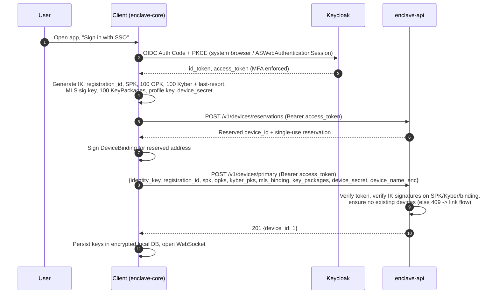
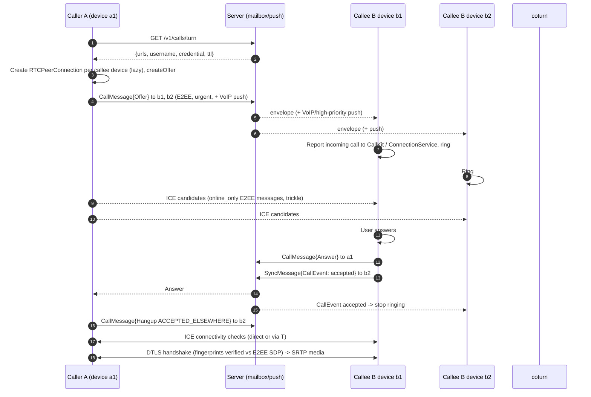
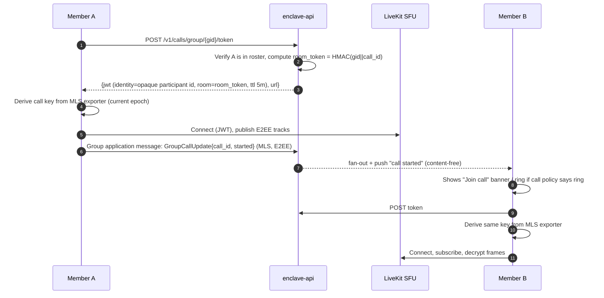

# Enclave — Technical Specification

| Field | Value |
|---|---|
| Document | Technical specification |
| Status | Draft v1.1 — Android and web first; implementation not started |
| Updated | 2026-10-16 |
| Related | [Architecture](arf.md), [UI](UI.md), [Mobile](mobile.md), [Tasks](tasks.md), [Sources](sources.md), [Diagrams](diagrams/README.md) |
| Normative language | MUST, SHOULD, MAY as in RFC 2119 |

This document specifies **how** Enclave works: components, identities, cryptography (1:1 and group), the wire protocol, delivery semantics, REST and WebSocket APIs, data model, 1:1 and group calling, push notifications, and operational concerns. Code samples are illustrative and pinned to concepts rather than exact library versions; library APIs (notably `libsignal` and OpenMLS) evolve and MUST be validated against the pinned versions in the build.

---

## 0. Product scope and release contract

Enclave is a customer-operated, secure messaging platform with a friendly Android app and a full web client in the first release. iOS follows after Android/web stabilization; desktop packaging is optional later work. One deployment represents one organization/security domain. Development, test, and production have separate keys, storage, and identity issuers.

**Security promise:** message bodies, attachments, profiles, and call media are encrypted between authorized endpoints. The infrastructure still processes routing and operational metadata. A compromised endpoint or malicious web bundle can expose content available to that endpoint. This is a product inspired by Signal, not a Signal-network client, interoperable Signal service, or claim of equivalent assurance.

**Priorities:** P0 is required for Android/web general availability (GA); P1 is a subsequent release; P2 is research or an optional extension. A P0 prototype is not a production release. No milestone dates are asserted without a staffed estimate.

### 0.1 Requirements and acceptance

| ID | Priority | Requirement and observable acceptance |
|---|---|---|
| FR-ID-01 | P0 | Organization URL/managed bootstrap, SSO with PKCE and MFA; first-use Android and web users can sign in without a phone number or uploading an address book. |
| FR-DEV-01 | P0 | Link Android and web, list/revoke devices, show identity changes, and sync own sent/read state; new devices cannot silently obtain old history. |
| FR-MSG-01 | P0 | E2EE direct text, emoji, replies, reactions, mentions, edits, delete requests, encrypted files/photos, voice notes, delivery/read preferences, drafts, mute/archive/pin, and Note to self. Offline retries do not create duplicate messages. |
| FR-MSG-08 | P1 | Sealed-sender deliveries use a separate unauthenticated transport and abuse controls; authenticated WebSockets must never advertise sender anonymity. |
| FR-GRP-02 | P0 | E2EE groups, roles, invites, removal, disappearing timers, encrypted group metadata; targets of 1,000 interactive accounts subject to the leaf limits in §6. |
| FR-CAL-01 | P0 | Android/web 1:1 audio/video with TURN fallback; microphone/camera denial, ringing on multiple devices, and network changes have explicit outcomes. |
| FR-CAL-05 | P1 | Group video, screen sharing, and P2P-to-SFU escalation, gated on E2EE compatibility and membership rotation evidence. Initial target: 50 participants. |
| FR-SEC-06 | P0 | Revoke server access immediately on commit, reject subsequent requests, close existing connections within 60 s, attempt local wipe on next contact; explain that offline erasure cannot be guaranteed. |
| FR-SEC-07 | P0 | Verify identity by QR/numeric fingerprint; verified identity replacement blocks sending until reconfirmed. |
| FR-UX-01 | P0 | Keyboard/screen-reader usable web app, TalkBack usable Android app, light/dark themes, English/Romanian localization, friendly empty/error/offline states. |
| FR-SRC-01 | P0 | Search local decrypted history and files, including Romanian diacritics; no query or result content reaches a server. |
| FR-ADM-01 | P0 | Separate administration for users, guests, devices, policies, health, and auditable actions; no conversation reading interface. |
| FR-OPS-01 | P0 | Install, upgrade, back up, and restore without SaaS; signed offline bundles and tested private-CA rotation. |
| FR-IOS-01 | P1 | iOS native lifecycle, notifications, calling, storage, and accessibility reuse the established protocols; no dependency from Android/web milestones. |
| FR-EXT-01 | P1 | Polls, stickers, encrypted history transfer, guest invitations, user-initiated abuse reports, and local scheduled messages. |
| FR-EXT-02 | P2 | Encrypted recovery backup, independent key transparency, federation, explicitly visible archive/bot participants, and optional on-device assistance. |

### 0.2 Nonfunctional targets

| ID | Target | Verification boundary |
|---|---|---|
| NFR-SEC-01 | No service-held content keys or plaintext content | Inspect server databases, objects, traces, logs, push payloads, and media captures during the acceptance scenario. |
| NFR-REL-01 | Zero loss of acknowledged, unexpired envelopes on tested single-node failover in HA mode | Acknowledgement means durable commit under the selected synchronous replication policy; site loss follows the stated DR RPO. |
| NFR-PERF-01 | Healthy online delivery p95 ≤ 300 ms and p99 ≤ 1 s, acceptance-to-recipient durable receipt | Reference medium tier, intra-site RTT ≤ 50 ms, 20k sockets, measured direct/group mix; excludes offline clients and push provider delays. |
| NFR-AVAIL-01 | Messaging API availability ≥ 99.9% per calendar month | Valid supported requests, including failed planned upgrades; authentication and media are measured separately. |
| NFR-UX-01 | Usable first chat within 3 minutes in ≥ 90% of moderated new-user trials | Excludes organization account approval and unavailable identity/network services; test on Android and web separately. |
| NFR-A11Y-01 | Web WCAG 2.2 AA target; Android equivalent keyboard/assistive access | Automated checks plus manual core journeys; visual color alone never conveys security or delivery state. |
| NFR-DR-01 | Secondary-site RPO ≤ 5 min, RTO ≤ 1 h target | Measured quarterly with identity, secrets, ciphertext queues, objects, and safe protocol recovery. |

### 0.3 Deployment profiles

| Profile | Required connections | Notification behavior |
|---|---|---|
| Connected on-prem | All data/media hosted locally; allowlisted optional provider egress | Android UnifiedPush or opted-in FCM; web open-tab WebSocket, optional browser-vendor Web Push. |
| Restricted | Corporate LAN/VPN, private DNS/CA, local IdP/push/media | Android certified UnifiedPush distributor or approved foreground connection; web delivery while active. No vendor push. |
| Air-gapped | No internet route at runtime; offline registry/packages, local DNS/NTP/PKI/IdP | Same Android/web restrictions; closed browsers have no promised wake-up. Future iOS needs separately certified Local Push Connectivity. |

Federation, public phone-number discovery, SMS fallback, server-side content search/moderation, invisible recording, and server-side AI are outside the first release. Feature richness MUST preserve the security promise; see §25 for feature semantics.

## Table of contents

0. Product scope and release contract
1. Components
2. Identifiers and addressing
3. Cryptographic foundations
4. Identity, authentication, and device lifecycle
5. 1:1 encryption (Signal Protocol)
6. Group encryption (MLS)
7. Attachments
8. Client-side storage and key protection
9. Transport and wire protocol
10. Delivery semantics
11. Message content types
12. REST API
13. Server data model
14. 1:1 calling
15. Group calling
16. Push notifications
17. Disappearing messages, edits, deletes, receipts
18. Search
19. Policies, administration, audit
20. Rate limiting and abuse controls
21. Observability
22. Error model
23. Testing strategy
24. Reference implementation notes
25. Feature behavior and state convergence
26. Durable submission, wake-ups, and backpressure
27. Identity, group authorization, and recovery hardening
28. Browser security and capability contract
29. Operations, privacy, and release gates

---

## 1. Components

| Component | Tech | Responsibility | Sees plaintext content? |
|---|---|---|---|
| `enclave-gateway` | Spring Boot (Java 21+, virtual threads), WebSocket | Persistent device connections, frame routing, mailbox drain | No |
| `enclave-api` | Spring Boot, REST | Accounts, devices, prekeys, KeyPackages, groups roster/ACL, attachments, calls tokens, policies | No |
| `enclave-push` | Spring Boot (worker, no ingress) | Consumes wake-up jobs from the `push:jobs` Valkey stream (one consumer group), coalesces per device, sends content-free pushes (APNs, UnifiedPush/ntfy, Local Push, optional FCM). Only workload with egress to push providers. Leases durable push intents on the primary; replica token reads require a freshness check. | No |
| `enclave-admin` | Spring Boot + admin web UI | Admin console backend; aggregate metrics, policy, audit | No |
| Keycloak | Supported version pinned in release BOM | Account authentication, MFA, passkeys, federation, admin roles | No |
| PostgreSQL | Supported version pinned in release BOM (CloudNativePG) | Accounts, devices, keys, rosters, mailbox, audit | No (ciphertext only) |
| PgBouncer | CNPG Pooler | `rw` pooler (transaction mode) in front of the primary for all writers; `ro` pooler in front of replicas for `enclave-push` and admin dashboards. Migrations bypass both. | No |
| Valkey (Redis-compatible) | Supported version pinned in release BOM | Presence keys, pub/sub signals (`mail:*`, `ctl:*`), the `push:jobs` stream, rate limit counters, call room registry | No |
| Object storage | SeaweedFS / Garage / Ceph RGW (S3 API) | Encrypted attachment blobs | No |
| coturn | 4.6+ | TURN/STUN relay for 1:1 calls (and SFU fallback) | No (SRTP only) |
| LiveKit | Pinned server/SDK compatibility set (P1) | SFU for group calls | No (frame-encrypted media) |
| ntfy | Pinned certified version | Self-hosted UnifiedPush distributor for Android | No (empty payloads) |
| Android client | Flutter + native Kotlin adapters + Rust core | UI, native lifecycle, encrypted protocol/storage | **Yes** |
| Web client | React + TypeScript + browser Rust/WASM adapter, subject to feasibility gate | Accessible browser UI; local cryptography/storage; no plaintext backend | **Yes** |
| iOS client (P1) | Flutter + native Swift adapters + Rust core | Later mobile target; extension work is deferred | **Yes** |

The backend is split into deployable modules but MAY run as a single Spring Boot application for small deployments (modular monolith, see `arf.md` ADR-003).

### 1.1 How the services communicate

`enclave-gateway`, `enclave-api`, `enclave-push` and `enclave-admin` MUST NOT call each other over HTTP, gRPC or any other synchronous request. They coordinate through durable state and asynchronous hints. Calls to infrastructure adapters (Keycloak, object storage, LiveKit, push providers, secrets) are permitted with bounded timeouts and retries. The no-direct-call rule applies only to the four Enclave backend apps:

| Channel | Mechanism | Carries | Guarantee |
|---|---|---|---|
| State | PostgreSQL via PgBouncer (`rw` for writers, `ro` for read-only consumers) | Envelopes, devices, keys, rosters, policies, revocations, audit | Durable, transactional |
| Signals | Valkey pub/sub | "Device has new mail", "close this device's socket", "policy changed" | Fire-and-forget. A lost signal is harmless because the data is already committed and a safety net catches it. |
| Jobs | PostgreSQL transactional outbox; Valkey stream as optional acceleration | Content-free wake-up and control intents | Durable intent with leased retries; provider delivery is best effort, duplicates are possible (§26). |

Keycloak sends lifecycle events to `POST /internal/keycloak-events` on `enclave-api` over mTLS. Authenticate the event producer, deduplicate event IDs, reject replay, and reconcile disabled/expired accounts periodically (§27). Later LiveKit webhooks are separately authenticated adapter inputs.

**Valkey key and channel catalogue**

| Name | Type | Written by | Read by | Content |
|---|---|---|---|---|
| `presence:{account}.{device}` | String, TTL 90 s | gateway (on connect, refreshed by pings) | gateway, api, admin before signalling | gateway pod id |
| `mail:{account}.{device}` | Pub/sub channel | gateway, api | the one gateway pod holding that device's socket | `1` (no content) |
| `ctl:{account}.{device}` | Pub/sub channel | api, admin | the gateway pod holding that device's socket | `REVOKED`, `KEYS_LOW`, `KEYPACKAGES_LOW`, `WIPE` |
| `ctl:broadcast` | Pub/sub channel | admin | every gateway pod | `POLICY_UPDATED` |
| `push:jobs` | Bounded stream, safe trim policy | outbox dispatch loop | consumer group `push-workers` | Opaque durable intent ID only; source of truth is PostgreSQL |
| `push:coalesce:{account}.{device}` | Expiring successful-attempt hint | push | push | Performance hint only; never proof that provider accepted a notification |

**Publishing rules and safety nets**

1. Persist envelopes and required push/control intents in the **same PostgreSQL transaction**. `afterCommit` may nudge dispatch but is never the only durable record.
2. Gateway/API signal online devices via `mail:*` after commit. A wake-up intent is also required for visible messages unless that device durably acknowledges within a short debounce. A stale presence key cannot suppress wake-ups indefinitely.
3. Workers lease intents with `FOR UPDATE SKIP LOCKED`, commit the lease before provider I/O, and persist success/retry outcomes. Worker restarts and a total Valkey loss are recovered by database polling.
4. Incoming calls have explicit type, TTL, and cancellation (§25); do not derive push type from a generic `urgent` Boolean. Security notices use their own policy. Receipts/typing do not wake devices.
5. All hints are content-free. Provider payloads use platform-required wrappers (§16), with no sender, group name, message body, or decryption key.

| Failure | Required outcome |
|---|---|
| Process dies immediately after mailbox commit | Committed outbox intent remains eligible; polling resumes wake-ups without a client reconnect. |
| Lost online signal | Connected gateway checks mailbox on keepalive; ordinary healthy recovery target is one 30 s interval. Network/server failure may take longer. |
| Worker dies before/after provider acceptance | Lease expires; retry may duplicate the push, never lose the message; client dedupe prevents repeated content/ringing. |
| Valkey unavailable or restored empty | Mailbox and intents remain durable; dispatch falls back to indexed PostgreSQL polling with bounded throughput. |
| Push token read is stale | Re-read current generation on primary; delete only the exact rejected token generation. |

**Why not Kafka.** Nothing here needs a distributed log. The mailbox needs per-device queues with point deletes (PostgreSQL), signals need sub-millisecond delivery to one specific pod (pub/sub), and push needs a small durable work queue (PostgreSQL intents, optionally accelerated by Valkey streams). Kafka is reconsidered only if a non-content domain-event backbone with many independent consumers is introduced (`arf.md` ADR-017).

---

## 2. Identifiers and addressing

| Identifier | Format | Scope | Notes |
|---|---|---|---|
| `account_id` | Application UUIDv4 | Immutable within deployment | Map a unique `(OIDC issuer, sub)` to this ID; never assume `sub` is a UUID. |
| `username` | `[a-z0-9._-]{3,32}` | Unique per deployment, mutable | Display/search handle. |
| `device_id` | uint32, 1..2^31−1 | Per account | Reserved before key bindings are signed; allocated monotonically; never reused. |
| `registration_id` | uint14 random | Per device install | Detects reinstall (stale sessions). |
| `DeviceAddress` | `account_id.device_id` | Global | Unit of delivery. |
| `group_id` | 32 random bytes (base64url) | Global | Opaque to server; equals MLS `group_id`. |
| `envelope_guid` | UUIDv7 | Global | Time-ordered; client dedupe key. |
| `message_id` | 16 random bytes | Inside ciphertext | Client-level message identity (edits/reactions reference it). |
| `call_id` | uint64 random | Per call | Carried inside E2EE CallMessages. |
| `room_token` | HMAC-SHA256 with typed, length-delimited context | SFU room name | Obscures raw group ID; operator correlation remains possible. |

The **unit of delivery is the device**, never the account. Every send fans out to an explicit list of device addresses.

---

## 3. Cryptographic foundations

### 3.1 Libraries

| Purpose | Library | Language | License |
|---|---|---|---|
| 1:1 protocol (PQXDH, Double Ratchet, sealed sender, fingerprints) | `libsignal` (`libsignal-protocol` crate) | Rust | AGPL-3.0 |
| Group protocol (MLS RFC 9420) | `openmls` + `openmls_rust_crypto` / `openmls_libcrux_crypto` | Rust | MIT |
| AEAD, HKDF, HMAC for app-layer crypto (attachments, storage, provisioning) | RustCrypto crates (`aes-gcm`, `hkdf`, `hmac`, `sha2`) | Rust | MIT/Apache |
| Password-based key derivation (desktop/web passphrase lock) | `argon2` | Rust | MIT/Apache |
| Frame encryption in calls | LiveKit client SDK E2EE (WebRTC encoded transforms) | Dart/Swift/Kotlin/JS | Apache-2.0 |

Protocol cryptography and transactional protocol state belong in the shared Rust core. Native Flutter uses a generated FFI facade; the React web client uses a browser-specific WASM/worker facade. Browser portability of the complete pinned dependency graph is an **M0 feasibility gate**, not an upstream guarantee. The backend contains public verification/parsing code but MUST NOT receive content decryption keys. General-purpose crypto libraries are permitted for TLS, signatures, token verification, and at-rest infrastructure encryption. [Upstream libsignal](https://github.com/signalapp/libsignal) documents its support boundary and change policy; see [sources](sources.md).

### 3.2 Primitives

| Use | Primitive |
|---|---|
| Identity keys (1:1) | Curve25519 key pair, XEdDSA signatures |
| Session key agreement (1:1) | PQXDH using the pinned libsignal profile; do not equate legacy Kyber wire formats with standardized ML-KEM |
| 1:1 message encryption | Double Ratchet; AES-256-CBC + HMAC-SHA256 (libsignal message format), HKDF-SHA256 |
| Post-quantum ratchet (1:1) | Sparse PQ / Triple Ratchet profile selected and interoperability-tested at M0; capability/version pinned, never silently downgraded (ADR-007) |
| MLS ciphersuite (GA) | `MLS_128_DHKEMX25519_AES128GCM_SHA256_Ed25519` (0x0001) |
| MLS ciphersuite (post-GA) | Hybrid PQ ciphersuite (X-Wing KEM based) once supported by OpenMLS and stable |
| MLS signature keys | Ed25519, per device |
| Attachments | Versioned audited STREAM construction with 64 KiB chunks, unique nonces, authenticated final-chunk/length; SHA-256 of ciphertext |
| Local DB | SQLCipher (AES-256-CBC + HMAC-SHA512 page encryption) on native; app-layer AES-256-GCM on web |
| Device provisioning channel | X25519 ephemeral ECDH + HKDF-SHA256 + AES-256-GCM |
| Call media (1:1) | DTLS-SRTP (AES-GCM / AES_CM_128_HMAC_SHA1_80), fingerprints authenticated through E2EE signaling |
| Call media (group) | DTLS-SRTP hop-by-hop + AES-GCM frame encryption end-to-end with MLS-exported keys |

### 3.3 Key hierarchy (per account)

```
Account Identity Key (IK, Curve25519)       shared by all devices of the account,
│                                           transferred only via provisioning channel
├── Device d1
│   ├── registration_id
│   ├── Signed PreKey (SPK, rotated every 7 days, signed by IK)
│   ├── One-time PreKeys (OPK x100, consumed once)
│   ├── Kyber PreKeys (one-time x100 + 1 last-resort, signed by IK)
│   ├── MLS signature key (Ed25519)  + DeviceBinding = XEdDSA_IK(account_id ‖ device_id ‖ mls_sig_pub)
│   ├── MLS KeyPackages (x100, single-use baseline)
│   └── Local storage master key (hardware-protected)
├── Device d2 ... (same structure)
└── Profile Key (32 bytes AES-256-GCM key, shared with contacts/groups to decrypt profile)
```

The shared account identity key matches Signal's multi-device model: contacts see one safety number per account, not per device. Device-level authenticity comes from (a) IK signatures over device prekeys and MLS device bindings and (b) device-list change notifications (§4.6).

---

## 4. Identity, authentication, and device lifecycle

### 4.1 Two layers of identity

| Layer | Authority | Proves | Used for |
|---|---|---|---|
| Account authentication | Keycloak (OIDC) | "This person is a legitimate org member, passed MFA." | Device registration, device linking authorization, admin console, REST calls requiring user presence |
| Cryptographic identity | Device-held keys | "This endpoint holds the account's IK / device keys." | All message encryption and verification |

Keycloak authenticates account actions; it does not supply E2EE keys. An additional device still needs existing-device consent and signed key bindings. An identity service or operator can attempt account reset/key substitution, affecting future traffic unless peers reject the identity change. No IdP reset recovers past plaintext by itself.

### 4.2 Device credentials

After registration, each device receives a **device credential** used for all subsequent server authentication (WebSocket and REST):

- `device_secret`: 32 random bytes generated by the client, sent once at registration over TLS; the server stores `HMAC-SHA256(pepper, device_secret)` (pepper from a KMS/Vault secret, not in the DB).
- Authentication: `Authorization: Basic base64(account_id.device_id:base64url(device_secret))` over TLS 1.3 with pinned CA.
- Post-GA hardening (ADR-011): replace the static secret with **DPoP-style proof-of-possession**, where the device signs a server nonce with a non-exportable hardware key (Android Keystore / Secure Enclave / WebAuthn on web).

Rationale: OIDC access tokens (5-minute lifetimes) are a poor fit for long-lived WebSocket connections on intermittently connected mobile devices, and refresh tokens on device are a larger blast radius than a per-device revocable secret.

### 4.3 First device registration



If the account already has devices, `POST /v1/devices/primary` returns `409 ACCOUNT_HAS_DEVICES` and the client offers (a) link via existing device or (b) **re-register** (new IK; all contacts will see a safety number change). Re-registration requires a Keycloak step-up (re-authentication + MFA) and is audit-logged.

### 4.4 Linking an additional device (QR provisioning)

The new device must obtain the account IK and profile key without the server learning them.

```mermaid
sequenceDiagram
    autonumber
    participant N as New device
    participant A as enclave-api
    participant G as enclave-gateway
    participant P as Primary/existing device
    participant U as User
    N->>N: Keycloak login (step-up MFA)
    N->>A: POST /v1/provisioning/sessions (Bearer token)
    A-->>N: {provisioning_id, ws_url}
    N->>G: Open provisioning WebSocket (provisioning_id)
    N->>N: Generate ephemeral X25519 (eN)
    N->>U: Show QR: enclave://link?pid=..&pub=eN_pub&v=1
    P->>P: User scans QR, confirms "Link Chrome on Linux?"
    P->>P: Generate ephemeral eP, then K = HKDF(ECDH(eP,eN), "enclave/provision/v1")
    P->>A: POST /v1/provisioning/sessions/{pid}/message<br/>{eP_pub, AES-GCM_K(ProvisionMessage)}
    A->>A: Store expiring ciphertext relay item + durable intent
    Note over A,G: Gateway reads shared relay state; no direct API-to-gateway call
    G-->>N: ProvisionMessage ciphertext
    N->>N: Decrypt: {IK pair, account_id, profile_key, provisioning_code, history_transfer_offer?}
    N->>A: Reserve device_id for linked enrollment
    A-->>N: Reserved address
    N->>N: Generate keys; sign binding for reserved address
    N->>A: POST /v1/devices/link {provisioning_code, keys...} (Bearer token)
    A->>A: Verify provisioning_code (single use, 10-min TTL, bound to account), verify signatures
    A-->>N: 201 {device_id: k}
    A->>A: Commit device-list version + own-device notices
    Note over A,G: Contacts compare signed lists on next send; no contact graph stored
    N->>N: External-commit join of all account groups (§6.6)
```

`ProvisionMessage` (protobuf, encrypted):

```protobuf
message ProvisionMessage {
  bytes identity_key_public  = 1;
  bytes identity_key_private = 2;
  string account_id          = 3;
  bytes profile_key          = 4;
  string provisioning_code   = 5;   // server-issued to the primary, proves primary consent
  bool read_receipts         = 6;
  HistoryTransferOffer history = 7; // optional (§4.5)
}
```

The `provisioning_code` is requested by the primary from `POST /v1/devices/provisioning-code` (authenticated with its device credential), proving an existing device consented. The server requires both a valid Keycloak token for the account **and** a code issued to an existing device of the same account.

### 4.5 History transfer (optional, P1)

Device-to-device only. The primary exports the last N days (policy, default 30) of messages, encrypts them with a fresh 256-bit key into an archive blob, uploads it as an attachment (§7), and sends the key and pointer inside the `ProvisionMessage`. The blob is deleted after download or 1 hour. The server never stores history in a decryptable form.

### 4.6 Device list integrity

- Every change increments a monotonic device-list version and produces durable notices for the account’s own devices. Contacts compare fetched signed snapshots with their local snapshot before sending; the server does not keep a direct-conversation/contact graph to distribute notices. A server signature alone does not prevent a malicious operator from presenting inconsistent lists.
- Clients render a system message: "Ana linked a new device" (contacts) and "A new device was linked to your account: <name>, <time>" (owner, high-priority notification).
- Clients refuse to encrypt to a device whose SPK/Kyber/MLS binding signature does not verify under the contact's known IK.
- Post-GA: key transparency log (§19.4, ADR-012).

### 4.7 Device revocation

Triggers: user unlinks, admin revokes, Keycloak user disabled (event listener SPI → `enclave-api` webhook), inactivity expiry.

1. `devices.revoked_at` set and credential invalidated in one transaction; after commit the api (or admin) publishes `REVOKED` on `ctl:{account}.{device}`, and the gateway pod holding that socket closes it with code `4401 DEVICE_REVOKED`.
2. Prekeys, KeyPackages, push tokens deleted; mailbox purged for that device.
3. For each MLS group containing the device: server marks the group `pending_removal` (§6.7) and refuses new application messages for that group until a member commits the removal.
4. `DeviceListChanged` is emitted.
5. If the device reconnects with a valid TLS session but revoked credential, the server rejects access with `DEVICE_REVOKED`; an honest client clears local credentials, keys, history, and caches. Unauthenticated or unsigned instructions MUST NOT erase local state. Remote wiping remains best effort (FR-SEC-06).

---

## 5. 1:1 encryption (Signal Protocol)

### 5.1 Session establishment (PQXDH)

To send to account B for the first time, client A:

1. `GET /v1/keys/{B}/*` returns a **pre-key bundle per device** of B:
   `{device_id, registration_id, identity_key, signed_prekey{id,pub,sig}, one_time_prekey{id,pub}?, kyber_prekey{id,pub,sig}}`.
   The server atomically consumes one OPK and one one-time Kyber key per device (falling back to the last-resort Kyber key when exhausted).
2. A verifies SPK and Kyber signatures under B's IK. If B's IK differs from a previously stored IK, A MUST surface an identity-change notice; if B was **verified**, sending is blocked until the user re-confirms.
3. A runs PQXDH per device via `SessionBuilder::process_prekey_bundle` and stores a session per `(B, device_id)`.
4. The first message to each device is a `PreKeySignalMessage` carrying A's IK, ephemeral key, Kyber ciphertext, and used prekey IDs.

The shared secret derivation is (per PQXDH): `SK = KDF(DH(IK_A,SPK_B) ‖ DH(EK_A,IK_B) ‖ DH(EK_A,SPK_B) ‖ DH(EK_A,OPK_B)? ‖ KEM_SS)`, providing hybrid classical + post-quantum security for the initial key.

### 5.2 Ongoing messages

Each subsequent message uses the Double Ratchet: a symmetric-key ratchet per message (forward secrecy) and a DH ratchet each round trip (post-compromise security). If enabled in the pinned libsignal version, the sparse post-quantum ratchet adds periodic ML-KEM-based ratchet steps (ADR-007).

### 5.3 Multi-device fan-out ("Sesame")

A message from device A1 to account B is encrypted separately for:

- every active device of B, and
- every other active device of A (as a `SyncMessage{sent}` so A's other devices show the outgoing message).

The `SendRequest` lists each device and its `registration_id`. The server validates against the current device list and returns `409 DEVICE_MISMATCH` with `missing`, `extra`, and `stale` device IDs. The client then fetches bundles for missing devices, drops sessions for extra devices, re-establishes sessions for stale ones, and retries. This loop is the backbone of multi-device correctness.

### 5.4 Sealed sender (P1, FR-MSG-08)

- Each device periodically fetches a **sender certificate** from `GET /v1/certificate/sender`: `{account_id, device_id, identity_key, expires(24h)}` signed by the deployment's **server certificate**, itself signed by an offline **trust root** whose public key is compiled into the client build for that deployment.
- Sender encrypts the inner Signal message plus the certificate in an `UnidentifiedSenderMessage` to the recipient's IK.
- Delivery authorization uses the exact unidentified-access construction supported by the pinned libsignal integration, with reviewed vectors; no hand-written AES formula substitutes for that protocol.
- This feature uses an isolated REST endpoint without device Basic credentials, cookies, or an authenticated WebSocket. Sender certificates and recipient access checks are verified as specified by the selected profile.
- Sealed delivery is P1. P0 uses authenticated E2EE delivery with honest sender-metadata disclosure. The service can still correlate source IP, request timing, and credential issuance; do not promise anonymity.

### 5.5 Padding

Plaintext `Content` protobufs are padded to a multiple of 160 bytes (Signal's scheme: append `0x80` then zeros) before encryption, so ciphertext length reveals only coarse size buckets. Attachments are padded to the next size bucket (`max(541, 1.05^ceil(log_1.05(size)))`).

### 5.6 Safety numbers

`fingerprint = libsignal NumericFingerprintGenerator(iterations=5200, version=2)` over `(account_id_A, IK_A, account_id_B, IK_B)`, displayed as 60 digits and a scannable QR. Verified status is stored locally and synced to own devices via `SyncMessage{verified}`.

---

## 6. Group encryption (MLS)

### 6.1 Why MLS for groups

Signal's Sender Keys require O(N) pairwise messages to rekey after a removal and offer weaker post-compromise security. MLS provides O(log N) rekeying via a ratchet tree, formally analyzed security, and an IETF standard (RFC 9420). Targets: 1,000 interactive accounts at P0, 5,000 announcement accounts at P1. The real MLS size is the number of devices: enforce 5,000 and 25,000 leaves respectively, and publish benchmarked limits. Tree work can grow with proposal batches and sparse trees; full delivery still costs O(number of recipients). See ADR-006 and §27.

### 6.2 Model

- Every **device** of every member account is an MLS leaf (client).
- Leaf credential: `BasicCredential(identity = "account_id.device_id")` plus the `DeviceBinding` (IK signature over the leaf signature key) carried in a custom leaf node extension `enclave_device_binding (0xF0A1)`.
- On processing any Add or external join, clients MUST verify the DeviceBinding against the account's known IK; failure means reject the commit and alert.
- `group_id` is random 32 bytes, generated by the creator.

### 6.3 Server role: Delivery Service (DS)

MLS requires that all members agree on the order of handshake messages. The server acts as an **ordering Delivery Service**:

| Message type | MLS framing | Server visibility | Server action |
|---|---|---|---|
| Commit | `PublicMessage` (signed, content visible to DS) | Proposal types, affected leaves, epoch, sender leaf | Validate epoch, validate sender authorization against ACL, update roster, fan out |
| Proposal (standalone) | `PublicMessage` | Same | Store as pending for the epoch, fan out |
| Application message | `PrivateMessage` | Epoch and group only | Fan out to current roster |
| Welcome | `Welcome` (HPKE to KeyPackage) | Recipient KeyPackage refs | Deliver to the specific new devices |
| GroupInfo (for external joins) | Signed `GroupInfo` with `ratchet_tree` extension | Public tree | Store latest per group |

Commits are sent as `PublicMessage` deliberately: the server must maintain the routing roster anyway (it cannot fan out without knowing recipient devices), and public commits let it validate membership changes and enforce role ACLs. Path secrets inside the UpdatePath remain HPKE-encrypted to tree nodes, so the server learns membership changes but never any group secret. Group metadata (name, avatar, description, disappearing timer) is sent in encrypted application messages (`GroupMetadataUpdate`, §11), not in the GroupContext, so the server never sees it.

### 6.4 Epoch ordering protocol

```
Client C (member, local epoch e) wants to commit:
  1. Build commit for epoch e (proposals by value + any pending by reference).
  2. POST /v1/groups/{gid}/commits {epoch: e, commit, welcome?, group_info}
  3. Server, in a single transaction:
       UPDATE mls_groups SET epoch = epoch + 1, group_info = :gi
        WHERE group_id = :gid AND epoch = :e AND pending_fork = false
       -> 0 rows: 409 EPOCH_CONFLICT {current_epoch}
       -> 1 row: validate ACL, apply roster delta, enqueue commit to all
                 devices in OLD roster (including C), enqueue Welcome to new devices
  4. C applies its own commit ONLY after receiving 200 (merge_pending_commit).
     On 409: C discards the pending commit, processes queued commits, retries if still needed.
```

Application messages are tagged with their epoch. Process commits and applications through the durable group sequence (§27). Keep only bounded past-epoch **receive** state for reordering: default 2 epochs / 5 minutes. Expire it promptly; long-offline devices need retained commits or explicit resynchronization, not indefinite historical secrets. Revocation cannot stop a sender that is offline or using a stale epoch from encrypting; the server rejects such submissions until refreshed.

### 6.5 Group lifecycle operations

| Operation | Who may perform | MLS operation | Notes |
|---|---|---|---|
| Create group | Any account | Creator builds group, adds members' devices using claimed KeyPackages (`POST /v1/keypackages/claim`) | Server creates roster, ACL (creator = owner) |
| Add member | Admin/owner | Commit with Add proposals for every device of the new account | Server checks committer role |
| Remove member | Admin/owner | Commit with Remove for every leaf of the account | Removed devices receive the commit and mark the group inactive |
| Leave | Member | Standalone Remove proposal for own leaves; server marks `pending_commit`; next online member/admin commits it (auto-commit) | Clients auto-commit pending proposals they receive when they are the designated committer (lowest active `account_id.device_id` among online admins, falling back to any member after 30 s) |
| Key update | Any member | Empty commit with UpdatePath | Every device MUST self-update at least every 7 days and after app restore |
| Role change | Owner/admin under current authenticated role state | MLS commit carrying a versioned role-state extension, atomically mirrored to REST ACL | Clients independently verify authorization; REST cannot unilaterally change cryptographic roles (§27). |
| Delete group | Owner | REST delete; server sends `GroupDeleted` system envelope to all | Clients archive locally |

### 6.6 Multi-device and recovery: external commits

When an account gains a device (§4.4), the new device joins every group the account belongs to via **external commit**:

1. `GET /v1/groups/mine` → list of `group_id` with latest `GroupInfo` (including ratchet tree).
2. For each group: build external commit (`ExternalInit` + self-add, leaf with DeviceBinding), `POST /v1/groups/{gid}/commits` with `external=true`.
3. Server authorizes: the committing device's account is in the roster and the device is active.
4. Other members verify the DeviceBinding and accept.

External commits are also the **fork recovery** mechanism: if a client detects it cannot decrypt (desynced state, restored backup, corrupted DB), it rejoins by external commit, removing its own stale leaf in the same commit (`resync`). History before rejoin is not recoverable by design.

### 6.7 Device revocation in groups

The server cannot commit (it is not a member). On revocation:

1. Server durably marks every affected group `pending_removal = {leaf refs}`, stops delivery to the device, and blocks application sends for affected groups until removal. Server availability gating is defense in depth, not a source of cryptographic authorization.
2. The next member device to send in that group receives `409 PENDING_REMOVAL {leaves}` and MUST first commit the Remove (any member is authorized to commit removals of server-revoked leaves; the server validates the leaves match).
3. Honest clients encrypt new content under the accepted removal epoch; removed devices cannot derive its secrets. Ciphertext already encrypted under the old epoch remains exposed to members of that epoch, so stale submissions are rejected and re-encrypted after catch-up. Peers validate any removal authority as described in §27.

### 6.8 Large announcement groups

For groups > 1,000 members: admin-only posting is enforced by the server ACL (non-admin application messages rejected), and clients defer self-updates (randomized within 7 days) to limit commit storms. Commit fan-out cost is O(N) envelopes but each envelope is small; the ratchet tree keeps commit computation O(log N).

### 6.9 KeyPackages

- Each device uploads 100 single-use KeyPackages. Baseline Enclave refuses reuse; exhaustion waits for replenishment. A last-resort reuse extension is not assumed to be part of RFC 9420 or interoperable OpenMLS support; any future reuse profile requires its own review.
- `POST /v1/keypackages/claim {account_ids[]}` returns one KeyPackage per active device, consuming one-time packages atomically.
- Server sends `KEYPACKAGES_LOW` to a device when fewer than 20 remain.
- Lifetime: 90 days; devices rotate before expiry.

---

## 7. Attachments

### 7.1 Upload

```
1. Client: plaintext P, generate a fresh key K (32 B); obtain the nonce/header from the reviewed versioned STREAM implementation (§27).
2. Encrypt P using that construction with 64 KiB chunks; authenticate stream version, original length, chunk index, and final marker.
3. Pad ciphertext to bucket size (§5.5).
4. digest = SHA-256(ciphertext)
5. POST /v1/attachments/upload-form {size} -> {attachment_id, upload_url (presigned PUT, 15 min), resumable: optional multipart upload session (P1)}
6. PUT ciphertext to object storage.
7. Message carries AttachmentPointer{attachment_id, key K, nonce prefix, digest, size, content_type, file_name?, thumbnail(encrypted inline), blurhash, width, height, duration}.
```

### 7.2 Download

`GET /v1/attachments/{id}` → presigned GET URL (5 min). Client downloads, verifies digest **before** decryption, decrypts, verifies GCM tags per chunk, strips padding.

### 7.3 Server rules

- Objects stored in a bucket with no public access, server-side encryption optional (defense in depth only).
- Lifecycle: delete after 30 days (policy). Download counts are not tracked per recipient (metadata minimization); expiry is time-based.
- Content scanning is impossible server-side by design. Optional client-side scanning hooks are explicitly out of scope.

---

## 8. Client-side storage and key protection

| Platform | DB | DB key protection | Notes |
|---|---|---|---|
| Android | SQLite + SQLCipher (via `sqlcipher_flutter_libs`, accessed through `enclave-core`) | 256-bit DB key wrapped by Android Keystore (StrongBox if available), `setUserAuthenticationRequired` optional by policy | `FLAG_SECURE` per policy |
| iOS | SQLite + SQLCipher in App Group container | Keychain item `kSecAttrAccessibleAfterFirstUnlockThisDeviceOnly`, access group shared with Notification Service Extension | NSE must open DB read/write with file coordination (§16.3) |
| Desktop | SQLite + SQLCipher | OS keystore (Keychain / DPAPI / libsecret) or user passphrase (Argon2id m=64 MiB, t=3) | Passphrase required where OS keystore unavailable |
| Web | IndexedDB encrypted records; SQLite WASM/OPFS is optional after worker/concurrency validation | Reviewed record AEAD and passphrase/WebAuthn-PRF key wrapping where supported; non-extractable WebCrypto keys do not prevent hostile same-origin code from using them | Lower trust tier ([UI](UI.md) §8 and §28) |

The Rust core owns the logical schema and all protocol-state reads/writes through native/browser storage adapters of protocol state (sessions, prekeys, MLS state) to guarantee atomicity: **decrypt → persist plaintext + new ratchet state in one transaction → ack to server.** Never ack before commit.

Core local tables (simplified): `identity`, `sessions`, `prekeys`, `signed_prekeys`, `kyber_prekeys`, `mls_state` (OpenMLS storage provider), `contacts`, `conversations`, `messages`, `messages_fts` (FTS5), `attachments`, `reactions`, `receipts`, `call_log`, `outbox`, `processed_envelopes` (dedupe, 30-day window).

---

## 9. Transport and wire protocol

### 9.1 Endpoints

| Channel | URL | Auth |
|---|---|---|
| REST | `https://chat.<org>/v1/...` | Device credential (Basic) or Keycloak bearer (registration/linking/admin) |
| WebSocket | `wss://chat.<org>/v1/ws` | Device credential in `Authorization` header (native) or `Sec-WebSocket-Protocol` ticket (web) |
| Provisioning WS | `wss://chat.<org>/v1/provisioning/ws?pid=` | Provisioning session id |
| TURN | `turns:turn.<org>:443?transport=tcp`, `turn:turn.<org>:3478?transport=udp` | Ephemeral HMAC credentials |
| SFU | `wss://sfu.<org>` | LiveKit JWT issued by `enclave-api` |

TLS 1.3 for client-facing HTTPS/WSS. Native clients pin approved SPKI keys via an authenticated configuration bundle with current/next overlap. Browsers use OS/browser certificate trust and cannot enforce native-style SPKI pinning from JavaScript. Private CA installation is an organization prerequisite. Internal TLS is required; see §28 and ARF deployment guidance.

### 9.2 WebSocket framing

Binary frames carrying protobuf. Request/response multiplexed by `request_id`.

```protobuf
syntax = "proto3";
package enclave.ws.v1;

message ClientFrame {
  uint64 request_id = 1;
  oneof body {
    SendRequest send           = 2;
    SendSealedRequest send_sealed = 3;
    Ack ack                    = 4;
    GroupSendRequest group_send = 5;
    Ping ping                  = 6;
    TypingRelay typing         = 7;  // ephemeral, never stored
  }
}

message ServerFrame {
  uint64 request_id = 1;            // 0 for server-initiated
  oneof body {
    Envelope envelope          = 2;
    SendResult send_result     = 3;
    QueueEmpty queue_empty     = 4;  // drain complete
    Directive directive        = 5;  // KEYS_LOW, KEYPACKAGES_LOW, WIPE, DEVICE_LIST_CHANGED, POLICY_UPDATED
    Pong pong                  = 6;
    Error error                = 7;
  }
}

message Envelope {
  enum Type {
    UNKNOWN = 0;
    CIPHERTEXT = 1;
    PREKEY_MESSAGE = 2;
    UNIDENTIFIED_SENDER = 3;
    MLS_PRIVATE = 4;       // group application message
    MLS_COMMIT = 5;
    MLS_WELCOME = 6;
    MLS_PROPOSAL = 7;
    SERVER_EVENT = 8;      // server-signed system events (DeviceListChanged, GroupDeleted)
  }
  Type type = 1;
  bytes guid = 2;                   // UUIDv7
  string source_account = 3;        // empty for UNIDENTIFIED_SENDER
  uint32 source_device = 4;
  bytes group_id = 5;               // MLS types only
  uint64 epoch = 6;                 // MLS types only
  bytes content = 7;
  uint64 server_timestamp = 8;
  bool urgent = 9;                  // controls push priority
}

message SendRequest {
  string destination_account = 1;
  repeated DeviceMessage messages = 2;
  uint64 client_timestamp = 3;
  bool urgent = 4;
  bool online_only = 5;             // e.g. typing-like payloads not to be queued
}

message DeviceMessage {
  uint32 device_id = 1;
  uint32 registration_id = 2;
  Envelope.Type type = 3;
  bytes content = 4;
}

message GroupSendRequest {
  bytes group_id = 1;
  uint64 epoch = 2;
  bytes mls_private_message = 3;    // one ciphertext for all members
  bool urgent = 4;
}

message SendResult {
  bool ok = 1;
  repeated uint32 missing_devices = 2;
  repeated uint32 extra_devices = 3;
  repeated uint32 stale_devices = 4;
  string error_code = 5;            // EPOCH_CONFLICT, PENDING_REMOVAL, RATE_LIMITED, ...
}

message Ack { repeated bytes guids = 1; }
```

Group application messages are a single MLS ciphertext; the server fans out the same bytes to every roster device (excluding the sender device). This is the major bandwidth advantage of MLS over pairwise fan-out.

### 9.3 Keepalive and reconnection

- Client sends `Ping` every 30 s (foreground) / relies on OS push in background; server closes after 90 s of silence.
- Each `Ping` refreshes `presence:{account}.{device}` and makes the gateway run an indexed `EXISTS` on the device's mailbox; if anything is pending it drains immediately. This bounds the cost of a lost `mail:*` signal to one keepalive interval (§1.1).
- Reconnect with exponential backoff (1 s → 60 s, full jitter). On reconnect the server drains the mailbox oldest-first, then sends `QueueEmpty`.
- Graceful pod shutdown: gateway sends close code `4100 RECONNECT` with randomized delay hint to spread reconnect storms.

---

## 10. Delivery semantics

| Property | Guarantee |
|---|---|
| Durability | A `SendResult{ok}` means the envelope is committed to PostgreSQL (synchronous replication in HA mode). |
| Delivery | At-least-once per device. Envelope deleted only on device `Ack`. |
| Deduplication | Client keeps `processed_envelopes(guid)` for 30 days; duplicates are acked and dropped. |
| Ordering | Mailbox pagination uses stable `(server_ts, guid)` with recipient scope. MLS handshake/application processing follows a persisted per-group sequence; display uses bounded sender time with stable IDs (§27). |
| Expiry | Undelivered envelopes expire after 30 days (policy). Sender is not notified (no metadata leak); delivery receipts simply never arrive. |
| Store-then-notify | The gateway (or api) persists, then, after commit, publishes `mail:{account}.{device}` for online devices; the pod holding the socket drains. No content transits Valkey. |
| Offline wake-up | A durable intent is committed with the envelope; workers lease/retry content-free provider attempts (§16.4, §26). Duplicate wake-ups are possible. |
| Missed signal | Each client keepalive triggers a mailbox `EXISTS` check, bounding delivery delay to 30 s if a signal was lost (§1.1). |
| Online-only | P0 transient ciphertext uses short-lived durable envelopes (typing ≤ 10 s, ICE ≤ 30 s), no push. A later ciphertext pub/sub path needs an ADR; content never enters ordinary Valkey hints. |

---

## 11. Message content types (inside encryption)

```protobuf
syntax = "proto3";
package enclave.content.v1;

message Content {
  oneof body {
    DataMessage data = 1;
    SyncMessage sync = 2;
    CallMessage call = 3;
    ReceiptMessage receipt = 4;
    TypingMessage typing = 5;
    GroupMetadataUpdate group_metadata = 6;
    DecryptionErrorMessage decryption_error = 7;  // retry request
  }
  bytes sender_key_hint = 15;  // reserved
}

message DataMessage {
  bytes message_id = 1;
  string body = 2;
  repeated AttachmentPointer attachments = 3;
  Quote quote = 4;
  repeated Mention mentions = 5;
  Reaction reaction = 6;
  Edit edit = 7;
  Delete delete = 8;
  uint32 expire_timer_seconds = 9;
  uint64 timestamp = 10;
  bytes profile_key = 11;        // shared on first contact / rotation
  LinkPreview preview = 12;
}

message Edit { bytes target_message_id = 1; string new_body = 2; uint64 edited_at = 3; }
message Delete { bytes target_message_id = 1; }
message Reaction { bytes target_message_id = 1; string emoji = 2; bool remove = 3; }

message CallMessage {
  uint64 call_id = 1;
  oneof body {
    Offer offer = 2;
    Answer answer = 3;
    IceCandidates ice = 4;
    Hangup hangup = 5;
    Busy busy = 6;
    GroupCallUpdate group_call = 7;
    AdHocCallKey adhoc_key = 8;
  }
  uint32 destination_device_id = 9;  // 0 = all devices
}

message Offer { enum Type { AUDIO = 0; VIDEO = 1; } Type type = 1; string sdp = 2; }
message Answer { string sdp = 1; }
message IceCandidates { repeated string candidates = 1; }
message Hangup {
  enum Reason { NORMAL = 0; ACCEPTED_ELSEWHERE = 1; DECLINED_ELSEWHERE = 2; BUSY_ELSEWHERE = 3; NEED_PERMISSION = 4; }
  Reason reason = 1;
  uint32 device_id = 2;
}

message GroupMetadataUpdate {
  uint64 version = 1;             // monotonically increasing; highest wins, ties by sender leaf index
  string name = 2;
  string description = 3;
  AttachmentPointer avatar = 4;
  uint32 expire_timer_seconds = 5;
  bool announcement_only = 6;
  bool history_sharing = 7;
}

message SyncMessage {
  oneof body {
    SentTranscript sent = 1;       // own outgoing message mirrored to own devices
    Read read = 2;
    Verified verified = 3;
    Contacts contacts = 4;
    Configuration configuration = 5;
    CallEvent call_event = 6;      // answered/declined elsewhere
  }
}
```

---

## 12. REST API

All endpoints under `/v1`, JSON (keys as base64url) except where noted. Auth: `D` = device credential, `K` = Keycloak bearer, `A` = Keycloak admin role, `P` = provisioning session.

### 12.1 Accounts and devices

| Method | Path | Auth | Description |
|---|---|---|---|
| POST | `/devices/reservations` | K | Reserve an address and single-use enrollment challenge; expire after 10 minutes. |
| POST | `/devices/primary` | K | Register first device (§4.3). |
| POST | `/devices/provisioning-code` | D | Existing device requests a single-use linking code. |
| POST | `/provisioning/sessions` | K | New device opens provisioning session. |
| POST | `/provisioning/sessions/{pid}/message` | D | Existing device delivers encrypted ProvisionMessage. |
| POST | `/devices/link` | K | New device registers keys with provisioning code. |
| GET | `/devices` | D | List own devices (names encrypted, decrypted client-side). |
| DELETE | `/devices/{deviceId}` | D | Unlink own device (cannot delete self via this route; use `/devices/self`). |
| DELETE | `/devices/self` | D | Unregister this device. |
| GET | `/accounts/{accountId}/devices` | D | Device IDs + registration IDs of another account (for fan-out). |
| GET | `/directory/search?q=` | D | Org directory search; returns `account_id`, username, encrypted profile pointer. |
| PUT | `/profile` | D | Upload encrypted profile blob + versioned profile key commitment. |
| GET | `/profile/{accountId}/{version}` | D | Fetch encrypted profile. |
| PUT | `/accounts/me/unidentified-access-key` | D | Upload UAK for sealed sender. |
| GET | `/certificate/sender` | D | Server-signed sender certificate (24 h). |

### 12.2 Keys

| Method | Path | Auth | Description |
|---|---|---|---|
| PUT | `/keys` | D | Upload SPK, OPKs, Kyber prekeys. |
| GET | `/keys/status` | D | Counts of remaining OPK/Kyber. |
| GET | `/keys/{accountId}/{deviceId or *}` | D or UAK | Fetch pre-key bundle(s), consuming one-time keys. |
| PUT | `/keypackages` | D | Upload MLS KeyPackages. |
| POST | `/keypackages/claim` | D | Claim KeyPackages for accounts' devices. |

### 12.3 Messages

Messages are sent over WebSocket. REST fallback for constrained environments and background sends:

| Method | Path | Auth | Description |
|---|---|---|---|
| PUT | `/messages/{accountId}` | D or UAK | Send 1:1 (body = `SendRequest` protobuf). |
| PUT | `/groups/{groupId}/messages` | D | Send group application message. |
| GET | `/messages?limit=100` | D | Drain mailbox (used by iOS NSE). |
| DELETE | `/messages/{guid}` | D | Ack. |

### 12.4 Groups

| Method | Path | Auth | Description |
|---|---|---|---|
| POST | `/groups` | D | Create group: `{group_id, initial_commit?, welcome, group_info, acl}`. |
| GET | `/groups/mine` | D | Groups of this account with latest `GroupInfo`. |
| POST | `/groups/{gid}/commits` | D | Submit commit (§6.4); `external=true` for external joins. |
| POST | `/groups/{gid}/proposals` | D | Submit standalone proposal (leave). |
| GET | `/groups/{gid}/acl` | D (member) | Roles. |
| PUT | `/groups/{gid}/acl` | D (admin) | Update roles. |
| DELETE | `/groups/{gid}` | D (owner) | Delete group. |

### 12.5 Attachments

| Method | Path | Auth | Description |
|---|---|---|---|
| POST | `/attachments/upload-form` | D | Presigned upload / tus endpoint. |
| GET | `/attachments/{id}` | D | Presigned download URL. |

### 12.6 Calls

| Method | Path | Auth | Description |
|---|---|---|---|
| GET | `/calls/turn` | D | Ephemeral TURN credentials (§14.3). |
| POST | `/calls/group/{gid}/token` | D (member) | LiveKit join token for the group's call room. |
| GET | `/calls/group/{gid}/state` | D (member) | Is a call active? participant count only. |
| POST | `/calls/adhoc` | D | Create ad-hoc room (1:1 escalation); returns `room_token`, join token. |
| POST | `/calls/adhoc/{room}/token` | D | Join token for invited participant (server checks invite list hash). |

### 12.7 Push

| Method | Path | Auth | Description |
|---|---|---|---|
| PUT | `/push/apns` | D | `{token, voip_token, sandbox}` |
| PUT | `/push/unifiedpush` | D | `{endpoint_url}` (ntfy topic URL) |
| PUT | `/push/fcm` | D | `{token}` (connected profile only) |
| DELETE | `/push` | D | Remove push registration. |

### 12.8 Admin (separate ingress, `enclave-admin`)

| Method | Path | Auth | Description |
|---|---|---|---|
| GET | `/admin/users?q=` | A | Users with device counts, status, coarse last-seen (day granularity). |
| DELETE | `/admin/users/{id}/devices/{deviceId}` | A | Revoke device. |
| POST | `/admin/users/{id}/revoke-all` | A | Revoke all devices. |
| GET/PUT | `/admin/policies` | A | Org policy document (§19). |
| GET | `/admin/audit?from=&to=` | A (auditor) | Hash-chained audit entries. |
| GET | `/admin/health` | A | Aggregate metrics. |
| POST | `/admin/groups/{gid}/archive` | A (compliance) | Designate archived group; triggers archive agent join (§19.3). |

---

## 13. Server data model (PostgreSQL)

```sql
-- Accounts and devices -------------------------------------------------------
CREATE TABLE accounts (
    account_id          uuid PRIMARY KEY,                 -- application ID
    oidc_issuer         text NOT NULL,
    oidc_subject        text NOT NULL,
    next_device_id      bigint NOT NULL DEFAULT 1 CHECK (next_device_id BETWEEN 1 AND 2147483648),
    device_list_version bigint NOT NULL DEFAULT 0,
    UNIQUE (oidc_issuer, oidc_subject),
    username            citext UNIQUE NOT NULL,
    identity_key        bytea NOT NULL,
    uak_hash            bytea,                            -- unidentified access key (hashed)
    profile_version     text,
    profile_blob_ref    text,
    status              text NOT NULL DEFAULT 'active',   -- active | disabled | guest_expired
    guest_expires_at    timestamptz,
    created_at          timestamptz NOT NULL DEFAULT now()
);

CREATE TABLE devices (
    account_id          uuid NOT NULL REFERENCES accounts ON DELETE CASCADE,
    device_id           int  NOT NULL CHECK (device_id > 0),
    registration_id     int  NOT NULL,
    credential_hmac     bytea NOT NULL,
    name_enc            bytea,
    platform            text NOT NULL,                    -- android | ios | desktop | web | archive_agent
    mls_sig_key         bytea NOT NULL,
    mls_binding_sig     bytea NOT NULL,
    created_at          timestamptz NOT NULL DEFAULT now(),
    last_seen_day       date,                             -- day granularity only
    revoked_at          timestamptz,
    PRIMARY KEY (account_id, device_id)
);
-- Allocate accounts.next_device_id atomically on the primary; never recycle a reserved ID.

-- Signal prekeys ---------------------------------------------------------------
CREATE TABLE signed_prekeys (
    account_id uuid, device_id int, key_id int,
    public_key bytea NOT NULL, signature bytea NOT NULL,
    PRIMARY KEY (account_id, device_id),
    FOREIGN KEY (account_id, device_id) REFERENCES devices ON DELETE CASCADE
);
CREATE TABLE one_time_prekeys (
    account_id uuid, device_id int, key_id int, public_key bytea NOT NULL,
    PRIMARY KEY (account_id, device_id, key_id),
    FOREIGN KEY (account_id, device_id) REFERENCES devices ON DELETE CASCADE
);
CREATE TABLE kyber_prekeys (
    account_id uuid, device_id int, key_id int,
    public_key bytea NOT NULL, signature bytea NOT NULL,
    last_resort boolean NOT NULL DEFAULT false,
    PRIMARY KEY (account_id, device_id, key_id),
    FOREIGN KEY (account_id, device_id) REFERENCES devices ON DELETE CASCADE
);

-- MLS ----------------------------------------------------------------------------
CREATE TABLE mls_key_packages (
    account_id uuid, device_id int, kp_ref bytea,
    expires_at timestamptz NOT NULL,
    PRIMARY KEY (account_id, device_id, kp_ref),
    FOREIGN KEY (account_id, device_id) REFERENCES devices ON DELETE CASCADE
);

CREATE TABLE mls_groups (
    group_id        bytea PRIMARY KEY,
    epoch           bigint NOT NULL DEFAULT 0,
    group_info      bytea NOT NULL,                    -- latest signed GroupInfo incl. ratchet tree
    announcement    boolean NOT NULL DEFAULT false,
    archived        boolean NOT NULL DEFAULT false,
    pending_removal bytea[] NOT NULL DEFAULT '{}',     -- leaf refs of revoked devices
    created_at      timestamptz NOT NULL DEFAULT now()
);

CREATE TABLE mls_group_members (                        -- account-level ACL
    group_id   bytea REFERENCES mls_groups ON DELETE CASCADE,
    account_id uuid  REFERENCES accounts ON DELETE CASCADE,
    role       text NOT NULL CHECK (role IN ('owner','admin','member')),
    PRIMARY KEY (group_id, account_id)
);

CREATE TABLE mls_group_leaves (                         -- device-level routing roster
    group_id   bytea REFERENCES mls_groups ON DELETE CASCADE,
    account_id uuid, device_id int,
    leaf_index int NOT NULL CHECK (leaf_index >= 0),
    UNIQUE (group_id, leaf_index),
    FOREIGN KEY (account_id, device_id) REFERENCES devices,
    PRIMARY KEY (group_id, account_id, device_id)
);
CREATE INDEX mls_group_leaves_device_idx ON mls_group_leaves (account_id, device_id);

-- Mailbox ---------------------------------------------------------------------------
CREATE TABLE envelopes (
    account_id  uuid NOT NULL,
    device_id   int  NOT NULL,
    guid        uuid NOT NULL,                          -- UUIDv7
    server_ts   timestamptz NOT NULL DEFAULT now(),
    urgent      boolean NOT NULL DEFAULT false,
    expires_at  timestamptz NOT NULL,
    group_seq   bigint,                                 -- group processing order when applicable
    payload     bytea NOT NULL,                         -- serialized Envelope
    PRIMARY KEY (account_id, device_id, guid, server_ts)
) PARTITION BY RANGE (server_ts);
-- Daily partitions created by pg_partman; partitions older than maximum retention are dropped.
CREATE INDEX envelopes_drain_idx ON envelopes (account_id, device_id, server_ts, guid);
-- Per-row expiry is also enforced; partition expiry is not sufficient for call/typing TTLs.
-- Idempotency and outbox tables are specified in §26; this schema is illustrative, not a ready migration.

-- Attachments -------------------------------------------------------------------------
CREATE TABLE attachments (
    attachment_id uuid PRIMARY KEY,
    object_key    text NOT NULL,
    size_bytes    bigint NOT NULL,
    uploaded_at   timestamptz,
    expires_at    timestamptz NOT NULL
);   -- no uploader column: metadata minimization

-- Push ----------------------------------------------------------------------------------
CREATE TABLE push_registrations (
    account_id uuid, device_id int,
    kind text NOT NULL CHECK (kind IN ('apns','apns_voip','unifiedpush','fcm','local_push')),
    token text NOT NULL,                                -- encrypted at rest with server-managed key
    generation bigint NOT NULL DEFAULT 1,
    updated_at timestamptz NOT NULL DEFAULT now(),
    PRIMARY KEY (account_id, device_id, kind),
    FOREIGN KEY (account_id, device_id) REFERENCES devices ON DELETE CASCADE
);

-- Policies and audit --------------------------------------------------------------------
CREATE TABLE policies (
    version     bigint PRIMARY KEY,
    document    jsonb NOT NULL,
    created_by  text NOT NULL,
    created_at  timestamptz NOT NULL DEFAULT now()
);

CREATE TABLE audit_log (
    seq         bigserial PRIMARY KEY,
    ts          timestamptz NOT NULL DEFAULT now(),
    actor       text NOT NULL,                 -- admin username (admins are not anonymous)
    action      text NOT NULL,
    target      text,                          -- hashed account id for user targets
    details     jsonb,
    prev_hash   bytea NOT NULL,
    entry_hash  bytea NOT NULL                 -- SHA-256(prev_hash || canonical(entry))
);
REVOKE UPDATE, DELETE ON audit_log FROM enclave_app;
```

**Explicitly not stored in plaintext:** message content, direct conversation/contact lists, call history, and read state. The server necessarily handles group rosters and call-authorization mappings; attachment/push access and timing can be correlated while requests run. No durable sender field is stored for P1 sealed deliveries. IP-bearing infrastructure logs, if enabled, obey explicit short retention (§29).

---

## 14. 1:1 calling

### 14.1 Architecture

- Peer-to-peer WebRTC between the caller device and the answering callee device.
- **Signaling** (offer, answer, ICE candidates, hangup) travels as E2EE `CallMessage`s over the normal Signal sessions. The server sees only envelopes.
- **NAT traversal**: STUN/TURN via coturn. ICE candidates gathered from host, server-reflexive, and relay.
- **Media**: Opus (audio, 6–64 kbps adaptive, DTX, FEC), VP8 (default video) with H.264 hardware fallback, simulcast not needed for P2P.
- **Encryption**: DTLS-SRTP end-to-end between the two devices. The DTLS certificate fingerprints in the SDP are authenticated because the SDP is carried inside Signal-encrypted messages between identity-verified parties, so a TURN server or network attacker cannot MITM.

### 14.2 Call flow



Rules:

- **Glare**: if A and B call each other simultaneously, the call with the numerically higher `call_id` wins; the other side sends `Hangup` for its own outgoing call and switches to an incoming-call prompt; media capture still requires explicit acceptance.
- **Busy**: a device in another call replies `Busy`; if all callee devices are busy, caller shows "Busy".
- **Timeout**: ring for 60 s, then `Hangup` and missed-call entry.
- **Ringing duration on push**: offers older than 60 s (server timestamp) are rendered as missed calls, never ring.
- **ICE restart** on network change (Wi-Fi ↔ cellular) via new offer with `iceRestart`.
- **Relay policy**: user setting "Always relay calls" (default ON for calls with external/guest accounts, OFF otherwise) forces `iceTransportPolicy: relay`, hiding device IPs from the peer.

### 14.3 TURN credentials (coturn REST API scheme)

coturn runs with `use-auth-secret` and `static-auth-secret` shared with `enclave-api`:

```
username   = "<unix_expiry>:<random_opaque_id>"     (expiry = now + 1 h; opaque id, not account id)
credential = base64(HMAC-SHA1(static_auth_secret, username))
```

Using an opaque random ID rather than `account_id` prevents TURN logs from identifying users.

### 14.4 Escalation to group call

Adding a third participant to a 1:1 call creates an **ad-hoc SFU call** (§15.6). Both existing participants receive `GroupCallUpdate{join ad-hoc room}` and transition from P2P to SFU (brief media interruption < 1 s, UI shows "Switching to group call").

---

## 15. Group calling (P1; after Android/web P0)

### 15.1 Architecture

- **SFU**: LiveKit (self-hosted, multi-node with Valkey for room state).
- **Transport**: WebRTC with DTLS-SRTP between each client and the SFU (hop-by-hop).
- **End-to-end media encryption**: every encoded audio/video frame is encrypted with AES-GCM using WebRTC encoded transforms (insertable streams) in the LiveKit client SDK's E2EE module before it reaches DTLS-SRTP. The SFU forwards encrypted frames without being able to decode them; it can still route based on unencrypted RTP headers and the small unencrypted frame header needed for codec packetization.
- **Simulcast**: 3 video layers (180p/360p/720p); SFU selects per subscriber based on bandwidth and tile size. Dynacast pauses unused layers.
- **Codecs**: Opus with RED for audio; VP8 simulcast default; AV1/SVC (L3T3) post-GA where hardware allows.
- **Limits**: 50 video participants (P1), 100 (P2, benchmark gated); 16 visible tiles; active speaker detection via audio levels (RTP header extension, unencrypted by design).

### 15.2 Key derivation from MLS

Group calls reuse the group's MLS state, so only current group members can derive call keys:

```
call_base_key(epoch) = MLS-Exporter("enclave/call/v1", group_id || call_id, 32)
frame_key(epoch, participant) = HKDF-SHA256(call_base_key(epoch), salt="enclave/frame",
                                            info=participant_identity, 32)
key_index = epoch mod 16    (LiveKit key ring slot)
```

- When a member is added or removed (new epoch), all in-call clients derive the new key and install it in the next key-ring slot. Senders switch to the new key after a 2-second grace period, giving receivers time to install it; receivers try current and previous slots.
- A removed member's devices cannot compute the new epoch's exporter secret, so they lose the ability to decrypt media within the grace period, and the SFU is instructed to disconnect them (§15.4).
- Every current group member can derive the exporter and the public participant inputs; per-participant HKDF keys provide domain separation, **not** sender authenticity against malicious members. Bind participant announcements to MLS sender credentials; stronger media-origin authentication needs separate signatures or a reviewed protocol. Never claim HKDF alone prevents impersonation.
- Graceful rotation is permitted for additions/ordinary updates. On removal, pause publication immediately until the new epoch key is installed; do not intentionally continue sending old-key media for two seconds. Reject retired generations and test slot wrap/reconnect so `epoch mod 16` cannot select stale keys.

### 15.3 Group call flow



### 15.4 SFU authorization and membership changes

- LiveKit JWT identity is an **opaque participant ID** (random per call), not the account ID. The mapping from participant ID to account lives only inside E2EE `GroupCallUpdate` messages (clients announce their participant ID to the group), so the SFU cannot name participants.
- On MLS removal of a member, `enclave-api` calls LiveKit's server API `RemoveParticipant` for any participant tokens it issued to that account's devices in active rooms (token-to-device mapping kept in Valkey only for the call's lifetime).
- Room deleted automatically when empty for 60 s.

### 15.5 Screen sharing

- Desktop/web: `getDisplayMedia`; published as a separate track with its own E2EE key-ring use (same derivation, distinct track).
- Android: MediaProjection with a foreground service of type `mediaProjection`.
- iOS (P2): ReplayKit Broadcast Upload Extension; the extension must share key material via App Group keychain, and runs under tight memory limits (≈50 MB), so it uses a minimal LiveKit publisher.

### 15.6 Ad-hoc calls (not tied to an MLS group)

For 1:1 escalation or calls with an arbitrary set of contacts:

1. Initiator creates `call_id` and a random 32-byte `adhoc_key`.
2. `POST /v1/calls/adhoc {invitee_hashes}` → `room_token`, JWT.
3. Initiator sends `CallMessage{AdHocCallKey{key, room_token, participants}}` to each invitee over 1:1 Signal sessions.
4. On participant leave, the initiator (or the next participant in deterministic order) generates a new key and distributes it to remaining participants; ratchet to new key index.

### 15.7 What the server learns about calls

| Party | Learns |
|---|---|
| enclave-api | That a device requested a TURN credential or group call token for a group it is a member of; time. |
| coturn | Relayed IP pairs, byte counts, opaque usernames. |
| LiveKit | Opaque participant IDs, room token, IPs, bandwidth, active-speaker audio levels, track layer selections. |
| Never available to infrastructure under the E2EE threat model | Audio/video plaintext or encrypted group names. Operators may correlate opaque IDs with token issuance, devices, and network metadata; names are not anonymous to the deployment. |

Operators SHOULD set LiveKit and coturn log levels to avoid persisting IP-to-room mappings beyond operational need (retention ≤ 24 h).

---

## 16. Push notifications

### 16.1 Principles

Pushes carry **no message content, decryption keys, sender identity, or group identity**. Platform wrappers still apply: APNs alert/NSE uses `aps.alert` with a generic “New message”, `mutable-content: 1`, and an opaque event ID; a data-only `{t:m}` payload is not sufficient to invoke NSE. Android data wakes use an opaque type/event ID. Call pushes include only an opaque call-instance reference and expiry. Fetch/decrypt locally before rendering allowed details.

### 16.2 Per platform

| Platform / profile | Mechanism |
|---|---|
| iOS connected (P1) | APNs alert push with `mutable-content: 1` → Notification Service Extension (NSE) fetches `GET /v1/messages`, decrypts, rewrites notification. Calls: PushKit VoIP push → app MUST report to CallKit immediately (iOS requirement), then fetches and decrypts the Offer; if the offer is stale/invalid it ends the CallKit call. |
| iOS restricted/air-gapped (P1, entitlement gated) | **Local Push Connectivity** (`NEAppPushProvider`) on admin-configured SSIDs: a provider extension keeps a connection to `enclave-push` on the local network and triggers local notifications/calls. Requires the Apple entitlement and a certified SSID configuration/distribution path; MDM is the managed deployment option. Outside configured SSIDs, delivery happens on app foreground only. |
| Android connected | FCM (optional) high-priority data message, or UnifiedPush. |
| Android restricted/air-gapped | UnifiedPush via self-hosted **ntfy** distributor (app or embedded distributor), or Enclave foreground service maintaining the WebSocket (persistent notification). Admin policy selects the mode. |
| Desktop | Persistent WebSocket; OS notifications. |
| Web | WebSocket while tab open; Web Push (VAPID) via the browser's push service is **disabled** in air-gapped profile and optional otherwise (it involves the browser vendor's push infrastructure). |

### 16.3 iOS NSE constraints (P1)

- NSE has strict OS-controlled memory/time budgets; the cited approximate 24 MB / 30 s values are engineering test assumptions, not API guarantees. Benchmark on supported physical devices: `enclave-core` exposes a lean `decrypt_pending(limit)` entry point that avoids loading the full app state.
- DB access shared between app and NSE via App Group container; SQLite WAL mode with a cross-process file lock (`NSFileCoordinator`-guarded lock file) to prevent ratchet state corruption when both run simultaneously. The NSE skips decryption and shows a generic "New message" notification if it cannot acquire the lock within 2 s; the main app processes the envelope later.

### 16.4 Job intake, coalescing and delivery guarantees

`enclave-push` pulls leased intents from the primary (§26). It may consume `push:jobs` hints, but correctness does not depend on stream persistence or after-commit callbacks. A separate **local-push bridge** has ingress for future iOS provider connections; the push worker itself has no client ingress.

1. Claim an eligible intent with an expiring lease; check mailbox relevance, account/device status, call expiry/cancellation, and push-registration generation on the primary.
2. Fetch a sufficiently fresh token; re-read on primary if replica lag, absence, or generation mismatch makes the read uncertain. Provider I/O happens outside the database transaction.
3. Record provider acceptance or bounded exponential-backoff retry. Provider acceptance is not delivery acknowledgement. Dead/expired intents go to a sanitized dead-letter view with a reason and redrive controls.
4. A successful-attempt coalescing window may reduce visible-message wakes. It never acknowledges a failed attempt or suppresses a call cancellation/security event. Crash-after-acceptance can duplicate pushes; opaque event IDs prevent repeat local notification/call rendering.
5. Delete invalid registrations only with `(device, kind, generation, token)` equality. A rejected old token must not delete a replacement.
6. Calls expire at the ringing deadline (default 60 s); no push worker or delayed mobile wake may resurrect them. Receipts/typing never create visible notifications.

Android restricted mode uses a separately installed/certified UnifiedPush distributor or approved native foreground service. An embedded distributor has the same background-execution constraints as the app; it is not an OS restriction bypass. See [mobile delivery profiles](mobile.md).

---

## 17. Disappearing messages, edits, deletes, receipts

- **Disappearing**: the timer is part of conversation state (1:1: `DataMessage.expire_timer_seconds` change event; groups: `GroupMetadataUpdate`). Expiry countdown starts when the message is **read** on that device (for received) or **sent** (for sender). Each device deletes locally, including attachments and FTS index entries. Policy may enforce a default or minimum.
- **Edits**: `Edit` referencing `message_id`, allowed by the original sender within the policy window; clients keep edit history locally (shown as "edited").
- **Delete for everyone**: `Delete` referencing `message_id`; recipients replace content with "This message was deleted". Best-effort: a modified client could ignore it (documented limitation).
- **Receipts**: `ReceiptMessage{type: DELIVERY | READ | VIEWED, message_ids[]}` sent 1:1 (also in groups: sent as an MLS application message only if group size ≤ 100; above that, delivery receipts are suppressed to limit traffic).

---

## 18. Search

Local only. SQLite FTS5 with `unicode61 remove_diacritics 2` tokenizer (Romanian diacritics matter), indexed at insertion inside the encrypted DB. The browser uses a local encrypted index owned by the storage adapter; identical logical search behavior does not require identical SQLite persistence. Search results never leave the device.

---

## 19. Policies, administration, audit

### 19.1 Policy document

Signed by the server's policy key and delivered to clients via `Directive{POLICY_UPDATED}`; clients verify signature and enforce locally.

```json
{
  "version": 12,
  "messaging": {
    "disappearing": { "default_seconds": 604800, "min_seconds": 3600, "max_seconds": 2419200, "user_can_disable": false },
    "edit_window_seconds": 86400,
    "delete_window_seconds": 86400,
    "max_attachment_bytes": 104857600,
    "link_previews": false
  },
  "devices": { "max_per_account": 5, "inactive_unlink_days": 60, "allowed_platforms": ["android", "web"] },
  "security": { "screenshot_block": true, "app_lock_required": true, "app_lock_timeout_seconds": 300, "web_client_enabled": false },
  "calls": { "max_group_video": 50, "always_relay_external": true },
  "notifications": { "max_preview_level": "generic" },
  "history_transfer_days": 30
}
```

Policy is enforced by honest clients; it is a governance tool, not a cryptographic guarantee (a modified client can ignore screenshot blocking). This is documented to customers.

### 19.2 Audit log

Every authenticated administrative action, read/export of audit data, denied sensitive request, and policy mutation writes a canonical hash-chained entry (§13). Serialize chain append with a transaction/advisory lock; periodically sign and export checkpoints to an independently controlled append-only destination. A database-only chain can be rewritten by a privileged operator; independent checkpoints detect rewriting only after anchoring. Admin identities are **not** anonymized (accountability), user targets are hashed.

### 19.3 Compliance archive agent (P2)

A headless device type `archive_agent` (server-side process operated by the compliance team, holding its own keys in an HSM-backed keystore) that joins designated groups through a normal MLS Add committed by a group admin after admin-console designation. Clients render the archive member with a distinct, non-dismissible banner. The agent writes decrypted content to a customer-controlled WORM store. It cannot be added to 1:1 conversations in v1.

### 19.4 Key transparency (P2)

An append-only Merkle prefix tree (verifiable log) mapping `account_id → (IK, device list hash)`, with:

- Clients verifying inclusion proofs for every contact key they use and monitoring their own entry for unexpected changes.
- Signed tree heads gossiped between clients via E2EE messages (to detect split views), and optionally published to an independent auditor service run by the customer's security team.
- Reference designs: CONIKS, Parakeet / AKD (WhatsApp's open-source auditable key directory).

---

## 20. Rate limiting and abuse controls

Token buckets in Valkey, keyed by device (and by IP for unauthenticated endpoints):

| Action | Limit |
|---|---|
| Message sends | 60/min per device (burst 120) |
| Pre-key bundle fetches | 100/hour per device, 5/hour per target account per device |
| KeyPackage claims | 200/hour per device |
| Attachment upload forms | 50/hour per device |
| Directory search | 60/min per device |
| Provisioning sessions | 5/hour per account |
| TURN credentials | 30/hour per device |
| Group commits | 30/min per device per group |

Pre-key exhaustion attacks (draining a victim's OPKs) are mitigated by per-target limits and last-resort keys.

---

## 21. Observability

- **Metrics** (Prometheus via Micrometer): connections per pod, mailbox depth histogram, send/ack latency, drain duration, 409 rates (device mismatch, epoch conflict), push send success, `push:jobs` consumer-group lag and pending count, `XAUTOCLAIM` reclaims, keepalive-triggered drains (a rising rate means signals are being lost), prekey/KeyPackage pool depletion counts, LiveKit room/participant counts, TURN allocations.
- **Tracing** (OpenTelemetry): REST and WebSocket request spans. Span attributes MUST NOT include account IDs, group IDs, or IPs in clear; use `hash_id(x) = HMAC(daily_salt, x)[0..8]`.
- **Logs** (structured JSON → Loki): same identifier rules; no payload bytes ever logged; log retention ≤ 14 days by default.
- **Client telemetry**: none by default. Optional, opt-in, aggregate crash reports to an on-prem Sentry-compatible endpoint with PII scrubbing.

SLO alerts: delivery latency p99 > 1 s for 10 min; mailbox oldest undelivered (for connected devices) > 60 s; decryption error reports (clients send `DecryptionErrorMessage` to peers, and a privacy-preserving counter to `/v1/metrics/decrypt-errors`) above baseline.

---

## 22. Error model

REST errors use RFC 9457 Problem Details:

```json
{ "type": "https://enclave/errors/device-mismatch", "title": "Device list mismatch",
  "status": 409, "code": "DEVICE_MISMATCH",
  "missing": [3], "extra": [], "stale": [2] }
```

| Code | HTTP | Meaning | Client action |
|---|---|---|---|
| `DEVICE_MISMATCH` | 409 | Recipient device list changed | Fetch bundles / drop sessions, retry |
| `STALE_DEVICES` | 410 | Registration IDs changed (reinstall) | Re-establish sessions, retry |
| `EPOCH_CONFLICT` | 409 | MLS commit for old epoch | Process pending commits, retry |
| `PENDING_REMOVAL` | 409 | Revoked leaves must be removed first | Commit removal, retry |
| `ACCOUNT_HAS_DEVICES` | 409 | Use link flow | Show link UI |
| `DEVICE_LIMIT` | 403 | Max devices reached | Show device management |
| `NOT_GROUP_MEMBER` / `FORBIDDEN_ROLE` | 403 | ACL violation | Refresh group state |
| `RATE_LIMITED` | 429 | Retry-After header | Back off |
| `DEVICE_REVOKED` | 401 / WS 4401 | Credential revoked | Wipe and show signed-out state |
| `POLICY_VIOLATION` | 422 | e.g. timer below minimum | Show policy message |

---

## 23. Testing strategy

| Layer | Approach |
|---|---|
| Rust core | Unit tests; property tests (`proptest`) for ratchet persistence/ordering; fuzzing (`cargo-fuzz`) on all parsers (protobuf, MLS messages, provisioning); test vectors from RFC 9420 and libsignal. |
| Protocol integration | Headless multi-device simulator (Rust) driving N virtual accounts × M devices through randomized send/link/revoke/commit sequences against a real backend in Testcontainers; invariant: every message decrypts on every intended device exactly once. |
| Backend | JUnit 5 + Testcontainers (PostgreSQL, Valkey, MinIO-compatible store, Keycloak); contract tests for protobuf/REST; concurrency tests for prekey claiming and epoch CAS. |
| Load | Python (asyncio + `websockets`) and Gatling for WebSocket fan-out; target medium tier (20k connections, 10M msgs/day); LiveKit load tester for group calls. |
| Chaos | Kill gateway pods mid-drain, kill push pods holding pending jobs, partition Valkey, fail PostgreSQL primary: verify zero acknowledged-message loss within the HA failure model, recovery of every eligible durable intent, and safe duplicate provider attempts. OS/provider delivery is not guaranteed. |
| Clients | Flutter widget/integration tests and physical Android devices; React component/Playwright/browser-worker tests and manual screen-reader journeys; iOS extension/device tests in P1; call tests with network shaping (`tc netem`). |
| Security | External audit; SAST (Semgrep), dependency scanning (OSV/Trivy), DAST on REST, mobile static analysis (MobSF), secret scanning. |

---

## 24. Reference implementation notes

These notes are conceptual contracts, not production-ready library integration code. [tasks.md](tasks.md) assigns implementation and verification artifacts; exact APIs come from the release BOM.

### 24.1 Atomic MLS acceptance

Under a primary-database group row lock: validate sender/device status, expected epoch/sequence, authenticated role-state version, referenced proposals, and complete roster delta; then atomically persist the commit ID/digest, next group state, ordered commit fan-out/Welcome envelopes, and durable notification intents. A losing CAS must produce no fan-out or roster side effect. Clients remain the final MLS validators because the delivery service lacks epoch secrets and cannot validate the membership/confirmation tags. A lost HTTP response is resolved by commit ID/digest lookup, not by blindly discarding a possibly accepted commit (§27).

### 24.2 TURN credential issuance

```java
@RestController
@RequestMapping("/v1/calls")
@RequiredArgsConstructor
public class TurnController {

    private final TurnProperties props;   // secret, urls, ttl

    @GetMapping("/turn")
    public TurnCredentials turn(@AuthenticationPrincipal DeviceAddress me) throws Exception {
        long expiry = Instant.now().plus(props.ttl()).getEpochSecond();
        String opaque = Base64.getUrlEncoder().withoutPadding()
                .encodeToString(SecureRandomHolder.bytes(12));          // not the account id
        String username = expiry + ":" + opaque;

        Mac mac = Mac.getInstance("HmacSHA1");
        mac.init(new SecretKeySpec(props.secret().getBytes(StandardCharsets.UTF_8), "HmacSHA1"));
        String credential = Base64.getEncoder()
                .encodeToString(mac.doFinal(username.getBytes(StandardCharsets.UTF_8)));

        return new TurnCredentials(props.urls(), username, credential, props.ttl().toSeconds());
    }
}
```

### 24.3 Core transaction contract

```text
receive envelope:
  acquire native cross-process lease / browser single-writer lease
  begin storage transaction
  if guid was processed: commit and acknowledge duplicate
  otherwise verify/decrypt through the pinned protocol implementation
  persist protocol state + message/event + local index + processed guid
  commit
  release lease
  acknowledge server
```

Keep protocol-state mutation inside the storage transaction, including libsignal/OpenMLS storage callbacks. Do not hold a database transaction across network I/O. Browser tabs, notification workers, and future iOS extensions cannot each independently mutate the same ratchet state. Poison envelopes have a bounded encrypted quarantine and user-visible recovery state; they must not block the mailbox forever.

### 24.4 Media SDK contract (P1)

Install an explicitly versioned key provider before publishing any track. Reject unsupported E2EE peers and stop publication during removal rotation or key-provider failure. Bind opaque participant IDs to authenticated MLS announcements. Keep sensitive call controls in Signal/MLS content; never assume SDK signaling, room metadata, or all data-channel modes are E2EE. Certify the selected SDK versions using [LiveKit encryption documentation](https://docs.livekit.io/transport/encryption/) and captured-media tests.

### 24.5 Mailbox drain query

```sql
-- Oldest-first drain for one device; partition pruning via server_ts lower bound (retention).
SELECT guid, payload
  FROM envelopes
 WHERE account_id = $1 AND device_id = $2
   AND server_ts > now() - interval '30 days'
   AND expires_at > now()
 ORDER BY server_ts, guid
 LIMIT 100;
```

### 24.6 Wake-up recovery contract

Enqueue the intent in the message transaction. A post-commit hint may wake a worker, but the worker periodically polls eligible rows even if every hint was lost. Lease expiry permits another worker to retry. Use the primary for authorization, leases, and write-after-read correctness. A stream `XACK` acknowledges only the acceleration hint; it never substitutes for persisting the durable intent outcome.
